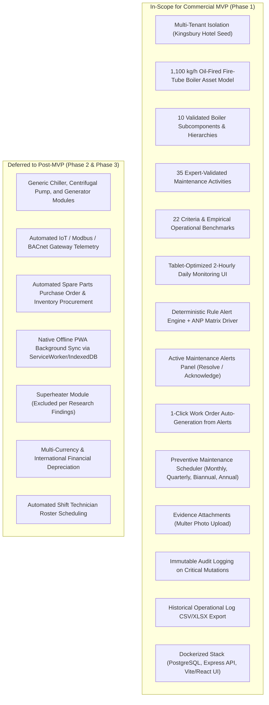
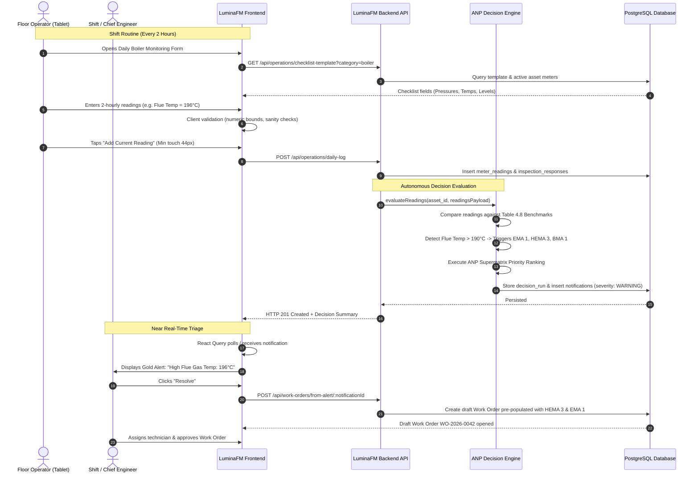

# LuminaFM - Commercial MVP Scope Specification
## Phase 1 Commercial Release: Kingsbury Boiler Maintenance & Decision Support System

- **Product Edition**: LuminaFM v1.0.0 Commercial MVP
- **Core Reference Asset**: 1,100 kg/h Oil-Fired Fire-Tube Steam Boiler (The Kingsbury Hotel, Colombo)
- **Architectural Scope**: End-to-End Enterprise CMMS with Embedded ANP Boiler Decision Engine

---

## 1. Executive Summary & MVP Mission

The primary objective of the LuminaFM Minimum Viable Product (MVP) is to deliver a commercial-grade, multi-tenant Facility Maintenance Management System centered entirely around the academic research conducted at The Kingsbury Hotel. The MVP transitions the original undergraduate prototype into a resilient, cloud-deployable SaaS product that empowers floor operators, shift engineers, and chief engineers to transition from reactive breakdown management to structured, proactive maintenance decision-making.

The MVP guarantees complete fidelity to the original research findings while delivering the security, scalability, and auditability required by commercial hospitality and industrial facilities.

---

## 2. In-Scope vs. Out-of-Scope Demarcation

### Detailed Boundary Matrix

| Functional Area | In-Scope for MVP (Phase 1) | Deferred to Post-MVP (Phase 2+) |
|---|---|---|
| **Tenancy & Auth** | Single/Multi-tenant SaaS foundation; Organization branding; JWT authentication; Roles: `Admin`, `Chief Engineer`, `Shift Engineer`, `Operator`. | SSO / SAML / Active Directory integration; Enterprise SCIM provisioning. |
| **Asset Management** | Boiler Asset Category; 10 Sub-components; Dynamic EAV attributes (Capacity, Design Pressure, Fuel Type, Burner Make). | Multi-asset categories (Chillers, GenSets, Air Compressors); Barcode/QR asset scanning on mobile camera. |
| **Hierarchies** | Dual independent trees: Physical Location (Site ➔ Building ➔ Room) and Technical System (Steam Generation). | GIS mapping; 3D BIM integration (IFC viewer). |
| **Operational Logging** | 2-Hourly shift monitoring data entry form; glove-friendly touchscreen layout ($\ge 44$px targets); Client & server-side type and range validation. | Direct IoT sensor telemetry; Bluetooth manometer/pyrometer wireless sync. |
| **Decision Engine** | Dual-network ANP model structure; 22 Criteria; 19 Benchmarks; Deterministic alert triggering; ANP priority ranking calculation; Model versioning. | Machine learning remaining-useful-life (RUL) regression; Automated fuzzy-AHP matrix tuning. |
| **Work Management** | Alert triage ('Resolve' creates draft WO, 'Acknowledge' flags review); Work Order state machine (`draft`, `approved`, `in_progress`, `completed`); Sequential numbering (`WO-YYYY-XXXX`). | Technician mobile signature sign-off; Contractor quote approval workflows. |
| **Preventive Maintenance**| Calendar-based schedules (Monthly, Quarterly, Biannual, Annual) mapping to the 35 research maintenance activities. | Dynamic run-hour auto-triggering based on automated SCADA meters. |
| **Attachments & Audit** | File attachment upload (Multer) for maintenance photos; Automatic `audit_logs` tracking on update/delete of assets and work orders. | S3 / Azure Blob multi-cloud storage drivers (MVP stores to volume disk); Video inspection streaming. |
| **Reporting & Export** | Operational logbook CSV and Excel (.xlsx) export; Decision run history audit. | Executive PDF compliance generation; Advanced BI dashboard with custom charts. |

---

## 3. Case Study Baseline Configuration: The Kingsbury Hotel

The MVP database seed (`prisma/seed.ts`) instantiates the exact case study environment analyzed in *Hardbound_Vishal.pdf*:

### 3.1 Organization & Site Profile
- **Organization Name**: The Kingsbury Hotel PLC
- **Tenant Code**: `KINGSBURY`
- **Primary Site**: The Kingsbury Hotel, Colombo 01, Sri Lanka
- **Physical Hierarchy**:
  - `Site`: Colombo Hotel Complex
  - `Building`: Main Hotel Building
  - `Floor / Area`: Service Basement Level -02
  - `Room`: Primary Boiler Room (`LOC-BLR-RM-01`)
- **Technical Hierarchy**:
  - `System Category`: Mechanical & Thermal Services
  - `System Type`: Steam Generation System (`SYS-STM-01`)

### 3.2 Primary Boiler Asset Specification
- **Asset Tag**: `BLR-001`
- **Asset Name**: Primary Industrial Steam Boiler
- **Asset Category**: Industrial Boilers (`CAT-BOILER`)
- **Model / Typology**: Oil-Fired Three-Pass Fire-Tube Steam Boiler
- **Rated Capacity**: $1,100\text{ kg/h}$ saturated steam
- **Nominal Operating Pressure**: $8.0 - 9.0\text{ bar}$
- **Safety Valve Set Pressure**: $9.0\text{ bar}$
- **Burner Typology**: Modulating Heavy Fuel Oil / Diesel Burner with Mechanical Atomization
- **Electrical Feed**: $400\text{V} / 3\text{-Phase} / 50\text{Hz}$

### 3.3 The 10 Codified Subcomponents
1. `BLR-001-FP`: Boiler Feed Water Pump (Multi-stage centrifugal)
2. `BLR-001-EC`: Flue Gas Economizer Coil
3. `BLR-001-FWT`: Atmospheric Feed Water & Condensate Tank
4. `BLR-001-HE`: Fire-Tube Heat Exchanger Bundle
5. `BLR-001-CC`: Refractory-Lined Combustion Chamber
6. `BLR-001-BN`: Modulating Fuel Oil Burner Assembly
7. `BLR-001-ES`: Natural Draft Exhaust Stack & Damper
8. `BLR-001-SV`: Dual Spring-Loaded Safety Relief Valves
9. `BLR-001-PG`: Bourdon Tube Master Pressure Gauges & Siphon
10. `BLR-001-BS`: Boiler Pressure Vessel Shell & Bottom Blowdown

---

## 4. MVP Core User Workflows

---

## 5. MVP Data Entry & Operational Forms Specification

### 5.1 2-Hourly Daily Monitoring Form Fields (`DailyBoilerMonitoringPage.tsx`)
*(Reference: Hardbound_Vishal.pdf Chapter 5, Figure 5.3; Chapter 4, Table 4.6–4.7)*

| Field Label | Parameter Key | Data Type | Physical Unit | Expected Range | Validation Rule | Research Benchmark Trigger |
|---|---|---|---|---|---|---|
| **Ambient Room Temp** | `ambient_temp` | Decimal | °C | $20.0 - 45.0$ | Numeric, mandatory | Warning if $> 35.0^\circ$C |
| **Steam Header Pressure** | `steam_pressure` | Decimal | bar | $0.0 - 12.0$ | Numeric, mandatory | Alert if $< 8.0$ bar or $> 9.0$ bar |
| **Boiler Water Level** | `water_level_pct` | Decimal | % (Gauge) | $0.0 - 100.0$ | Numeric, mandatory | Alert if $< 40\%$ or $> 60\%$ (Nominal $50\%$) |
| **Flue Gas Temperature** | `flue_gas_temp` | Decimal | °C | $120.0 - 280.0$ | Numeric, mandatory | Alert if $> 190.0^\circ$C or $< 190.0^\circ$C |
| **Feed Water Pump Flow/Head**| `feed_water_flow_bar` | Decimal | bar | $0.0 - 10.0$ | Numeric, mandatory | Alert if $< 4.0$ bar |
| **Feed Water Tank Temp** | `feed_water_temp` | Decimal | °C | $50.0 - 100.0$ | Numeric, mandatory | Alert if $< 90.0^\circ$C |
| **Condensate Return Temp** | `return_water_temp` | Decimal | °C | $60.0 - 105.0$ | Numeric, mandatory | Alert if $< 90.0^\circ$C or $> 90.0^\circ$C |
| **Pump Motor Current** | `pump_ampere` | Decimal | Amperes (A) | $0.0 - 30.0$ | Numeric, optional | Trend check: steady increase |
| **Burner Spark Quality** | `spark_quality` | Single Select | Enum | `Clean Spark`, `Poor Spark` | Selection mandatory | Alert if `Poor Spark` (`BMA 2`, `BMA 7`) |
| **Audible Steam Leaks** | `steam_leak_detected` | Boolean | Radio | `No Leak`, `Leak Detected` | Mandatory | Alert if `Leak Detected` (`SVMA 3`, `SVMA 4`) |

---

## 6. MVP Technical Acceptance Criteria

1. **Academic Fidelity**:
   - All 10 boiler subcomponents instantiated under Kingsbury Hotel asset `BLR-001`.
   - All 35 research maintenance activities codified with exact thematic codes (`FPMA 1` through `BSMA 2`).
   - All 22 criteria and empirical thresholds active in the decision engine.
2. **Data Integrity & Isolation**:
   - Zero cross-tenant data leakage between tenant organizations.
   - All mutations on assets and work orders captured in `audit_logs` with before/after JSON diffs.
3. **Ergonomics & Tablet Usability**:
   - All interactive touch targets on the daily logging form meet or exceed $44 \times 44\text{ px}$.
   - Midnight blue background (`#0B132B` / `#1C2541`) with high-contrast text and subtle gold accent (`#DDA74F`) for warnings and crimson (`#D62828`) for critical failures.
   - Responsive switching: full grid on desktop/tablet landscape ($\ge 1024$px), stacked cards on portrait tablets ($< 768$px).
4. **Reliability & Performance**:
   - Daily logbook submission latency $< 500\text{ ms}$ under local containerized execution.
   - Near real-time alert delivery to the dashboard within 2 seconds of log submission.
   - Export service successfully produces valid CSV and Excel (.xlsx) files of logged history.

