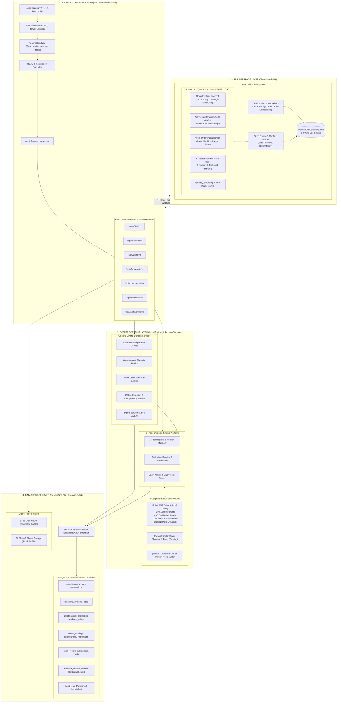
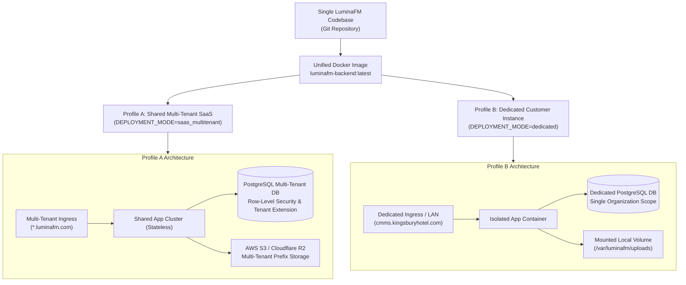
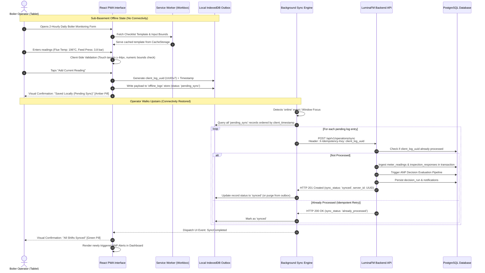
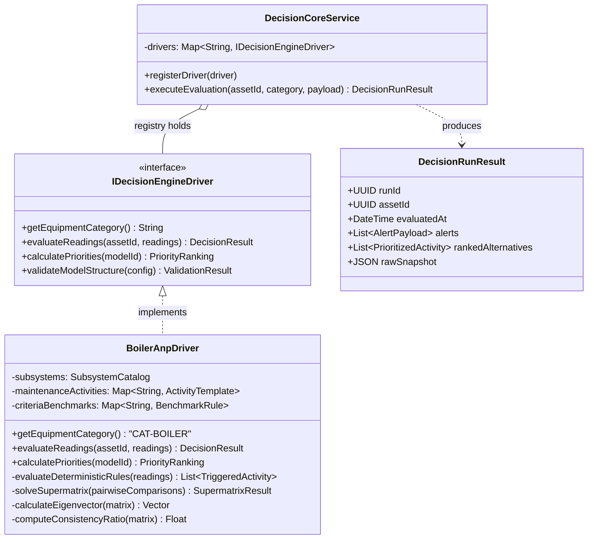
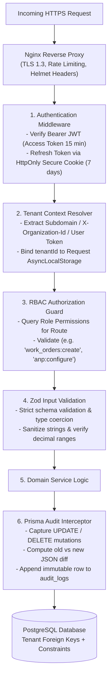
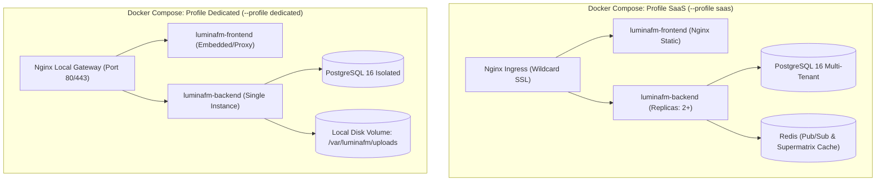

# LuminaFM - Final Solution Architecture Specification
## Enterprise Modular Monolith Architecture, PWA Offline Strategy & Domain Governance

- **System Name**: LuminaFM (Facility Maintenance Management & Decision Support System)
- **Role**: Principal Enterprise Software Architect
- **Status**: Complete Architecture Specification • **Ready for Architectural Review**
- **Target Stack**: React 18+ (TypeScript, Vite, Tailwind CSS, PWA/ServiceWorker), Node.js (TypeScript, Express), PostgreSQL 16, Prisma ORM, Docker & Docker Compose

---

## 1. Architectural Principles & System Goals

LuminaFM is engineered to bridge academic decision science with commercial facilities management software. The architecture adheres to ten non-negotiable principles:

1. **Modular Monolith First**: Single codebase and single deployment unit containing strictly bounded, independently maintainable domain modules. Avoid microservice sprawl until team size and traffic boundaries necessitate physical decoupling.
2. **Preservation of the 4-Layer Research Model**: Uphold the four-tier architectural model documented by Vishal Perera (2025):
   - **User Interface Layer**: Presentation, client validation, offline storage, and responsive views.
   - **Application Layer**: API routing, authentication, RBAC, tenant context, and workflow orchestration.
   - **Data Processing Layer**: Decision engine core, equipment-specific drivers (Boiler ANP), benchmark deviation engine, and conflict resolution.
   - **Data Storage Layer**: Relational ACID storage (PostgreSQL), Prisma ORM, EAV metamodel, and audit interceptor.
3. **Dual Deployment Modes from a Single Codebase**:
   - `saas_multitenant`: Multi-tenant SaaS with shared database, tenant isolation via Row-Level Security / Prisma client extensions, and dynamic subdomain branding.
   - `dedicated`: Single-tenant dedicated instance for air-gapped industrial plants or strict enterprise hosting contracts.
4. **PWA-First Offline Resilience**: Full support for floor operators in underground mechanical rooms without connectivity. Offline logbook entry, local IndexedDB caching, and conflict-free background synchronization.
5. **Domain Decoupling & Pluggable Equipment Modules**: Generic CMMS operations (work orders, assets, checklists, meters) know *nothing* of boiler thermodynamics. The Boiler ANP module is an isolated pluggable driver implementing a generic decision contract (`IDecisionEngineDriver`).
6. **Future Equipment Extensibility**: Native support for onboarding chillers, diesel generators, pumps, and AHUs through metadata definitions and algorithm drivers without modifying the core schema.
7. **Strict Inward Dependency Flow**: Outer layers (UI, Controllers, Adapters) depend on inner layers (Core Domain, Interfaces). Core business logic has zero dependencies on HTTP frameworks or ORM internals.
8. **Immutable Change Traceability**: Every critical data mutation (`UPDATE`, `DELETE`) is captured via database/ORM interceptors into `audit_logs` with before/after JSON diffs.
9. **Touch-First Operator Ergonomics**: Minimum $44 \times 44\text{px}$ touch targets, high-legibility dark midnight blue (`#0B132B`) with gold (`#DDA74F`) and crimson (`#D62828`) visual cues, and responsive transformation from tables to stacked cards on portrait tablets.
10. **Zero Fabricated Science**: The platform adheres strictly to the expert-validated benchmarks and activities from the University of Moratuwa dissertation, providing an administrative configuration interface for Saaty pairwise matrices.

---

## 2. High-Level Solution Architecture



---

## 3. Domain Decomposition & Module Boundaries

The modular monolith is organized into discrete internal packages located within `src/modules/`. Each domain possesses a strict public boundary interface (`index.ts`). Internal implementations are strictly private to the module.

```
src/
├── app.ts                          # Express application setup
├── server.ts                       # Server bootstrap & lifecycle
├── config/                         # Typed environment configuration
│   ├── configuration.ts            # Environment schema (Zod)
│   └── deployment-profile.ts       # SaaS vs Dedicated configuration
├── core/                           # Shared kernel (zero business dependencies)
│   ├── errors/                     # Standard AppError, NotFoundError, etc.
│   ├── types/                      # Common Result<T>, Pagination, etc.
│   ├── middleware/                 # Global error handling, correlation ID
│   └── database/                   # Prisma client singleton & extensions
├── modules/                        # Bounded Context Modules
│   ├── platform/                   # Tenant, Site, White-Label Branding
│   ├── iam/                        # Auth, Users, Roles, Permissions, JWT
│   ├── assets/                     # Assets, Categories, EAV Metamodel, Hierarchies
│   ├── telemetry/                  # Meters, Units of Measure, Timeseries Readings
│   ├── checklists/                 # Inspection Templates, Items, Responses, Sync
│   ├── maintenance/                # Preventive Plans, Schedules, Task Templates
│   ├── work-orders/                # Work Order State Machine, Tasks, Labor, Parts
│   ├── faults/                     # Fault Logs, Root Cause, Failure History
│   ├── decision-core/              # Generic MCDM Registry, Supermatrix Solver
│   ├── equipment-boiler/           # Boiler ANP Driver, 35 Activities, 22 Criteria
│   ├── audit/                      # Immutable Audit Interceptor & Log Viewer
│   ├── attachments/                # File Upload (Multer), Storage Adapters
│   └── notifications/              # Active Alerts, WebSocket Subscriptions
└── shared/                         # Cross-cutting utilities (Zod schemas, math)
```

```mermaid
graph LR
    subgraph CorePlatform["Core Platform & Governance"]
        Platform["platform"]
        IAM["iam"]
        Audit["audit"]
    end

    subgraph GenericCMMS["Generic CMMS Business Engine"]
        Assets["assets"]
        Telemetry["telemetry"]
        Checklists["checklists"]
        Maintenance["maintenance"]
        WorkOrders["work-orders"]
        Attachments["attachments"]
        Notifications["notifications"]
    end

    subgraph DecisionScience["Decision Support Platform"]
        DecisionCore["decision-core"]
        BoilerPlugin["equipment-boiler"]
    end

    IAM --> Platform
    Assets --> Platform
    Telemetry --> Assets
    Checklists --> Assets
    Maintenance --> Assets
    WorkOrders --> Assets
    WorkOrders --> Maintenance
    WorkOrders --> Checklists
    Attachments --> WorkOrders
    Notifications --> WorkOrders

    Audit -.->|Observes Mutations| GenericCMMS
    Audit -.->|Observes Mutations| DecisionScience

    DecisionCore --> Telemetry
    DecisionCore --> Checklists
    BoilerPlugin --> DecisionCore
    BoilerPlugin -.->|Implements IDecisionEngineDriver| DecisionCore
    Notifications <-- DecisionCore
    WorkOrders <-- Notifications
```

### Module Boundary Dependency Rules

1. **The Plugin Inversion Rule**: Generic modules (`work-orders`, `checklists`, `decision-core`) must **never** import from `equipment-boiler` or any future equipment module. Equipment modules register themselves with `decision-core` at runtime via dependency injection.
2. **Public Facade Rule**: Module cross-communication occurs **only** through the module's root export (`src/modules/<domain>/index.ts`). No module may import deep internal files (e.g. `import from '../assets/internal/asset.repo'`).
3. **No Cross-Domain Database Transactions**: If an operation spans two domains (e.g. Work Order created from Maintenance Alert), the orchestrating Application Service coordinates the workflow; foreign keys validate reference integrity, but entity state mutations belong to their respective domains.
4. **Data Isolation Invariant**: All domain queries must pass through the Tenant Context extension (`tenantPrisma(req.tenantId)`). Raw, un-scoped queries (`prisma.$queryRawUnsafe`) are strictly forbidden outside automated migration scripts.

---

## 4. Dual Deployment Profile Specification

LuminaFM is delivered as a **single, unified codebase** capable of executing in two distinct runtime profiles controlled via environment configuration (`DEPLOYMENT_MODE`):



### Profile Comparison Matrix

| Architectural Feature | Profile A: `saas_multitenant` | Profile B: `dedicated` |
|---|---|---|
| **Target Customers** | Small/Medium facilities, hotel chains, multi-site groups | Enterprise hospitality, defence, air-gapped plants, data sovereignty requirements |
| **Database Topology** | Single shared PostgreSQL instance; all tables scoped by `organization_id` with RLS. | Isolated PostgreSQL database instance; single tenant seeded on startup. |
| **Tenant Resolution** | Dynamic: Subdomain parsing (`kingsbury.luminafm.com`) or `X-Organization-Id` header. | Static: Environment configuration `DEDICATED_TENANT_ID` locked to single tenant. |
| **Branding & Logos** | Dynamic: Fetched from DB `organizations.branding` JSON (logo URL, colors, name). | Static or DB: Loaded from mounted branding directory or DB seed. |
| **File Storage** | AWS S3, Cloudflare R2, or MinIO with tenant bucket partitioning (`/{org_id}/...`). | Local Docker volume mount (`/app/uploads`) or on-premise NAS/NFS share. |
| **Audit Compliance** | Multi-tenant audit trail with organization-level cryptographic separation. | Dedicated audit table with optional direct syslog/SIEM export forwarding. |
| **Update Lifecycle** | Continuous deployment managed by LuminaFM cloud operations. | Scheduled maintenance windows, air-gapped image deployment, customer approval. |

---

## 5. PWA Offline Data Entry & Synchronization Protocol

Boiler plants and mechanical rooms are frequently located in reinforced sub-basements where wireless connectivity is intermittent or absent. The LuminaFM operator daily logbook is designed with a **PWA Offline-First Architecture**:



### Conflict Resolution Strategy & Data Invariants
1. **Append-Only Timeseries Invariant**: Shift readings (`meter_readings`) and inspection checks are strictly append-only observation logs. Because operators log time-stamped chronological states, concurrent write collisions on the *same record* cannot occur.
2. **Dual Timestamping**: Every log row stores both `recorded_at` (the physical wall-clock time entered by the technician on the tablet) and `created_at` (the server-side ingestion time). ANP evaluation uses `recorded_at` for sequential trend analysis.
3. **Idempotency Guarantee**: Every offline payload generates a client-side `client_log_uuid` (UUIDv7, monotonically increasing with embedded timestamp). The API enforces a unique constraint on `(organization_id, client_log_uuid)` to eliminate duplicate submissions caused by network retries.
4. **Offline Master Data Caching**: Active checklist templates, meter definitions, and asset metadata are refreshed and cached locally whenever network connectivity is available, with a 72-hour offline Time-To-Live (TTL).

---

## 6. The Boiler ANP Decision Engine Architecture

The Boiler ANP engine is strictly isolated inside `src/modules/equipment-boiler/` and communicates with the platform through the `IDecisionEngineDriver` contract.



### The Two-Tier Decision Pipeline:
1. **Tier 1 — Real-Time Deterministic Rule Engine**:
   - Executes synchronously during shift log submission ($< 50\text{ ms}$).
   - Evaluates incoming parameters against the empirical benchmarks codified in *Hardbound_Vishal.pdf* (Tables 4.8, 4.9, 4.10).
   - *Example*: If `flue_gas_temp > 190°C`, the engine immediately matches triggers for `EMA 1` (Economizer clean), `HEMA 3` (Fire-tube brushing), and `BMA 1` (Burner nozzle replacement).
   - Generates immediate active maintenance alerts with Gold/Crimson severity.
2. **Tier 2 — Multi-Criteria ANP Matrix Prioritization**:
   - Executes Saaty network synthesis across the dual network structure (Daily Operational Network vs Periodic/Preventive Network).
   - Formulates the unweighted supermatrix from expert pairwise comparison eigenvectors.
   - Normalizes columns into a stochastic weighted supermatrix.
   - Computes power iterations until convergence ($W^\infty$) to calculate global priority weights for all 35 alternatives.
   - Attaches priority rankings to generated work orders so maintenance teams execute the highest-leverage tasks first.

---

## 7. Security Architecture & RBAC Governance



### Role-Based Access Control (RBAC) Matrix

| Permission Key | System Admin | Chief Engineer | Shift / Mechanical Engineer | Boiler Operator | External Auditor |
|---|:---:|:---:|:---:|:---:|:---:|
| `platform:branding:update` | 🔒 Yes | ❌ No | ❌ No | ❌ No | ❌ No |
| `users:manage` | 🔒 Yes | 🔒 Yes (Site) | ❌ No | ❌ No | ❌ No |
| `assets:create:update` | 🔒 Yes | 🔒 Yes | 🔒 Yes | ❌ No | ❌ No |
| `operations:log:submit` | 🔒 Yes | 🔒 Yes | 🔒 Yes | 🔒 Yes | ❌ No |
| `alerts:triage:acknowledge`| 🔒 Yes | 🔒 Yes | 🔒 Yes | 🔒 Yes | ❌ No |
| `alerts:triage:resolve` | 🔒 Yes | 🔒 Yes | 🔒 Yes | ❌ No | ❌ No |
| `work_orders:approve` | 🔒 Yes | 🔒 Yes | ❌ No | ❌ No | ❌ No |
| `work_orders:execute` | 🔒 Yes | 🔒 Yes | 🔒 Yes | 🔒 Yes | ❌ No |
| `anp_model:configure` | 🔒 Yes | 🔒 Yes | ❌ No | ❌ No | ❌ No |
| `audit_logs:view` | 🔒 Yes | 🔒 Yes | 🔒 Yes | ❌ No | 🔒 Read-Only |
| `reports:export` | 🔒 Yes | 🔒 Yes | 🔒 Yes | 🔒 Yes | 🔒 Read-Only |

---

## 8. API Conventions & Standard Envelopes

All RESTful endpoints follow strict semantic versioning (`/api/v1/...`) and return deterministic response envelopes:

### Success Envelope (HTTP 200 / 201)
```json
{
  "success": true,
  "data": {
    "id": "019318b7-6571-7000-8442-984400112233",
    "asset_id": "019318b7-6571-7000-8442-984400112200",
    "evaluated_at": "2026-11-15T08:00:00.000Z",
    "triggered_alerts": [
      {
        "code": "ALERT-FLUE-GAS-HIGH",
        "severity": "warning",
        "message": "Flue Gas Temperature (196°C) exceeds benchmark of 190°C",
        "recommended_activities": ["EMA_1", "HEMA_3", "BMA_1"]
      }
    ]
  },
  "meta": {
    "timestamp": "2026-11-15T08:00:00.124Z",
    "request_id": "req-8842-9901"
  }
}
```

### Error Envelope (HTTP 4xx / 5xx)
```json
{
  "success": false,
  "error": {
    "code": "VALIDATION_FAILED",
    "message": "The submitted operational log contains invalid data types or out-of-bounds readings",
    "details": [
      {
        "field": "steam_pressure",
        "expected": "Decimal in range [0.0, 15.0] bar",
        "received": "string"
      }
    ]
  },
  "meta": {
    "timestamp": "2026-11-15T08:00:00.015Z",
    "request_id": "req-8842-9902"
  }
}
```

---

## 9. Containerization Topology & Deployment Profiles

The deployment configuration provides two Docker Compose profiles within the same root `docker-compose.yml`:



### Docker Run Configurations:
```bash
# 1. Run Shared Multi-Tenant SaaS Profile
docker compose --profile saas up --build -d

# 2. Run Dedicated On-Premise Single-Tenant Profile (Kingsbury Hotel)
docker compose --profile dedicated up --build -d
```

---

## 10. Key Architectural Decisions Requiring Explicit User Approval

Before any application code or schema migrations are executed, the following four architectural decisions require formal sign-off:

### Decision 1: Offline Synchronization Conflict Strategy
- **Option A (Recommended)**: **Append-Only Timeseries Invariant**. Shift logs are pure historical observation points. Concurrent collisions are impossible because each shift technician logs their own timestamped observation using client UUIDv7. Replay on reconnection preserves chronological integrity.
- **Option B**: **Server Timestamp Re-anchoring**. When an offline batch arrives, the server overwrites the observation time with the arrival time. *(Rejected by Architect: Destroys physical shift validity and correlation with thermodynamic alarms)*.

### Decision 2: Decision Engine Execution Model
- **Option A (Recommended)**: **Synchronous Rule Evaluation + Async ANP Limit Solver**. Rule-based alert matching (Tables 4.8–4.10) runs synchronously within 50ms during log submission so operators immediately see active alerts. Full ANP supermatrix limit power recalculation runs asynchronously or on cached matrices.
- **Option B**: **Full Real-time Supermatrix Power Iteration on Every HTTP Request**. Compute $W^{2k+1}$ iteratively inside the HTTP request cycle. *(Risk: Potential latency spike of 200–800ms depending on node network count)*.

### Decision 3: Storage Engine for Maintenance Attachments
- **Option A (Recommended)**: **Abstracted Storage Driver (Local Volume default with S3 switch)**. Use local Docker volume mounts for Dedicated profile deployments, and AWS S3 / MinIO API for SaaS multi-tenant deployments, controlled via `STORAGE_DRIVER=local|s3`.
- **Option B**: **Database Bytea / BLOB Storage**. Store binary images directly inside PostgreSQL. *(Rejected by Architect: Bloats database backups, impairs I/O performance, and complicates replication)*.

### Decision 4: Dedicated Mode Tenancy Enforcement
- **Option A (Recommended)**: **Virtual Single-Tenant Configuration**. The dedicated deployment uses the exact same relational schema, but binds `DEDICATED_TENANT_ID` at container launch, effectively auto-scoping all operations without maintaining separate single-tenant schema variations.
- **Option B**: **Completely Separate Schema DDL for Dedicated Mode**. Strip `organization_id` entirely from dedicated builds. *(Rejected by Architect: Violates single codebase principle and doubles maintenance surface)*.

