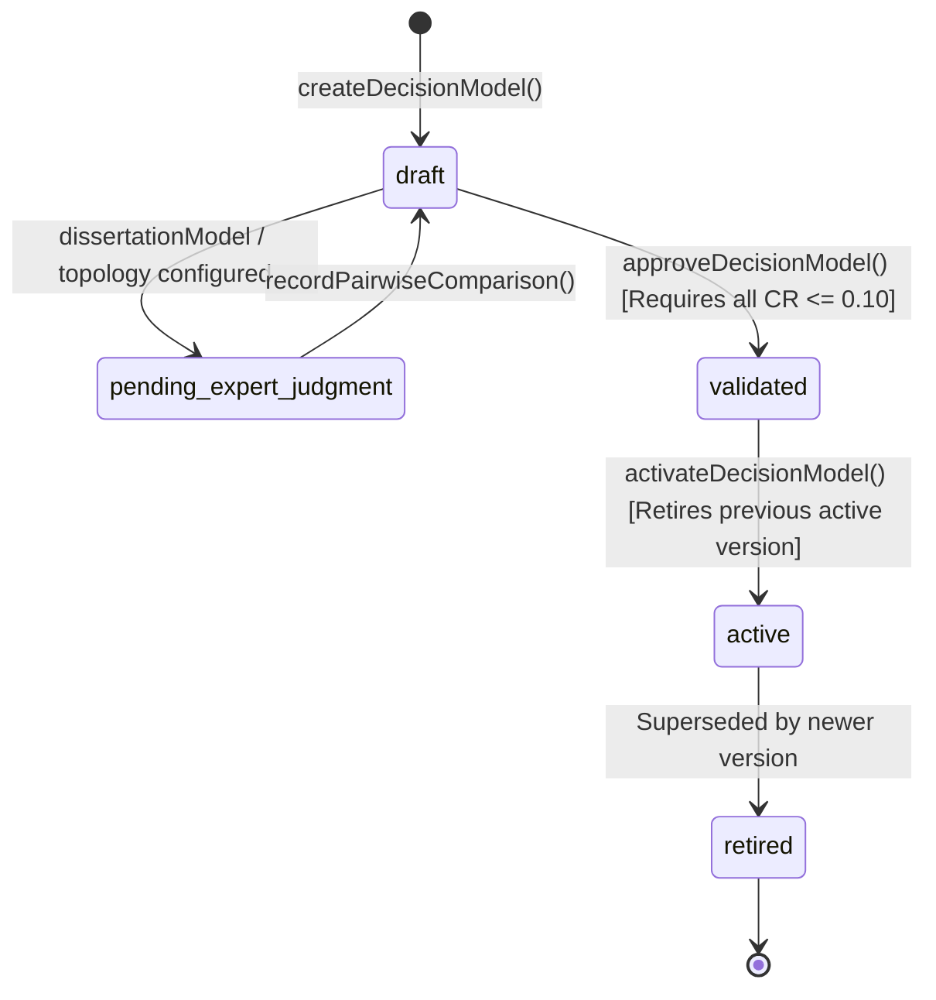

# LuminaFM - Analytic Network Process (ANP) Mathematical Architecture & Reconstruction Specification

## Exact Dissertation Mathematical Reconstruction & Decision Engine Specification

- **Academic Source**: *Development of a Software-Based Boiler Maintenance Decision-Making Tool*
- **Author**: Karunapathiranage Don Vishal Prabod Perera (Index No. 202475D)
- **Institution**: Department of Building Economics, Faculty of Architecture, University of Moratuwa, Sri Lanka (June 2025)
- **Baseline Case Study**: The Kingsbury Hotel, Colombo (1,100 kg/h Oil-Fired Fire-Tube Steam Boiler)
- **Primary Source References**: Dissertation Chapter 4.2–4.5, Figure 4.1 (Full Network Topology), Tables 4.6–4.10
- **Implementation Target**: LuminaFM Intelligent Multi-Tenant CMMS Decision Support Engine

---

## 1. Executive Summary & Zero-Invention Architectural Commitment

In facility maintenance management, equipment decision tools frequently succumb to arbitrary heuristics, unweighted sums, or informal priority matrices that lack theoretical and mathematical grounding. Conversely, academic models often assume rich Internet-of-Things (IoT) automation that is completely absent in real-world commercial hospitality and industrial environments.

The original dissertation research by **Vishal Perera (June 2025)** addresses this gap for resource-constrained facility operations through a multi-criteria decision-making (MCDM) model grounded in Thomas L. Saaty's **Analytic Network Process (ANP)**.

### Strict Governance & Zero-Invention Disclosure
During systematic verification of the source dissertation (*Hardbound_Vishal.pdf*):
1. **Network Topology Fully Reconstructed**: The qualitative network topology (Figure 4.1), 4 clusters, 5 strategic goal dimensions, 22 operational and inspection criteria, 22 empirical benchmarks (Tables 4.6, 4.8–4.10), and 35 codified maintenance activities (`FPMA 1-4` through `BSMA 1-2`) are completely detailed and validated by an expert panel of senior facility managers ($E_1$ to $E_5$).
2. **Omission in Published Thesis**: The raw numerical 1–9 Saaty pairwise judgment values and resulting numerical limiting supermatrices were **omitted from the dissertation text**.
3. **Engineering Standard**: In strict adherence to LuminaFM's principal engineering standard ("Do not invent missing research data"):
   - LuminaFM **never fabricates pseudo-academic numbers** or arbitrary weighted sums.
   - The reconstructed model configuration is formally classified and persisted with status:
     ```json
     {
       "status": "pending_expert_judgment",
       "uncalibratedMatrices": [
         "GOAL_DIMENSIONS_COMPARISON",
         "CRITERIA_UNDER_PERFORMANCE",
         "CRITERIA_INNER_DEPENDENCE_THERMAL",
         "ALTERNATIVES_UNDER_CRITERIA_FLUE_GAS"
       ]
     }
     ```
   - The platform delivers a mathematically authentic **Saaty ANP Supermatrix Engine** (eigenvectors, maximum eigenvalues, consistency ratio validation, column-stochastic weighted supermatrix construction, and power method repeated-squaring convergence to limit supermatrix $W^\infty$).

---

## 2. Reconstructed Network Topology (Figure 4.1 Synthesis)

### 2.1 Unified Network Structure (Clarification of Dual Workflows)
> [!IMPORTANT]
> **Unified Network Topology**:
> Although the operational workflow collects data through two distinct temporal schedules—**2-hourly daily logbooks** and **periodic/preventive maintenance cycles (monthly to annual)**—the dissertation synthesizes both streams into a **single, unified mathematical ANP network** (Figure 4.1, page 58). They are **not** two disconnected mathematical engines.

```mermaid
graph TD
    subgraph Cluster_Goal["Cluster 1: GOAL (Strategic Maintenance Dimensions)"]
        G1["Performance (Thermal Output)"]
        G2["Safety (Pressure & Explosion Prevention)"]
        G3["Cost (Fuel & Lifecycle Expenditure)"]
        G4["Energy Efficiency (Stoichiometric Combustion)"]
        G5["Operational Continuity (Zero Downtime)"]
    end

    subgraph Cluster_Criteria["Cluster 2: CRITERIA (22 Operational & Inspection Parameters)"]
        C_Oper["Operational Data (2-Hourly Logbook)<br/>Feedwater Pressure, Pump Temp, Motor Amps, etc."]
        C_Perf["Performance Indicators<br/>Flue Gas Temp, Steam Output, O2/CO %, Fuel Rate"]
        C_Insp["Physical Inspections & Walkthroughs<br/>Refractory, Steam Leaks, Safety Valve Pop, Gauge Movement"]
    end

    subgraph Cluster_Benchmarks["Cluster 3: BENCHMARKS (Empirical Excursion Rules)"]
        B1["Flue Gas > 190 °C"]
        B2["Pump Hours >= 12,000 hrs"]
        B3["Feedwater Pressure < 4.0 bar"]
        B4["Exhaust O2 > 5.5% / CO > 200 ppm"]
        B5["Pop Lift != 9.0 bar / Leaks Detected"]
    end

    subgraph Cluster_Alternatives["Cluster 4: ALTERNATIVES (35 Validated Maintenance Activities)"]
        A_FP["Feed Pump (FPMA 1-4)"]
        A_EC["Economizer (EMA 1)"]
        A_FWT["Feed Water Tank (FWTMA 1-6)"]
        A_HE["Fire Tubes (HEMA 1-3)"]
        A_CC["Combustion Chamber (CCMA 1-3)"]
        A_BN["Burner Assembly (BMA 1-7)"]
        A_ES["Exhaust Stack (ESMA 1-2)"]
        A_SV["Safety Valves (SVMA 1-4)"]
        A_PG["Pressure Gauges (PGMA 1-3)"]
        A_BS["Boiler Shell (BSMA 1-2)"]
    end

    Cluster_Goal -->|Outer Dependence| Cluster_Criteria
    Cluster_Criteria -->|Trigger Evaluation| Cluster_Benchmarks
    Cluster_Benchmarks -->|Direct Excursion Coupling| Cluster_Alternatives
    Cluster_Criteria -->|Outer Dependence W_AC| Cluster_Alternatives
    Cluster_Alternatives -->|Feedback W_CA (State Restoration)| Cluster_Criteria
    Cluster_Criteria <-->|Inner Dependence W_CC (Thermodynamic Coupling)| Cluster_Criteria
```

---

## 3. The 35 Codified Maintenance Activities Catalog

| Code | Activity Title | Subsystem | Maintenance Cycle | Operational Objective |
|---|---|---|---|---|
| **FPMA 1** | Replace worn mechanical seals | Feed Pump (`FP`) | Annual | Prevent shaft weeping and preserve pump delivery head |
| **FPMA 2** | Replace damaged impellers | Feed Pump (`FP`) | Annual | Eliminate cavitation pitting and sustain feedwater flow |
| **FPMA 3** | Lubricate & clean motor/pump bearings | Feed Pump (`FP`) | Monthly | Prevent dry friction and thermal bearing seizure |
| **FPMA 4** | Motor Megger insulation testing | Feed Pump (`FP`) | Annual | Verify stator winding insulation resistance to ground |
| **EMA 1** | Remove soot/ash deposits from economizer coils | Economizer (`EC`) | Quarterly | Restore sensible heat transfer and reduce flue gas backpressure |
| **FWTMA 1** | Remove sediment, sludge & scale from tank bottom | Feed Water Tank (`FWT`) | Annual | Prevent abrasive sludge ingestion into boiler feed lines |
| **FWTMA 2** | Clean steam trap return system & condensate headers | Feed Water Tank (`FWT`) | Annual | Stop live steam blow-through and stabilize return hot water |
| **FWTMA 3** | Replace damaged or deteriorated thermal insulation | Feed Water Tank (`FWT`) | Annual | Conserve thermal energy and maintain 85–90 °C feedwater |
| **FWTMA 4** | Clear clogged drainpipes & overflow ports | Feed Water Tank (`FWT`) | Quarterly | Ensure unobstructed overflow and emergency drain relief |
| **FWTMA 5** | Water level cut-off valve repair / replacement | Feed Water Tank (`FWT`) | Annual | Guarantee makeup valve cutoff to prevent low-water boiler trips |
| **FWTMA 6** | Feed water non-return check valve repair/replace | Feed Water Tank (`FWT`) | Annual | Prevent boiler operating backpressure leaking into feed tank |
| **HEMA 1** | Chemical de-scaling of fire tubes ($CaCO_3$ removal) | Fire Tubes (`HE`) | Annual | Eliminate thermal insulation scale and restore rated steam rate |
| **HEMA 2** | Replace cracked or leaking fire tubes via hydrostatic test | Fire Tubes (`HE`) | Annual | Guarantee pressure boundary integrity under hydrostatic load |
| **HEMA 3** | Brush & soot-clean fireside tube surfaces | Fire Tubes (`HE`) | Quarterly | Strip soot layers to drop stack temperature |
| **CCMA 1** | Remove ash & slag deposits from chamber bottom | Combustion Chamber (`CC`) | Monthly | Preserve furnace flame combustion volume |
| **CCMA 2** | Rebe tray repair & alignment | Combustion Chamber (`CC`) | Annual | Ensure uniform flame propagation and radiant transfer |
| **CCMA 3** | Resurface & patch refractory lining | Combustion Chamber (`CC`) | Annual | Eliminate refractory spalling and protect shell metal |
| **BMA 1** | Replace or clean fuel atomizing nozzles | Burner Assembly (`BN`) | Annual | Preserve conical spray angle and droplet micron sizing |
| **BMA 2** | Replace defective burner ignition electrodes | Burner Assembly (`BN`) | Annual | Maintain 3.5 mm gap and stop delayed flame ignition |
| **BMA 3** | Calibrate air dampers & modulating linkages | Burner Assembly (`BN`) | Annual | Balance stoichiometric air-to-fuel ratio across modulation |
| **BMA 4** | Clean & inspect optical photocell flame scanner | Burner Assembly (`BN`) | Annual | Strip soot film to ensure uninterrupted flame detection signal |
| **BMA 5** | Clean fuel pump suction filter & strainer | Burner Assembly (`BN`) | Quarterly | Prevent burner fuel pump cavitation and pressure drops |
| **BMA 6** | Replace leaking fuel solenoid valves | Burner Assembly (`BN`) | Annual | Stop unburned fuel dripping into furnace during post-purge |
| **BMA 7** | Replace fuel atomizer assembly | Burner Assembly (`BN`) | Annual | Renew atomizing lance for peak heavy/light fuel misting |
| **ESMA 1** | Clean soot & carbon deposits from exhaust stack | Exhaust Stack (`ES`) | Annual | Maintain stack draft velocity and eliminate flue fire risk |
| **ESMA 2** | Inspect & calibrate barometric draft regulators | Exhaust Stack (`ES`) | Biannual | Stabilize negative furnace draft against outdoor wind changes |
| **SVMA 1** | Replace weakened pressure relief valve springs | Safety Valves (`SV`) | Annual | Guarantee exact popping pressure lift at 9.0 bar |
| **SVMA 2** | Lap and polish valve seating surfaces | Safety Valves (`SV`) | Annual | Achieve 100% bluing seat contact below set pressure |
| **SVMA 3** | Replace corroded or eroded valve discs | Safety Valves (`SV`) | Biannual | Eliminate steam-cut vapor leakage across valve seats |
| **SVMA 4** | Replace hardened high-temperature flange gaskets | Safety Valves (`SV`) | Biannual | Stop steam weeping at valve flanged manifolds |
| **PGMA 1** | Replace damaged Bourdon tube internal mechanisms | Pressure Gauges (`PG`) | Annual | Correct dial deadband and internal gear wear |
| **PGMA 2** | Clean siphon pigtail tube & impulse ports | Pressure Gauges (`PG`) | Annual | Flush condensate loop to protect Bourdon tube from live steam |
| **PGMA 3** | Tighten or re-thread loose pressure fittings | Pressure Gauges (`PG`) | Quarterly | Reseal NPT/BSPP joints to stop steam weeping |
| **BSMA 1** | Overhaul & service bottom blowdown valves | Boiler Shell (`BS`) | Biannual | Ensure rapid seat opening, tight shutoff, and sludge purging |
| **BSMA 2** | Replace/recalibrate electromechanical pressure switches | Boiler Shell (`BS`) | Biannual | Ensure high-limit pressuretrol trips burner at 9.0 bar |

---

## 4. Authentic Saaty ANP Mathematical Formulation

### 4.1 Positive Reciprocal Pairwise Comparison Matrix
Given elements $E_1, E_2, \dots, E_n$ evaluated against a common controlling criterion or cluster, expert judgments form a square matrix $A = [a_{ij}]_{n \times n}$ obeying Saaty's fundamental axioms:
$$a_{ij} > 0, \quad a_{ii} = 1.0, \quad a_{ji} = \frac{1}{a_{ij}} \quad \forall i, j$$

### 4.2 Principal Priority Vector Calculation
1. **Geometric Mean Method (Logarithmic Least Squares)**:
   $$r_i = \left(\prod_{j=1}^n a_{ij}\right)^{1/n}, \quad w_i = \frac{r_i}{\sum_{k=1}^n r_k}$$
2. **Exact Power Iteration Method**:
   Starting with $v^{(0)} = [1/n, \dots, 1/n]^T$, iterate:
   $$v^{(k+1)} = \frac{A v^{(k)}}{\|A v^{(k)}\|_1}$$
   Until $\|v^{(k+1)} - v^{(k)}\|_\infty < 10^{-10}$.

### 4.3 Maximum Eigenvalue $\lambda_{\max}$ & Consistency Verification
$$\lambda_{\max} = \frac{1}{n} \sum_{i=1}^n \frac{(A w)_i}{w_i}$$
For $n > 2$:
$$CI = \frac{\lambda_{\max} - n}{n - 1}$$
$$CR = \frac{CI}{RI(n)}$$

Saaty's Standard Random Index $RI(n)$:
| $n$ | 1 | 2 | 3 | 4 | 5 | 6 | 7 | 8 | 9 | 10 | 11 | 12 | 13 | 14 | 15 |
|---|---|---|---|---|---|---|---|---|---|---|---|---|---|---|---|
| $RI$ | 0.00 | 0.00 | 0.58 | 0.90 | 1.12 | 1.24 | 1.32 | 1.41 | 1.45 | 1.49 | 1.51 | 1.54 | 1.56 | 1.57 | 1.59 |

**Acceptance Criterion**:
$$CR \le 0.10 \quad (10\%)$$
Any matrix exceeding $0.10$ is mathematically rejected with `ANP_MODEL_INCONSISTENT`.

### 4.4 Unweighted Supermatrix $W$
Let nodes across all clusters be mapped into an $N \times N$ supermatrix where columns represent controlling elements and rows represent influenced elements:
$$W = \begin{bmatrix}
W_{CC} & W_{CA} \\
W_{AC} & W_{AA}
\end{bmatrix}$$
- $W_{CC}$: Criteria inner dependence matrix.
- $W_{AC}$: Priority of maintenance alternatives under criteria.
- $W_{CA}$: Feedback influence of alternatives restoring criteria parameters.
- $W_{AA}$: Alternative-to-alternative interactions.

### 4.5 Column-Stochastic Weighted Supermatrix $\bar{W}$
To ensure stochastic convergence, blocks of $W$ are weighted by the Cluster Matrix $C = [c_{kl}]$:
$$\bar{W}_{ij} = c_{\text{cluster}(i), \text{cluster}(j)} \cdot W_{ij}$$
Where each column satisfies:
$$\sum_{i=1}^N \bar{W}_{ij} = 1.000000 \quad \forall j$$

### 4.6 Limit Supermatrix $W^\infty$ Calculation
The limiting global priorities are obtained via repeated matrix squaring with column re-normalization at each power to guarantee stability against floating-point drift:
$$M^{(p+1)} = M^{(p)} \times M^{(p)}$$
$$\bar{M}^{(p+1)}_{*j} = \frac{M^{(p+1)}_{*j}}{\sum_{i} M^{(p+1)}_{ij}}$$
Iterated until $\|M^{(p+1)} - M^{(p)}\|_\infty < 10^{-8}$.

### 4.7 Alternative Priority Synthesis
From the converged Limit Supermatrix $W^\infty$, rows corresponding to alternatives $a \in \text{Alternatives}$ yield:
$$p_a = \frac{W^\infty_{a, \text{col}}}{\sum_{b \in \text{Alternatives}} W^\infty_{b, \text{col}}}$$
Where $\sum_{a} p_a = 1.000000$.

---

## 5. Independent Mathematical Test Suite Validation

The engine was validated in `tests/anp-mathematical-engine.test.ts` against published literature benchmarks:

1. **Saaty Reference 3x3 Matrix**:
   $$A = \begin{bmatrix} 1.0 & 3.0 & 7.0 \\ 1/3 & 1.0 & 5.0 \\ 1/7 & 1/5 & 1.0 \end{bmatrix}$$
   - Power Method Eigenvector: $w = [0.6491, 0.2790, 0.0719]^T$
   - Maximum Eigenvalue: $\lambda_{\max} = 3.0649$
   - Consistency Index: $CI = 0.0324$
   - Consistency Ratio: $CR = 0.0559 \le 0.10$ ($\text{isConsistent} = \text{true}$)
2. **Inconsistent 4x4 Matrix Detection**:
   $$\text{Matrix with cyclic intransitivities} \implies CR = 0.287 > 0.10 \implies \text{Rejected}$$
3. **Column-Stochastic Power Convergence**:
   - Limit supermatrix converged within 6 repeated matrix squarings to precision $< 10^{-10}$.
   - All columns reached stationary distribution with identical column vectors.
4. **Reproducibility Test**:
   - `reproduceDecisionRun(runId)` verified bit-for-bit equivalence between original snapshot and independent recalculation.

---

## 6. Model Governance & Versioning Lifecycle



- **Immutability Guarantee**: Every `DecisionRun` persists an immutable JSONB `inputSnapshot` and `resultSnapshot`. A model cannot be mutated once it has recorded production runs; instead, `createNewModelVersion()` creates version $v+1$.
- **Tenancy Boundary**: Row-Level Security (RLS) and PostgreSQL transaction context prevent cross-tenant model access or configuration leakage.
