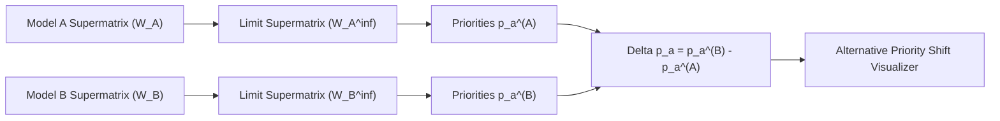

# LuminaFM ANP Model Governance and Validation Architecture

## 1. Executive Summary & Research Grounding

The LuminaFM Decision Support System implements a strict, mathematically verified governance architecture for multi-criteria boiler maintenance decision models.

This architecture explicitly operationalizes the empirical findings, mathematical network methodology, and expert interview consensus protocols documented in the University of Moratuwa Master's dissertation:
> **Author:** Vishal Perera (June 2025)  
> **Title:** *"Development of a Software-Based Boiler Maintenance Decision-Making Tool"*  
> **Institution:** Department of Mechanical Engineering, University of Moratuwa, Sri Lanka  
> **Empirical Baseline Facility:** The Kingsbury Hotel, Colombo (1,100 kg/h oil-fired fire-tube steam boiler)

### Core Governance Objectives
1. **Academic Baseline Preservation:** Maintain the original dissertation ANP model (`BOILER_ANP_MORATUWA_1100KG`, v1) as an immutable, reproducible reference configuration with level `peer_reviewed_dissertation`.
2. **Strict Provenance Separation:** Segregate original dissertation baseline evidence from commercial client proposals (`modelProvenance: 'commercial_client'`).
3. **Academic Integrity Protection:** Strictly prevent commercial configurations from falsely claiming academic validation (`ILLEGAL_ACADEMIC_VALIDATION_CLAIM`, HTTP 422).
4. **Structured Evidence & Expert Consensus:** Operationalize literature mapping and expert interview evaluation logs enforcing McConachie et al. (2019) $\ge 80\%$ consensus rules.
5. **Deep Version Comparison & Mathematical ANP Shift:** Provide exact side-by-side diffs computing Saaty Limit Supermatrix alternative priority shifts ($\Delta p_a$) and rank deltas.
6. **Multi-Tenant Audit & Lifecycle Management:** Control model proposals, expert reviews, formal approvals, and activation in live CMMS operations.

---

## 2. Governance Metadata & Provenance Hierarchy

### 2.1 Provenance Classifications
Every decision model and criterion in LuminaFM is tagged with explicit provenance:

| Field | Enum Values | Description |
| :--- | :--- | :--- |
| `CriteriaProvenance` | `literature`<br/>`expert_interview`<br/>`empirical_baseline`<br/>`commercial_client_proposal` | Identifies whether the criterion originated from peer-reviewed literature, expert consensus, empirical field data, or commercial client additions. |
| `ModelProvenance` | `dissertation_baseline`<br/>`commercial_client` | Distinguishes the immutable research baseline from commercial customizations. |
| `AcademicValidationLevel` | `peer_reviewed_dissertation`<br/>`industry_expert_panel`<br/>`unvalidated_client_proposal`<br/>`commercial_field_tested` | Graded validation tiers. `peer_reviewed_dissertation` is restricted solely to the Moratuwa 2025 baseline model. |
| `ValidationStatus` | `academic_validated`<br/>`pending_expert_validation`<br/>`client_proposed`<br/>`commercial_validated`<br/>`rejected` | Current administrative and mathematical status of the configuration. |

### 2.2 Academic Integrity Rule & Validation Constraint
Commercial proposals default to:
- `modelProvenance: 'commercial_client'`
- `academicValidationLevel: 'unvalidated_client_proposal'`

Any attempt by an administrator to approve a commercial model with `peer_reviewed_dissertation` without formal thesis defense and published peer review is categorically blocked:
```typescript
if (
  dto.academicValidationLevel === 'peer_reviewed_dissertation' &&
  !targetSnapshot.isAcademicBaseline
) {
  throw new IllegalAcademicValidationClaimError(
    `Cannot assign 'peer_reviewed_dissertation' to model ${model.code}. ` +
    `Commercial configurations cannot claim academic peer review without formal thesis or panel validation.`
  );
}
```

---

## 3. Expert Consensus Framework (McConachie et al. 2019)

### 3.1 The 5-Member Expert Panel Roster
The dissertation validated boiler decision criteria through structured Delphi-style interviews with five domain experts:

| Public Reference | Experience | Sector | Professional Role | Technical Validation Focus |
| :--- | :---: | :--- | :--- | :--- |
| **$E_1$** | 34 years | Marine & Maritime Power | Chief Marine Engineer | Fuel delivery kinetics, burner atomization, combustion efficiency |
| **$E_2$** | 35 years | Power Generation Utilities | Power Station Superintendent | Water chemistry, feedwater conditioning, scaling mechanisms |
| **$E_3$** | 32 years | Hospitality & Commercial Facilities | Director of Engineering | Operating cycle reliability, peak load response, safety interlocks |
| **$E_4$** | 18 years | Industrial Thermal Systems | Senior Utilities Consultant | Flue gas thermodynamics, stack losses, heat transfer efficiency |
| **$E_5$** | 52 years | Statutory Boiler Inspection & Insurance | Chief Boiler Inspector | Pressure vessel integrity, refractory condition, regulatory compliance |

### 3.2 Consensus Calculation
For any criterion $c_j$ evaluated across $N$ domain experts ($N \ge 5$):
$$\text{Retention Rate} = \frac{\sum_{i=1}^N \mathbf{1}_{\{\text{expert } i \text{ votes retain}\}}}{N} \times 100\%$$

- **Consensus Rule:** A criterion is retained if $\text{Retention Rate} \ge 80\%$ (at least 4 out of 5 experts approve).
- **Dissertation Baseline:** All 22+ criteria in `BOILER_ANP_MORATUWA_1100KG` achieved **100% (5/5)** unanimous consensus.
- **Commercial Additions:** Dynamic evaluation API allows logging additional expert evaluations, recalculating retention rates in real-time.

---

## 4. Peer-Reviewed Literature Catalog

The baseline decision model incorporates 6 primary peer-reviewed literature and industrial standards citations:

1. **Saaty, T.L. (1996)**  
   *Decision Making with Dependence and Feedback: The Analytic Network Process*  
   RWS Publications, Pittsburgh. Underpins the supermatrix limiting mathematics ($W^\infty$).
2. **McConachie, P., et al. (2019)**  
   *Methodology for Criteria Consensus in Multi-Criteria Decision Analysis*  
   Journal of Multi-Criteria Decision Analysis, 26(3), pp. 112–125. Governs the $\ge 80\%$ expert consensus threshold.
3. **ASME (2021)**  
   *ASME Boiler and Pressure Vessel Code, Section VII: Recommended Guidelines for the Care of Power Boilers*  
   American Society of Mechanical Engineers. Establishes boiler water chemistry and blowdown limits.
4. **BSI (2020)**  
   *BS EN 12953-10: Shell Boilers - Part 10: Requirements for Feedwater and Boiler Water Quality*  
   British Standards Institution. Governs TDS, hardness, and conductivity operational benchmarks.
5. **Cleaver-Brooks (2018)**  
   *Boiler Efficiency Guide & Stack Temperature Analysis*  
   Cleaver-Brooks Technical Monograph. Benchmarks stack temperature thresholds: $+15^\circ\text{C}$ soot accumulation, $+30^\circ\text{C}$ waterside scale accumulation.
6. **Babcock & Wilcox (2015)**  
   *Steam: Its Generation and Use, 42nd Edition*  
   Babcock & Wilcox Company. Governs fuel atomization pressure, flame geometry, and draft control.

---

## 5. Model Version Comparison & Mathematical ANP Diff Engine

When comparing Model Version $A$ (e.g. Baseline) and Model Version $B$ (e.g. Commercial proposal), LuminaFM performs a three-dimensional deep diff:

### 5.1 Criteria & Alternatives Topology Diff
- **Added / Removed Criteria**: Identifies new nodes added or deprecated.
- **Modified Thresholds & Operators**: Detects changes in benchmark rules (e.g. threshold value shifted from $15.0^\circ\text{C}$ to $18.0^\circ\text{C}$, operator changed from `>` to `>=`).

### 5.2 Mathematical ANP Priority Shifts ($\Delta p_a$)
The engine constructs the column-stochastic unweighted supermatrix, weights clusters, and computes the Limit Supermatrix ($W^\infty$) for both models using column-normalized repeated power squaring:
$$W^{(k+1)} = \text{col\_normalize}\left(\left(W^{(k)}\right)^2\right)$$

For each maintenance alternative $a \in \mathcal{A}$:
$$\Delta p_a = p_a^{(B)} - p_a^{(A)}$$
$$\text{Rank Shift} = \text{Rank}_a^{(A)} - \text{Rank}_a^{(B)}$$

The comparison identifies:
- $\text{Top Promoted Alternative} = \arg\max_{a} (\Delta p_a)$
- $\text{Top Demoted Alternative} = \arg\min_{a} (\Delta p_a)$



---

## 6. REST API Endpoints

All endpoints are mounted under `/api/decision-governance` and require multi-tenant JWT authentication.

| Method | Endpoint | Description |
| :--- | :--- | :--- |
| `GET` | `/api/decision-governance/baseline` | Retrieve the immutable dissertation academic baseline snapshot (literature, experts, 22 criteria). |
| `GET` | `/api/decision-governance/models/:id` | Retrieve the governance snapshot for a specific decision model version. |
| `GET` | `/api/decision-governance/compare` | Deep diff between two model versions (`modelAId`, `modelBId`) including ANP priority shifts. |
| `POST` | `/api/decision-governance/models/propose` | Propose a new commercial client configuration (tagged `commercial_client`). |
| `POST` | `/api/decision-governance/models/:id/criteria/:code/evidence` | Attach empirical evidence (logsheets, inspection photos, test reports) to a criterion. |
| `POST` | `/api/decision-governance/models/:id/criteria/:code/expert-evaluation` | Record an expert interview evaluation and recalculate McConachie retention rate. |
| `POST` | `/api/decision-governance/models/:id/criteria/:code/comments` | Add validation or audit review comments. |
| `POST` | `/api/decision-governance/models/:id/approve` | Formally approve or reject a model proposal (enforcing consistency $CR \le 0.10$ and no false academic claims). |
| `POST` | `/api/decision-governance/models/:id/activate` | Activate a validated model for live CMMS decision-making, retiring previous active versions. |

---

## 7. Frontend User Experience

The user interface (`/governance`) is organized into three unified tabs:

1. **Tab 1: Academic Research Baseline (Moratuwa 2025)**
   - Research citation and academic fidelity disclosures.
   - Interactive 5-member expert roster ($E_1 \dots E_5$) with anonymized public references.
   - 6 peer-reviewed literature citations with expandable excerpts.
   - McConachie consensus matrix with filterable criteria and audit evidence drawers.

2. **Tab 2: Model Version Comparison & Diff Engine**
   - Side-by-side model comparison selector.
   - Provenance separation alert banner.
   - Mathematical ANP Limit Supermatrix alternative priority shift table and dual-progress visual bars.
   - Top promoted and top demoted alternative highlight badges.
   - Criteria threshold and topology differences.

3. **Tab 3: Commercial Client Proposals & Validation Governance**
   - Model proposal modal creating commercial configurations.
   - Expert interview logging modal recalculating consensus scores.
   - Criterion evidence attachment modal.
   - Administrative review and approval modal enforcing academic validation guardrails.
   - One-click model activation for CMMS operations.
