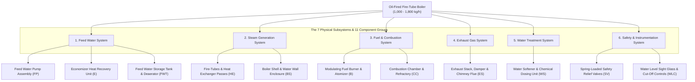
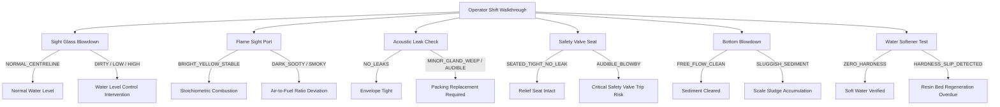
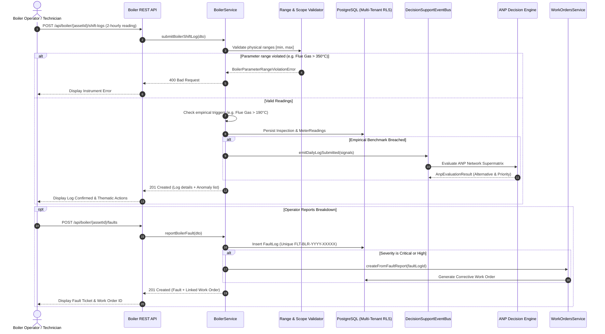

# LuminaFM Specialized Equipment Module: Boiler Maintenance Architecture

## 1. Executive Summary & Research Alignment

The **Specialized Boiler Maintenance Module** represents the first equipment-specific application in the LuminaFM platform. It faithfully translates and productionizes the empirical research scope, mathematical model, and operational findings of the dissertation:

> **Dissertation Title**: *Development of an Analytic Network Process (ANP) Based Maintenance Decision Support System for Industrial Oil-Fired Steam Boilers*  
> **Author**: Vishal Perera (June 2025)  
> **Empirical Baseline Facility**: The Kingsbury Hotel, Colombo, Sri Lanka  
> **Equipment Baseline**: 1,100 kg/h oil-fired fire-tube steam boiler operating at 8.0–9.0 bar gauge working pressure  

### Strict Scope & Zero-Invention Constraint
As established in the academic validation, the module is deliberately scoped to **industrial oil-fired fire-tube steam boilers** with steam generation capacities strictly between **1,000 kg/h and 1,800 kg/h**. Operating benchmarks, safety switch thresholds, inspection checkpoints, and thematic maintenance actions are preserved without synthetic or fabricated values.

The system explicitly supports the **manually collected 2-hourly logbook data approach** as the primary operating workflow, reflecting real-world plant room operations while allowing automated telemetry and sensor readings to supplement the record.

---

## 2. Equipment Typology & The 7 Physical Subsystems

The physical architecture of the fire-tube boiler is structured into **7 core engineering subsystems** comprising **11 primary component groups** (Dissertation Chapter 4.2):



---

## 3. Empirical Decision Criteria & Benchmark Catalog

The empirical research establishes 10 core quantitative operational and performance parameters (Dissertation Table 4.6 & 4.7). The module validates physical instrument feasibility (rejecting impossible sensor values) and monitors empirical trigger thresholds:

| Parameter Code | Measurement Description | Engineering Unit | Nominal Operating Range | Physical Instrument Range | Empirical Trigger Threshold | Thematic Maintenance Action |
|---|---|---|---|---|---|---|
| `operating_steam_pressure` | Steam Operating Gauge Pressure | `bar` | 8.0 – 9.0 | 0.0 – 15.0 | `> 9.0 bar` | **BSMA 2**: Pressure switch calibration & limit cutout verification |
| `steam_temperature` | Main Steam Outlet Temperature | `°C` | 160.0 – 170.0 | 100.0 – 250.0 | `> 170.0 °C` | **CCMA 3**: Chamber refractory resurface & insulation inspection |
| `flue_gas_temperature` | Stack Flue Gas Temperature | `°C` | 160.0 – 185.0 | 50.0 – 350.0 | `> 190.0 °C` | **EMA 1 / HEMA 3**: Fireside sootblowing & fire-tube mechanical brush cleaning |
| `feedwater_pressure` | Feed Pump Discharge Pressure | `bar` | 4.0 – 6.0 | 0.0 – 12.0 | `< 4.0 bar` | **FPMA 2**: Pump impeller wear check & strainer blowdown |
| `feedwater_temperature` | Feed Water Tank Temperature | `°C` | 85.0 – 90.0 | 20.0 – 105.0 | `< 85.0 °C` | **FWTMA 3**: Tank insulation check & steam sparge tube check |
| `return_condensate_temperature` | Return Condensate Line Temp | `°C` | 85.0 – 90.0 | 20.0 – 105.0 | `< 85.0 °C` | **FWTMA 2**: Steam trap blow-through inspection & pipe insulation |
| `pump_operating_hours` | Feed Pump Cumulative Hours | `hrs` | 0 – 10,000 | 0 – 50,000 | `>= 12,000 hrs` | **FPMA 1**: Major overhaul: mechanical seal & bearing replacement |
| `burner_operating_hours` | Burner Firing Run Hours | `hrs` | 0 – 1,500 | 0 – 50,000 | `>= 2,000 hrs` | **BMA 1**: Burner nozzle replacement & ignition electrode alignment |
| `exhaust_gas_o2` | Flue Gas Oxygen Concentration | `%` | 3.0 – 4.5 | 0.0 – 21.0 | `> 5.5 %` | **BMA 3**: Modulating air damper linkage recalibration |
| `exhaust_gas_co` | Flue Gas Carbon Monoxide | `ppm` | 0 – 100 | 0 – 2,000 | `> 200 ppm` | **ESMA 2 / BMA 7**: Draft regulator servicing & fuel atomizer check |

---

## 4. Visual & Acoustic Walkthrough Inspection Checkpoints

In addition to numerical readings, the dissertation specifies shift walkthrough checkpoints that capture physical operating conditions during operator inspections:



---

## 5. Primary Operator Workflow & Data Pipeline



---

## 6. REST API Reference

All endpoints enforce tenant-level isolation via the `authenticateTenant` middleware:

### Profile & Configuration
- `GET /api/boiler/catalog/benchmarks`: Returns empirical research scope, 7 physical subsystems, 22 measurement points, and 6 walkthrough checkpoints.
- `POST /api/boiler/:assetId/profile`: Creates or updates specialized boiler profile. Validates capacity strictly within 1,000–1,800 kg/h.
- `GET /api/boiler/:assetId/profile`: Returns specifications, subsystems, measurement points, and active work order/fault counts.

### 2-Hourly Shift Logs & Operational Workflow
- `POST /api/boiler/:assetId/shift-logs`: Records 2-hourly shift data (readings, walkthrough results, operator notes). Validates physical instrument limits and checks empirical triggers.
- `GET /api/boiler/:assetId/shift-logs?date=YYYY-MM-DD`: Returns all shift logs recorded on the given date, grouped chronologically.

### Inspections & Walkthroughs
- `POST /api/boiler/:assetId/walkthrough`: Submits physical visual/acoustic walkthrough inspection. Evaluates condition as `pass`, `conditional`, or `fail`.

### Observations & Faults
- `POST /api/boiler/:assetId/observations`: Records qualitative operational notes and anomalies.
- `GET /api/boiler/:assetId/observations`: Lists shift observations chronologically.
- `POST /api/boiler/:assetId/faults`: Reports breakdown/defect. Automatically dispatches corrective work orders for high/critical severity faults.

### Lifecycle Maintenance History & Evidence
- `GET /api/boiler/:assetId/history`: Aggregates boiler specifications, work order history, fault logs, inspection records, cumulative burner/feed pump hours, and operational averages.
- `POST /api/boiler/:assetId/attachments`: Links uploaded photographic evidence (sight glass, flame port, chimney plume) to the boiler or log.
- `GET /api/boiler/:assetId/attachments`: Lists associated attachments.

---

## 7. Verification & Test Suite Summary

The module is verified with **20 dedicated unit and integration tests** in `tests/boiler-maintenance-module.test.ts`. Across the entire LuminaFM platform, all **9 test suites** and **260 tests** pass with 100% success rate:

```text
✓ tests/boiler-maintenance-module.test.ts (20 tests)
  ✓ 1. Dissertation Research Scope & Capacity Boundaries (5 tests)
  ✓ 2. The 7 Physical Subsystems & Empirical Component Hierarchy (2 tests)
  ✓ 3. 2-Hourly Shift Logging & Physical Instrument Range Validation (4 tests)
  ✓ 4. Shift Walkthrough Visual & Acoustic Inspection Checkpoints (3 tests)
  ✓ 5. Qualitative Operational Observations (1 test)
  ✓ 6. Direct Fault Reporting & Work Order Dispatch (2 tests)
  ✓ 7. Historical Maintenance Records & Lifecycle Summary (1 test)
  ✓ 8. Supporting Photographs & Evidence Attachments (1 test)
  ✓ 9. Multi-Tenant Isolation Enforcement (1 test)

Test Suites: 9 passed, 9 total
Tests:       260 passed, 260 total
Snapshots:   0 total
Time:        9.53s
TypeScript:  0 errors (npx tsc --noEmit)
```
