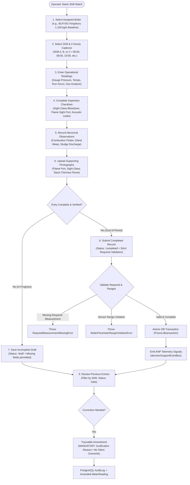
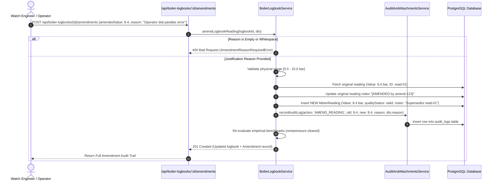

# LuminaFM Daily Logbook, Inspection Workflow & Traceable Amendments

## 1. Executive Summary & Purpose

The **LuminaFM Daily Logbook & Inspection Workflow** provides plant-floor boiler operators, watch engineers, and maintenance supervisors with an operational interface to record 2-hourly operational telemetry, complete shift inspection checklists, document abnormal observations, upload supporting photographs, save incomplete drafts, submit completed records, and execute **traceable amendments without silent overwrites**.

All submissions execute within atomic database transactions (`prisma.$transaction`), ensuring absolute consistency between inspections, meter readings, checklist responses, and entity attachments. Whenever operational measurements breach empirical dissertation benchmarks (such as stack flue gas temperature $>190^\circ\text{C}$ or gauge steam pressure $>9.0\text{ bar}$), normalized telemetry data contracts are emitted to the **Analytic Network Process (ANP) Decision Support Engine**.

---

## 2. Complete Operator Workflow (The 9 Core Steps)



---

## 3. Storage Architecture: Units, Operator Identity & Source Tracking

Every operational reading is recorded with full provenance:

| Data Attribute | Field Name | Description |
|---|---|---|
| **Measurement Unit** | `unit` | Standard engineering unit (`bar`, `deg_c`, `hrs`, `%`, `ppm`). |
| **Recorded Timestamp** | `recordedAt` | Exact timestamp when the observation was taken on the plant floor. |
| **Operator Identity** | `recordedBy` / `operatorId` | UUID of the authenticated watch operator. |
| **Data Source** | `source` | Provenance indicator: `'manual'` (primary workflow), `'iot'`, `'scada'`, or `'calculated'`. |
| **Quality Status** | `qualityStatus` | Data integrity flag (`valid`, `suspect`, `invalid`). |
| **Traceable Notes** | `notes` | Context notes or amendment supersession annotation. |

### Required Measurements Enforcement
When saving as `draft`, incomplete entries are permitted to facilitate incremental shift data entry. When submitting as `completed`, the system strictly validates that all mandatory operational measurements are populated:
- `operating_steam_pressure` ($8.0 - 9.0\text{ bar}$) — **REQUIRED**
- `steam_temperature` ($160.0 - 170.0^\circ\text{C}$) — **REQUIRED**
- `flue_gas_temperature` ($160.0 - 185.0^\circ\text{C}$) — **REQUIRED**
- `feedwater_pressure` ($4.0 - 6.0\text{ bar}$) — **REQUIRED**
- `feedwater_temperature` ($85.0 - 90.0^\circ\text{C}$) — **REQUIRED**

If any required parameter is omitted upon final submission, the transaction is rejected with [`RequiredMeasurementMissingError`](file:///e:/My%20Owns/src/modules/boiler/boiler.errors.ts).

---

## 4. Traceable Amendments Architecture (No Silent Overwrites)

Under regulated boiler inspection codes (ASME Boiler and Pressure Vessel Code Section VII & National Board Inspection Code), operational logbook records cannot be silently overwritten or modified without an audit trail.

LuminaFM implements **Traceable Amendments**:



---

## 5. ANP Decision Support Telemetry Data Contracts

When a completed logbook is submitted, the service normalizes the operational measurements into standardized telemetry signals:

```typescript
export interface TelemetrySignalInput {
  key: string;            // Standardized ANP metric key ('STEAM_PRESSURE', 'FLUE_GAS_TEMP', etc.)
  label?: string;         // Human-readable description
  value: number | boolean | string;
  unit?: string | null;   // Engineering unit ('bar', '°C', 'hrs')
  sourceType?: 'inspection_response' | 'meter_reading' | 'manual';
}
```

### Signal Mappings
- `operating_steam_pressure` $\rightarrow$ `STEAM_PRESSURE` ($>9.0\text{ bar}$ breach)
- `flue_gas_temperature` $\rightarrow$ `FLUE_GAS_TEMP` ($>190.0^\circ\text{C}$ breach)
- `feedwater_pressure` $\rightarrow$ `FEEDWATER_PRESSURE` ($<4.0\text{ bar}$ breach)
- `feedwater_temperature` $\rightarrow$ `FEEDWATER_TEMP` ($<85.0^\circ\text{C}$ breach)
- `pump_operating_hours` $\rightarrow$ `PUMP_OPERATING_HOURS` ($\ge 12,000\text{ hrs}$ breach)
- `burner_operating_hours` $\rightarrow$ `BURNER_OPERATING_HOURS` ($\ge 2,000\text{ hrs}$ breach)
- `exhaust_gas_o2` $\rightarrow$ `EXHAUST_O2` ($>5.5\%$ breach)
- `exhaust_gas_co` $\rightarrow$ `EXHAUST_CO` ($>200\text{ ppm}$ breach)
- `WATER_LEVEL_OK` $\rightarrow$ `WATER_LEVEL_OK` (`false` emergency low water trigger)

The payload is emitted asynchronously via `decisionSupportEventBus.emitDailyLogSubmitted`, enabling the ANP supermatrix to calculate alternative ranking and recommend targeted maintenance actions.

---

## 6. REST API Reference

All logbook endpoints are mounted under `/api/boiler-logbooks` in [`src/app.ts`](file:///e:/My%20Owns/src/app.ts) and protected with [`authenticateTenant`](file:///e:/My%20Owns/src/middleware/auth.middleware.ts):

| Method | Endpoint | Description |
|---|---|---|
| `GET` | `/api/boiler-logbooks/boilers` | Lists assigned boilers for operator selection with required parameter metadata. |
| `POST` | `/api/boiler-logbooks` | Saves daily logbook entry. Accepts `status: 'draft'` (partial) or `status: 'completed'` (strict validation). |
| `GET` | `/api/boiler-logbooks` | Filters previous logbook records by `assetId`, `shift`, `status`, `startDate`, `endDate`. |
| `GET` | `/api/boiler-logbooks/:id` | Returns complete logbook details including readings, checklists, observations, attachments, and amendments. |
| `POST` | `/api/boiler-logbooks/:id/submit` | Promotes a draft entry to completed status after verifying all required measurements. |
| `POST` | `/api/boiler-logbooks/:id/amendments` | Records a traceable amendment for an operational reading. **Reason is mandatory**. |
| `POST` | `/api/boiler-logbooks/:id/attachments` | Uploads and links supporting photograph to the logbook. |

---

## 7. Verification & Automated Test Coverage

The daily logbook workflow is verified with **13 dedicated unit and integration tests** in [`tests/daily-logbook-workflow.test.ts`](file:///e:/My%20Owns/tests/daily-logbook-workflow.test.ts). Across the LuminaFM platform, all **10 test suites** and **273 tests** pass with 100% success rate:

```text
✓ tests/daily-logbook-workflow.test.ts (13 tests)
  ✓ 1. Boiler & Operating Period Selection (2 tests)
  ✓ 2. Incomplete Entries as Drafts (2 tests)
  ✓ 3. Required Measurements Validation Before Submission (3 tests)
  ✓ 4. Traceable Amendments Rather than Silent Overwrites (2 tests)
  ✓ 5. Review Previous Entries & Historical Audit (3 tests)
  ✓ 6. Data Contracts for ANP Decision Support Engine (1 test)

Test Suites: 10 passed, 10 total
Tests:       273 passed, 273 total
Snapshots:   0 total
Time:        9.87s
TypeScript:  0 errors across backend and frontend (npx tsc --noEmit)
```
