# LuminaFM - Comprehensive Database Entity-Relationship Specification (ERD v2.0)
## Multi-Tenant Commercial CMMS with Native ANP Decision Engine & Offline PWA Sync

- **System**: LuminaFM Database Architecture
- **Target Engine**: PostgreSQL 15+ / 16
- **ORM Representation**: Prisma v6.19.3 (`prisma/schema.prisma`)
- **DDL Migration**: `prisma/migrations/20261115000000_init/migration.sql`

---

## 1. High-Level Entity-Relationship Diagram (ERD)

```mermaid
erDiagram
    ORGANIZATIONS ||--o{ USERS : owns
    ORGANIZATIONS ||--o{ ORGANIZATION_MEMBERSHIPS : has
    USERS ||--o{ ORGANIZATION_MEMBERSHIPS : joins
    ORGANIZATIONS ||--o{ ROLES : defines
    ROLES ||--o{ ROLE_PERMISSIONS : grants
    PERMISSIONS ||--o{ ROLE_PERMISSIONS : contains
    ORGANIZATION_MEMBERSHIPS ||--o{ MEMBERSHIP_ROLES : assigned
    ROLES ||--o{ MEMBERSHIP_ROLES : assigned

    ORGANIZATIONS ||--o{ SITES : owns
    SITES ||--o{ LOCATIONS : contains
    LOCATION_TYPES ||--o{ LOCATIONS : classifies
    LOCATIONS ||--o{ LOCATIONS : parent_of

    SYSTEM_CATEGORIES ||--o{ SYSTEM_TYPES : groups
    SYSTEM_TYPES ||--o{ SYSTEMS : classifies
    SITES ||--o{ SYSTEMS : hosts
    SYSTEMS ||--o{ SYSTEMS : parent_of

    ASSET_CATEGORIES ||--o{ ASSET_CATEGORIES : parent_of
    ASSET_CATEGORIES ||--o{ ASSET_MODELS : applies_to
    BRANDS ||--o{ ASSET_MODELS : manufactures
    ASSET_CATEGORIES ||--o{ ASSETS : classifies
    ASSET_MODELS ||--o{ ASSETS : model_of
    BRANDS ||--o{ ASSETS : brand_of
    SITES ||--o{ ASSETS : contains
    LOCATIONS ||--o{ ASSETS : located_at
    SYSTEMS ||--o{ ASSETS : belongs_to
    ASSETS ||--o{ ASSETS : parent_of

    ATTRIBUTE_DEFINITIONS ||--o{ CATEGORY_ATTRIBUTES : configured_as
    ASSET_CATEGORIES ||--o{ CATEGORY_ATTRIBUTES : has_attributes
    ASSETS ||--o{ ASSET_ATTRIBUTE_VALUES : has_values
    ATTRIBUTE_DEFINITIONS ||--o{ ASSET_ATTRIBUTE_VALUES : describes

    UNITS_OF_MEASUREMENT ||--o{ METER_DEFINITIONS : measures
    ASSETS ||--o{ ASSET_METERS : measured_by
    METER_DEFINITIONS ||--o{ ASSET_METERS : defines
    ASSET_METERS ||--o{ METER_READINGS : records
    ORGANIZATIONS ||--o{ OFFLINE_SYNC_BATCHES : ingests
    USERS ||--o{ OFFLINE_SYNC_BATCHES : uploads

    MAINTENANCE_TYPES ||--o{ MAINTENANCE_PLANS : classifies
    MAINTENANCE_PLANS ||--o{ MAINTENANCE_PLAN_TASKS : includes
    MAINTENANCE_TASK_TEMPLATES ||--o{ MAINTENANCE_PLAN_TASKS : reused_in
    ASSETS ||--o{ ASSET_MAINTENANCE_PLANS : assigned
    MAINTENANCE_PLANS ||--o{ ASSET_MAINTENANCE_PLANS : scheduled_for

    SITES ||--o{ WORK_ORDERS : scopes
    ASSETS ||--o{ WORK_ORDERS : concerns
    MAINTENANCE_PLANS ||--o{ WORK_ORDERS : generates
    MAINTENANCE_TYPES ||--o{ WORK_ORDERS : classifies
    WORK_ORDERS ||--o{ WORK_ORDER_TASKS : contains
    MAINTENANCE_TASK_TEMPLATES ||--o{ WORK_ORDER_TASKS : templates
    WORK_ORDERS ||--o{ WORK_ORDER_LABOR : records
    WORK_ORDERS ||--o{ WORK_ORDER_PARTS : consumes
    WORK_ORDERS ||--o{ WORK_ORDER_STATUS_HISTORY : tracks

    CHECKLIST_TEMPLATES ||--o{ CHECKLIST_ITEMS : contains
    CHECKLIST_TEMPLATES ||--o{ INSPECTIONS : used_for
    ASSETS ||--o{ INSPECTIONS : inspected
    INSPECTIONS ||--o{ INSPECTION_RESPONSES : captures
    CHECKLIST_ITEMS ||--o{ INSPECTION_RESPONSES : answered_by

    ASSETS ||--o{ FAULT_LOGS : experiences
    WORK_ORDERS ||--o{ FAULT_LOGS : resolves

    DECISION_MODELS ||--o{ DECISION_CRITERIA : evaluates
    DECISION_MODELS ||--o{ DECISION_ALTERNATIVES : compares
    DECISION_MODELS ||--o{ DECISION_RUNS : executes
    DECISION_MODELS ||--o{ DECISION_PAIRWISE_COMPARISONS : calibrates
    DECISION_MODELS ||--o{ DECISION_NETWORK_EDGES : structures
    DECISION_CRITERIA ||--o{ DECISION_NETWORK_EDGES : connects_from
    DECISION_CRITERIA ||--o{ DECISION_NETWORK_EDGES : connects_to
    DECISION_CRITERIA ||--o{ DECISION_PAIRWISE_COMPARISONS : assesses
    UNITS_OF_MEASUREMENT ||--o{ DECISION_CRITERIA : scales
    METER_DEFINITIONS ||--o{ DECISION_CRITERIA : feeds_reading
    CHECKLIST_ITEMS ||--o{ DECISION_CRITERIA : feeds_response
    MAINTENANCE_TASK_TEMPLATES ||--o{ DECISION_ALTERNATIVES : maps_to
    ASSETS ||--o{ DECISION_RUNS : evaluated
    WORK_ORDERS ||--o{ DECISION_RUNS : triggered_from

    DECISION_RUNS ||--o{ NOTIFICATIONS : raises
    DECISION_ALTERNATIVES ||--o{ NOTIFICATIONS : recommends
    ORGANIZATIONS ||--o{ AUDIT_LOGS : audits
    ORGANIZATIONS ||--o{ NOTIFICATIONS : delivers
    USERS ||--o{ NOTIFICATIONS : receives
    ORGANIZATIONS ||--o{ ATTACHMENTS : stores
    ATTACHMENTS ||--o{ ENTITY_ATTACHMENTS : links
```

---

## 2. Table Groups & Schema Taxonomy

The database encompasses **50 enterprise relational tables** organized into 11 logical functional clusters:

| Cluster # | Domain Cluster | Tables Included | Primary Architectural Responsibility |
|---|---|---|---|
| **1** | **Tenancy, Access & Deployment** | `organizations`, `users`, `organization_memberships`, `roles`, `permissions`, `role_permissions`, `membership_roles` | Multi-tenant scoping, RBAC, deployment profiles (`saas_multitenant`, `dedicated`), and white-label branding. |
| **2** | **Physical Location Tree** | `sites`, `location_types`, `locations` | Physical containment hierarchy (Site ➔ Building ➔ Floor ➔ Room). Strict DAG cycle detection. |
| **3** | **Technical System Tree** | `system_categories`, `system_types`, `systems` | Functional engineering hierarchy (Steam Generation ➔ Boiler Plant). Independent of physical location. |
| **4** | **Asset Master & Dynamic EAV** | `asset_categories`, `brands`, `asset_models`, `assets`, `attribute_definitions`, `category_attributes`, `asset_attribute_values` | Core equipment registry. Typed EAV engine for equipment specifications (1,100 kg/h, 9 bar) across typologies. |
| **5** | **Telemetry, Meters & Offline Ingestion**| `units_of_measurement`, `meter_definitions`, `asset_meters`, `meter_readings`, `offline_sync_batches` | Continuous and manual shift telemetry. Idempotent client UUIDv7 synchronization and batch audit. |
| **6** | **Preventive Maintenance Planning** | `maintenance_types`, `maintenance_task_templates`, `maintenance_plans`, `maintenance_plan_tasks`, `asset_maintenance_plans` | Reusable task templates, calendar and run-hour recurrence rules (Monthly, Quarterly, Biannual, Annual). |
| **7** | **Work Order Execution Engine** | `work_orders`, `work_order_tasks`, `work_order_labor`, `work_order_parts`, `work_order_status_history` | Formal state machine (`draft` ➔ `approved` ➔ `completed`), sequential numbering, technician labor, parts cost. |
| **8** | **Digital Inspections & Checklists** | `checklist_templates`, `checklist_items`, `inspections`, `inspection_responses` | 2-hourly shift monitoring checklists, qualitative walkthroughs, typed responses (numeric, boolean, photo). |
| **9** | **Fault History & Root-Cause** | `fault_logs` | Equipment breakdown tracking, failure symptoms, and work order remediation linkage. |
| **10** | **ANP Decision Support Platform** | `decision_models`, `decision_criteria`, `decision_alternatives`, `decision_pairwise_comparisons`, `decision_network_edges`, `decision_runs` | Full Analytic Network Process engine: versioned models, cluster benchmarks, Saaty matrices, limit supermatrix runs. |
| **11** | **Platform Evidence, Alerts & Audit** | `attachments`, `entity_attachments`, `notifications`, `audit_logs` | Multipart file evidence (Multer), real-time alerts with Resolve/Acknowledge triage, and immutable mutation audit. |

---

## 3. Structural Innovations & Research Bridges in v2.0

### 3.1 Decision Model Bridges to Operational Sources
In the original research (*Vishal Perera 2025*), maintenance decisions evaluate two streams: continuous meter readings (e.g., Flue Gas Temp) and physical inspection walkthroughs (e.g., Visual Spark Quality, Steam Leaks).

In v2.0, `decision_criteria` has direct foreign keys to both operational channels:
- `meter_definition_id`: Enables the decision engine to automatically bind an incoming 2-hourly temperature or pressure reading to its corresponding criterion benchmark.
- `checklist_item_id`: Enables the decision engine to evaluate qualitative responses (e.g., `poor_spark` or `steam_leak`) against inspection benchmarks.

### 3.2 Decision Alternative Bridge to Maintenance Execution
When the ANP engine prioritizes an alternative (e.g., `FPMA 1: Replace worn mechanical pump seals`):
- `maintenance_task_template_id`: Direct link in `decision_alternatives` to standard operational tasks in `maintenance_task_templates`.
- When an engineer clicks **Resolve** in the Active Maintenance Alerts panel, LuminaFM instantly instantiates a draft Work Order pre-populated with standard safety instructions, tools, and estimated duration.

### 3.3 Saaty Pairwise Comparison Storage (`decision_pairwise_comparisons`)
Stores subjective and empirical pairwise comparisons ($A_{ij}$ on the Saaty 1–9 fundamental scale):
- Composite unique key: `(organization_id, decision_model_id, cluster_code, criterion_id, row_element_id, col_element_id)`.
- Prevents matrix corruption and enables real-time Consistency Ratio ($CR < 0.10$) validation before supermatrix power convergence.

### 3.4 Non-Hierarchical Network Edges (`decision_network_edges`)
Models the full ANP feedback loops documented in Dissertation Figure 4.1 (*Page 58*):
- Models directed dependencies between criteria and criteria (inner dependence) and criteria and alternatives (outer dependence/feedback).
- Supports dual network structures (Network 1: Daily Corrective vs. Network 2: Periodic Lifecycle Overhauls).

### 3.5 Offline Synchronization & Idempotency Engine
- `meter_readings` and `inspections` contain `client_log_uuid` (UUIDv7) with composite unique constraints: `UNIQUE (organization_id, client_log_uuid)`.
- `offline_sync_batches` tracks every tablet sync transaction, device fingerprint, and payload manifest, preventing replay duplication.

### 3.6 Uniform UUID Primary Keys & Multi-Tenant Composite Integrity
- Every primary key is a native PostgreSQL UUID generated via `gen_random_uuid()`.
- Every child table enforces composite foreign keys `(organization_id, parent_id)` to mathematically eliminate cross-tenant data corruption at the database engine level.
