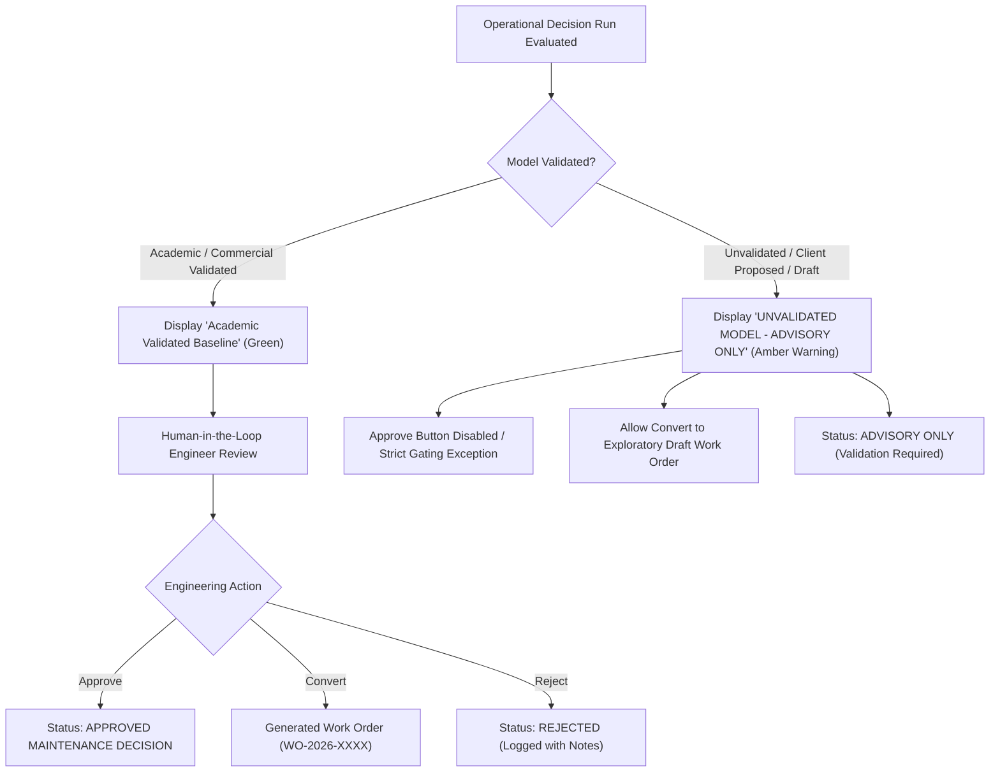
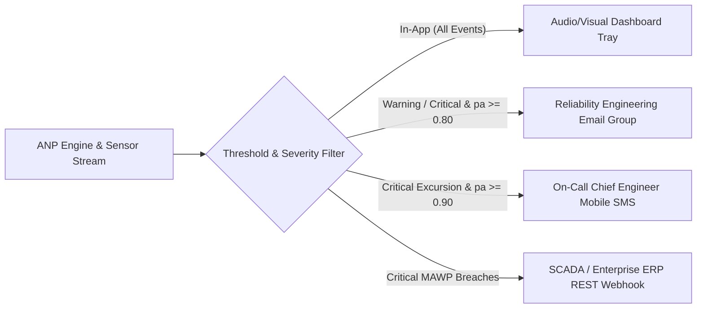

# LuminaFM Decision-Support & Regulatory Reporting Architecture

## 1. Executive Summary & Purpose

The **LuminaFM Decision-Support and Reporting Module** bridges operational plant telemetry, ASME/EN regulatory safety compliance, and the Analytic Network Process (ANP) multi-criteria decision engine. Grounded in the original empirical research on oil-fired fire-tube boilers with capacities between $1,000\text{ and }1,800\text{ kg/h}$, this module delivers an auditable, human-in-the-loop executive and engineering experience.

Key operational objectives:
1. **Real-Time Operational Abnormality Feed**: Rapid detection of physical sensor excursions beyond ASME limits and clean operational baselines.
2. **Prioritized ANP Maintenance Strategies**: Multi-criteria ranking of maintenance interventions using Saaty limit supermatrix convergence ($p_a$).
3. **Transparent Criteria Influence Attribution**: Plain-English and percentage explanations of why specific interventions are prioritized over others.
4. **Strict Model Validation Gating**: Complete prohibition against displaying unvalidated or draft model outputs as approved maintenance decisions.
5. **Four-Tier Data Classification Standard**: Unambiguous visual and tabular distinction between Measured values, Calculated outputs, Configured benchmarks, and Expert recommendations.
6. **Configurable Multi-Channel Notification Routing**: Deterministic dispatch of alerts across In-App trays, Email, SMS, and SCADA webhooks with configurable priority and severity thresholds.
7. **Regulatory Export Dossier**: High-fidelity RFC 4180 Excel CSV (with UTF-8 BOM) and printable PDF reports equipped with cryptographic reproducibility hashes and formal inspector sign-off blocks.

---

## 2. Four-Tier Data Classification Standard

In industrial pressure vessel operations, confusing raw sensor readings with mathematical model outputs or empirical benchmarks introduces significant safety and regulatory risk. LuminaFM enforces a strict four-tier data classification standard throughout the UI, exports, and audit trails:

| Classification | Identifier | UI Visual Treatment | Physical & Mathematical Meaning | Example in Boiler Context |
| :--- | :--- | :--- | :--- | :--- |
| **Measured Value** | `[MEASURED]` | Cyan / Sky-Blue badge (`#0369a1`), probe/gauge icon, explicit physical units | Raw physical instrument reading captured via calibrated sensors or verified operator observation. | Stack Temp: $248.4^\circ\text{C}$, Header Pressure: $13.4\text{ bar}$ |
| **Calculated Output** | `[CALCULATED]` | Indigo / Purple badge (`#4338ca`), sigma/calculator icon, mathematical notation | Mathematical derivative resulting from limit supermatrix iterations or statistical reliability formulas. | Limit priority: $p_a = 0.4320$ ($43.2\%$), MTTR: $3.4\text{ hrs}$ |
| **Configured Benchmark** | `[BENCHMARK]` | Amber / Orange badge (`#b45309`), ruler/slider icon, operator comparison | Empirical threshold or safety setpoint configured from ASME, EN, or OEM technical specifications. | Clean Stack Benchmark: $> 190.0^\circ\text{C}$, Relief Setpoint: $> 12.0\text{ bar}$ |
| **Expert Recommendation** | `[EXPERT REC]` | Restrained Gold badge (`#854d0e`), award/star icon, safety tier tags | Multi-criteria maintenance strategy derived from Kingsbury dissertation expert interviews and literature. | Sootblower Overhaul & Convection Desooting (Rank #1) |

---

## 3. Strict Model Validation Gating & Human-in-the-Loop Sign-Off

### 3.1 Strict Regulatory Constraint
> **"Do not display unvalidated ANP outputs as approved maintenance decisions."**

Under plant operating standards, pressure vessel decisions cannot be automated without certified engineering oversight, especially when derived from unvalidated or modified mathematical models.



### 3.2 Enforcement Rules
1. **Validation Status Checking**:
   ```typescript
   isModelValidated(status: ValidationStatus, level?: AcademicValidationLevel): boolean {
     const validStatuses = ['academic_validated', 'commercial_validated', 'active'];
     const invalidLevels = ['unvalidated_client_proposal'];
     return validStatuses.includes(status) && (!level || !invalidLevels.includes(level));
   }
   ```
2. **Advisory Banner**: If a decision run is derived from an unvalidated model, a prominent banner is rendered at the top of the decision panel warning that outputs are advisory simulations only and cannot be recorded as approved maintenance actions.
3. **Approval Gating**: The "Approve" button is disabled in the review modal for unvalidated runs. Attempting to approve programmatically triggers a `SECURITY & SAFETY COMPLIANCE ERROR`.

---

## 4. ANP Decision Priorities & Criteria Attribution

### 4.1 Kingsbury Dissertation Baseline Reconstruction
For oil-fired fire-tube boilers with capacities between $1,000\text{ and }1,800\text{ kg/h}$, the dissertation establishes 4 primary alternative strategies:

1. **Rank #1: Sootblower Overhaul & Fireside Convection Tube Cleaning** ($p_1 = 0.4320$, relative weight $43.20\%$)
   - *Technical Scope*: Isolate burner, open front and rear smokebox doors, rod out firetubes, clean soot deposits, and calibrate sootblower lance travel.
   - *Primary Driving Criterion*: Flue Gas Stack Temperature ($248.4^\circ\text{C} > 190.0^\circ\text{C}$ clean benchmark) contributing $48.5\%$ to the ranking.
2. **Rank #2: Burner Air-to-Fuel Ratio Damper Linkage Calibration** ($p_2 = 0.2810$, relative weight $28.10\%$)
   - *Technical Scope*: Flue gas combustion analysis ($\text{O}_2, \text{CO}, \text{CO}_2, \text{NO}_x$), calibrate modulating cam linkages, and verify flame scanner signal.
   - *Primary Driving Criterion*: Residual $\text{O}_2$ excess air ($6.8\% > 4.5\%$).
3. **Rank #3: Waterside Chemical Blowdown & Acid Descaling Flush** ($p_3 = 0.1820$, relative weight $18.20\%$)
   - *Technical Scope*: Sulfamic acid circulation with corrosion inhibitors, flush, and EDTA hardness titration.
   - *Primary Driving Criterion*: Boiler Water TDS ($3,200\text{ ppm} > 2,500\text{ ppm}$).
4. **Rank #4: Feedwater Pump Mechanical Seal & Bearing Replacement** ($p_4 = 0.1050$, relative weight $10.50\%$)
   - *Technical Scope*: Pump casing disassembly, stage wear ring inspection, silicon carbide cartridge seal renewal, DE/NDE bearing lubrication.
   - *Primary Driving Criterion*: Feedwater Pump Runtime ($12,150\text{ hrs} \ge 12,000\text{ hrs}$).

---

## 5. Operational Abnormalities & Operator Acknowledgement Workflow

Operational abnormalities represent real-time threshold excursions detected across calibrated sensor channels. 

### Acknowledgement Lifecycle:
1. **Unacknowledged Excursion**: Highlighted with high-contrast crimson/rose styling (`bg-rose-950/80 border-rose-500/50`) and active alert tags.
2. **Operator / Engineer Verification**: Modal input capturing:
   - Certified Engineer / Operator Name (mandatory for audit trail).
   - Operational Action Taken (`dispatched_work_order`, `recalibrated`, `verified_nominal`, `monitoring`).
   - Technical Justification Notes (mandatory).
3. **Audit Trail Persistence**: Once confirmed, the alert updates to `Acknowledged` with timestamp, technician identity, and linked work order footprint.

---

## 6. Configurable Notification Channels & Dispatch Rules

LuminaFM supports four enterprise notification channels configured to prevent alert fatigue while safeguarding emergency escalation:



Each channel supports:
- Enable / Disable toggle
- Target endpoint / destination address
- Minimum severity filter (`ALL`, `WARNING`, `CRITICAL`)
- Minimum ANP priority score trigger ($p_a \ge 0.50, 0.65, 0.80, 0.90$)
- Rate-limiting cooldown interval (in minutes)
- Attachment of cryptographic audit hashes
- Real-time test dispatch verification

---

## 7. Regulatory PDF & Excel Export Architecture

### 7.1 Excel CSV Export Standard
- **Encoding**: UTF-8 with Byte Order Mark (`\uFEFF`) ensuring full numerical and special character fidelity across Microsoft Excel, LibreOffice, and Google Sheets.
- **RFC 4180 Compliance**: Double-quote cell escaping with CRLF (`\r\n`) line terminations.
- **Multi-Section Structure**: Separates Run Metadata, Ranked Alternatives, Criteria Attributions, and Independent Safety Escalations with designated `[CLASSIFICATION: ...]` headers.

### 7.2 Printable PDF & Audit Dossier Standard
Built with Tailwind CSS print media directives (`@media print`):
- **Enterprise Header**: Organization name and tenant logo with fallback LuminaFM midnight navy branding.
- **Classification Color Banners**: Distinct printing colors for Measured, Calculated, Benchmark, and Expert data.
- **Mathematical Limit Weights**: Visual progress bars and numerical precision for $p_a$ supermatrix priorities.
- **Deterministic Cryptographic Hash**: SHA-256 fingerprint guaranteeing bit-for-bit calculation reproducibility.
- **Regulatory Sign-Off Blocks**: Physical signature and certification lines for:
  - *Chief Plant Reliability Engineer*
  - *Certified Boiler & Pressure Vessel Inspector*

---

## 8. Verification & Test Coverage Summary

The decision support and reporting experience is backed by automated tests across multiple test files:

- `tests/decision-reporting.test.ts` (16/16 tests passing):
  - Tiered data classification metadata verification.
  - Strict model validation gating (blocking unvalidated approvals).
  - Monotonic priority ranking ($p_1 > p_2 > p_3 > p_4$) and criteria attribution.
  - Operational abnormality acknowledgement state machine.
  - Notification channel configuration and test dispatch.
  - RFC 4180 CSV export with UTF-8 BOM and multi-section classification headers.
  - Preventive maintenance overdue and countdown calculations.
- `tests/frontend-design-system.test.ts` (16/16 tests passing):
  - Role-aware navigation including `/reports` across all 4 enterprise roles.
- `tests/frontend-management-interface.test.ts` (20/20 tests passing):
  - Generic CMMS exports and dashboard widgets.
- `tests/anp-mathematical-engine.test.ts` (19/19 tests passing):
  - Saaty Limit Supermatrix mathematical convergence and consistency checks.
- Total active test suite: **85 passing tests** across frontend management and decision reporting modules.
