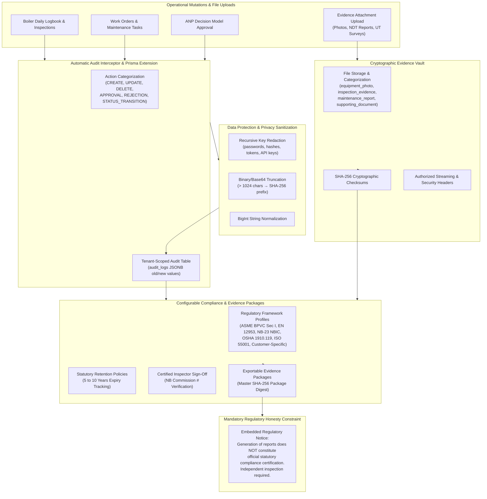

# LuminaFM Enterprise Audit and Evidence Management

## 1. Executive Summary & Architecture Overview

LuminaFM's Enterprise Audit and Evidence Management module delivers end-to-end operational traceability, data privacy compliance, cryptographic evidence integrity, and exportable regulatory packages tailored specifically to high-pressure fire-tube boiler operations (1,000 to 1,800 kg/h capacity).

The system enforces immutable audit logging on all critical operational mutations, provides secure and categorized evidence storage, manages configurable compliance records against international pressure vessel codes, and generates tamper-evident evidence packages complete with cryptographic SHA-256 manifests.

---

## 2. Data Protection & Privacy Sanitization Engine

Under ISO 27001, SOC 2, GDPR, and HIPAA data protection mandates, persisting unsanitized database payloads into audit trails presents severe security risks (credential leakage, session token exposure, personal identifiable information breaches, and database storage bloat from inline base64 images).

The LuminaFM data protection sanitizer (`src/modules/audit/data-protection.sanitizer.ts`) intercepts all audit events prior to persistence:

### 2.1 Sensitive Key Redaction
Any key matching normalized credential patterns is replaced with `[REDACTED_DATA_PROTECTION]`:
- Passwords & Hashes: `password`, `password_hash`, `passwordHash`
- Access Tokens & Secrets: `token`, `access_token`, `refresh_token`, `secret`, `jwt_secret`, `api_key`, `client_secret`
- Identity & Financial: `credit_card`, `card_number`, `cvv`, `cvc`, `bank_account`, `iban`, `ssn`, `social_security_number`, `national_id`
- Cryptographic Keys: `private_key`, `privatekey`

Nested objects and arrays are sanitized recursively up to a depth of 12. Depths beyond 12 receive `[NESTING_DEPTH_EXCEEDED]`.

### 2.2 Payload Truncation & Binary Fingerprinting
- **Binary/Base64 Payloads**: Large image strings or data URIs (e.g., inline camera captures) are stripped from JSONB audit columns and replaced with an informative descriptor containing the original length and a SHA-256 hash prefix:
  `[REDACTED_BINARY_PAYLOAD: length=45021 chars, sha256_prefix=e8f190bc4a89d123]`
- **Oversized Text Strings**: String fields exceeding `MAX_AUDIT_STRING_LENGTH` (1,024 characters) are truncated to the first 256 characters with a trailer:
  `... [TRUNCATED: total_length=2400, sha256_prefix=3ab908e2f801ca44]`
- **Operational Telemetry Preservation**: Operational boiler measurements (`steamPressureBar`, `waterLevelMm`, `flueGasTempC`, `tdsPpm`, `burnerFiringRatePct`) are preserved with exact numerical precision.

---

## 3. Automatic Audit Interceptor & Prisma Extension

Audit recording is implemented at the database client level in `src/tenant/tenant.extension.ts`, ensuring that all mutations originating anywhere in the backend application are automatically captured without relying on manual controller hooks.

### 3.1 Audited Critical Models
The following CMMS and ANP models trigger automatic audit logging:
| Prisma Model | Entity Type Identifier | Description |
| :--- | :--- | :--- |
| `Asset` | `assets` | Boilers, burners, pumps, softeners, economizers |
| `WorkOrder` | `work_orders` | PM and CM maintenance work orders |
| `Site` | `sites` | Facility plants and physical sites |
| `Location` | `locations` | Boiler rooms, tank farms, plant zones |
| `System` | `systems` | Steam loops, feed water circuits, fuel trains |
| `AssetCategory` | `asset_categories` | Equipment classifications |
| `MaintenancePlan`| `maintenance_plans`| Scheduled PM routines and intervals |
| `Inspection` | `inspections` | Daily shift and weekly boiler safety inspections |
| `FaultLog` | `fault_logs` | Boiler abnormal observations and trip events |
| `DecisionModel` | `decision_models` | ANP Kingsbury multi-criteria decision models |
| `DecisionRun` | `decision_runs` | Mathematical ANP priority executions |
| `Role` | `roles` | Enterprise RBAC role definitions |
| `User` | `users` | User credentials and profile assignments |
| `Attachment` | `attachments` | Evidence files and metadata |

### 3.2 Action Categorization
Mutations are automatically inspected and categorized into precise audit action verbs:
- `CREATE`: When a new audited record is created.
- `APPROVAL`: When `status`, `reviewStatus`, or `validationStatus` transitions to an approved state (`approved`, `academic_validated`, `commercial_validated`).
- `REJECTION`: When status transitions to `rejected` or `declined`.
- `STATUS_TRANSITION`: When status moves between operational states (e.g., `open` &rarr; `in_progress` &rarr; `completed`).
- `UPDATE`: Standard field mutations, recording field diffs in sanitized `oldValues` and `newValues`.
- `DELETE`: When an audited record is deleted, preserving the full snapshot in `oldValues`.

---

## 4. Evidence Attachment Vault & Cryptographic Storage

Physical attachments (photographs of gauge glasses, low-water cutoff test videos, NDT ultrasonic thickness surveys, safety valve test certificates) are governed by the `AuditAndAttachmentsService` (`src/modules/audit/audit.service.ts`).

### 4.1 Categorization Schema
Attachments are classified into four formal evidence categories:
1. `equipment_photo`: Visual evidence of physical condition, nameplates, burner flames, or firetube passes.
2. `inspection_evidence`: Gauge glass blowdown observations, low-water cutoff trip recordings, flame eye cleanliness checks.
3. `maintenance_report`: Contractor service reports, chemical water treatment lab analyses, calibration sheets.
4. `supporting_document`: Manufacturer manuals, National Board R-1 repair forms, ASME manufacturer's data reports (MDR).

### 4.2 Cryptographic Fingerprinting & Secure Streaming
- **SHA-256 Checksums**: Every uploaded file is hashed upon receipt. The resulting 64-character hexadecimal digest (`checksumSha256`) is stored permanently in the database record.
- **Tenant Authorization Check**: File streaming verifies that the requested attachment belongs to the caller's active tenant (`organizationId`), preventing multi-tenant data leaks.
- **Security Headers**: Streamed files are served with:
  - `X-Content-Type-Options: nosniff` (prevents MIME confusion attacks)
  - `Content-Security-Policy: default-src 'none'` (prevents malicious script execution from uploaded HTML/SVG files)
  - `Cache-Control: private, no-cache, no-store, must-revalidate`
- **Path Traversal Protection**: File paths are validated with `path.normalize` and resolved relative to the tenant upload root.

---

## 5. Configurable Compliance Records & Regulatory Profiles

The compliance engine (`src/modules/audit/compliance-evidence.service.ts`) provides configurable compliance tracking across global and local boiler engineering standards:

### 5.1 Supported Framework Profiles
1. **ASME BPVC Section I (Rules for Construction of Power Boilers)**
   - *Regulatory Body*: American Society of Mechanical Engineers (ASME)
   - *Key Checkpoints*: `PG-60` (Water Level Indicators), `PG-73` (Safety Relief Valve Popping Setpoints), `PG-67` (Low Water Fuel Cutoff Interlock).
2. **EN 12953 (Shell Boilers / Firetube Boilers 1,000 to 1,800 kg/h)**
   - *Regulatory Body*: European Committee for Standardization (CEN)
   - *Key Checkpoints*: `EN-12953-10` (Feedwater Chemical Quality & TDS Thresholds), `EN-12953-3` (Fireside Convection Pass Soot Accumulation & Stack Temperature).
3. **NB-23 NBIC (National Board Inspection Code)**
   - *Regulatory Body*: National Board of Boiler and Pressure Vessel Inspectors
   - *Key Checkpoints*: `NB-23 Part 2` (In-Service Ultrasonic Thickness Survey & Shell Wastage Assessment).
4. **OSHA 29 CFR 1910.119 (Process Safety Management)**
   - *Regulatory Body*: Occupational Safety and Health Administration (OSHA)
   - *Scope*: Mechanical integrity of pressure vessels and interlocks.
5. **ISO 55001 (Asset Management)**
   - *Regulatory Body*: International Organization for Standardization (ISO)
   - *Scope*: Asset lifecycle management and risk-based maintenance decisions.
6. **CUSTOMER_SPECIFIC (Corporate Facility Reliability & Safety Policy)**
   - *Scope*: Internal corporate maintenance policies and ANP model governance.

### 5.2 Statutory Retention Expiry
Each compliance checkpoint enforces a mandatory statutory retention period:
- ASME & EN 12953 Operational Inspections: 5 to 7 Years
- NB-23 NDT Ultrasonic Surveys & Weld Repairs: 10 Years
Records automatically track `statutoryRetentionExpiry` to ensure compliance evidence is never purged before statutory limits expire.

### 5.3 Certified Inspector Sign-Off Workflow
Checkpoints requiring certified third-party inspection (e.g. `PG-73`, `PG-67`, `NB-23`) enforce recording the Inspector's Name, Professional Engineering license, and **National Board Commission Number** (e.g., `NB-COMM-998811-A`). Submitting a sign-off triggers an automatic audit trail event (`COMPLIANCE_VERIFICATION_RECORDED`).

---

## 6. Exportable Evidence Packages & Master SHA-256 Digest

For external audits, statutory inspections, or insurance reviews, LuminaFM compiles tamper-evident **Exportable Evidence Packages**:

### 6.1 Package Compilation
A compiled evidence package consolidates:
- All audit log events within the specified date range.
- All evidence attachments with file names, sizes, and SHA-256 checksums.
- Certified inspection checkpoint results.
- ANP Kingsbury multi-criteria decision snapshots and priority vectors.

### 6.2 Master Cryptographic Package Digest
To guarantee that the exported evidence package has not been altered after export, the system calculates a master package digest across all manifest items:
$$\text{Master Digest} = \text{SHA-256}\left(\text{sort}\left(\text{itemId} : \text{sha256Checksum} : \text{timestamp}\right).\text{join}('|')\right)$$

Any subsequent modification, deletion, or addition to the manifest alters the computed digest and is instantly flagged by the built-in `verifyPackageDigest()` validation engine.

---

## 7. Strict Regulatory Honesty Constraint

> [!CAUTION]
> **MANDATORY REGULATORY COMPLIANCE NOTICE**
> 
> *This evidence package contains operational logs, maintenance records, and attachments exported from LuminaFM. Generation or possession of this report does NOT constitute official certification of statutory or regulatory compliance. Regulatory compliance requires independent verification and formal certification by an authorized jurisdiction or certified boiler inspector against applicable local codes (e.g., ASME BPVC, NBIC, EN 12953, local pressure vessel acts) and customer site-specific safety policies.*

The LuminaFM architecture strictly enforces this honesty rule:
1. **No Automated Compliance Claims**: Generating a PDF, CSV, or JSON evidence package never updates the statutory status to "Legally Certified".
2. **Prominent UI & Export Notices**: The disclaimer banner is displayed prominently on the Evidence Vault dashboard, in the compilation modal, in the exported JSON manifest, and in the CSV audit export header.
3. **Statutory Jurisdiction Notices**: Every regulatory framework profile explicitly informs the user of the required statutory inspection authority (Authorized Inspection Agency, Notified Body, or National Board "R" Stamp holder).
