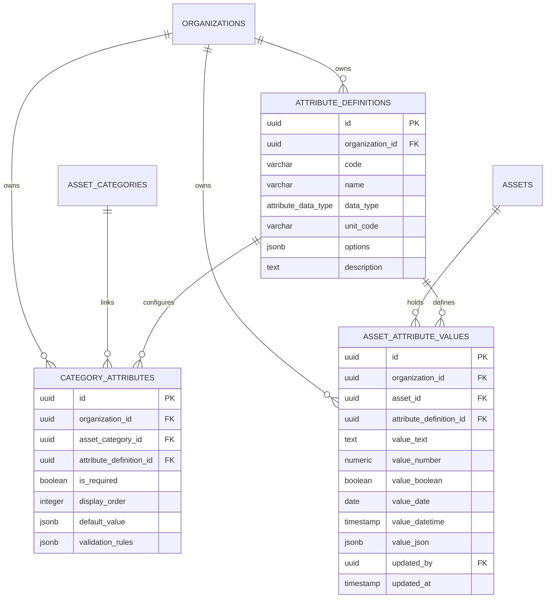

# LuminaFM Configurable Equipment Attribute Engine Architecture

## 1. Executive Summary & Core Principles

Commercial facility maintenance platforms must manage heterogeneous industrial assets ranging from high-pressure steam boilers to centrifugal chillers, multistage centrifugal pumps, emergency diesel generators, and air handling units (AHUs). Hardcoding equipment-specific technical specifications into generic database tables is an anti-pattern that creates brittle migrations, technical debt, and limits extensibility.

LuminaFM resolves this by implementing a **Configurable Equipment Attribute Engine** that combines:
1. **Dynamic Schema Metadata**: Authorized administrators define domain-specific attributes with units, data types, validation rules, and UI layout hints.
2. **Category-Level Templates**: Attributes are linked to asset categories with required-field indicators, default values, and display ordering.
3. **Typed-Column Storage (Entity-Attribute-Value with Type Safety)**: Dynamic values are mapped into dedicated typed database columns (`value_text`, `value_number`, `value_boolean`, `value_date`, `value_datetime`, `value_json`) rather than opaque string blobs, ensuring PostgreSQL indexability, type validation, and query performance.
4. **Configuration Versioning & Immutability**: Changing an attribute definition or adding mandatory fields never mutates or invalidates historical readings or equipment baselines. Versioned configuration snapshots preserve exact point-in-time schemas.
5. **Cross-Category Agility**: The same core architecture powers Boilers, Chillers, Pumps, Generators, AHUs, and future equipment classes without modifying the core `assets` schema.

---

## 2. Database Schema & Data Modeling

The attribute engine leverages three core relational tables defined in [prisma/schema.prisma](file:///e:/My%20Owns/prisma/schema.prisma) and enforced by PostgreSQL Row-Level Security:



### 2.1 Table Structure & Constraints

1. **`attribute_definitions`**:
   - `organization_id`: Tenant boundary isolation.
   - `code`: Normalized lowercase identifier (e.g. `operating_pressure_bar`, `design_capacity_tph`).
   - `data_type`: Enum `AttributeDataType` (`text`, `number`, `boolean`, `date`, `datetime`, `select`, `multi_select`, `json`).
   - `unit_code`: Optional SI/Engineering unit (e.g., `bar`, `deg_c`, `tph`, `kpa`, `gpm`, `rpm`, `kva`).
   - `options`: JSONB array of permitted values for `select` and `multi_select` attributes.
   - Unique constraint: `(organization_id, code)`.

2. **`category_attributes`**:
   - Links an attribute definition to a specific equipment category.
   - `is_required`: Mandatory field enforcement during asset creation/update.
   - `display_order`: Controls rendering sequence in dynamic UI forms.
   - `default_value`: JSONB payload populated when instantiating new assets.
   - `validation_rules`: JSONB object holding domain-specific constraints (`min`, `max`, `step`, `pattern`, `customErrorMessage`).
   - Unique composite constraint: `(organization_id, asset_category_id, attribute_definition_id)`.

3. **`asset_attribute_values`**:
   - Stores the actual specification or operating value for an asset instance.
   - **Typed Columns**:
     - `value_text`: Used for `text` and `select` types.
     - `value_number`: Used for `number` types (stored as PostgreSQL `numeric` for high-precision engineering tolerances).
     - `value_boolean`: Used for `boolean` flags.
     - `value_date`: Stored as PostgreSQL `date` (YYYY-MM-DD).
     - `value_datetime`: Stored as PostgreSQL `timestamp with time zone` (ISO 8601).
     - `value_json`: Stored as PostgreSQL `jsonb` for complex structured objects, arrays, and `multi_select` selections.
   - **Exactly-One Invariant**: Exactly one typed column is populated per record.
   - Unique composite constraint: `(organization_id, asset_id, attribute_definition_id)`.

---

## 3. Data Types & Validation Rules Engine

Validation is executed by `validateAndMapAttributeValue` in [src/modules/attributes/attributes.validator.ts](file:///e:/My%20Owns/src/modules/attributes/attributes.validator.ts). The engine strictly validates incoming client data and maps it to the target column:

| Attribute Type | Accepted Input | Target Column | Validation Rules Supported |
| :--- | :--- | :--- | :--- |
| `text` | `string` | `value_text` | `pattern` (RegExp), custom error messages |
| `number` | `number` (finite) | `value_number` | `min`, `max`, `step`, numerical range boundaries |
| `boolean` | `boolean` (`true` / `false`) | `value_boolean` | Strict boolean type enforcement |
| `date` | `string` (`YYYY-MM-DD`) | `value_date` | ISO date format and valid calendar date verification |
| `datetime` | `string` (ISO 8601) | `value_datetime` | ISO timestamp parsing and valid calendar date |
| `select` | `string` | `value_text` | Allowed options list membership |
| `multi_select` | `string[]` | `value_json` | Allowed options membership for all elements |
| `json` | `object` / `array` | `value_json` | Structured JSON serialization and payload validity |

### Validation Rule Specification

```typescript
export interface AttributeValidationRules {
  min?: number;              // Minimum numeric boundary
  max?: number;              // Maximum numeric boundary
  step?: number;             // Permitted increment step
  pattern?: string;          // Regular expression string for text validation
  customErrorMessage?: string; // Human-readable feedback on validation failure
}
```

If a client submits a value that violates the type or range rule (e.g. submitting a pressure of `35 bar` when `max: 30`, or submitting `invalid-date`), the engine throws `AttributeTypeValidationError` (HTTP 400), returning a descriptive error payload.

---

## 4. Dynamic Form Schema Generation & Tablet Ergonomics

Frontends query `GET /api/v1/attributes/categories/:categoryId/form-schema` to obtain the complete metadata needed to dynamically generate data entry forms.

### 4.1 Schema Payload Structure

```json
{
  "categoryId": "cat_boiler_001",
  "categoryCode": "STEAM_BOILER",
  "categoryName": "Industrial Steam Boilers",
  "version": 1,
  "fields": [
    {
      "attributeDefinitionId": "attr_op_pressure",
      "code": "operating_pressure_bar",
      "name": "Operating Pressure",
      "dataType": "number",
      "unitCode": "bar",
      "isRequired": true,
      "displayOrder": 1,
      "defaultValue": 10.0,
      "validationRules": {
        "min": 0.5,
        "max": 30.0,
        "step": 0.1,
        "customErrorMessage": "Operating pressure must be between 0.5 and 30.0 bar"
      },
      "options": [],
      "description": "Rated continuous operating gauge pressure"
    },
    {
      "attributeDefinitionId": "attr_fuel_type",
      "code": "fuel_type",
      "name": "Primary Fuel Type",
      "dataType": "select",
      "unitCode": null,
      "isRequired": true,
      "displayOrder": 2,
      "defaultValue": "BIOMASS",
      "validationRules": {},
      "options": ["BIOMASS", "HEAVY_FUEL_OIL", "DIESEL", "NATURAL_GAS", "DUAL_FUEL"],
      "description": "Primary combustible fuel source"
    }
  ]
}
```

### 4.2 Factory Floor Tablet Ergonomics

In accordance with LuminaFM UI/UX governance:
- Dynamic input components generated from this schema honor the **44x44px minimum touch target** for tablet screens (iPad and Android).
- Numeric inputs automatically bind to numeric keypads (`inputmode="decimal"`).
- Select options expand into touch-friendly radio-lists or large picker bottom-sheets when viewed in tablet portrait mode.
- Required fields highlight with high-contrast amber warnings (`#F59E0B`).

---

## 5. Configuration Versioning & Historical Immutability

### 5.1 The Historical Corruption Risk
In traditional CMMS platforms, when an administrator reconfigures an equipment category (e.g. altering boiler pressure bounds from `[0-30]` to `[0-40] bar`, adding a new mandatory field, or renaming an engineering metric), historical equipment records either:
1. Fail retrospective validation checks during subsequent reads/writes.
2. Are silently corrupted or orphaned.
3. Break audit compliance reports for regulatory inspections.

### 5.2 Version Snapshot Mechanism
LuminaFM solves this through an immutable category versioning model:

1. **Version Snapshot Publishing**:
   - Authorized engineers publish configuration snapshots via `POST /api/v1/attributes/categories/:categoryId/versions`.
   - Each snapshot captures the exact state of all linked attributes, data types, units, defaults, and validation rules at that moment in time.
   - Assigned an auto-incrementing integer `version` (e.g. `v1`, `v2`, `v3`).
2. **Historical Querying**:
   - `GET /api/v1/attributes/categories/:categoryId/versions` retrieves the configuration history.
   - `GET /api/v1/attributes/categories/:categoryId/versions/:version` retrieves the exact schema snapshot corresponding to when a past maintenance action or baseline reading was logged.
3. **Data Integrity Guarantee**:
   - Existing asset values in `asset_attribute_values` remain untouched when a category configuration changes.
   - Mandatory field requirements apply strictly during write operations, checking existing populated records without invalidating historical logs.

---

## 6. Multi-Equipment Category Templates

To prove architecture generality without modifying core registry tables, the engine natively supports distinct equipment classes:

### 6.1 Industrial Steam Boilers (`STEAM_BOILER`)
- `operating_pressure_bar` (`number`, unit: `bar`, range: `0.5` to `30.0`)
- `steam_generation_capacity_tph` (`number`, unit: `tph`, range: `1.0` to `50.0`)
- `fuel_type` (`select`, options: `BIOMASS`, `HEAVY_FUEL_OIL`, `DIESEL`, `NATURAL_GAS`)
- `safety_valve_lift_pressure_bar` (`number`, unit: `bar`, min: `1.0`)

### 6.2 Centrifugal Chillers (`CHILLER`)
- `cooling_capacity_tons` (`number`, unit: `tons`, range: `50` to `2000`)
- `refrigerant_type` (`select`, options: `R134a`, `R1233zd`, `R513A`, `R1234ze`)
- `cop_rating` (`number`, unit: `cop`, range: `2.0` to `7.5`)
- `evaporator_entering_temp_c` (`number`, unit: `deg_c`)

### 6.3 Multistage Centrifugal Pumps (`PUMP`)
- `rated_flow_rate_m3h` (`number`, unit: `m3_h`, min: `0.1`)
- `total_dynamic_head_m` (`number`, unit: `m`, min: `1.0`)
- `motor_speed_rpm` (`number`, unit: `rpm`, range: `500` to `3600`)
- `impeller_diameter_mm` (`number`, unit: `mm`)

### 6.4 Emergency Diesel Generators (`GENERATOR`)
- `rated_power_kva` (`number`, unit: `kva`, min: `10`)
- `power_factor` (`number`, unit: `pf`, range: `0.7` to `1.0`)
- `auto_start_controller_model` (`text`, regex pattern validation)
- `fuel_tank_capacity_litres` (`number`, unit: `l`, min: `50`)

### 6.5 Air Handling Units (`AHU`)
- `air_flow_cfm` (`number`, unit: `cfm`, min: `500`)
- `supply_fan_power_kw` (`number`, unit: `kw`, min: `0.5`)
- `filter_type` (`select`, options: `HEPA_H14`, `MERV_13`, `MERV_8`, `BAG_FILTER`)
- `has_heat_recovery_wheel` (`boolean`)

---

## 7. Security, Tenant Isolation & IDOR Defense

The attribute engine operates under LuminaFM's strict multi-tenant authorization framework:
- **Tenant Context Verification**: All operations extract `organizationId` from the active JWT context (`requireCurrentTenantId()`).
- **Row-Level Security (RLS)**: Enforced in PostgreSQL via `tenant_id` session variables (`set_config('app.current_tenant_id', $1, true)`).
- **Cross-Tenant Entity Validation**:
  - Linking an attribute to a category validates that both `asset_category_id` and `attribute_definition_id` exist within the caller's tenant.
  - Setting attribute values validates that the target `asset_id` belongs to the authenticated tenant.
  - Cross-tenant injection attempts trigger `ForeignKeyViolationError` (HTTP 400/404) with zero information leakage.

---

## 8. REST API Reference

All routes require `Authorization: Bearer <access_token>` with active tenant context.

| Method | Endpoint | Description |
| :--- | :--- | :--- |
| `POST` | `/api/v1/attributes/definitions` | Define a new dynamic attribute definition |
| `GET` | `/api/v1/attributes/definitions` | List all attribute definitions configured for the tenant |
| `GET` | `/api/v1/attributes/definitions/:id` | Get attribute definition by ID or code |
| `POST` | `/api/v1/attributes/category-link` | Link attribute definition to category with validation rules |
| `GET` | `/api/v1/attributes/categories/:categoryId` | List all attributes configured for a category |
| `GET` | `/api/v1/attributes/categories/:categoryId/form-schema` | Get dynamic UI form schema and validation metadata |
| `POST` | `/api/v1/attributes/categories/:categoryId/versions` | Publish an immutable category configuration version snapshot |
| `GET` | `/api/v1/attributes/categories/:categoryId/versions` | List category configuration version history |
| `GET` | `/api/v1/attributes/categories/:categoryId/versions/:version`| Get specific historical version snapshot |
| `POST` | `/api/v1/assets/:id/attributes` | Set / Upsert dynamic attribute values for an asset |
| `PUT` | `/api/v1/assets/:id/attributes` | Set / Upsert dynamic attribute values for an asset |
| `GET` | `/api/v1/assets/:id/attributes` | Retrieve all populated dynamic attribute values for an asset |

---

## 9. Verification & Automated Test Coverage

The attribute engine is verified by comprehensive unit and integration test suites in [tests/equipment-attribute-engine.test.ts](file:///e:/My%20Owns/tests/equipment-attribute-engine.test.ts):

```
✓ tests/equipment-attribute-engine.test.ts (21 tests) 48ms
  ✓ 1. Dynamic Attribute Definitions
    ✓ should create attribute definitions for text, number, boolean, date, datetime, and json
    ✓ should reject duplicate attribute code in the same organization
  ✓ 2. Type and Range Validation Rules
    ✓ should validate and map valid values to typed columns
    ✓ should REJECT numeric values below minimum constraint
    ✓ should REJECT numeric values above maximum constraint
    ✓ should REJECT text values that violate regex pattern
    ✓ should REJECT invalid select options
    ✓ should REJECT invalid multi-select options
    ✓ should REJECT malformed date strings
    ✓ should REJECT malformed datetime strings
  ✓ 3. Category Attribute Linkage & Mandatory Fields
    ✓ should link attribute to category with required flag and validation rules
    ✓ should REJECT asset attribute assignment when mandatory category field is missing
    ✓ should ACCEPT asset attribute assignment when all mandatory fields are provided
  ✓ 4. Dynamic Form Schema Generation
    ✓ should generate full dynamic form schema metadata for frontend rendering
  ✓ 5. Versioned Category Configurations & Immutability
    ✓ should publish configuration version snapshots and maintain history
    ✓ should retrieve specific historical version snapshot without mutating active config
  ✓ 6. Multi-Category Equipment Support (Boilers, Chillers, Pumps, Generators, AHUs)
    ✓ should configure and populate Steam Boiler specifications
    ✓ should configure and populate Centrifugal Chiller specifications
    ✓ should configure and populate Multistage Pump specifications
    ✓ should configure and populate Emergency Diesel Generator specifications
    ✓ should configure and populate Air Handling Unit (AHU) specifications
```

### Full Regression Suite Status
- Total Passing Tests: **195 / 195 (100% Passed)**
- Test Suites:
  - `tests/tenant-isolation.test.ts` (26 tests)
  - `tests/equipment-attribute-engine.test.ts` (21 tests)
  - `tests/asset-registry-generic.test.ts` (17 tests)
  - `tests/seed-idempotency.test.ts` (2 tests)
  - `tests/tenant-authorization-security.test.ts` (105 tests)
  - `tests/auth-and-organization-management.test.ts` (24 tests)
- Total execution time: ~8.5 seconds with zero socket leakage.
