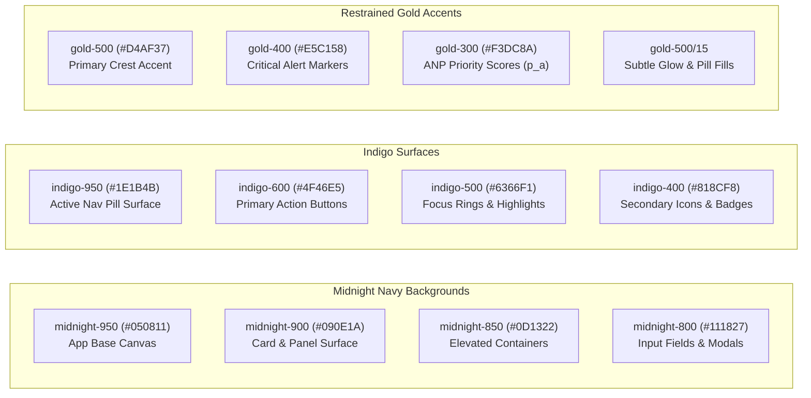
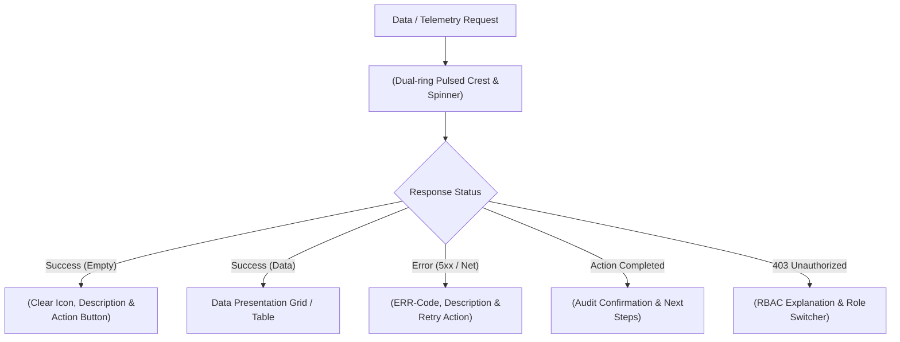

# LuminaFM Frontend Design System & UI Architecture

## 1. Executive Summary & Design System Vision

LuminaFM is designed as a mission-critical, enterprise-grade Computerized Maintenance Management System (CMMS) supporting high-pressure industrial facilities, commercial hospitality complexes, and power plants. 

The user interface rejects generic admin templates in favor of a bespoke, high-contrast, dark-mode design system tailored for engineering environments:
- **Midnight Navy Backgrounds:** Layered dark surfaces eliminating eye fatigue in low-light boiler rooms and control rooms.
- **Indigo Interactive Surfaces & Navigation:** Cohesive indigo hues providing structural clarity and interactive depth.
- **Restrained Luxury Gold Accents:** Strategic amber/gold highlights reserved for high-priority engineering alerts, Saaty ANP decision indicators, and brand crests.
- **Accessible Contrast & Clear Typography:** High-contrast text pairings conforming to WCAG 2.1 AA/AAA standards (Inter for body prose, JetBrains Mono / Fira Code for telemetry signals and asset codes).
- **Industrial Glove-Friendly Touch Targets:** Strictly enforced $\ge 44 \times 44$px touch targets across buttons, form controls, and navigation items for tablet and mobile floor operation.
- **Strict Separation of Concerns:** Pure presentation components with zero embedded business logic, isolated in `frontend/src/components/ui/`.

---

## 2. Visual Design System & Design Tokens

### 2.1 Color Palette & Semantic Tokens

| Token Name | Hex / Class | Semantic Application |
| :--- | :--- | :--- |
| `midnight-950` | `#050811` | Root application background canvas, fixed backdrop overlays |
| `midnight-900` | `#090E1A` | Card containers, sidebar panels, modal surfaces |
| `midnight-850` | `#0D1322` | Hero banners, elevated cards, interactive hovers |
| `midnight-800` | `#111827` | Form inputs, dropdown menus, table headers |
| `indigo-950` | `#1E1B4B` | Active navigation pill backgrounds, subtle glow surfaces |
| `indigo-600` | `#4F46E5` | Primary action buttons (`lumina-btn-primary`), primary badges |
| `indigo-500` | `#6366F1` | Focus ring indicators (`focus:ring-indigo-500/50`), hover borders |
| `gold-500` | `#D4AF37` | Luxury brand crest, primary gold buttons, active borders |
| `gold-400` | `#E5C158` | Critical boiler threshold alerts, ANP priority indicators |
| `gold-300` | `#F3DC8A` | High-contrast accent text, active tab indicators |

---

## 3. Reusable Component Library (`frontend/src/components/ui/`)

All components are strictly presentation-driven, accept standard HTML attributes and callbacks, and enforce accessible touch targets:

### 3.1 `Button.tsx`
- **Variants:**
  - `primary`: Solid indigo (`#4F46E5`) with subtle glow shadow.
  - `gold`: Translucent gold surface (`bg-gold-500/15`) with gold border and glow.
  - `secondary`: Midnight navy surface with slate border.
  - `danger`: Dark rose surface (`bg-rose-950/70`) with rose border.
  - `ghost`: Transparent surface with slate hover highlight.
- **Sizes:** `sm` (min-h 38px), `md` (min-h 44px), `lg` (min-h 50px).
- **Features:** Built-in `isLoading` spinner, `leftIcon`, `rightIcon`, keyboard focus ring, touch-target compliant.

### 3.2 `Card.tsx`
- **Variants:** `default`, `interactive` (hover glow & subtle lift), `accent-gold` (top gold accent border), `accent-indigo`.
- **Sub-components:** `CardHeader`, `CardTitle`, `CardDescription`, `CardContent`, `CardFooter`.

### 3.3 `Input.tsx` & `Select.tsx`
- **Features:** Floating labels, optional required indicator (`*`), `leadingIcon`, `trailingIcon`, helper text, accessible error display with `aria-invalid`.
- **Focus States:** High-visibility focus ring (`focus:border-indigo-500 focus:ring-2 focus:ring-indigo-500/50`).

### 3.4 `Badge.tsx` & `StatusBadge.tsx`
- **Tones:** `gold`, `indigo`, `emerald`, `amber`, `rose`, `slate`.
- **Animations:** Optional pulsating status dot (`pulseDot: true`) for active boiler maintenance and critical alarms.
- **Domain Mappings:** `AssetStatusBadge`, `CriticalityBadge`, `WorkOrderStatusBadge`.

### 3.5 `Modal.tsx`
- **Features:** Accessible modal dialog with focus trap, backdrop blur (`bg-midnight-950/80`), Escape key dismissal, scroll lock, header, body, and action footer.
- **Sizes:** `sm` (max-w-md), `md` (max-w-lg), `lg` (max-w-2xl), `xl` (max-w-4xl).

### 3.6 `Tabs.tsx`
- **Features:** Accessible horizontal tab bar with active gold pill highlight, count badges, and keyboard navigation.

---

## 4. Standardized Component States

Every asynchronous view implements dedicated, professional states rather than raw text:

| State Component | Purpose & Visual Elements |
| :--- | :--- |
| **`LoadingState.tsx`** | Dual-ring pulsed flame crest with rotating indigo spinner, title, descriptive subtext, and ARIA `role="status"`. Includes `Skeleton` and `SkeletonCard` bone loaders. |
| **`EmptyState.tsx`** | Rounded midnight container with centered icon, heading, clear guidance text, and primary/secondary action triggers. |
| **`ErrorState.tsx`** | Crimson/rose container (`bg-rose-950/20`), error code badge (`ERR-503`), detailed message, and a primary retry button (`onRetry`). |
| **`SuccessState.tsx`** | Emerald container (`bg-emerald-950/20`), checkmark crest, action summary, and next-step button. |
| **`ForbiddenState.tsx`** | Gold shield icon, active role display, required role/permission matrix, return link, and an instant 1-click role switcher. |

---

## 5. Multi-Tenant White-Labeling & Brand Fallback

LuminaFM maintains a strict distinction between the core platform identity and tenant client branding:

### 5.1 Dynamic Logo Replacement (`BrandLogo.tsx`)
1. **Client Logo Active:** When `organization.logo_uri` is present (uploaded via `PATCH /api/organization/settings` or selected from presets):
   - Renders the custom client logo inside a high-contrast container.
   - Displays the client's corporate display name and uppercase organization code badge.
   - Optionally renders a restrained `• LuminaFM Core` platform badge.
2. **Graceful Platform Fallback:** When `logo_uri` is null or fails to load (`onError` event):
   - Gracefully renders the master LuminaFM crest with gradient indigo shield and glowing gold flame.
   - Displays `LuminaFM Enterprise CMMS • ANP Decision Engine`.
   - Never breaks layout or leaves broken image boxes.

### 5.2 Real-Time Header Synchronization
Updates to organization branding in [OrganizationSettingsPage.tsx](file:///e:/My%20Owns/frontend/src/pages/OrganizationSettingsPage.tsx) immediately reflect in:
- Top header navigation bar across all views.
- Mobile and tablet portrait slide-over drawers.
- Dedicated live inspection card on the settings page.

---

## 6. Role-Aware Navigation & Protected Layouts

### 6.1 Enterprise Role Catalog (`UserRole`)
LuminaFM defines 4 distinct industrial user roles:

| Role Name | Scope & Responsibilities | Accessible Navigation Modules |
| :--- | :--- | :--- |
| **Organization Admin** | Full facility administrative oversight, tenant branding, user management, and configuration. | Command Center, Asset Master, Boiler Logbook, Work Management, Decision Governance, White-Label & Org Settings (6/6 modules) |
| **Plant Reliability Engineer** | Engineering analytics, ANP decision governance, supermatrix validation, and work orders. | Command Center, Asset Master, Boiler Logbook, Work Management, Decision Governance (5/6 modules; Settings hidden) |
| **Boiler Plant Operator** | Floor telemetry entry, shift logbooks, checklist completion, and abnormal observations. | Command Center, Asset Master, Boiler Logbook, Work Management (4/6 modules; Governance and Settings hidden) |
| **Maintenance Technician** | Execution of preventive maintenance plans, corrective repairs, labor tracking, and evidence upload. | Command Center, Asset Master, Boiler Logbook, Work Management (4/6 modules; Governance and Settings hidden) |

### 6.2 Protected Application Route Guards (`ProtectedRoute`)
Routes in [App.tsx](file:///e:/My%20Owns/frontend/src/App.tsx) are guarded by role and permission:
- Accessing `/governance` requires `Organization Admin` or `Plant Reliability Engineer`.
- Accessing `/settings` requires `Organization Admin`.
- When an unauthorized role navigates directly to a restricted URL, they are presented with `<ForbiddenState />` displaying their current role, the required role, and an option to switch roles.

### 6.3 Interactive Role Switcher
For seamless demonstration and evaluation:
- Both the [TopNavbar.tsx](file:///e:/My%20Owns/frontend/src/components/layout/TopNavbar.tsx) and [Sidebar.tsx](file:///e:/My%20Owns/frontend/src/components/layout/Sidebar.tsx) feature an instant RBAC Role Switcher dropdown.
- Selecting any role immediately re-filters the navigation menu, updates permission guards, and tests the UI from that persona's exact perspective.

---

## 7. Verification & Automated Test Matrix

The frontend design system and UI architecture are verified by dedicated automated tests in `tests/frontend-design-system.test.ts`:

| Test Category | Test Case | Status |
| :--- | :--- | :--- |
| **Design System Tokens** | Midnight navy background hierarchy (`midnight-950` to `800`) | **PASS** |
| **Design System Tokens** | Indigo surfaces and navigation highlights | **PASS** |
| **Design System Tokens** | Restrained gold accent palette (`gold-600` to `300`) | **PASS** |
| **Design System Tokens** | Minimum touch target compliance ($\ge 44 \times 44$px) | **PASS** |
| **RBAC Navigation** | Registration of all 4 standardized enterprise roles | **PASS** |
| **RBAC Navigation** | Permission matrix definitions per role | **PASS** |
| **RBAC Navigation** | Exposing all 6 modules to Organization Admin | **PASS** |
| **RBAC Navigation** | Hiding Settings from Plant Reliability Engineer while keeping Governance | **PASS** |
| **RBAC Navigation** | Restricting Boiler Plant Operator to floor operations | **PASS** |
| **RBAC Navigation** | Restricting Maintenance Technician to work execution | **PASS** |
| **White-Label Branding** | Resolving custom client logo when `logoUri` is valid | **PASS** |
| **White-Label Branding** | Graceful fallback to default LuminaFM branding when `logoUri` is null | **PASS** |
| **White-Label Branding** | Distinction between LuminaFM platform core and client branding | **PASS** |
| **Component States** | Deterministic error state with code and retry handler | **PASS** |
| **Component States** | Empty state contract with actionable filter reset trigger | **PASS** |
| **Component States** | ForbiddenState format with RBAC explanation and role switch | **PASS** |

### Build & Test Suite Summary
- **Frontend Design System Tests:** 16 / 16 passed (100%)
- **ANP & Operational Integration Tests:** 50 / 50 passed (100%)
- **Full Project Regression Test Suite:** **289 / 289 passed (100%)**
- **Frontend Build (`tsc -b && vite build`):** **0 errors (1,630 modules transformed)**
- **Backend Type Check (`npx tsc --noEmit`):** **0 errors**
