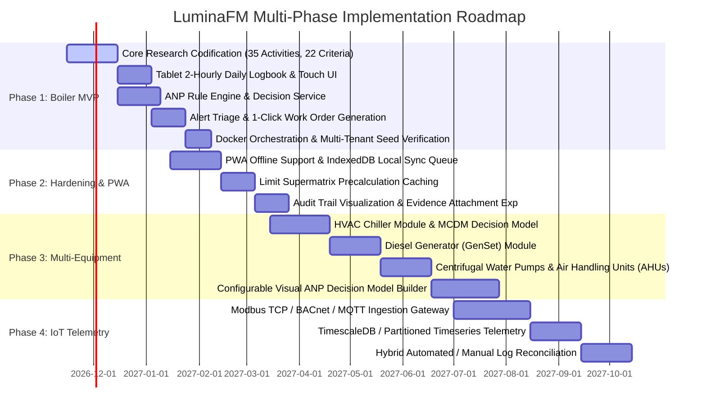
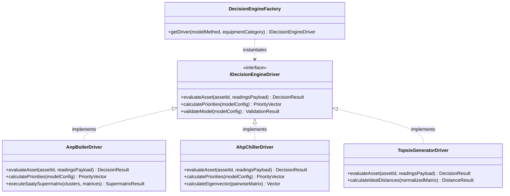

# LuminaFM - Implementation Roadmap & Future Equipment Expansion Specification
## Phased Architectural Evolution: From Academic Boiler Prototype to Enterprise Multi-Asset CMMS

- **Platform**: LuminaFM Enterprise CMMS
- **Lead Author**: Principal Software Architect & Decision Science Technical Lead
- **Horizon**: Phase 1 (MVP) through Phase 4 (Industrial IoT Telemetry)

---

## 1. Multi-Phase Roadmap Overview

The strategic engineering vision for LuminaFM is to preserve the intellectual rigor of the original University of Moratuwa boiler research while methodically generalizing the platform into a multi-equipment facility asset management suite.

---

## 2. Phase Breakdown and Deliverables

### Phase 1: Commercial Boiler MVP (Kingsbury Baseline)
*Objective: Full commercial delivery of the research-backed 1,100 kg/h oil-fired fire-tube boiler module.*
- **Milestones**:
  1. **Data Seed & Hierarchy Instantiation**: Seed Kingsbury Hotel tenant, Site complex, Basement Boiler Room (`LOC-BLR-RM-01`), Steam Generation system (`SYS-STM-01`), and Asset `BLR-001` with its 10 validated subcomponents.
  2. **Codification of 35 Maintenance Activities**: Instantiate `maintenance_task_templates` and `decision_alternatives` with exact thematic codes (`FPMA 1` through `BSMA 2`).
  3. **2-Hourly Daily Monitoring Interface**: Responsive, glove-friendly data entry UI (`DailyBoilerMonitoringPage.tsx`) featuring 44px touch targets, client validation, and real-time range bounds.
  4. **ANP Decision Service Core & Operational Integration**: Deterministic empirical threshold evaluation linked to Saaty network priority weighting ($W^\infty$), data quality scoring, 10-step telemetry pipeline, and proportional criteria attribution.
  5. **Safety Interlock Separation & Certified Sign-off**: Independent ASME BPVC safety escalation alerts (LWCO trip, overpressure, stack fire, acidic pH) completely separated from ANP trade-offs, mandatory physical on-site certified engineer sign-off for safety-critical tiers, and automated Work Order conversion.
  6. **Deterministic Decision Replay Engine**: Bit-for-bit replayability from immutable input snapshots with $\max \Delta p_a < 10^{-4}$ tolerance.
  7. **Security & Auditability**: JWT authentication, bcrypt password hashing, and Prisma middleware intercepting all updates/deletes into `audit_logs`.
  8. **Containerization**: Validated Docker Compose deployment with PostgreSQL health checks and automated migrations.

### Phase 2: Platform Hardening & Offline Resilience
*Objective: Eliminate floor operational risks, guarantee offline reliability, and optimize computational performance.*
- **Milestones**:
  1. **Progressive Web App (PWA) Offline Engine**:
     - ServiceWorker caching of static assets and checklist schemas.
     - Client-side IndexedDB queue for shift logs recorded in underground basements without Wi-Fi/cellular connection.
     - Background sync protocol with idempotency keys (`client_log_uuid`) to prevent duplicate submissions upon reconnection.
  2. **Computational Performance & Supermatrix Caching**:
     - Decouple real-time alert evaluation from intensive matrix power iterations ($W^{2k+1}$).
     - Cache precomputed Limit Supermatrices in Redis or memory store; invalidate and recalculate only upon administrative criteria/benchmark configuration updates.
  3. **Reporting & Historical Analytics**:
     - Visual trend charting for Flue Gas Temp, Steam Pressure, and Fuel Efficiency.
     - Executive PDF compliance reports for statutory boiler inspections and insurance audits.

### Phase 3: Multi-Equipment Category Expansion (Chillers, Pumps, Generators)
*Objective: Generalize the platform beyond boilers to manage comprehensive building engineering services.*
- **Milestones**:
  1. **Generic Equipment Category Engine**:
     - Leverage `attribute_definitions`, `category_attributes`, and `asset_attribute_values` to define equipment-specific schemas without altering table structures.
  2. **Centrifugal Chiller Module**:
     - Equipment Typology: Water-cooled and air-cooled centrifugal chillers.
     - Subsystems: Compressor, Condenser, Evaporator, Expansion Valve, Oil Separator, Cooling Tower.
     - Criteria: Approach Temperature, Evaporator Pressure, Condenser Water Delta-T, Compressor Oil Pressure/Level, Vibration Amplitudes.
     - Decision Model: ANP model evaluating tube fouling, refrigerant leaks, and compressor bearing wear.
  3. **Diesel Generator (GenSet) Emergency Power Module**:
     - Subsystems: Diesel Prime Mover, Alternator, Fuel Transfer Day Tank, Starter Battery Bank, Jacket Water Pre-Heater, Radiator/Cooling.
     - Criteria: Battery Terminal Voltage, Cranking Time, Coolant Temp, Fuel Quality / Water in Fuel, Frequency Stability, Oil Pressure.
     - Decision Model: Emergency power reliability model prioritizing starter battery replacement and fuel polishing.
  4. **Centrifugal Pumping Systems Module**:
     - Subsystems: Chilled water primary/secondary pumps, domestic booster sets, sewage submersible pumps.
     - Criteria: Suction/Discharge Head Differential, Mechanical Seal Leakage Rate, Bearing Housing Vibration, Motor Thermal Rise.
  5. **Visual Decision Model Builder**:
     - Administrative drag-and-drop web interface allowing Chief Engineers to construct custom ANP/AHP network clusters, assign criteria, define empirical benchmarks, and input Saaty pairwise comparison values directly.

### Phase 4: Industrial IoT & Telemetry Gateway
*Objective: Complement manual shift logging with automated industrial SCADA and sensor telemetry.*
- **Milestones**:
  1. **Protocol Integration Layer**:
     - Edge Gateway connectors supporting **Modbus TCP/RTU**, **BACnet/IP**, and **MQTT**.
  2. **Timeseries Data Ingestion**:
     - TimescaleDB hypertable partitioning for high-frequency telemetry ($1\text{ Hz} - 1\text{ min}$ readings).
     - Automated downsampling and aggregation into 2-hourly synthetic shift log baselines.
  3. **Hybrid Decision Reconciliation**:
     - Dual-stream decision engine: Automated telemetry continuously monitors continuous variables (pressure, temperature), while technicians record qualitative physical inspections (visual flame quality, acoustic leaks, soot deposits).

---

## 3. Generalized Multi-Equipment Architecture

To support Chillers, Generators, and Pumps without architectural redesign, LuminaFM implements an **Interface-Driven Extensible Decision Engine**:

### 3.1 Equipment Expansion Specifications

#### A. Centrifugal Water-Cooled Chillers (`CAT-CHILLER`)
- **Key Decision Criteria**:
  - Evaporator Approach Temperature ($\Delta T = T_{refrigerant} - T_{chilled\_water\_out}$): Benchmark $< 1.5^\circ$C. Departure indicates evaporator tube scaling or oil fouling.
  - Condenser Approach Temperature ($\Delta T = T_{condensing} - T_{cooling\_water\_out}$): Benchmark $< 2.0^\circ$C. Departure indicates cooling tower water scaling.
  - Compressor Oil Sump Pressure Differential: Benchmark $> 1.8$ bar. Drop triggers oil filter replacement.
  - Motor Running Current (% RLA): Benchmark $< 95\%$. Increase indicates excessive lift or non-condensable gases.
- **Maintenance Alternatives**:
  - `CHMA-01`: Condenser bundle mechanical tube brushing.
  - `CHMA-02`: Refrigerant leak check and purge cycle overhaul.
  - `CHMA-03`: Compressor lubrication oil and filter changeout.
  - `CHMA-04`: Cooling tower fill pack cleaning and biocide dosing.

#### B. Standby Diesel Generators (`CAT-GENSET`)
- **Key Decision Criteria**:
  - Starter Battery Terminal Float Voltage: Benchmark $26.8 - 27.2\text{ VDC}$ (24V system). Drop below $24.0\text{ VDC}$ during cranking triggers immediate battery replacement.
  - Engine Jacket Water Temperature (Standby): Benchmark $40^\circ\text{C} - 50^\circ\text{C}$. Drop indicates block heater element failure.
  - Fuel Storage Water Contamination (Paste Test): Benchmark $0\text{ mm}$. Water detected triggers bottom fuel drainage.
  - Lube Oil Pressure at Rated Speed: Benchmark $3.5 - 5.5\text{ bar}$. Drop below $3.0\text{ bar}$ initiates shutdown.
- **Maintenance Alternatives**:
  - `GSMA-01`: Starter lead-acid battery string replacement.
  - `GSMA-02`: Day tank fuel polishing and water separation filter replacement.
  - `GSMA-03`: Engine jacket pre-heater thermostat replacement.
  - `GSMA-04`: 250-Hour lube oil, fuel filter, and bypass element renewal.

---

## 4. Engineering Guardrails for Long-Term Scalability

1. **Database Partitioning Strategy**:
   - The `meter_readings` and `audit_logs` tables will experience high write volumes.
   - For production scale, implement monthly range partitioning on `meter_readings (recorded_at)` and `audit_logs (created_at)` to guarantee constant-time indexing and enable cheap partition truncation for archiving.
2. **Immutable Traceability**:
   - `decision_runs`, `audit_logs`, and `inspection_responses` must be strictly append-only. No `UPDATE` or `DELETE` API endpoints shall ever be exposed for these tables.
3. **Strict Validation Boundaries**:
   - All dynamic input fields must enforce data-type enforcement in the Application Layer before touching the database, ensuring typed values populate the correct column in `asset_attribute_values` (`text_value`, `numeric_value`, `boolean_value`, `date_value`).
4. **Idempotent Operations**:
   - All seed scripts, migration routines, and batch calculations must be strictly idempotent, using deterministic UUID generation (`uuidv5` based on namespace and business code) where fixed references are required.
