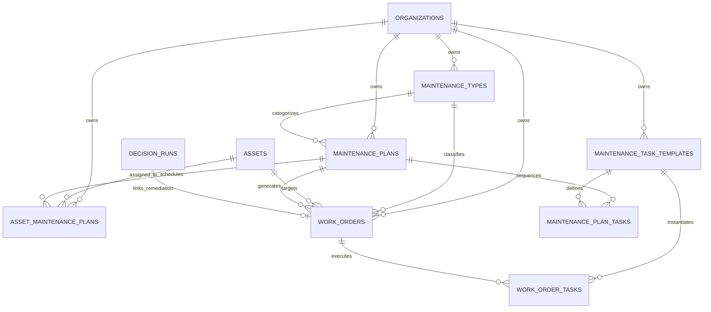
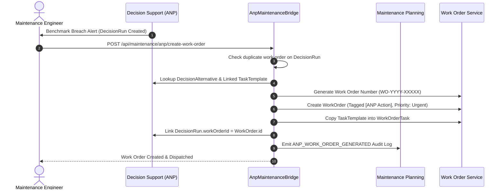

# LuminaFM Maintenance Planning & Preventive Scheduling Architecture

## 1. Executive Summary & Architectural Governance

In heavy industrial operations—such as commercial boiler houses, central chiller plants, and critical power infrastructure—unplanned equipment downtime causes immense operational losses and catastrophic safety hazards. LuminaFM addresses this through a robust, decoupled **Maintenance Planning & Preventive Scheduling Module**.

### Core Architecture Pillars

1. **Reusable Task Template Catalog**: Engineering supervisors author standardized maintenance task templates with step-by-step instructions, safety protocols, required skills, and duration estimates that can be shared across equipment classes.
2. **Flexible Recurrence Triggers**: Supports Calendar-based (fixed intervals), Usage/Operating-Hour-based (meter thresholds with utilization rate projections), Inspection-based, and One-Time preventive plans.
3. **Timezone-Safe Scheduling**: Normalizes all day boundaries to the tenant's operational timezone (e.g. `Asia/Colombo`, `America/New_York`, or `UTC`) while persisting immutable UTC timestamps in PostgreSQL.
4. **Real-Time Due & Overdue Engine**: Calculates categorical statuses (`OVERDUE`, `DUE`, `UPCOMING`, `ON_SCHEDULE`, `INACTIVE`), computes exact days/hours overdue, and generates a dynamic urgency score to prioritize work orders.
5. **Duplicate-Generation Prevention**: Enforces strict idempotency checks to prevent redundant work orders from being created while an active work order remains open for the same asset and maintenance plan.
6. **Decoupled ANP Decision Integration**: Routine preventive schedules execute completely independently of the Analytic Network Process (ANP) engine. Approved ANP recommendations interface through a controlled, audited integration bridge (`AnpMaintenanceBridge`).

---

## 2. Relational Database Schema & Data Models

The module builds upon seven core tables in PostgreSQL, enforced by multi-tenant Row-Level Security:



### 2.1 Entity Model Overview

1. **`maintenance_types`**:
   - Classifies maintenance strategies: `PM` (Preventive Maintenance), `CM` (Corrective Maintenance), `CBM_ANP` (Condition-Based ANP Maintenance), `INSPECTION` (Routine Inspection), `OVERHAUL` (Major Overhaul).
2. **`maintenance_task_templates`**:
   - Reusable operations catalog. Fields: `code`, `title`, `description`, `asset_category_id`, `estimated_duration_minutes`, `safety_instructions`, `required_skills` (JSONB array), `is_active`.
3. **`maintenance_plans`**:
   - Plan configuration: `code`, `name`, `maintenance_type_id`, `recurrence_type` (`calendar`, `meter`, `condition`, `one_time`), `interval_value`, `interval_unit` (`days`, `weeks`, `months`, `years`, `hrs`), `meter_definition_id`, `lead_time_days`, `priority`, `is_active`.
4. **`maintenance_plan_tasks`**:
   - Ordered checklist linking plan to task templates (`sequence_no`, `is_mandatory`).
5. **`asset_maintenance_plans`**:
   - Concrete schedule binding an asset to a plan: `start_date`, `end_date`, `next_due_at`, `last_completed_at`, `is_active`.
6. **`work_orders` & `work_order_tasks`**:
   - Dispatched work execution records. Tasks are populated directly from the plan's task templates.

---

## 3. Scheduling & Recurrence Engine

The engine is encapsulated in [src/modules/maintenance/schedule-calculator.ts](file:///e:/My%20Owns/src/modules/maintenance/schedule-calculator.ts).

### 3.1 Calendar-Based Maintenance
- **Interval Support**: `days`, `weeks`, `months`, `years`, `hours`.
- **Month Length & Leap Year Normalization**: Adding 1 month to `January 31` automatically clamps to `February 28` (or `29` in leap years) without calendar overflow.
- **Anchor Semantics**:
  - If `lastCompletedAt` exists: `nextDueAt = lastCompletedAt + interval`.
  - If never completed: `nextDueAt = startDate + interval`.

### 3.2 Usage / Operating-Hour-Based Maintenance
For assets with cumulative meters (e.g., boiler runtime hours, pump operating hours):
- **Formulae**:
  $$\text{Usage Since Last Maintenance} = \text{Current Reading} - \text{Reading At Last Maintenance}$$
  $$\text{Target Due Reading} = \text{Reading At Last Maintenance} + \text{Interval Value}$$
  $$\text{Usage Remaining} = \text{Target Due Reading} - \text{Current Reading}$$
  $$\text{Percent Consumed} = \left(\frac{\text{Usage Since Last Maintenance}}{\text{Interval Value}}\right) \times 100\%$$
- **Utilization Rate Projection**: Given an average daily utilization rate (e.g. 10 hours/day):
  $$\text{Days Remaining} = \frac{\text{Usage Remaining}}{\text{Daily Average Rate}}$$
  $$\text{Projected Next Due Date} = \text{Reference Date} + \text{Days Remaining}$$
- When $\text{Usage Remaining} \le 0$, the schedule is marked **`DUE`** or **`OVERDUE`** with the exact units overdue.

---

## 4. Maintenance Due & Overdue Tracking

Every active schedule is evaluated against the current timestamp or reference date:

| Categorical Status | Condition | Meaning |
| :--- | :--- | :--- |
| **`OVERDUE`** | $\text{now} > \text{nextDueAt}$ or $\text{usageRemaining} < 0$ | Past scheduled due date/meter. Requires immediate operational attention. |
| **`DUE`** | $\text{nextDueAt} - \text{now} \le 24\text{ hours}$ or $\text{usageRemaining} \le 0$ | Due today or within the current 24-hour shift. |
| **`UPCOMING`** | $\text{nextDueAt} - \text{now} \le \text{leadTimeDays} \times 24\text{h}$ | Inside advance notice window (staging parts/permits). |
| **`ON_SCHEDULE`** | $\text{nextDueAt} - \text{now} > \text{leadTimeDays} \times 24\text{h}$ | Normal operational state. |
| **`INACTIVE`** | $\text{isActive} = \text{false}$ | Schedule paused or asset temporarily decommissioned. |

### Engineering Urgency Score Formula

To prioritize dispatching when hundreds of schedules are active:
$$\text{Urgency Score} = (\text{Base Urgency} + \text{Days Overdue} \times 10) \times \text{Priority Weight}$$

Where Priority Weights are:
- `Urgent`: $\times 4.0$
- `High`: $\times 2.5$
- `Medium`: $\times 1.5$
- `Low`: $\times 1.0$

---

## 5. Duplicate-Generation Prevention & Idempotency

A critical defect in legacy CMMS platforms is the automated generation of dozens of duplicate work orders if a schedule is overdue for multiple cycles. LuminaFM prevents this via:

1. **Active Work Order Check**:
   Before generating a work order for an `(assetId, maintenancePlanId)`, the engine queries for existing work orders with statuses:
   `draft`, `open`, `approved`, `assigned`, `in_progress`, `on_hold`.
2. **Conflict Enforcement**:
   - If an active work order exists, the generator blocks duplicate generation by throwing `DuplicateWorkOrderError` (HTTP 409).
   - In batch generation mode (`batchGenerateDueWorkOrders`), existing active work orders are safely skipped and reported in `skippedDuplicatesCount`.
   - Authorized supervisors can pass `forceGenerate: true` to bypass the guard for emergency operational overrides.
3. **Schedule Cycle Advancement**:
   Upon work order completion (`recordWorkOrderCompletion`), `lastCompletedAt` is updated to the completion timestamp, and `nextDueAt` automatically advances to the subsequent cycle.

---

## 6. Schedule Modifications & Audit Trail

Modifying maintenance schedules in regulated environments (e.g. pressure vessels, life safety) requires strict accountability:

- **Rescheduling (`rescheduleAssetPlan`)**:
  - Updates `nextDueAt`.
  - Enforces mandatory `reason` text.
  - Automatically writes an immutable audit record to `audit_logs` (`SCHEDULE_RESCHEDULED`, recording previous due date, new due date, user, and reason).
- **Pausing / Resuming (`toggleAssetPlanStatus`)**:
  - Allows seasonal shutdowns or overhaul periods to pause schedules.
  - Logs `SCHEDULE_PAUSED` / `SCHEDULE_RESUMED` events in `audit_logs`.
- **History Inspection (`getScheduleHistory`)**:
  - Retrieves chronological audit trail for any asset maintenance assignment.

---

## 7. Controlled ANP Recommendation Integration

### 7.1 Independence Principle
Schedule execution, due calculations, and routine work order generation run **100% independently of the ANP decision support engine**. The maintenance module functions completely if ANP is disabled or unconfigured.

### 7.2 Controlled Integration Bridge (`AnpMaintenanceBridge`)
When an ANP evaluation produces an approved recommendation (e.g. after a thermal excursion or vibration benchmark breach):



- **Traceability**: The resulting `work_orders` record is explicitly linked to `decision_runs.workOrderId`.
- **Alternative Task Mapping**: If the top ANP alternative links to a `MaintenanceTaskTemplate`, its instructions and safety procedures are automatically populated into `work_order_tasks`.
- **Proposing Plan Modifications**: `proposePlanAssignmentFromAnp` allows chronic ANP excursion patterns to propose adjusting routine PM frequency.

---

## 8. REST API Reference

All routes require `Authorization: Bearer <token>` and valid tenant context.

| Category | Method | Endpoint | Description |
| :--- | :--- | :--- | :--- |
| **Task Templates** | `POST` | `/api/maintenance/task-templates` | Create reusable task template |
| | `GET` | `/api/maintenance/task-templates` | List task templates (filter by category, active) |
| | `GET` | `/api/maintenance/task-templates/:id` | Get task template by ID or code |
| | `PATCH` | `/api/maintenance/task-templates/:id` | Update task template |
| | `DELETE` | `/api/maintenance/task-templates/:id` | Delete task template |
| **Maintenance Types** | `POST` | `/api/maintenance/types` | Create maintenance type |
| | `GET` | `/api/maintenance/types` | List maintenance types |
| | `GET` | `/api/maintenance/types/:id` | Get maintenance type |
| **Maintenance Plans** | `POST` | `/api/maintenance/plans` | Create preventive maintenance plan |
| | `GET` | `/api/maintenance/plans` | List maintenance plans |
| | `GET` | `/api/maintenance/plans/:id` | Get maintenance plan with tasks |
| | `PATCH` | `/api/maintenance/plans/:id` | Update maintenance plan |
| | `DELETE` | `/api/maintenance/plans/:id` | Delete maintenance plan |
| | `POST` | `/api/maintenance/plans/:planId/tasks` | Add task template to plan |
| | `DELETE` | `/api/maintenance/plans/:planId/tasks/:taskId` | Remove task template from plan |
| **Asset Schedules** | `POST` | `/api/maintenance/asset-plans` | Assign maintenance plan to asset |
| | `GET` | `/api/maintenance/asset-plans` | List asset maintenance assignments |
| | `GET` | `/api/maintenance/asset-plans/:id` | Get asset maintenance plan details |
| | `POST` | `/api/maintenance/asset-plans/:id/reschedule` | Reschedule due date with audit reason |
| | `PATCH` | `/api/maintenance/asset-plans/:id/status` | Pause / Resume schedule |
| | `GET` | `/api/maintenance/asset-plans/:id/history` | Get schedule change audit history |
| **Due & Overdue** | `GET` | `/api/maintenance/due-summary` | Portfolio summary of overdue, due, upcoming |
| | `GET` | `/api/maintenance/asset-plans/:id/due-status` | Real-time due status for single assignment |
| **Work Orders** | `POST` | `/api/maintenance/asset-plans/:id/generate-work-order` | Generate work order with duplicate prevention |
| | `POST` | `/api/maintenance/batch-generate-work-orders` | Batch scan and generate due work orders |
| | `POST` | `/api/maintenance/asset-plans/:id/complete` | Record completion & advance recurring cycle |
| **ANP Bridge** | `POST` | `/api/maintenance/anp/create-work-order` | Generate targeted work order from ANP run |
| | `POST` | `/api/maintenance/anp/propose-plan` | Propose schedule modification from ANP run |

---

## 9. Verification & Automated Test Coverage

Verified by 26 automated integration and unit tests in [tests/maintenance-planning.test.ts](file:///e:/My%20Owns/tests/maintenance-planning.test.ts):

```
✓ tests/maintenance-planning.test.ts (26 tests) 241ms
  ✓ 1. Timezone-Safe Schedule Arithmetic & Date Intervals
    ✓ should add days interval accurately without time drift
    ✓ should add weeks interval accurately
    ✓ should add months interval safely handling month lengths
    ✓ should add years interval accurately
    ✓ should calculate next calendar due date anchored to lastCompletedAt when completed
    ✓ should calculate next calendar due date from startDate when never completed
  ✓ 2. Usage & Operating-Hour-Based Calculations
    ✓ should compute remaining hours and percent consumed when not yet due
    ✓ should flag maintenance as DUE and calculate overdue units when threshold is exceeded
  ✓ 3. Maintenance Due Status & Overdue Evaluation
    ✓ should classify schedule as OVERDUE with days and hours overdue metrics
    ✓ should classify schedule as DUE when within 24 hours of due date
    ✓ should classify schedule as UPCOMING when inside lead-time advance window
    ✓ should classify schedule as ON_SCHEDULE when beyond lead-time window
    ✓ should return INACTIVE status when assignment is paused/inactive
  ✓ 4. Reusable Task Templates Management
    ✓ should create a reusable task template with safety instructions and required skills
    ✓ should reject creating task template with duplicate code in same organization
  ✓ 5. Preventive Maintenance Plans & Task Linkages
    ✓ should reject calendar plan without interval value or unit
    ✓ should reject meter-based plan without meter definition id
  ✓ 6. Asset-Plan Assignments, Rescheduling & Audit Logs
    ✓ should assign maintenance plan to asset and log SCHEDULE_ASSIGNED audit event
    ✓ should reschedule asset plan due date, update record, and log SCHEDULE_RESCHEDULED with reason
    ✓ should toggle schedule pause and resume with audit trail
  ✓ 7. Work Order Generation & Duplicate Prevention
    ✓ should generate Work Order copying reusable tasks from maintenance plan
    ✓ should REJECT generating duplicate work order when an active work order already exists
    ✓ should advance recurring nextDueAt upon recordWorkOrderCompletion
  ✓ 8. Controlled ANP Recommendation Integration
    ✓ should generate targeted work order from approved ANP recommendation with bidirectional linkage
    ✓ should propose new preventive plan assignment based on ANP findings
  ✓ 9. Due & Overdue Portfolio Summary
    ✓ should aggregate and categorize maintenance assignments into overdue, due, upcoming, and on-schedule
```

### Full Regression Suite Status
- **221 tests passed (100% success)** across 7 test suites:
  - `tests/maintenance-planning.test.ts` (26 tests)
  - `tests/equipment-attribute-engine.test.ts` (21 tests)
  - `tests/asset-registry-generic.test.ts` (17 tests)
  - `tests/auth-and-organization-management.test.ts` (24 tests)
  - `tests/tenant-authorization-security.test.ts` (105 tests)
  - `tests/tenant-isolation.test.ts` (26 tests)
  - `tests/seed-idempotency.test.ts` (2 tests)
- **TypeScript Static Verification**: `npx tsc --noEmit` exited with 0 errors.
