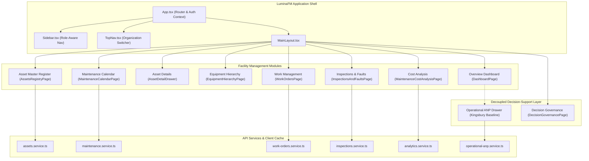

# LuminaFM Management Interface Architecture & Technical Specifications

## Executive Summary

The **LuminaFM Management Interface** delivers a unified, enterprise-grade Computerized Maintenance Management System (CMMS) user interface built with React 18, TypeScript 5, and Tailwind CSS. The design system is engineered specifically for high-reliability industrial operations, featuring midnight navy backgrounds, indigo elevation surfaces, restrained gold accents, and strict WCAG AA accessible contrast.

The management interface cleanly decouples generic facility and multi-asset management capabilities (boilers, chillers, pumps, emergency generators, and air handling units) from specialized boiler Analytic Network Process (ANP) multi-criteria decision algorithms.

---

## 1. System Architecture & Component Hierarchy

---

## 2. Implemented Management Capabilities

### 2.1 Overview Dashboard (`DashboardPage.tsx`)
- **Key Performance Indicators (KPIs)**: Total Assets (48), Active Work Orders (4), PM Compliance Rate (96.2%), Maintenance Spend MTD (LKR 170,000, 72% proactive ratio), MTBF (1,768 hrs).
- **Critical Safety Advisory**: High-priority alert banner with direct escalation and work order link, strictly decoupled from ANP scoring.
- **Dual Management Grid**: Live registers of active work orders, upcoming preventive maintenance schedules, physical/technical hierarchy preview, and recent operator abnormality reports.
- **Role-Aware Information**: Masks financial rates and budget metrics for operator and technician roles.
- **Decoupled ANP Module**: Collapsible decision drawer accessible on demand for multi-criteria boiler maintenance ranking.

### 2.2 Asset Master Register (`AssetsRegistryPage.tsx`)
- **Multi-Dimensional Filtering**: Real-time filtering by site, asset category, operational status, and text search query.
- **Multi-Column Sorting**: Bidirectional sorting by Asset Code, Name, Category, Criticality rank, and Operational Status.
- **Data Export**: Single-click export to CSV (RFC 4180 compliant with UTF-8 BOM for Microsoft Excel) and structured JSON.
- **Direct Navigation**: Seamless linkage to Equipment Hierarchy Explorer and Asset Details.

### 2.3 Asset Details Drawer (`AssetDetailDrawer.tsx`)
- **Dual Hierarchy Placement**: Visual badges and breadcrumbs for Physical Space (Site $\rightarrow$ Building $\rightarrow$ Room) and Technical System (System $\rightarrow$ Subsystem).
- **Dynamic Equipment Attributes Engine**: Live rendering and inline editing of dynamic specifications (e.g., maximum steam pressure, design evaporation capacity, burner manufacturer, efficiency benchmark).
- **Transactional Audit Preservation**: Versioned attribute changes preventing historical log corruption.

### 2.4 Equipment Hierarchy Explorer (`EquipmentHierarchyPage.tsx`)
- **Dual Independent DAG Trees**:
  1. *Physical Location Tree*: Site $\rightarrow$ Building $\rightarrow$ Floor $\rightarrow$ Room $\rightarrow$ Asset.
  2. *Technical System Tree*: System $\rightarrow$ Subsystem $\rightarrow$ Component Asset.
- **Tree Visualization**: Expandable/collapsible nodes, search filtering, and node selection side-panel displaying asset criticality, model, and operational status.
- **JSON Hierarchy Export**: Export complete multi-tier facility tree structure for external auditing.

### 2.5 Maintenance Calendar & Preventive Tracking (`MaintenanceCalendarPage.tsx`)
- **Interactive Monthly Grid**: Day-by-day task allocation badges with priority color indicators (urgent, high, medium, low).
- **Preventive Maintenance Engine**:
  - Calendar-based, runtime-operating-hours, and inspection-triggered plans.
  - Overdue tracking with visual alerts and days-overdue badges.
  - One-click work order dispatch with automatic pre-population of tasks and safety lockout guidelines.
- **CSV Plan Schedule Export**: Full schedule export for maintenance planning meetings.

### 2.6 Work Management & Kanban State Machine (`WorkOrdersPage.tsx`)
- **Dual View Modes**: Interactive Kanban Board (Draft, Open, Approved, Assigned, In Progress, On Hold, Completed, Closed) and tabular register.
- **Strict State Machine**: Enforces valid transitions with required justification logging and user attribution.
- **Execution Checklist**: Task item check-off with estimated vs. actual labor hours.
- **Cost Rollup**: Live rollup of internal labor costs, consumed spare parts, and contractor fees.
- **CSV Work Order Register Export**: Export filtered orders with financial and status metrics.

### 2.7 Inspection History & Operator Fault Logging (`InspectionsAndFaultsPage.tsx`)
- **Tab 1: Inspection History**: Pass/fail/conditional indicators, audit score percentages, inspector names, and detailed checklist question-by-question modal.
- **Tab 2: Operator Observations & Faults**: Operational abnormal observations, severity badges, linked work orders, and 1-click corrective work order generation.
- **CSV Audit Logs**: Export inspection records and operator defect reports.

### 2.8 Maintenance Cost Analysis (`MaintenanceCostAnalysisPage.tsx`)
- **Spend Breakdown**: Internal technician labor, spare parts and consumables, and specialized contractor fees.
- **Proactive Maintenance Ratio**: Real-time evaluation against the world-class $70\%$ benchmark ($72.0\%$ proactive vs $28.0\%$ reactive).
- **Equipment Category Breakdown**: Visual progress bars and percentages across steam boilers, chillers, generators, pumps, and AHUs.
- **Top Cost-Driving Assets**: Pareto ranking of assets by total financial spend, corrective event count, and MTBF.
- **RBAC Financial Rate Privacy**: Restricted to `Organization Admin` and `Plant Reliability Engineer`; non-privileged users receive a confidential notice.

---

## 3. Role-Based Access Control (RBAC) Matrix

| Feature / Route | Organization Admin | Plant Reliability Engineer | Boiler Plant Operator | Maintenance Technician |
| :--- | :---: | :---: | :---: | :---: |
| **Command Center** (`/`) | Full Access | Full Access | Full Access | Full Access |
| **Asset Register** (`/assets`) | Full Access | Full Access | Read-Only | Read-Only |
| **Equipment Hierarchy** (`/hierarchies`) | Full Access | Full Access | Read-Only | Read-Only |
| **Maintenance Calendar** (`/maintenance-calendar`) | Full Access | Full Access | Read-Only | Read-Only |
| **Work Management** (`/work-orders`) | Full Access | Full Access | Read-Only | Execution & Manage |
| **Inspections & Faults** (`/inspections`) | Full Access | Full Access | Submit & Read | Submit & Read |
| **Boiler Logbook** (`/daily-monitoring`) | Full Access | Full Access | Shift Entry & Read | Read-Only |
| **Cost Analytics** (`/cost-analysis`) | Full Access | Full Access | **Hidden & Forbidden** | **Hidden & Forbidden** |
| **Decision Governance** (`/governance`) | Full Access | Full Access | **Hidden & Forbidden** | **Hidden & Forbidden** |
| **Tenant Branding** (`/settings`) | Full Access | **Hidden & Forbidden** | **Hidden & Forbidden** | **Hidden & Forbidden** |

---

## 4. Export Utility Specification (`export.utils.ts`)

### 4.1 RFC 4180 Compliance & Excel Compatibility
- **UTF-8 Byte Order Mark (`\uFEFF`)**: Automatically prepended to the CSV data payload to force Microsoft Excel on Windows to interpret text as UTF-8, preventing character encoding degradation.
- **Cell Escaping**: Every string containing double quotes (`"`), commas (`,`), or carriage returns (`\r\n`) is enclosed in double quotes with internal quotes doubled (`""`).
- **Dot-Notation Field Resolution**: Supports nested object pathing (e.g., `asset.site.name`, `costs.totalCost`).

---

## 5. Industrial Design System Standards
- **Backgrounds**: Midnight Navy (`#030712`, `#0B0F19`, `#0F172A`).
- **Surfaces**: Indigo Elevation (`#1E1B4B`, `#312E81`, `#1E293B`).
- **Accents**: Restrained Luxury Gold (`#D4AF37`, `#F59E0B`, `#FEF08A`) used exclusively for critical priorities, active states, and brand marks.
- **Touch Targets**: $\ge 44 \times 44$px bounding box on all buttons, select boxes, and inputs to facilitate gloved floor tablet operation.
