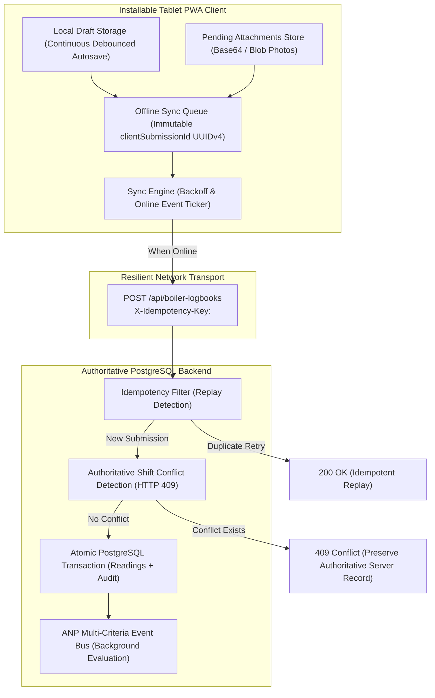
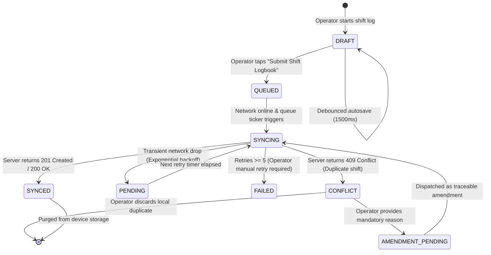

# LuminaFM Offline Data Retention & Security Policy (PWA Operator Workflows)

## Executive Summary

The **LuminaFM Offline-Capable PWA Engine** delivers continuous operational capabilities for industrial facility operators in challenging subterranean, basement, and remote environments (such as boiler plant bunkers, chiller vaults, and generator enclosures) where cellular and Wi-Fi networks frequently drop out.

This policy defines the cryptographic identification, local persistence architecture, conflict detection rules, and data retention standards that govern offline shift logbooks, safety inspections, and photo uploads.

---

## 1. Core Architectural Tenets



1. **The Server-Side PostgreSQL Database Remains Authoritative**:
   - Client devices never possess unilateral overwrite authority over finalized facility logs.
   - Server records represent the legal and regulatory compliance record of the facility.
2. **Zero Silent Overwrites**:
   - If an operator submits an offline record for an equipment shift and period that was already completed on the server by another operator, the system **never silently overwrites** the server record.
   - A `409 Conflict` is returned with the full authoritative server record snapshot, requiring explicit operator review and a mandatory justification reason to record a traceable amendment.
3. **Idempotent Network Semantics**:
   - Every completed shift logbook generated offline is stamped with an immutable, cryptographically random `clientSubmissionId` (RFC 4122 UUIDv4).
   - If a transient network failure interrupts the HTTP response after the server has committed the transaction, subsequent retries bearing the same `clientSubmissionId` return the existing record (`isIdempotentReplay: true`) without creating duplicate records or advancing log numbering.

---

## 2. Local Storage Partitioning & Multi-Tenant Security

### 2.1 Multi-Tenant Isolation
Floor tablets are frequently shared between maintenance technicians and plant operators across rotating shifts. To prevent cross-tenant or cross-user data contamination, all offline persistence keys are partitioned:
- `lumina_pwa_queue_{organizationId}_{userId}`: Immutable queued submissions.
- `lumina_pwa_drafts_{organizationId}_{userId}`: Incomplete shift drafts.
- `lumina_pwa_attachments_{organizationId}_{userId}`: Captured equipment photographs.

### 2.2 Storage Limits & Quota Management
- Modern browser IndexedDB storage provides up to $60\%$ of available disk space for installable PWAs.
- LuminaFM caps pending photographic attachments to a maximum of $5\text{MB}$ per shift entry, using image compression ($1280 \times 720\text{px}$) to prevent device storage exhaustion during multi-day network outages.

---

## 3. Synchronization Lifecycle & State Machine



### 3.1 Exponential Backoff & Jitter Algorithm
On network failures (such as `TypeError: Failed to fetch`, timeout, or HTTP 503), the synchronization engine calculates the next retry timestamp:
$$\text{Delay}_{\text{ms}} = \min\left(60000,\, 1000 \times 2^{\text{retryCount}} + \text{jitter}\right)$$
- `jitter`: Random uniform integer in $[0, 500)\text{ ms}$ to prevent thundering-herd synchronization spikes when a factory Wi-Fi access point recovers.
- `maxRetries`: Defaults to 5 attempts before marking an item as `failed` and presenting a manual "Retry Now" button to the operator.

### 3.2 Application Restart Recovery
If the tablet runs out of battery, the browser crashes, or the operator terminates the PWA while an item is in the `syncing` state:
- Upon application restart, `recoverStaleSyncingItems()` scans the local queue store.
- Any orphaned `syncing` items are automatically reset to `pending` with `nextRetryAt = now`.
- Synchronization begins as soon as network connectivity is confirmed.

---

## 4. Conflict Resolution & Traceable Amendments

When an operator returns from a prolonged offline inspection and attempts to synchronize a shift that has already been submitted by another operator (e.g. shift overlap or duplicate handoff):
1. **Server Detection**: The backend `boiler-logbook.service.ts` detects that `LOG-BLR-YYYYMMDD-HHMM` is already marked `completed` and the incoming `clientSubmissionId` differs from the existing record.
2. **HTTP 409 Conflict**: The server halts the write and responds with:
   ```json
   {
     "code": "OPERATIONAL_SYNC_CONFLICT",
     "message": "Shift logbook 'LOG-BLR-20261115-0800' was already completed by Dr. Nalin Fernando at 08:05:00.",
     "serverRecord": { ... },
     "clientSubmissionId": "8f3b2a1c-..."
   }
   ```
3. **Interactive Side-by-Side Diff (`SyncQueueDrawer.tsx`)**:
   - The PWA presents both the authoritative server record and the client offline readings.
   - The operator has two explicit options:
     - **Option 1: Submit as Traceable Amendment**: Requires a non-empty, audited justification reason (e.g., *"Re-verified steam drum pressure gauge with calibrated test manometer; amending recorded reading"*). The engine assigns a new `clientSubmissionId`, increments `baseVersion`, and records the amendment into the immutable audit trail.
     - **Option 2: Discard Local Duplicate**: Purges the redundant local item without altering the authoritative server database.

---

## 5. Secure Logout Protocol

Factory floor tablets are shared assets. An operator must never inadvertently leave uncommitted operational data visible to or modifiable by the next operator:
1. **Logout Guard (`LogoutSyncGuardModal.tsx`)**:
   - When the operator clicks "Sign Out", `checkPendingSyncBeforeLogout()` verifies the queue.
   - If pending or conflicted items exist, the modal alerts the operator with three options:
     1. **Force Sync Now & Sign Out**: Attempts immediate upload; if successful, purges local cache and terminates session.
     2. **Leave Queued on Tablet & Sign Out**: Preserves encrypted queue under `{tenantId}_{userId}` partition for the next authenticated session, while wiping all memory tokens.
     3. **Purge Local Queue & Sign Out**: Wipes uncommitted drafts and queue items immediately.
     4. **Cancel / Stay Signed In**: Returns to floor interface to review records.

---

## 6. Offline Data Retention Lifecycles

| Data Entity | Local Storage Target | Retention Period | Purge Trigger |
| :--- | :--- | :--- | :--- |
| **Incomplete Shift Drafts** | IndexedDB / Web Storage | Up to 72 hours | Tapping "Submit Shift" or explicit user draft deletion |
| **Pending Sync Queue** | IndexedDB / Web Storage | Retained indefinitely until synced | Successful server receipt (`status: 'synced'`) |
| **Photographic Attachments** | IndexedDB Blob Store | Retained until synced | Successful binary upload to cloud storage |
| **Resolved Conflicts** | Local Audit Log | 30 days locally | Periodic garbage collection after sync confirmation |
| **Session & Auth Tokens** | Memory & SessionStorage | Terminated upon logout | User sign-out or session expiration |
