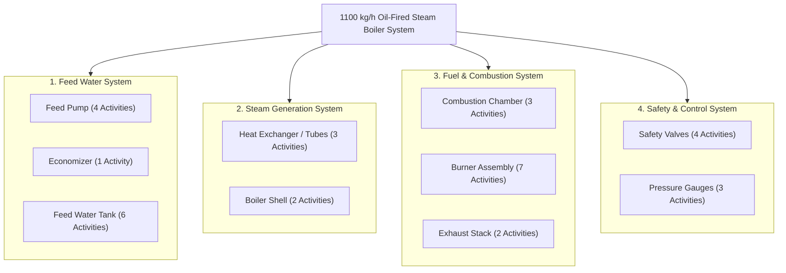
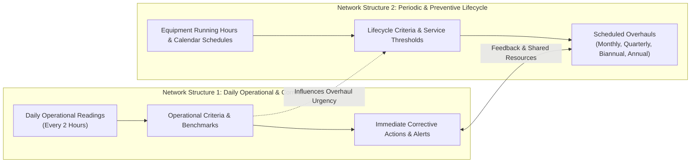
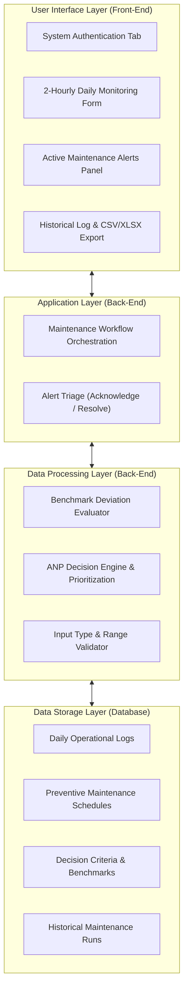

# LuminaFM - Research Requirements Specification
## Foundational Analysis of Dissertation Research for Commercial CMMS Translation

- **Source Document**: *Development of a Software-Based Boiler Maintenance Decision-Making Tool*
- **Author**: Karunapathiranage Don Vishal Prabod Perera (Index No. 202475D)
- **Institution**: Department of Building Economics, Faculty of Architecture, University of Moratuwa, Sri Lanka
- **Degree**: Bachelor of Science Honours in Facilities Management (June 2025)
- **Supervisors**: Mr. Mapa M.M.I.S. (Supervisor), Ms. Silva S.D.R.Y. (Assistant Supervisor)
- **Target Application**: LuminaFM - Intelligent Facility Maintenance Management System

---

## 1. Executive Summary & Original Research Context

In commercial and hospitality facility operations across developing economies and low-tech building environments (specifically evaluated in Sri Lanka), mechanical service systems such as steam boilers operate without continuous automated Internet-of-Things (IoT) sensor integration or advanced SCADA telemetry. Instead, facility operations rely on manual data recording in shift logbooks, periodic visual inspections, and reactive/corrective maintenance upon failure.

The original academic research by Vishal Perera (June 2025) addresses this industrial vulnerability by creating a structured, multi-criteria decision-making (MCDM) framework based on the **Analytic Network Process (ANP)**. Using manually logged operational data and periodic inspections, the system evaluates the health of critical equipment subsystems, detects operational anomalies against empirical benchmarks, and prioritizes 35 specific maintenance interventions.

This specification extracts and structures the core research findings, boundaries, mathematical framework, and component relationships to ensure complete fidelity during commercial implementation within the LuminaFM platform.

---

## 2. Research Objectives, Scope, and Boundaries

### 2.1 Research Aim and Objectives
*(Dissertation Source: Chapter 1.3, Page 4; Chapter 6.2, Pages 68–70)*

1. **Aim**: Develop a practical, software-based boiler maintenance decision-making tool utilizing manually collected operational data to support accurate, structured, and cost-effective maintenance decisions in resource-constrained facility environments.
2. **Objective 1 (Literature Synthesis)**: Conduct a comprehensive review of industrial boilers, maintenance practices, MCDM models (AHP, ANP, Fuzzy Logic, TOPSIS), and software architecture frameworks (Layered, Component-Based). *(Source: Chapter 2, Pages 7–26)*
3. **Objective 2 (Criteria & Activity Validation)**: Identify and validate boiler-specific maintenance activities, input parameters, and operational benchmarks through an iterative expert validation process with industry practitioners. *(Source: Chapter 3.4–3.5, Pages 28–30; Chapter 4.2, Pages 34–54)*
4. **Objective 3 (MCDM Model Development)**: Construct a multi-criteria decision-making model using ANP that captures feedback and interdependencies between operating readings, performance indicators, physical inspections, and preventive/periodic maintenance cycles. *(Source: Chapter 3.5.4, Pages 30–31; Chapter 4.4–4.5, Pages 55–58)*
5. **Objective 4 (Software Tool Realization)**: Design and develop a software application with an intuitive user interface enabling boiler operators to input manual logbook data, trigger decision evaluations, and receive prioritized maintenance alerts. *(Source: Chapter 4.6–4.7, Pages 59–60; Chapter 5.3, Pages 63–66)*

### 2.2 Operational Scope and Equipment Baseline
*(Dissertation Source: Chapter 1.5, Page 5; Chapter 3.6, Page 31; Chapter 4.4.1, Page 55)*

- **Equipment Category**: Industrial Oil-Fired Fire-Tube Steam Boiler.
- **Operating Capacity**: 1,000 kg/h – 1,800 kg/h steam generation capacity.
- **Primary Case Study Asset**:
  - **Facility**: The Kingsbury Hotel, Colombo, Sri Lanka.
  - **Boiler Specification**: 1,100 kg/h oil-fired fire-tube steam boiler.
  - **Working Pressure**: 8 – 9 bar nominal operating pressure (Safety valve set point: 9.0 bar).
  - **Data Collection Interval**: 2-hour manual logbook recording by shift technicians and boiler operators.
- **Exclusions**:
  - High-pressure water-tube utility boilers (power generation sector).
  - Solid-fuel (coal/biomass) and pulverised fuel boilers.
  - Superheaters (validated as absent in standard low-pressure commercial hotel boilers).

### 2.3 Research Limitations
*(Dissertation Source: Chapter 1.5, Page 5; Chapter 5.3.3, Page 66; Chapter 6.4, Page 71)*

1. **Geographic and Sample Size Constraint**: The empirical investigation was constrained to the Sri Lankan hospitality and industrial maintenance context, utilizing 5 deeply experienced industry experts ($E_1$ to $E_5$).
2. **Manual Data Sensitivity**: The decision model relies entirely on the accuracy and punctuality of human operators. Inconsistent logging or transcription errors directly impact decision outputs.
3. **Predefined Structural Logic**: The criteria, benchmarks, and maintenance alternatives were hard-configured for the 1,100 kg/h oil-fired fire-tube typology. Expanding the logic to different assets required structural software changes.
4. **Prototype Storage Limitation**: The academic prototype implemented browser-based local storage (session/localStorage), lacking multi-device synchronization, relational integrity, and durable audit persistence.

---

## 3. Expert Validation Methodology & Roster

### 3.1 Iterative Expert Validation Approach
*(Dissertation Source: Chapter 3.4.1, Pages 28–29; Chapter 3.5.1, Page 30)*

The study utilized an Iterative Expert Validation Approach (McConachie et al., 2019) across five progressive rounds ($E_1 \to E_2 \to E_3 \to E_4 \to E_5$). Feedback from each expert interview was synthesized to refine the criteria list, adjust benchmark thresholds, and eliminate non-viable academic practices.

**Retention Criterion**: To preserve theoretical integrity and ensure practical validity, any candidate maintenance activity, input parameter, or benchmark was retained in the final model **only if four or more experts ($\ge 80\%$) confirmed its industrial necessity**.

### 3.2 Expert Panel Profile
*(Dissertation Source: Chapter 3.4.1, Table 3.1, Page 29)*

| Expert ID | Sector / Organization | Experience | Professional Role | Strategic / Technical Focus |
|---|---|---|---|---|
| **E1** | Steam Engineering Specialized Firm | 34 Years | Regional Site Manager | Cross-sector periodic maintenance, life-cycle servicing |
| **E2** | Five-Star Hospitality (Hotel) | 35 Years | Chief Engineer | Strategic steam engineering, energy efficiency, plant safety |
| **E3** | Five-Star Hospitality (Hotel) | 32 Years | Shift Engineer (Electrical, Lighting & Steam) | Hands-on operational logging, overseas practice (12 yrs), shift triage |
| **E4** | Mechanical Outsourcing Firm | 18 Years | Site Executive | Utility integration, routine overhaul, pump/pipe maintenance |
| **E5** | Five-Star Hospitality (Hotel) | 52 Years | Senior Boiler Plant Operator | Empirical failure modes, acoustics, visual/tactile troubleshooting |

---

## 4. Key Equipment Subsystems and Validated Maintenance Activities

The research examined 4 primary thermodynamic systems comprising 10 distinct physical components. Through expert validation, the academic literature baseline was filtered: Superheaters were eliminated as inapplicable, while the Boiler Shell was established as a mandatory component. A total of **35 Refined Maintenance Activities** were codified.

*(Dissertation Source: Chapter 2.2.5, Pages 10–11; Chapter 4.2.1–4.2.3, Pages 34–43; Table 4.2, Pages 39–41)*

### 4.1 Exhaustive Catalog of Validated Maintenance Activities (35 Total)

#### A. Feed Pump (Thematic Code: `FPMA`)
*(Source: Table 4.2, Page 39; Table 4.7, Page 53)*
- **FPMA 1**: Replace worn mechanical seals (Prevent leakage, maintain pump feed pressure).
- **FPMA 2**: Replace damaged impellers (Ensure proper flow rate, prevent cavitation).
- **FPMA 3**: Lubricate and clean motor/pump bearings (Reduce friction, extend operational life).
- **FPMA 4**: Motor Megger insulation testing (Identify electrical winding degradation, prevent burnouts).
- *Rejected Literature Practices*: Coupling realignment (LFPMA 3) and direct torque measurements were discarded by experts in favor of operating hour tracking and motor ampere logging.

#### B. Economizer (Thematic Code: `EMA`)
*(Source: Table 4.2, Page 39; Table 4.7, Page 53)*
- **EMA 1**: Remove soot and ash deposits from economizer coils (Restore heat transfer efficiency, mitigate flue gas backpressure).
- *Rejected Literature Practices*: Pipe ultrasonic thickness profiling (LEMA 2), acidic flue chemical titrations (LEMA 3), and vibration analysis (LEMA 4) were deemed impractical for commercial hotel installations.

#### C. Feed Water Tank (Thematic Code: `FWTMA`)
*(Source: Table 4.2, Pages 39–40; Table 4.7, Page 53)*
- **FWTMA 1**: Remove sediment, sludge, and scale from tank bottom (Prevent sediment ingestion into feed lines).
- **FWTMA 2**: Clean steam trap return system and condensate headers (Prevent thermal and energy loss).
- **FWTMA 3**: Replace damaged or deteriorated thermal insulation (Minimize radiant heat loss, stabilize water temperature).
- **FWTMA 4**: Clear clogged drainpipes and overflow ports (Ensure emergency drainage capacity).
- **FWTMA 5**: Water level cut-off valve repair / replacement (Prevent dry-firing hazards).
- **FWTMA 6**: Feed water non-return check valve repair / replacement (Prevent boiler backflow into feed tank).

#### D. Heat Exchanger & Fire Tubes (Thematic Code: `HEMA`)
*(Source: Table 4.2, Page 40; Table 4.7, Page 53)*
- **HEMA 1**: Chemical de-scaling to remove calcium carbonate ($CaCO_3$) scale (Restore heat transmission, lower fuel consumption).
- **HEMA 2**: Replace cracked or leaking fire tubes via hydrostatic leak testing (Ensure pressure vessel integrity).
- **HEMA 3**: Brush and soot-clean internal and external fire-tube surfaces (Eliminate insulating soot layers).

#### E. Combustion Chamber (Thematic Code: `CCMA`)
*(Source: Table 4.2, Page 40; Table 4.7, Page 54)*
- **CCMA 1**: Remove ash and slag deposits from chamber bottom (Maintain unobstructed combustion volume).
- **CCMA 2**: Rebe tray repair and alignment (Ensure uniform flame propagation and radiant transfer).
- **CCMA 3**: Resurface and patch refractory lining (Prevent hot spots, protect boiler shell integrity).

#### F. Burner Assembly (Thematic Code: `BMA`)
*(Source: Table 4.2, Page 40; Table 4.7, Page 54)*
- **BMA 1**: Replace or clean worn/carbonized fuel atomizing nozzles (Maintain spray angle and atomization quality).
- **BMA 2**: Replace defective burner ignition electrodes / igniters (Prevent delayed ignition and flameouts).
- **BMA 3**: Calibrate air dampers and modulating linkages (Optimize stoichiometric air-to-fuel ratio).
- **BMA 4**: Clean and inspect optical photocell flame scanner (Ensure reliable flame detection).
- **BMA 5**: Clean fuel pressure pump suction filter and strainer (Prevent pump starvation and pressure drops).
- **BMA 6**: Replace leaking or sticking fuel solenoid valves (Prevent unburned fuel leakage into furnace).
- **BMA 7**: Replace fuel atomizer assembly (Ensure fine mist formation at peak firing rates).

#### G. Exhaust Stack (Thematic Code: `ESMA`)
*(Source: Table 4.2, Page 40; Table 4.7, Page 54)*
- **ESMA 1**: Clean accumulated soot and carbon deposits from stack (Maintain flue gas draft velocity).
- **ESMA 2**: Inspect and calibrate draft regulators and exhaust dampers (Prevent furnace backpressure).

#### H. Safety Valve (Thematic Code: `SVMA`)
*(Source: Table 4.2, Pages 40–41; Table 4.7, Page 54)*
- **SVMA 1**: Replace weakened pressure relief valve springs (Ensure exact popping pressure calibration).
- **SVMA 2**: Lap and polish valve seating surfaces (Ensure tight shutoff below set pressure).
- **SVMA 3**: Replace corroded or eroded valve discs (Prevent steam leakage and premature opening).
- **SVMA 4**: Replace hardened high-temperature flange gaskets (Eliminate steam leaks at manifold joints).

#### I. Pressure Gauge (Thematic Code: `PGMA`)
*(Source: Table 4.2, Page 41; Table 4.7, Page 54)*
- **PGMA 1**: Replace damaged Bourdon tube internal mechanisms (Ensure measurement precision).
- **PGMA 2**: Clean siphon tube and impulse connection ports (Prevent blockage from scale/sludge).
- **PGMA 3**: Tighten or re-thread loose pressure fittings (Prevent gauge port steam leaks).

#### J. Boiler Shell (Thematic Code: `BSMA`)
*(Source: Table 4.2, Page 41; Table 4.7, Page 54)*
- **BSMA 1**: Overhaul and service bottom blowdown valves (Ensure rapid sludge discharge and zero seat leakage).
- **BSMA 2**: Replace or recalibrate electromechanical pressure cut-off switches (Protect against overpressure excursions).

---

## 5. Decision-Making Criteria, Input Parameters, and Empirical Benchmarks

The research structures decision-making inputs into three distinct categories:
1. **Operational Data**: Parameters logged continuously/periodically during live operation.
2. **Performance Indicators**: Efficiency and combustion metrics indicating thermodynamic health.
3. **Physical Inspections**: Qualitative visual/auditory checks performed during shift walkthroughs.

*(Dissertation Source: Chapter 4.2.4–4.2.7, Pages 44–52; Table 4.6, Pages 48–50; Table 4.7, Pages 53–54)*

### 5.1 Criteria and Benchmark Matrix

| Parameter / Criterion | Category | Logging Method | Normal Operating Benchmark | Anomaly Threshold (Trigger) | Primary Maintenance Alternative Triggered |
|---|---|---|---|---|---|
| **Pump Operating Hours** | Operational Data | Runtime Counter | $\le 10,000$ hrs | $\ge 12,000$ hrs | `FPMA 1` (Replace seals) |
| **Feed Water Flow / Pressure** | Operational Data | Dial Gauge / Log | $4.0 - 6.0$ bar | $< 4.0$ bar | `FPMA 2` (Impeller), `FWTMA 4` (Drainpipes) |
| **Pump Operating Temp** | Operational Data | Surface Thermometer | $< 85^\circ$C | $> 90^\circ$C | `FPMA 3` (Lubricate bearings) |
| **Motor Ampere Logs** | Operational Data | Ammeter Clip/Panel | Baseline Amps | Steady Increase above rated | `FPMA 4` (Megger testing) |
| **Flue Gas Temperature** | Performance Indicator | Stack Pyrometer | $190^\circ\text{C} - 200^\circ\text{C}$ | $> 190^\circ$C (Elevated) | `EMA 1` (Econ soot), `HEMA 3` (Tubes), `BMA 1` (Nozzle) |
| **Flue Gas Temperature** | Performance Indicator | Stack Pyrometer | $190^\circ\text{C} - 200^\circ\text{C}$ | $< 190^\circ$C (Low draft) | `ESMA 1` (Stack cleaning) |
| **Return Hot Water Temp** | Performance Indicator | Condensate Pipe Temp | $85^\circ\text{C} - 90^\circ\text{C}$ | $< 90^\circ$C (Subcooled) | `FWTMA 1` (Sediment cleaning) |
| **Return Hot Water Temp** | Performance Indicator | Condensate Pipe Temp | $85^\circ\text{C} - 90^\circ\text{C}$ | $> 90^\circ$C (Live steam slip) | `FWTMA 2` (Steam trap clean) |
| **Feed Water Temp** | Performance Indicator | Tank Thermometer | $85^\circ\text{C} - 90^\circ\text{C}$ | $< 90^\circ$C | `FWTMA 3` (Replace tank insulation) |
| **Boiler Water Level** | Performance Indicator | Sight Glass Observation | Operating Centreline | Departure from Baseline | `FWTMA 5` (Cut-off valve check) |
| **Feed Water Tank Level** | Performance Indicator | Tank Gauge Glass | Safe High Level | Departure from Baseline | `FWTMA 6` (Non-return valve check) |
| **Steam Production Rate** | Performance Indicator | Steam Flowmeter / Batch | $1,100$ kg/h (Rated) | Below Daily Demand / $< 1,100$ | `HEMA 1` (De-scaling), `BMA 5` (Pump filter) |
| **Steam Operating Pressure** | Performance Indicator | Master Pressure Gauge | $8.0 - 9.0$ bar | $< 8.0 - 9.0$ bar (Pressure drop) | `CCMA 1` (Rebe tray), `SVMA 2` (Safety valve lap) |
| **Steam Operating Pressure** | Performance Indicator | Master Pressure Gauge | $8.0 - 9.0$ bar | $> 9.0$ bar (Overpressure) | `BSMA 2` (Pressure switch replace) |
| **Steam Temperature** | Performance Indicator | Steam Outlet Sensor | $160^\circ\text{C} - 170^\circ\text{C}$ | $> 170^\circ$C (Superheating) | `CCMA 3` (Chamber refractory resurface) |
| **Steam Temperature** | Performance Indicator | Steam Outlet Sensor | $160^\circ\text{C} - 170^\circ\text{C}$ | $< 160^\circ$C (Wet steam) | `BMA 5` (Burner fuel pump check) |
| **Burner Operating Hours** | Operational Data | Hour Run Meter | $\le 1,500$ hrs | $\ge 2,000$ hrs | `BMA 1` (Nozzle overhaul) |
| **Fuel Consumption Rate** | Performance Indicator | Daily Day-Tank Level | Baseline L/h per kg steam | Overconsumption ($\ge 10\%$ increase) | `BMA 4` (Photocell), `BMA 6` (Solenoid) |
| **Burner Ignition Spark** | Physical Inspection | Sight Port Check | Clean blue/white continuous | Poor Spark / Intermittent | `BMA 2` (Igniters), `BMA 7` (Atomizer) |
| **Exhaust Gas $O_2$ Level** | Performance Indicator | Gas Analyzer Log | $3.0\% - 4.5\%$ | Steady Increase ($> 5.5\%$) | `BMA 3` (Air damper calibration) |
| **Exhaust Gas $CO$ Level** | Performance Indicator | Gas Analyzer Log | $< 100$ ppm | $> 200$ ppm (Incomplete burn) | `ESMA 2` (Draft regulator service) |
| **Safety Valve Popping** | Physical Inspection | Annual Lift Test | Pop at exactly $9.0$ bar | Any Value Deviation | `SVMA 1` (Spring replacement) |
| **Hydrostatic Leak Test** | Physical Inspection | Annual Pressure Test | Zero drop at test pressure | Water Leak / Drop detected | `HEMA 2` (Retube heat exchanger) |
| **Refractory Integrity** | Physical Inspection | Internal Walkthrough | Intact smooth lining | Spalling / Refractory Break | `CCMA 2` (Rebe tray / Refractory repair) |
| **Steam Leaks** | Physical Inspection | Acoustic / Visual Walk | Zero audible/visible vapor | Steam Leak Detected | `SVMA 3`, `SVMA 4` (Safety valve discs/gaskets) |
| **Pressure Gauge Response** | Physical Inspection | Gauge Comparison Check | Concordance across 2 gauges | Sluggish / Stuck / Breakdown | `PGMA 1`, `PGMA 2`, `PGMA 3` (Gauge mechanisms) |
| **Blowdown Operation** | Physical Inspection | Shift Blowdown Line Check | Free flow, clean discharge | Blockage / Breakdown | `BSMA 1` (Blowdown valve repair) |
| **Sediment Accumulation** | Physical Inspection | Bottom Drain Inspection | Clear bottom effluent | Increase in Mud/Sludge | `FWTMA 1` (Tank sludge cleaning) |

---

## 6. Analytic Network Process (ANP) Architecture in Research

### 6.1 ANP Theoretical Formulation
*(Dissertation Source: Chapter 2.4.1.3, Pages 18–19; Chapter 4.4, Pages 55–58)*

The Analytic Network Process (Saaty, 1996) expands the linear hierarchical structure of the Analytic Hierarchy Process (AHP) into a generalized network of clusters, nodes, and bidirectional feedback loops.

In ANP:
1. Criteria are not assumed to be mutually independent.
2. Elements within a cluster can exhibit inner dependence (e.g. Flue Gas Temperature influences Steam Pressure, and Steam Pressure influences Steam Temperature).
3. Feedback loops connect alternatives back to criteria (e.g. scheduling a Preventive Maintenance overhaul directly alters the priority of daily operational readings).

The system supermatrix is formulated as:
$$W = \begin{bmatrix} 
W_{11} & W_{12} & \dots & W_{1n} \\
W_{21} & W_{22} & \dots & W_{2n} \\
\vdots & \vdots & \ddots & \vdots \\
W_{n1} & W_{n2} & \dots & W_{nn}
\end{bmatrix}$$

Where each sub-block $W_{ij}$ contains the eigenvectors derived from pairwise comparisons of elements in cluster $i$ with respect to an element in cluster $j$.

### 6.2 The Dual Network Structure
*(Dissertation Source: Chapter 3.5.4, Page 31; Chapter 4.4.1, Pages 55–57)*

The research models the decision environment using two interconnected networks:

- **Network 1 (Daily Operational & Corrective Decisions)**:
  - Input: 2-hourly shift log entries, physical walkthrough observations, emergent process alarms.
  - Evaluation: Evaluates parameters against instantaneous upper/lower bounds.
  - Output: Immediate maintenance alerts, shift work order drafts, corrective repairs.
- **Network 2 (Periodic & Preventive Decisions)**:
  - Input: Cumulative operating hours (pump run hours, burner hours), calendar time elapsed.
  - Evaluation: Evaluates periodic maintenance cycles (Monthly: `FPMA 3`, `CCMA 1`; Quarterly: `EMA 1`, `FWTMA 4`, `HEMA 3`, `PGMA 3`; Biannual: `ESMA 2`, `SVMA 3`, `SVMA 4`, `BSMA 1`, `BSMA 2`; Annual: `FPMA 1`, `FPMA 2`, `FPMA 4`, `FWTMA 1`, `FWTMA 2`, `FWTMA 5`, `FWTMA 6`, `HEMA 1`, `HEMA 2`, `CCMA 2`, `BMA 1`, `BMA 2`, `BMA 3`, `BMA 4`, `BMA 7`, `ESMA 1`, `SVMA 1`, `SVMA 2`, `PGMA 1`, `PGMA 2`).
  - Output: Long-term overhaul planning, spare parts procurement, shut-down schedules.

### 6.3 Dissertation Structural Network Synthesis (Figure 4.1)
*(Dissertation Source: Chapter 4.5, Figure 4.1, Page 58)*

In Figure 4.1, the dissertation author synthesizes the criteria, sub-criteria benchmarks, and alternatives into a full network model:
- **Top Tier (Main Criteria)**: 22 operational, performance, and inspection criteria cross-linked with Preventive Maintenance and Periodic Maintenance cycles.
- **Middle Tier (Sub-Criteria / Benchmarks)**: Quantitative levels ($> 190^\circ$C, $< 4$ bar, 12,000 hrs, $> 200$ ppm, etc.) and calendar frequencies (Monthly, Quarterly, Biannual, Annual).
- **Bottom Tier (Alternatives / Maintenance Activities)**: The 35 codified maintenance actions (`BMA 1` through `BSMA 2`).

### 6.4 Key Mathematical Finding from Source Verification
> [!CRITICAL]
> **Source Verification Disclosure**:
> A rigorous inspection of *Hardbound_Vishal.pdf* reveals that while the **qualitative network structure**, the **interdependency graph (Figure 4.1)**, the **complete list of 35 maintenance activities**, the **22 criteria**, and the **exact empirical benchmarks (Tables 4.6–4.10)** are fully detailed and validated by experts, **the raw numerical pairwise comparison matrices, Saaty 1–9 matrix values, and numerical limit supermatrices were omitted from the dissertation text**.
>
> In accordance with core engineering governance ("Do not invent missing research data"):
> 1. LuminaFM will **not** fabricate pseudo-academic numerical weights.
> 2. The platform will implement the exact empirical benchmark triggers (Tables 4.8–4.10) for deterministic, real-time alert dispatch.
> 3. The platform will provide a fully generalized, mathematically authentic **ANP Engine** (supporting user-administered Saaty pairwise input, Consistency Ratio verification, and Supermatrix limit powers) enabling facility engineers to calibrate exact numerical weights without altering the underlying codebase.

---

## 7. Software Architecture in Research

*(Dissertation Source: Chapter 3.6, Page 31; Chapter 4.6–4.7, Pages 59–60, Figure 4.2; Chapter 5.3, Pages 63–66)*

The dissertation outlines a hybrid software architecture combining **Layered Architecture (N-tier)** with **Component-Based Architecture (CBA)**:

### 7.1 Architecture Mapping in Research (Figure 4.2)
1. **User Interface Layer (Front-End)**:
   - Built in HTML, CSS, JavaScript in prototype.
   - Responsible for presenting 2-hourly data entry fields, validating input types on client side, displaying active maintenance alerts, and exporting historical records.
2. **Application Layer (Back-End)**:
   - Manages maintenance workflows, handles state transitions for detected alerts, and interfaces between the UI and computational algorithms.
3. **Data Processing Layer (Back-End Engine)**:
   - Executes validation logic, evaluates logged parameters against predefined benchmarks, and runs the ANP decision algorithm to prioritize alerts.
4. **Data Storage Layer (Database)**:
   - Stores operational readings, checklist submissions, maintenance plan schedules, criteria benchmarks, and audit history.
