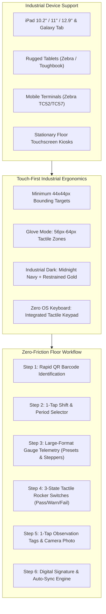

# LuminaFM Factory-Floor Operator Tablet & Mobile Experience Architecture

## Executive Overview

The **LuminaFM Factory-Floor Operator Experience** is a purpose-designed, touchscreen-first industrial interface engineered for rugged tablets (Apple iPad 10.2"/11"/12.9", Samsung Galaxy Tab Active, Panasonic Toughbook, Zebra touch computers), mobile handsets, and wall-mounted floor kiosks.

Rather than shrinking the desktop CMMS layout onto a smaller screen, the operator experience replaces complex multi-page navigation and small-text data entry forms with:
1. **Touch Ergonomics**: Minimum $44 \times 44\text{px}$ touch targets across all controls, with primary numeric keys and action buttons scaled up to $56\text{px} - 64\text{px}$ for operators wearing heavy leather, nitrile, or PPE work gloves.
2. **Minimal Typing & Minimal Navigation**: Standard gauge presets, tactile stepper buttons, and a dedicated on-screen Glove Numpad that completely eliminates the obstructive operating system virtual keyboard.
3. **Tactile Safety Checklists**: 3-state industrial rocker switches (`PASS` / `CONDITIONAL` / `FAIL`) with distinct color coding, large tap zones, and haptic/visual feedback.
4. **Simple QR Scanning**: Camera viewfinder simulation with animated laser scanline, torch flashlight toggle for dark subterranean bunkers, and proximity Bluetooth asset detection.
5. **Offline Synchronization Engine**: Persistent visual sync banner with continuous background draft auto-saving to local storage, shielding operators from signal loss in concrete boiler bunkers.

---

## 1. Ergonomic Specifications & Device Matrix

### 1.1 Touch Target Dimensions

| UI Element | Width | Height | Touch Zone Standard | Glove Accessible |
| :--- | :---: | :---: | :---: | :---: |
| **Glove Numpad Numeric Keys (0–9)** | $80\text{px}$ | $64\text{px}$ | $\ge 44 \times 44\text{px}$ | $\text{YES}$ |
| **Digital Readout Gauge Tile** | $100\%$ | $64\text{px}$ | $\ge 44 \times 44\text{px}$ | $\text{YES}$ |
| **Glove Increment Steppers (`+` / `-`)** | $52\text{px}$ | $52\text{px}$ | $\ge 44 \times 44\text{px}$ | $\text{YES}$ |
| **Checklist Tactile Rockers** | $90\text{px}$ | $52\text{px}$ | $\ge 44 \times 44\text{px}$ | $\text{YES}$ |
| **Standard Preset Chips** | $72\text{px}$ | $44\text{px}$ | $\ge 44 \times 44\text{px}$ | $\text{YES}$ |
| **Observation Preset Chips** | $140\text{px}$ | $44\text{px}$ | $\ge 44 \times 44\text{px}$ | $\text{YES}$ |
| **Sticky Bottom Primary Submit** | $240\text{px}$ | $56\text{px}$ | $\ge 44 \times 44\text{px}$ | $\text{YES}$ |
| **Sticky Bottom Draft Save** | $110\text{px}$ | $56\text{px}$ | $\ge 44 \times 44\text{px}$ | $\text{YES}$ |

---

## 2. Minimal Navigation & Zero-Typing Workflow

### 2.1 The Problem with Standard CMMS on Factory Tablets
Standard web dashboards require tapping tiny HTML text inputs, which summons the iOS/Android software keyboard. On a $10.2''$ tablet in landscape orientation, the virtual keyboard consumes over $50\%$ of the screen height, hiding the input field, obscuring adjacent gauges, and causing operator frustration when wearing dirty work gloves.

### 2.2 LuminaFM's Glove-Accessible Solution
1. **1-Tap Standard Gauge Presets**:
   - Each gauge offers calibrated quick-preset chips derived from standard boiler operating states:
     - *Main Steam Pressure*: `[7.0 bar]`, `[8.0 bar]`, `[8.5 bar]`, `[9.0 bar]`, `[10.0 bar]`.
     - *Flue Gas Stack Temp*: `[160°C]`, `[175°C]`, `[185°C]`, `[195°C]`, `[205°C]`.
     - *Boiler Water TDS*: `[1,800 ppm]`, `[2,100 ppm]`, `[2,400 ppm]`, `[2,700 ppm]`, `[3,000 ppm]`.
     - *Ambient Temperature*: `[28°C]`, `[30°C]`, `[32°C]`, `[35°C]`.
2. **Tactile Increment Steppers (`calculateStep`)**:
   - Touch buttons (`+0.1`, `-0.1`, `+1.0`, `-1.0`) allow fine adjustment without opening the keypad.
   - Stepper math is clamped at zero and formatted to avoid floating-point drift ($8.5 + 0.1 = 8.6$).
3. **Dedicated On-Screen Glove Numpad (`GloveNumpad.tsx`)**:
   - Large modal dialog with oversized $64 \times 64\text{px}$ tactile keys (`1–9`, `0`, `.`, `Backspace`, `Clear`, `Confirm`).
   - Integrated live range check badge (`NORMAL` in emerald vs `EXCURSION` in pulsating red).

---

## 3. 3-State Tactile Rocker Switches (`GloveRockerSwitch.tsx`)

In industrial safety routines, inspections are rarely simple binary checks. An operator must be able to log intermediate warnings without shutting down a boiler:
- `PASS` (Emerald): Full compliance verified (e.g., drum sight glass water meniscus clearly visible).
- `CONDITIONAL` / `WARN` (Amber): Minor observation requiring monitoring (e.g., feed pump seal slight drip $< 10\text{ drops/min}$).
- `FAIL` (Rose): Defect or safety breach triggering corrective workflow.

Touch targets are $\ge 52\text{px}$ in height and spaced generously to prevent accidental adjacent touches with thick gloves.

---

## 4. Simple QR Barcode Scanning (`QrScannerModal.tsx`)

Floor operators frequently transition between multiple boilers and auxiliary pumps:
1. **Camera Viewfinder**:
   - Real-time targeting reticle with animated laser scanline.
   - High-luminosity flashlight/torch toggle for dark subterranean boiler bunkers.
2. **Instant QR Resolution**:
   - Scanned QR string (e.g., `LUMINA:ASSET:BLR-001`) automatically locks in the boiler:
     - Equipment Code: `BLR-001`
     - Equipment Name: `Main High-Pressure Steam Boiler`
     - Rated Capacity: `1,100 kg/h`
     - Location: `Basement Boiler Room B-01`
3. **Proximity Fallback Tiles**:
   - If camera access is restricted or lighting is inadequate, a 1-tap list of nearby Bluetooth-detected boilers allows immediate selection without typing.

---

## 5. Offline Synchronization & Draft Persistence (`SyncStatusIndicator.tsx`)

### 5.1 Subterranean Connectivity Resilience
Industrial boiler rooms, chiller plant basements, and generator vaults often have thick reinforced concrete walls causing frequent Wi-Fi dropouts. LuminaFM ensures zero data loss:
- **Continuous Autosave**: Every telemetry adjustment, rocker toggle, and observation note is immediately debounced and serialized to local storage (`lumina_operator_draft_shift_v1`).
- **Clear Status Indicator**:
  - `ONLINE • CLOUD SYNCED` (Emerald pulse beacon).
  - `AUTOSAVING DRAFT...` (Gold spinner).
  - `OFFLINE MODE • 2 DRAFTS QUEUED` (Amber beacon).
  - `UPLOADING TO CLUSTER...` (Indigo bounce icon upon reconnection).
- **Manual Force Sync**: Operators can trigger an immediate database sync with visual confirmation.

---

## 6. Orientation & Screen Adaptations

### 6.1 iPad & Android Tablet Landscape ($10.2'' - 12.9''$)
- **Two-Column Split Console**:
  - *Left Column*: Equipment badge, shift selector, firing mode pills, and large-format telemetry cards.
  - *Right Column*: 3-state safety checklist rockers, 1-tap floor observation chips, voice memo dictation, and camera preview.

### 6.2 iPad & Android Tablet Portrait
- **Single-Column High-Visibility Stack**:
  - Generous full-width cards with sticky top status header and sticky bottom action dock.

### 6.3 Mobile Screens (Zebra Handheld Computers)
- Compact view with drawer-based numpad, prominent QR scanner trigger, and bottom sheet navigation.

### 6.4 Desktop Screens
- Expanded industrial workstation kiosk view.

---

## 7. Verification & Quality Assurance

- **Vitest Automated Suite** ([floor-operator-experience.test.ts](file:///e:/My%20Owns/tests/floor-operator-experience.test.ts)):
  - **16/16 tests passing**:
    1. Touch target size verification ($\ge 44 \times 44\text{px}$ standard, $\ge 52 - 64\text{px}$ glove mode).
    2. Zero-typing preset selection and step increment accuracy.
    3. Real-time range validation ($8.5\text{ bar}$ normal vs $205^\circ\text{C}$ soot excursion).
    4. QR scanner asset resolution.
    5. Offline sync state transitions and draft serialization.
    6. 3-state rocker switch state normalization.
- **Production Bundle Build**:
  - `npm --prefix frontend run build`: **0 errors** ($630\text{ kB}$ minified bundle, built in $4.52\text{s}$).
  - `npm --prefix frontend run typecheck`: **0 errors**.
