# LuminaFM - Technical Gap Analysis & Architectural Risk Assessment
## Evaluation of Dissertation Research vs. Commercial Enterprise CMMS Requirements

- **Research Document**: *Development of a Software-Based Boiler Maintenance Decision-Making Tool* (Vishal Perera, June 2025)
- **Database Schema**: `cmms_schema.sql` / `prisma/schema.prisma`
- **Architectural Reference**: Master Product Vision & Engineering Governance

---

## 1. Executive Summary

This Technical Gap Analysis establishes a rigorous engineering comparison between the academic proof-of-concept developed in the original dissertation and the commercial requirements of the LuminaFM platform. The original research successfully codified an empirical decision network (10 subsystems, 22 criteria, 35 maintenance activities) for an 1,100 kg/h steam boiler at The Kingsbury Hotel. However, significant architectural, mathematical, and data modeling gaps exist between the academic prototype and an enterprise-grade, multi-tenant SaaS CMMS.

This document identifies every gap, documents internal inconsistencies in the source materials, evaluates the database representation, and outlines actionable mitigations.

---

## 2. Functional Demarcation: Original Research vs. Commercial CMMS

```mermaid
graph TD
    subgraph Research["Original Academic Research (Vishal Perera 2025)"]
        R1["Single 1,100 kg/h Fire-Tube Boiler (Kingsbury Hotel)"]
        R2["10 Specific Boiler Subsystems & 35 Maintenance Actions"]
        R3["22 Criteria with Hardcoded Empirical Benchmarks"]
        R4["2-Hourly Manual Data Entry via Shift Forms"]
        R5["Dual Network Structure (Daily vs Periodic PM)"]
        R6["Static Alerts: High Temp (37°C), High Pressure (10kPa)"]
        R7["Browser-based LocalStorage (Client-only Ephemeral)"]
        R8["Hardcoded Admin Credentials (admin / admin123)"]
    end

    subgraph Commercial["Commercial LuminaFM Enterprise Platform"]
        C1["Multi-Tenant Architecture with Strict Data Isolation (RLS)"]
        C2["Generic Asset Registry with Dynamic EAV Attributes (Chillers, Pumps, GenSets)"]
        C3["Configurable Multi-Method Decision Engine (ANP, AHP, TOPSIS, Fuzzy)"]
        C4["Digital Work Order Lifecycle with State Machine & Cost Tracking"]
        C5["Dual Independent Hierarchies: Physical Location vs Functional System"]
        C6["Immutable Audit Logging with Before/After Mutation Diffs"]
        C7["Multi-part Evidence Attachment Management (Multer + Object Store)"]
        C8["Tablet-Optimized Responsive UI (Glove-friendly, $\ge 44$px Touch Targets)"]
        C9["ACID PostgreSQL Persistence with Docker Orchestration"]
        C10["Granular Role-Based Access Control (RBAC) with JWT & Refresh Tokens"]
    end

    Research -.->|Domain Logic & Decision Model| Commercial
```



### Detailed Functional Comparison Matrix

| Functional Dimension | Original Research Prototype | LuminaFM Commercial SaaS | Architecture Assessment |
|---|---|---|---|
| **Multi-Tenancy** | None. Single hardcoded environment representing Kingsbury Hotel. | Native multi-tenancy. Every entity scoped by `organization_id` with composite FKs. | Critical Enterprise Gap. Prototype cannot support multi-client isolation. |
| **Authentication & Auth** | Trivial plaintext login (`admin / admin123`) stored client-side. | Enterprise RBAC: bcrypt salted password hashing, JWT access/refresh tokens, fine-grained permissions. | Critical Security Gap. Prototype lacked session validation and privilege levels. |
| **Asset Generalization** | Hardcoded exclusively for 1,100 kg/h fire-tube boiler. | Dynamic EAV asset engine. Supports boilers, chillers, pumps, generators, transformers via metadata tables. | Core Product Vision Requirement. Academic logic must become a modular plugin. |
| **Hierarchy Management** | Simple tabular list of 10 components. | Dual independent DAG hierarchies: Physical Location Tree and Functional Technical System Tree. | Schema Advantage. Commercial schema (`cmms_schema.sql`) already surpasses prototype. |
| **Data Persistence** | HTML5 `localStorage` / client-side SQLite. Data lost on cache wipe or device change. | PostgreSQL 16 database with foreign key constraints, partial indexes, and transactional boundaries. | Critical Reliability Gap. Industrial operations require durable, auditable storage. |
| **Work Order Lifecycle** | Trivial alert popups with "Resolve" and "Acknowledge" buttons. No work tracking. | Full lifecycle: Draft ➔ Approved ➔ Scheduled ➔ In Progress ➔ On Hold ➔ Completed. Labor & parts tracking. | Commercial Operational Requirement. Alert resolution must link directly to draft Work Orders. |
| **Inspection Checklists** | Hardcoded static form with 3 fields (Ambient Temp, Steam Pressure, Water Level). | Dynamic checklist templates and items with typed responses (numeric, boolean, text, photo evidence). | Commercial Flexibility Requirement. Shift logs must be rendered from configurable templates. |
| **Evidence & Attachments** | None. No image capture or file upload capability. | Multipart upload via Multer with MIME verification, linking files to Work Orders or Assets via `entity_attachments`. | Compliance Requirement. Floor technicians must attach photos of worn boiler parts. |
| **Audit Traceability** | None. | Automated mutation interceptor recording user ID, timestamp, old JSON snapshot, new JSON snapshot. | Enterprise Traceability Requirement. Required for insurance and statutory inspections. |

---

## 3. Decision Science & Mathematical Gaps in ANP Modeling

### 3.1 The Missing Numerical Matrices Gap
*(Dissertation Reference: Chapter 4.4–4.5, Pages 55–58)*

The dissertation provides an exceptional qualitative contribution by mapping 22 criteria to 19 benchmarks and 35 maintenance activities (Figure 4.1, Table 4.7). However, **the dissertation does NOT contain the raw pairwise comparison matrices, Saaty 1–9 evaluation values, or computed supermatrices**.

```
Documented in Thesis:
[Goal] ──> [22 Criteria] ──> [19 Benchmarks] ──> [35 Maintenance Activities]
   ▲                                                       │
   └──────────────── Feedback & PM Schedules ──────────────┘
   (Qualitative interdependency graph completely codified in Figure 4.1)

OMITTED in Thesis:
[Saaty Pairwise Matrices A] ──> [Eigenvectors w] ──> [Supermatrix W] ──> [Limit Supermatrix W^∞]
   (No numerical pairwise weights, CR values, or power iterations published)
```

#### Engineering Resolution:
1. **Never Invent Research Data**: LuminaFM will not fabricate arbitrary numbers and attribute them to the University of Moratuwa study.
2. **Deterministic Empirical Rule Engine**: The immediate real-time alert trigger is fully specified by Tables 4.8, 4.9, and 4.10. When an operational reading deviates (e.g., Flue Gas Temp $> 190^\circ$C), the system deterministically triggers the exact associated maintenance activities (`EMA 1`, `HEMA 3`, `BMA 1`).
3. **Configurable ANP Engine Core**: Implement an authentic mathematical ANP computational service (`AnpEngineService`) capable of:
   - Ingesting pairwise comparison matrices ($A$) on the Saaty 1–9 scale.
   - Calculating principal eigenvectors using the Power Iteration Method: $A w = \lambda_{\max} w$.
   - Computing Consistency Index ($CI = \frac{\lambda_{\max} - n}{n - 1}$) and Consistency Ratio ($CR = \frac{CI}{RI}$) with validation ($CR < 0.10$).
   - Constructing the unweighted supermatrix, normalizing columns to achieve stochasticity (weighted supermatrix), and raising to powers $W^{2k+1}$ until convergence ($W^\infty$).
   - Providing an administrative UI where Chief Engineers can fine-tune expert weights or import validated baseline profiles.

---

## 4. Internal Inconsistencies & Anomalies in Source Materials

During detailed forensic analysis of *Hardbound_Vishal.pdf*, three noticeable internal discrepancies were discovered between the dissertation's theoretical chapters and its prototype implementation screenshots:

### 4.1 Pressure Unit Discrepancy: kPa vs. Bar
- **Theoretical Formulation (Chapter 4, Table 4.6, Table 4.7, Appendix B)**:
  - Throughout Chapter 4 and Expert E3's interview (Appendix B, p. 104), the operational steam pressure is universally defined in **bars**:
    - Nominal operating pressure: $8.0 - 9.0$ bar.
    - Safety valve popping set point: $9.0$ bar.
    - Feed water pump head: $> 4.0$ bar.
- **Prototype Screenshot (Chapter 5, Figure 5.3, Page 65)**:
  - The prototype web form displays: `Steam Pressure Benchmark: ≤ 9.5kPa`.
  - In Figure 5.4 (Page 66), the alert triggers at: `High Pressure (10kPa)`.
- **Engineering Assessment**:
  - $9.5\text{ kPa} \approx 0.095\text{ bar}$ (atmospheric/vacuum pressure). No commercial steam boiler operates at 9.5 kPa. This was an obvious unit conversion/typographic error in the undergraduate UI mock-up.
  - **Resolution**: LuminaFM standardizes on **bars** (with SI Pascal equivalence in metadata). The benchmark for overpressure cutoff is codified as **9.5 bar**, and nominal operating pressure is **8.0 – 9.0 bar**.

### 4.2 Water Level Discrepancy: Volume ($m^3$) vs. Gauge Glass Elevation
- **Theoretical Formulation (Chapter 4, Table 4.4, Table 4.7)**:
  - Water level is tracked as a physical level: "Boiler Water Level: Baseline Observation" through the optical sight glass.
- **Prototype Screenshot (Chapter 5, Figure 5.3, Page 65)**:
  - The prototype form lists: `Water Level Benchmark: 50-80m³`.
- **Engineering Assessment**:
  - An 1,100 kg/h fire-tube boiler has an internal shell water volume of approximately $1.5 - 2.5\text{ m}^3$. A volume of $50 - 80\text{ m}^3$ represents a massive outdoor hotel reservoir, not an operational boiler water level.
  - **Resolution**: LuminaFM represents boiler water level as a percentage of sight glass height ($-50\text{ mm}$ to $+50\text{ mm}$ from baseline centerline, or $0 - 100\%$, with nominal at $50\%$).

### 4.3 Temperature Threshold Discrepancy: Ambient vs. Flue Gas
- **Prototype Screenshot (Figure 5.3, Page 65 & Figure 5.4, Page 66)**:
  - Form displays `Ambient Temperature ≤ 35°C`, and the alert in Figure 5.4 reads `High Temp (37°C)`.
- **Engineering Assessment**:
  - In boiler operations, ambient boiler room temperature (35°C–37°C) is a minor environmental variable. The critical thermodynamic health parameter identified in Table 4.6 and Table 4.7 is **Flue Gas Temperature ($190^\circ\text{C} - 200^\circ\text{C}$)** and **Steam Temperature ($160^\circ\text{C} - 170^\circ\text{C}$)**.
  - **Resolution**: LuminaFM includes both: ambient room monitoring for occupational safety, and rigorous Flue Gas / Steam Temperature monitoring for core maintenance decision-making.

---

## 5. Database Schema Evaluation (`cmms_schema.sql` vs. Research Requirements)

The provided SQL schema (`cmms_schema.sql`) provides an enterprise-grade foundation, but requires specific structural enhancements to support the full ANP research model:

```mermaid
classDiagram
    class decision_models {
        UUID id
        UUID organization_id
        VARCHAR code
        VARCHAR name
        VARCHAR model_method
        JSONB configuration
        VARCHAR status
    }

    class decision_criteria {
        UUID id
        UUID organization_id
        UUID decision_model_id
        VARCHAR code
        VARCHAR name
        NUMERIC weight
        NUMERIC benchmark_value
        VARCHAR benchmark_operator
        UUID meter_definition_id *NEW*
        UUID checklist_item_id *NEW*
    }

    class decision_alternatives {
        UUID id
        UUID organization_id
        UUID decision_model_id
        VARCHAR code
        VARCHAR name
        UUID maintenance_task_template_id *NEW*
    }

    class decision_pairwise_comparisons {
        UUID id *NEW*
        UUID organization_id *NEW*
        UUID decision_model_id *NEW*
        VARCHAR cluster_code *NEW*
        UUID row_element_id *NEW*
        UUID col_element_id *NEW*
        NUMERIC value_saaty *NEW*
    }

    class decision_network_edges {
        UUID id *NEW*
        UUID organization_id *NEW*
        UUID from_criterion_id *NEW*
        UUID to_criterion_id *NEW*
        VARCHAR influence_type *NEW*
    }

    decision_models "1" --o{ decision_criteria : evaluates
    decision_models "1" --o{ decision_alternatives : compares
    decision_models "1" --o{ decision_pairwise_comparisons : calibrates
    decision_criteria "1" --o{ decision_network_edges : influences
```

### 5.1 Identified Database Gaps & Required Additions

1. **Missing Pairwise Comparison Table**:
   - `cmms_schema.sql` lacks storage for expert judgments.
   - *Addition*: `decision_pairwise_comparisons` table to store Saaty scale ratings ($1/9$ to $9$) between criteria pairs and alternative pairs, along with evaluator user reference and timestamp.
2. **Missing Interdependency Network Graph Table**:
   - ANP requires modeling non-hierarchical network feedback loops between criteria. In `cmms_schema.sql`, `decision_criteria` only has a linear `parent_id` (suited for AHP, but insufficient for ANP).
   - *Addition*: `decision_network_edges` table representing directed influence edges between nodes (Criteria $\leftrightarrow$ Criteria, Criteria $\leftrightarrow$ Alternatives).
3. **Bridge from Operational Readings to Decision Criteria**:
   - In `cmms_schema.sql`, there is no foreign key linking a `decision_criteria` row to a `meter_definitions` row or a `checklist_items` row.
   - *Addition*: Add nullable `meter_definition_id` and `checklist_item_id` to `decision_criteria`. This allows the engine to automatically map a shift meter reading directly to its evaluation criteria!
4. **Bridge from Decision Alternatives to Work Order Task Templates**:
   - When an alternative (e.g. `FPMA 1: Replace worn seals`) is prioritized, the system must instantiate standard tasks.
   - *Addition*: Add `maintenance_task_template_id` to `decision_alternatives` to enable 1-click Work Order auto-generation.

---

## 6. Implementation & Operational Risk Matrix

| Risk ID | Risk Description | Severity | Likelihood | Impact Area | Mitigation Strategy |
|---|---|---|---|---|---|
| **RSK-01** | **Floor Offline Vulnerability**: Boiler plants in hotel basements frequently lose Wi-Fi/cellular connectivity, causing manual shift log submission failures. | HIGH | HIGH | Operational Data Capture | Implement Progressive Web App (PWA) architecture with ServiceWorker caching and IndexedDB offline queue. Submissions queue locally and auto-sync on reconnect. |
| **RSK-02** | **Operator Input Errors**: Operators wearing industrial gloves entering numeric values on touchscreens risk transcription errors (e.g. 90 bar instead of 9.0 bar). | HIGH | HIGH | Data Quality / Safety | Implement strict client-side and server-side range validation with immediate ergonomic error cues and physical sanity bounds ($P_{steam} \in [0, 15]$ bar). |
| **RSK-03** | **Limit Supermatrix Latency**: Real-time iterative matrix multiplication ($W^{2k+1}$) on large networks can introduce API response latency during shift logging. | MEDIUM | MEDIUM | Performance / UX | Decouple immediate benchmark rule evaluation from full ANP supermatrix recalculation. Precompute and cache the Limit Supermatrix; recalculate only on model configuration changes. |
| **RSK-04** | **Configuration Drift**: Floor technicians inadvertently altering benchmark thresholds or disabling critical safety alerts. | CRITICAL | LOW | Plant Safety & Compliance | Restrict all decision model modifications to `Chief Engineer` and `Admin` roles. Enforce immutable audit logging on all `decision_*` mutations. |
| **RSK-05** | **Superheater Module Misconfiguration**: Users attempting to attach a superheater checklist to a standard fire-tube boiler. | MEDIUM | LOW | System Modeling | Codify category-level constraints preventing incompatible subsystems from being instantiated under the fire-tube boiler category. |
