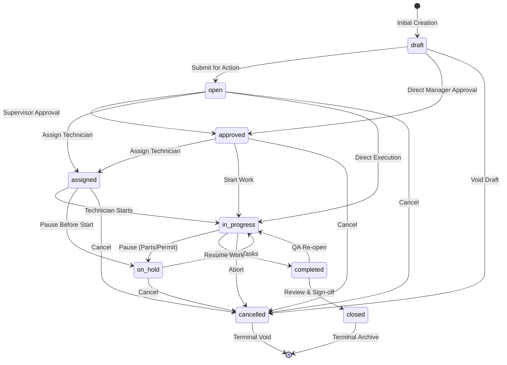
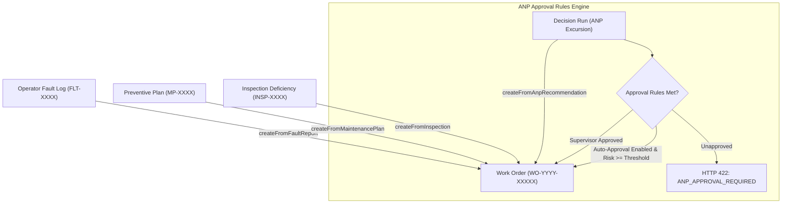

# LuminaFM Work Management Architecture

## 1. Executive Summary & Architectural Governance

The LuminaFM Work Management module provides an enterprise-grade execution engine for industrial facilities. It orchestrates the lifecycle of maintenance tasks from initial origin through approval, dispatch, labor logging, spare part consumption, cost accounting, evidence attachment, and completion.

### Core Architecture Pillars

1. **Explicit Finite State Machine (FSM)**: Enforces a strict, deterministic lifecycle graph covering 9 discrete statuses (`draft`, `open`, `approved`, `assigned`, `in_progress`, `on_hold`, `completed`, `cancelled`, `closed`).
2. **Multi-Source Ingestion & Traceability**: Supports work orders originating from:
   - **Operator Fault Reports** (`fault_logs`).
   - **Preventive Maintenance Schedules** (`asset_maintenance_plans`).
   - **Inspection Deficiencies** (`inspections`).
   - **Approved ANP Decision Support Recommendations** (`decision_runs`).
3. **Configured ANP Approval Rules Engine**: Guarantees that ANP recommendations are not automatically converted into live work orders without evaluating configured policy thresholds (manual supervisor approval vs. automated high-risk criteria).
4. **Comprehensive Cost Accounting**: Automatically aggregates actual labor costs ($\sum \text{hours} \times \text{rate}$) and spare parts ($\sum \text{quantity} \times \text{unitCost}$), computing cost variance against budget estimates upon completion.
5. **Audited Lifecycle History**: Every state change records an immutable transition entry in `work_order_status_history` capturing timestamps, user identities, and operational notes.
6. **Thread-Safe Work Order Numbering**: Atomically issues organization-specific, contiguous identifiers formatted as `WO-YYYY-XXXXX`.

---

## 2. Finite State Machine Specification

The state machine is formally defined in [src/modules/work-orders/work-order.state-machine.ts](file:///e:/My%20Owns/src/modules/work-orders/work-order.state-machine.ts) and enforced at service and API boundaries.



### 2.1 State Transition Matrix

| Current State | Permitted Target States | Operational Meaning |
| :--- | :--- | :--- |
| **`draft`** | `open`, `approved`, `cancelled` | Work order drafted; awaiting dispatch or managerial review. |
| **`open`** | `approved`, `assigned`, `in_progress`, `cancelled` | Work order released; ready for approval or scheduling. |
| **`approved`** | `assigned`, `in_progress`, `cancelled` | Managerial sign-off granted; queued for technician assignment. |
| **`assigned`** | `in_progress`, `on_hold`, `cancelled` | Assigned to a specific technician or crew. |
| **`in_progress`**| `on_hold`, `completed`, `cancelled` | Active physical intervention underway (`actualStartAt` recorded). |
| **`on_hold`** | `in_progress`, `cancelled` | Temporarily halted (awaiting spares, shutdown window, or permit). |
| **`completed`** | `closed`, `in_progress` | Execution completed (`actualEndAt` recorded; costs rolled up). |
| **`closed`** | *None (Terminal)* | Verified by chief engineer and permanently archived. |
| **`cancelled`** | *None (Terminal)* | Voided with required operational cancellation reason. |

Attempting any unauthorized transition (such as attempting `draft -> completed` or transitioning out of `closed`) throws an `InvalidWorkOrderStatusTransitionError` (HTTP 400).

---

## 3. Work Order Originating Sources & Traceability



### 3.1 Operator Fault Reports
- Endpoint: `POST /api/work-orders/from-fault`
- Originating Entity: `fault_logs`
- Functionality:
  - Automatically maps fault severity (`critical`, `high`, `medium`, `low`) to Work Order priority (`urgent`, `high`, `medium`, `low`).
  - Atomically sets `fault_logs.relatedWorkOrderId = workOrder.id` and updates fault status to `work_order_created`.
  - Rejects duplicate work order creation if an active work order is already linked to the fault.

### 3.2 Preventive Maintenance Schedules
- Endpoint: `POST /api/maintenance/asset-plans/:id/generate-work-order`
- Originating Entity: `asset_maintenance_plans`
- Functionality:
  - Clones ordered checklist items from `maintenance_plan_tasks` into `work_order_tasks`.
  - Idempotency Guard: Verifies no active, uncompleted work order exists for the asset and plan.

### 3.3 Inspection Deficiencies
- Endpoint: `POST /api/work-orders/from-inspection`
- Originating Entity: `inspections`
- Functionality:
  - Instantiates remedial work orders when checklist items fail inspection.
  - Binds `inspections.workOrderId = workOrder.id` for compliance traceability.

### 3.4 Approved ANP Decision Recommendations
- Endpoint: `POST /api/work-orders/from-anp`
- Originating Entity: `decision_runs`
- **Configured Approval Policy**:
  - Industrial facilities cannot permit machine learning or multi-criteria decision models to trigger expensive machinery overhauls without human accountability.
  - The engine checks `organization.deploymentSettings.anpApprovalRules`:
    $$\text{Auto-Approval Granted} \iff (\text{autoApprovalEnabled} = \text{true}) \land (\text{compositeRiskScore} \ge \text{minRiskScore})$$
  - If auto-approval conditions are not satisfied and `supervisorApproval: true` is not explicitly provided by an authorized user, the request is rejected with `ANP_APPROVAL_REQUIRED` (HTTP 422).
  - When approved, `decision_runs.workOrderId` is linked, priority is inherited from the recommendation, and the alternative's task template is populated.

---

## 4. Financials, Labor, Spare Parts & Cost Rollup

Cost accounting is handled by `calculateWorkOrderCosts` in [src/modules/work-orders/work-orders.service.ts](file:///e:/My%20Owns/src/modules/work-orders/work-orders.service.ts).

### 4.1 Cost Calculation Model

$$\text{Total Labor Cost} = \sum_{i=1}^{L} (\text{hoursWorked}_i \times \text{hourlyCost}_i)$$
$$\text{Total Parts Cost} = \sum_{j=1}^{P} (\text{quantity}_j \times \text{unitCost}_j)$$
$$\text{Actual Total Cost} = \text{Total Labor Cost} + \text{Total Parts Cost}$$
$$\text{Budget Variance} = \text{Actual Total Cost} - \text{Estimated Cost}$$

- **Automatic Rollup on Completion**: When a work order transitions to `completed`, the system calculates the actual totals and persists `actualCost` on `work_orders` in an atomic database transaction.
- **Detailed Cost Breakdown**: Available at `GET /api/work-orders/:id/costs`, providing line-item visibility into technician hours and consumed materials.

---

## 5. Evidence Attachments & Media Linkage

Work orders link to physical evidence (failure photos, thermal imaging, pressure gauge readings, oil analysis reports) via the unified `entity_attachments` table:
- Supported via `auditAndAttachmentsService`:
  - `GET /api/work-orders/:id/attachments`: Lists all linked evidence.
  - `POST /api/work-orders/:id/attachments`: Links an uploaded attachment.
- Physical files are stored in tenant-isolated object storage with directory traversal defenses (`LocalObjectStorageService`).

---

## 6. REST API Reference

All routes require `Authorization: Bearer <token>` and valid tenant context.

| Category | Method | Endpoint | Description |
| :--- | :--- | :--- | :--- |
| **Work Orders** | `GET` | `/api/work-orders` | List work orders with filtering (status, priority, site, asset) |
| | `POST` | `/api/work-orders` | Create work order in draft status |
| | `GET` | `/api/work-orders/:id` | Get work order details (tasks, labor, parts, history) |
| | `PATCH` | `/api/work-orders/:id` | Update work order metadata |
| **Lifecycle Actions** | `POST` | `/api/work-orders/:id/approve` | Approve work order |
| | `POST` | `/api/work-orders/:id/assign` | Assign technician to work order |
| | `POST` | `/api/work-orders/:id/start` | Start work execution (`actualStartAt = now`) |
| | `POST` | `/api/work-orders/:id/hold` | Place on hold with reason |
| | `POST` | `/api/work-orders/:id/resume` | Resume work execution |
| | `POST` | `/api/work-orders/:id/complete` | Complete work order (`actualEndAt = now`, cost rollup) |
| | `POST` | `/api/work-orders/:id/close` | Officially close work order |
| | `POST` | `/api/work-orders/:id/cancel` | Cancel work order with reason |
| | `GET` | `/api/work-orders/:id/status-history`| Get chronological lifecycle audit history |
| **Originating Sources**| `POST` | `/api/work-orders/from-fault` | Create work order from Operator Fault Report |
| | `POST` | `/api/work-orders/from-inspection`| Create work order from Inspection failure |
| | `POST` | `/api/work-orders/from-anp` | Create work order from ANP recommendation (enforcing approval rules) |
| **Task Lists** | `GET` | `/api/work-orders/:id/tasks` | List work order tasks |
| | `POST` | `/api/work-orders/:id/tasks` | Add task to work order |
| | `PATCH` | `/api/work-orders/:id/tasks/:taskId`| Update task status or completion notes |
| | `DELETE` | `/api/work-orders/:id/tasks/:taskId`| Remove task |
| **Labor & Parts** | `GET` / `POST`| `/api/work-orders/:id/labor` | List and log technician labor hours |
| | `GET` / `POST`| `/api/work-orders/:id/parts` | List and log consumed spare parts |
| **Financials** | `GET` | `/api/work-orders/:id/costs` | Get complete cost rollup and variance analysis |
| **Attachments** | `GET` / `POST`| `/api/work-orders/:id/attachments` | List and link evidence attachments |

---

## 7. Verification & Automated Test Coverage

Verified by 19 automated integration and unit tests in [tests/work-orders-management.test.ts](file:///e:/My%20Owns/tests/work-orders-management.test.ts):

```
✓ tests/work-orders-management.test.ts (19 tests) 56ms
  ✓ 1. Explicit State Machine & Valid/Invalid Transitions
    ✓ should validate standard lifecycle path: draft -> open -> approved -> assigned -> in_progress -> completed -> closed
    ✓ should validate operational pause and resume: in_progress -> on_hold -> in_progress
    ✓ should validate cancellation from non-terminal states
    ✓ should REJECT illegal transition: draft directly to completed
    ✓ should REJECT illegal transition from closed terminal state
    ✓ should REJECT illegal transition from cancelled terminal state
    ✓ should REJECT transitioning to the same status
  ✓ 2. Organization-Specific Work Order Number Generation
    ✓ should generate sequential number prefixed with current year (WO-YYYY-00001)
    ✓ should increment existing sequence contiguously
  ✓ 3. Work Order Creation, Tasks, Labor & Spare Parts
    ✓ should create a Work Order in draft status with tasks in atomic transaction
    ✓ should add labor and spare parts with positive value validations
  ✓ 4. Financials & Cost Breakdown Calculation
    ✓ should accurately compute labor, parts, total actual cost and variance
  ✓ 5. Lifecycle Actions & Mandatory Task Verification
    ✓ should transition through approve, assign, start, and hold
    ✓ should REJECT completeWorkOrder when mandatory tasks remain unfinished
    ✓ should ALLOW completeWorkOrder when skipIncompleteTaskCheck is explicitly provided
  ✓ 6. Work Orders Originating Sources
    ✓ should create Work Order from Operator Fault Report and update fault log status
    ✓ should create Work Order from Inspection deficiency and link inspection
    ✓ should REJECT converting ANP recommendation without supervisor approval when auto-approval is disabled
    ✓ should ALLOW converting ANP recommendation when supervisor explicitly approves
```

### Full Regression Suite Status
- **240 tests passed (100% success)** across 8 test suites:
  - `tests/work-orders-management.test.ts` (19 tests)
  - `tests/maintenance-planning.test.ts` (26 tests)
  - `tests/equipment-attribute-engine.test.ts` (21 tests)
  - `tests/asset-registry-generic.test.ts` (17 tests)
  - `tests/auth-and-organization-management.test.ts` (24 tests)
  - `tests/tenant-authorization-security.test.ts` (105 tests)
  - `tests/tenant-isolation.test.ts` (26 tests)
  - `tests/seed-idempotency.test.ts` (2 tests)
- **TypeScript Static Verification**: `npx tsc --noEmit` exited with 0 errors.
