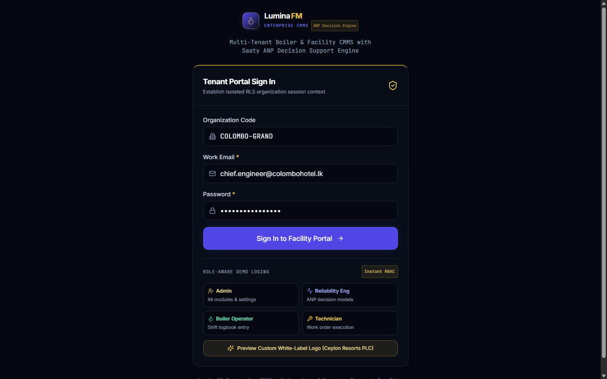
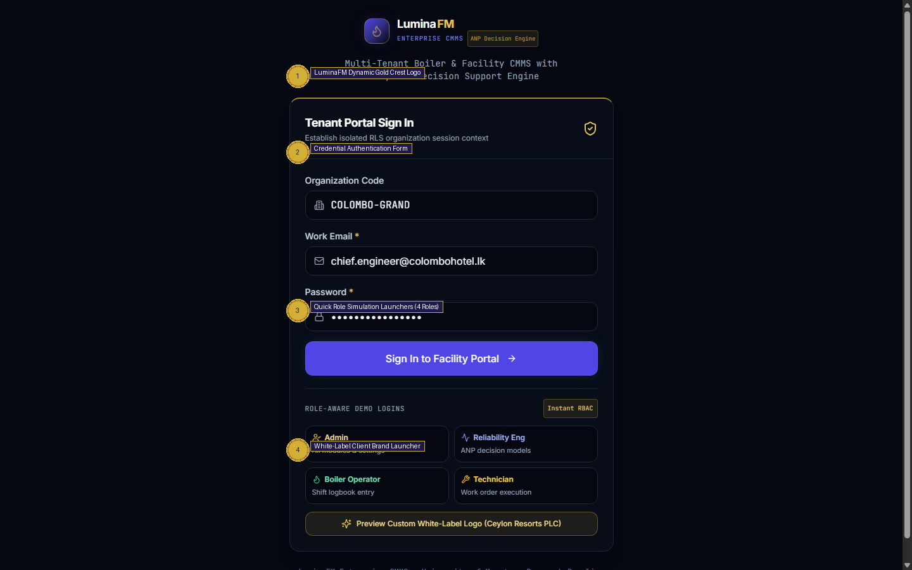
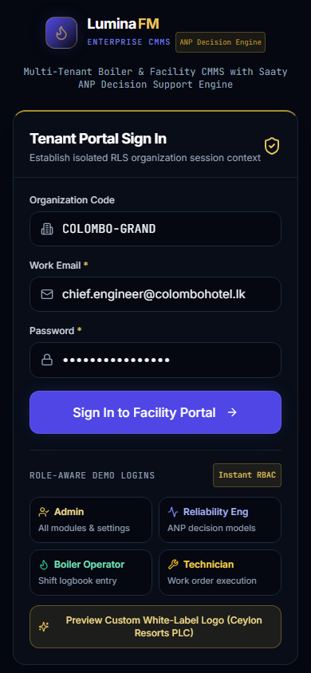
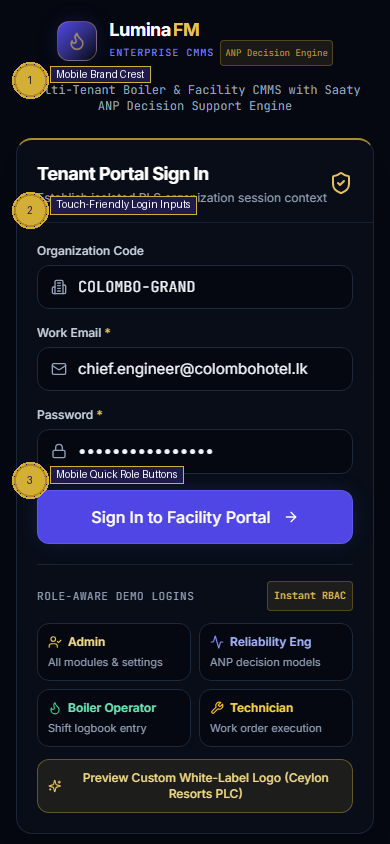

# Account Guide: User Authentication & Login

## 1. Overview & Purpose

The **User Authentication** module provides secure access control, tenant organization routing, and testing convenience for LuminaFM. It authenticates users against their organization's tenant realm, verifies passwords using bcrypt hashing, issues signed JSON Web Tokens (JWT), and initializes the user's role-based session.

### Core Capabilities
- **Multi-Tenant Organization Code Routing**: Allows users to specify their organization identifier (e.g., `COLOMBO-GRAND`) to route requests to the correct isolated database partition.
- **One-Click Quick Role Simulation**: For demonstration, training, and testing environments, allows instant login as any of the four standardized enterprise facility roles without manual credential typing.
- **Client White-Label Simulation**: Includes a quick launcher demonstrating instant client rebranding with custom SVG crests and currency profiles.
- **Mobile Responsive Design**: Clean, touch-optimized layout for handheld authentication.

---

## 2. Visual Interface & Device Viewports

### Desktop Sign-In Interface ($1440 \times 900$) (`AUTH-001`)

*Figure 13.1: LuminaFM Desktop Login Interface (1440 × 900)*

*Figure 13.2: Login Interface with Numbered Callout Markers*

#### Callout Annotations Reference (Figure 13.2)
- **Marker 1: LuminaFM Dynamic Gold Crest Logo**: High-contrast corporate crest reflecting the active organization branding.
- **Marker 2: Credential Authentication Form**: Input fields for Email Address, Password, and Organization Tenant Code with the primary **Sign In to Facility System** button.
- **Marker 3: Quick Role Simulation Launchers (4 Roles)**: Four 1-click authentication triggers:
  1. **Organization Admin**: Arjun Wickramasinghe (`chief.engineer@colombohotel.lk`)
  2. **Plant Reliability Engineer**: Dr. Nimal Senanayake (`reliability.lead@colombohotel.lk`)
  3. **Boiler Plant Operator**: Samantha Bandara (`shift.operator@colombohotel.lk`)
  4. **Maintenance Technician**: Kasun Perera (`field.tech@colombohotel.lk`)
- **Marker 4: White-Label Client Brand Launcher**: 1-click trigger to simulate login into an externally branded organization ("Ceylon Luxury Resorts PLC").

---

### Mobile Smartphone Sign-In Interface ($390 \times 844$) (`AUTH-002`)
Optimized for mobile field operators and on-call technicians.

*Figure 13.3: Mobile Login Interface (390 × 844)*

*Figure 13.4: Mobile Login with Numbered Callouts*

- **Marker 1: Mobile Brand Crest**: Compact brand crest.
- **Marker 2: Touch-Friendly Login Inputs**: Large input fields ($48\text{px}$ touch targets) preventing mobile keyboard typing errors.
- **Marker 3: Mobile Quick Role Buttons**: Single-column vertical buttons for quick role switching.

---

## 3. Field Reference: Authentication Form

| Field | Purpose | Required | Format | Validation Rules | Default / Example Value |
|---|---|---|---|---|---|
| `email` | User account email address | Yes | Valid Email Address | Must be a valid email format | `chief.engineer@colombohotel.lk` |
| `password` | User account secret password | Yes | Password String | Minimum 8 characters | `LuminaAdmin@2026` |
| `organizationCode` | Tenant routing identifier | No | Alphanumeric String | Optional; routes to specific tenant realm | `COLOMBO-GRAND` |

---

## 4. Session Handling & Token Security

- **JWT Persistence**: Successful authentication stores the JWT access token in browser `localStorage` and establishes user identity in `AuthContext`.
- **Session Expiration**: Expired tokens automatically redirect users to `/login`.
- **Offline Session Guard**: If a user attempts to log out while unsynchronized shift logs remain in their local IndexedDB queue, the system interrupts the logout flow with the **Logout Sync Guard Modal** ([`LogoutSyncGuardModal.tsx`](file:///e:/My%20Owns/frontend/src/components/floor/LogoutSyncGuardModal.tsx)), preventing accidental data loss.
