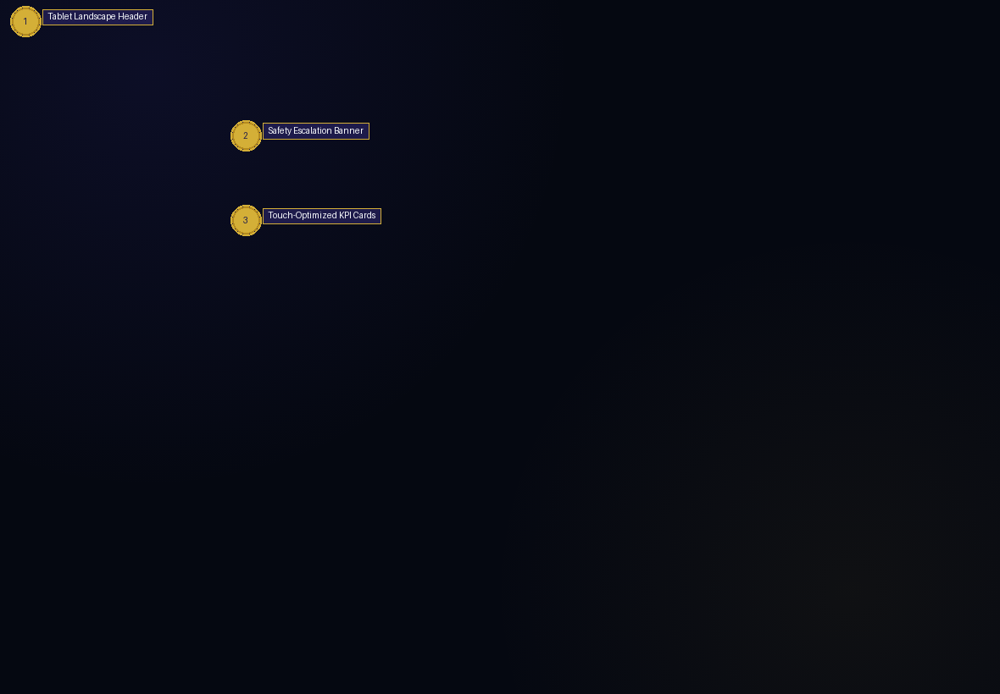
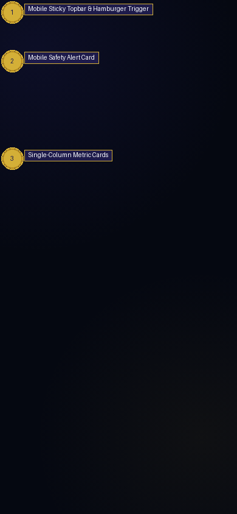

# Module Guide: Command Center Dashboard

## 1. Overview & Purpose

The **Command Center Dashboard** serves as the central operational hub of LuminaFM. It synthesizes facility-wide asset health, active preventive maintenance schedules, real-time safety alerts, thermodynamic telemetry, and cross-discipline work orders into an executive overview.

### Key Operational Capabilities
- **Direct Safety Escalation**: Displays high-priority safety interlock and boiler trip alerts that bypass algorithm scoring to ensure immediate plant safety compliance.
- **Facility KPI Grid**: Tracks total active assets, overdue maintenance tasks, open work order tickets, and the facility proactive maintenance ratio.
- **Equipment Extensibility Demonstration**: Highlights polymorphic non-boiler equipment monitoring with live thermodynamic Coefficient of Performance ($\text{COP}$) and approach temperature scaling indicators for water-cooled chillers.
- **Executive Task Summary**: Provides one-click navigation to upcoming scheduled maintenance and recent critical equipment faults.

---

## 2. Page Access & Permissions

- **Primary Route**: `/`
- **Navigation Access**: Click **Command Center** in the left navigation sidebar or click the **LuminaFM Crest** in the top navigation bar.
- **Permitted Roles**: All authenticated personnel (`Organization Admin`, `Plant Reliability Engineer`, `Boiler Plant Operator`, `Maintenance Technician`).
- **Role-Aware Visibility**: Financial indicators (such as maintenance expenditure metrics) automatically hide for operators and technicians who lack the `finance:read` permission.

---

## 3. Visual Interface & Layout

The dashboard features a responsive, midnight navy surface with restrained gold accents and high-contrast typography conforming to industrial readability standards.

### Desktop Command Center Overview

*Figure 1.1: LuminaFM Command Center Desktop Overview (Viewport: 1440 × 900)*

*Figure 1.2: Command Center Desktop Overview with Numbered Callout Markers*

#### Callout Annotations Reference (Figure 1.2)
- **Marker 1: Top Navigation Header & Brand Logo**: Displays the client's corporate logo (or LuminaFM gold crest fallback), tenant organization code, active RBAC role switcher, tablet kiosk shortcut, and user logout trigger.
- **Marker 2: Sidebar Operations Navigation**: The 12-module facility navigation menu. Items are dynamically filtered based on the active user role's permissions. Includes a live boiler telemetry heartbeat indicator.
- **Marker 3: Critical Safety Alert**: An urgent visual banner triggered by direct safety escalation rules (e.g., boiler safety relief valve or interlock test overdue). This alert is deliberately decoupled from mathematical ranking algorithms.
- **Marker 4: Executive Facility KPI Cards Grid**: High-level operational metrics showing Total Assets Registered, Preventive Maintenance Due, Active Work Orders, and Proactive Maintenance Ratio.
- **Marker 5: Chiller Extensibility Demonstration Card**: Demonstrates non-boiler equipment integration, displaying live evaporator/condenser approach temperatures, thermodynamic $\text{COP}$, and decision model isolation status.
- **Marker 6: Recent Work Orders & Preventive Schedules**: Tabular widgets showing tickets awaiting execution and maintenance due within the next 7 days.

---

## 4. Responsive Device Layouts

The Command Center adapts dynamically across all verified industrial device form factors.

### Tablet Landscape Viewport ($1180 \times 820$)
Designed for control room desktop monitors, ruggedized tablet docks, and wall-mounted plant status screens.

*Figure 1.3: Command Center Tablet Landscape Layout*

*Figure 1.4: Tablet Landscape Layout with Numbered Callouts*

- **Marker 1**: Condensed top header retaining tenant scope and role switcher.
- **Marker 2**: High-visibility safety escalation banner spanning the full primary content width.
- **Marker 3**: Two-column responsive metric cards with touch targets exceeding $44\text{px}$.

### Tablet Portrait Viewport ($820 \times 1180$)
Optimized for mobile floor supervisors conducting walkthrough inspections with an iPad or Android tablet.

*Figure 1.5: Command Center Tablet Portrait Layout*

*Figure 1.6: Tablet Portrait Layout with Numbered Callouts*

- **Marker 1**: Collapsible sidebar menu accessible via top navigation drawer button.
- **Marker 2**: Stacked safety alert card with large tap targets.
- **Marker 3**: Vertically arranged metric cards.

### Mobile Viewport ($390 \times 844$)
Designed for on-call engineers responding to plant abnormalities via smartphone.

*Figure 1.7: Mobile Responsive Viewport*

*Figure 1.8: Mobile Viewport with Numbered Callouts*

- **Marker 1**: Sticky mobile topbar with hamburger drawer trigger and status badge.
- **Marker 2**: Critical safety alert card formatted for small touch screens.
- **Marker 3**: Single-column executive metrics.

---

## 5. UI Component Details

### A. Critical Safety Alert Banner
- **Component Type**: Alert Card / Direct Escalation Banner.
- **Location**: Top of main dashboard content area below the header.
- **Purpose**: Warns facility managers of immediate safety hazards, such as overdue boiler safety relief valve testing or combustion interlock lockouts.
- **Behavior**: Clicking the banner navigates directly to the relevant safety work order ticket in `/work-orders`.
- **Special Rule**: Safety critical alerts **never** depend on ANP priority ranking; they trigger immediately upon threshold breach or overdue compliance deadline.

### B. Executive KPI Metric Cards
- **Component Type**: Stat Metric Card Grid.
- **Location**: Upper content section.
- **Metrics Displayed**:
  1. **Total Assets**: Count of all equipment assets active in the tenant registry.
  2. **Active PM Due**: Number of preventive maintenance tasks due within the current 7-day operating cycle.
  3. **Open Work Orders**: Count of maintenance orders currently in `open`, `assigned`, or `in_progress` status.
  4. **Proactive Ratio**: Percentage of total labor hours spent on preventive/predictive tasks versus corrective breakdown repairs (Benchmark: World-Class $\ge 80\%$).

### C. Chiller Extensibility Demonstration Card (`ChillerModuleCard`)
- **Component Type**: Specialized Equipment Monitoring Card.
- **Location**: Mid-dashboard interactive section.
- **Thermodynamic Gauges**:
  - **Evaporator Approach Temperature**: Normal: $0.5 - 2.0^\circ\text{C}$. Exceeding $2.5^\circ\text{C}$ indicates refrigerant starvation or water-side fouling.
  - **Condenser Approach Temperature**: Normal: $0.5 - 2.0^\circ\text{C}$. Exceeding $2.5^\circ\text{C}$ indicates tube scale buildup.
  - **Operating COP**: Calculated live via $\text{COP} = \frac{3.51685}{\text{kW/TR}}$.
- **Interactive Action Buttons**:
  - **Run Anomaly Check**: Evaluates current telemetry and displays detected maintenance needs.
  - **Test Boiler ANP Model on Chiller**: Triggers the system's cross-module isolation guard. The system catches the invalid request and displays a `CrossModuleDecisionModelError` banner, proving that boiler models cannot be misapplied to chillers.

### D. Active RBAC Role Switcher Popover
- **Component Type**: Popover Dropdown Menu.
- **Location**: Top navigation bar right section.

*Figure 1.9: Interactive RBAC Role Selector Popover*

*Figure 1.10: Role Switcher Popover with Numbered Callouts*

- **Marker 1**: Active user role badge in top navbar.
- **Marker 2**: Dropdown selection menu displaying all 4 system roles.
- **Marker 3**: Instant role switch trigger that updates navigation permissions without requiring re-login.

---

## 6. Related Pages & Workflows

- **Maintenance Calendar**: Click the **Calendar** button in the dashboard header to access `/maintenance-calendar`.
- **Work Management**: Click the **Work Orders** button to access `/work-orders`.
- **Operator Kiosk**: Click **Tablet Kiosk** in the top navigation bar to launch the full-screen touch interface at `/operator`.
