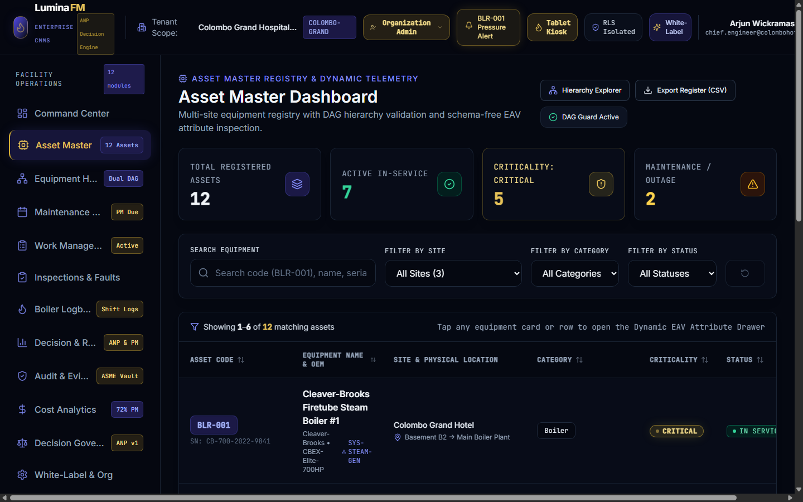
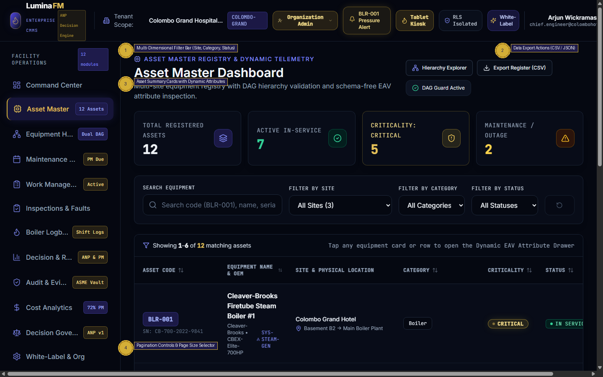
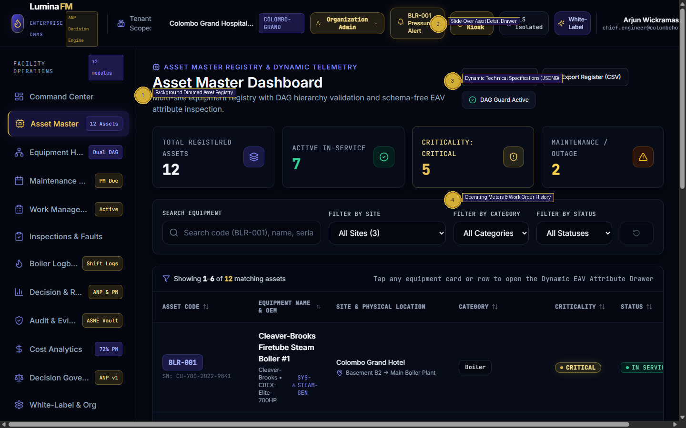
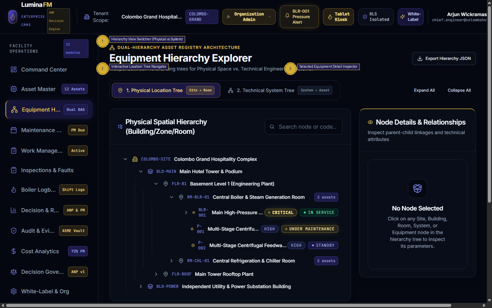
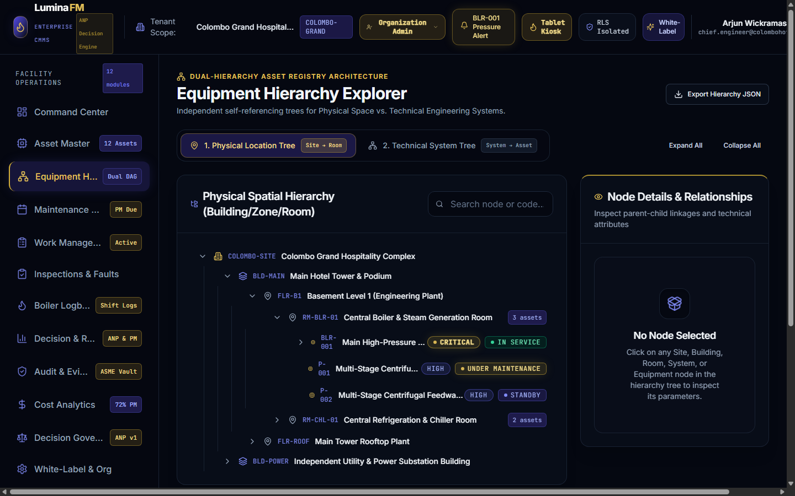
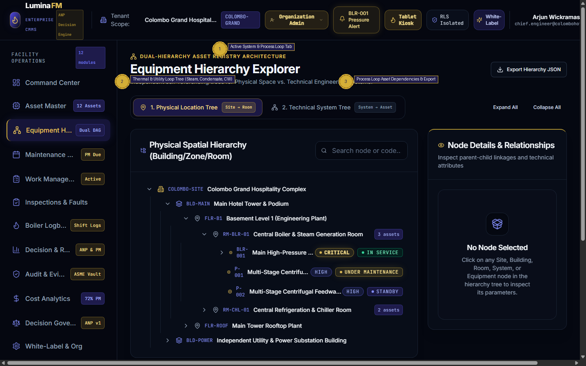

# Module Guide: Asset Management & Equipment Hierarchy

## 1. Overview & Purpose

The **Asset Management** suite comprises the **Asset Master Registry** and the **Equipment Hierarchy Engine**. Together, they form the technical foundation of LuminaFM, establishing asset provenance, parent-child relationships, location assignments, operating meter thresholds, and polymorphic JSONB engineering specifications.

---

## 2. Asset Master Registry (`/assets`)

### Access & Permissions
- **Route**: `/assets`
- **Navigation Access**: Click **Asset Master** in the left navigation menu.
- **Required Permission**: `assets:read` (Permitted for all roles).

### Visual Interface & Layout

*Figure 2.1: Asset Master Registry Viewport (1440 × 900)*

*Figure 2.2: Asset Master Registry with Numbered Callout Markers*

#### Callout Annotations Reference (Figure 2.2)
- **Marker 1: Multi-Dimensional Filter Bar**: Filter controls allowing users to isolate assets by Facility Site, Asset Category, Operating Status, and live text search query.
- **Marker 2: Data Export Actions**: Action buttons allowing instant client-side generation and download of complete asset inventory data in **CSV** or **JSON** formats.
- **Marker 3: Asset Summary Cards Grid**: Responsive cards displaying equipment name, unique asset code (e.g., `BLR-001`), manufacturer model, serial number, location breadcrumbs, and criticality badges.
- **Marker 4: Pagination Controls**: Bottom toolbar providing previous/next page navigation, current page indicator, and page size selector ($6$, $12$, or $24$ records per page).

---

### Slide-Over Asset Detail Drawer (`AssetDetailDrawer`)
Clicking the **Inspect Specifications** button on any asset card opens the slide-over inspection drawer without navigating away from the registry.

*Figure 2.3: Asset Detail Side-Drawer Open*

*Figure 2.4: Asset Detail Drawer with Numbered Callout Markers*

- **Marker 1: Dimmed Background Registry**: Accessible backdrop overlay. Clicking the backdrop closes the drawer.
- **Marker 2: Slide-Over Inspection Drawer**: High-contrast side panel displaying full engineering metadata.
- **Marker 3: Dynamic Technical Specifications (JSONB)**: Schema-driven nameplate specifications rendered dynamically with engineering units (e.g., Boiler Design Working Pressure: $10.5\text{ bar}$, Steam Capacity: $1,100\text{ kg/h}$).
- **Marker 4: Operating Meters & Work Order History**: Real-time operating meter totals (e.g., Operating Hours: $11,420\text{ hrs}$) and active work orders assigned to this asset.

---

## 3. Equipment Hierarchy & Dual Process DAG (`/hierarchies`)

LuminaFM supports a **Dual Directed Acyclic Graph (DAG)** architecture. Users can examine equipment relationships through two distinct perspectives:
1. **Physical Location Hierarchy**: Where the equipment physically resides within the real estate structure.
2. **System & Process Loop Hierarchy**: How the equipment functions as part of a continuous thermodynamic cycle.

### Physical Location DAG View
- **Route**: `/hierarchies`
- **Hierarchy Structure**: `Site` $\rightarrow$ `Building` $\rightarrow$ `Floor` $\rightarrow$ `Room` $\rightarrow$ `Asset` $\rightarrow$ `Component Sub-Assembly`.

*Figure 2.5: Physical Location Hierarchy Tree View*

*Figure 2.6: Location Hierarchy Tree with Numbered Callouts*

- **Marker 1: Hierarchy View Switcher**: Tab bar to switch between Physical Location and System Process Loop views.
- **Marker 2: Interactive Location Tree Navigator**: Expandable and collapsible tree nodes with asset count badges and health indicators.
- **Marker 3: Selected Equipment Detail Inspector**: Side panel showing the selected node's location breadcrumbs, parent asset, serial number, and JSON export button.

---

### System & Process Loop Hierarchy View
Clicking the **System & Process Loop** tab reveals the functional thermodynamic topology of the plant:
- **Primary Loops**: Steam & Condensate Generation Loop, Chilled Water Circulation Loop, Electrical Distribution Network, Fire Suppression System.

*Figure 2.7: System Process Loop Hierarchy View*

*Figure 2.8: Process Loop Hierarchy with Numbered Callouts*

- **Marker 1: Active System Process Loop Tab**: Highlights the active process loop graph view.
- **Marker 2: Utility Loop Tree Navigator**: Decomposes thermal loops into generation units, distribution valves, pumps, and end-use heat exchangers.
- **Marker 3: Process Loop Asset Dependencies**: Displays upstream supply sources and downstream dependencies.

---

## 4. UI Component Reference

| Component | UI Type | Location | Purpose & Behavior | Permitted Roles |
|---|---|---|---|---|
| **Site Filter** | Dropdown Select | Filter Toolbar | Filters asset records by physical site (e.g., `COLOMBO-SITE`). | All Roles |
| **Category Filter** | Dropdown Select | Filter Toolbar | Filters assets by equipment class (`boilers`, `chillers`, `pumps`). | All Roles |
| **Status Filter** | Dropdown Select | Filter Toolbar | Isolates assets by state: `in_service`, `under_maintenance`, `standby`, `out_of_service`, `decommissioned`. | All Roles |
| **Search Input** | Search Field | Filter Toolbar | Performs instant multi-field text search matching asset code, name, and serial number. | All Roles |
| **Export CSV** | Button (`secondary`) | Action Header | Compiles filtered asset register into a downloadable `.csv` file. | All Roles |
| **Export JSON** | Button (`secondary`) | Action Header | Exports complete asset data including nested dynamic attributes as `.json`. | All Roles |
| **Inspect Specifications** | Button (`gold`) | Asset Card Footer | Opens the `AssetDetailDrawer` for the target asset. | All Roles |
| **Close Drawer (X)** | Button (`ghost`) | Drawer Header | Closes the side drawer and returns focus to the registry grid. | All Roles |

---

## 5. Field Reference: Asset Specifications & Metadata

| Field | Purpose | Required | Format | Validation Rules | Example |
|---|---|---|---|---|---|
| `assetCode` | Unique organizational asset identifier | Yes | String (Uppercase alphanumeric with hyphens) | Must be unique within tenant organization | `BLR-001` |
| `name` | Human-readable asset title | Yes | String | 3–100 characters | `Main High-Pressure Steam Boiler` |
| `categoryCode` | Classification category | Yes | Enum Code | Must match registered `AssetCategory` | `boilers` |
| `siteId` | Physical facility complex assignment | Yes | UUID | Must reference valid `Site` | `loc-site-1` |
| `status` | Operational availability state | Yes | Enum | One of 5 standardized states | `in_service` |
| `criticality` | Impact level on plant safety and operations | Yes | Enum | `low`, `medium`, `high`, `critical` | `critical` |
| `serialNumber` | Manufacturer nameplate serial | No | String | Alphanumeric | `CB-2024-98412` |
| `modelNumber` | Manufacturer engineering model | No | String | Alphanumeric | `CB-PACK-1100` |
| `operatingHours` | Accumulated runtime meter | Yes | Number | Positive floating-point or integer | `11420.5` |
| `specifications.designPressure` | Design working pressure rating | Yes (Boilers) | Number with unit | $0.0 - 25.0\text{ bar}$ | `10.5 bar` |
| `specifications.steamCapacity` | Rated steam output capacity | Yes (Boilers) | Number with unit | $100 - 5,000\text{ kg/h}$ | `1,100 kg/h` |
| `specifications.coolingCapacity` | Rated refrigeration capacity | Yes (Chillers) | Number with unit | $50 - 3,000\text{ TR}$ | `500 TR` |
