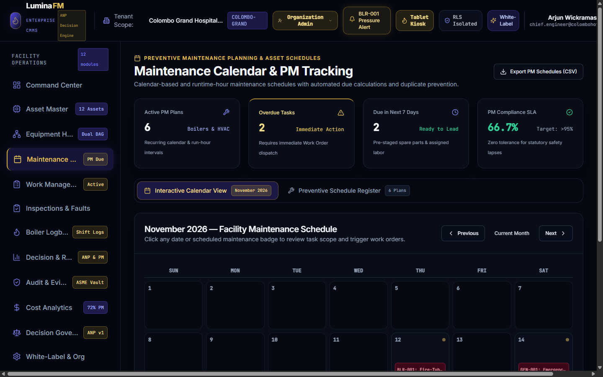
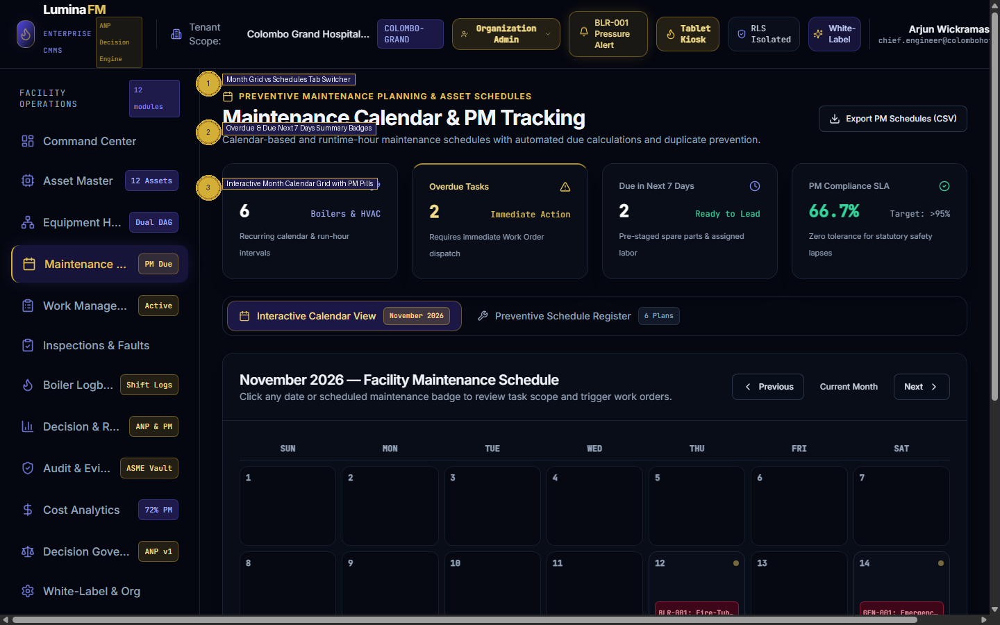
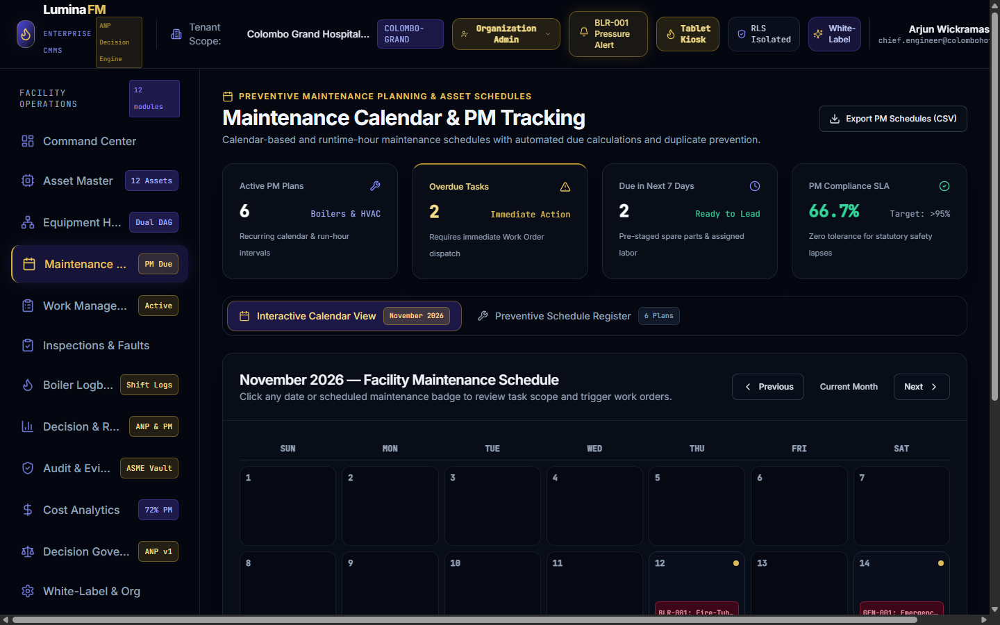
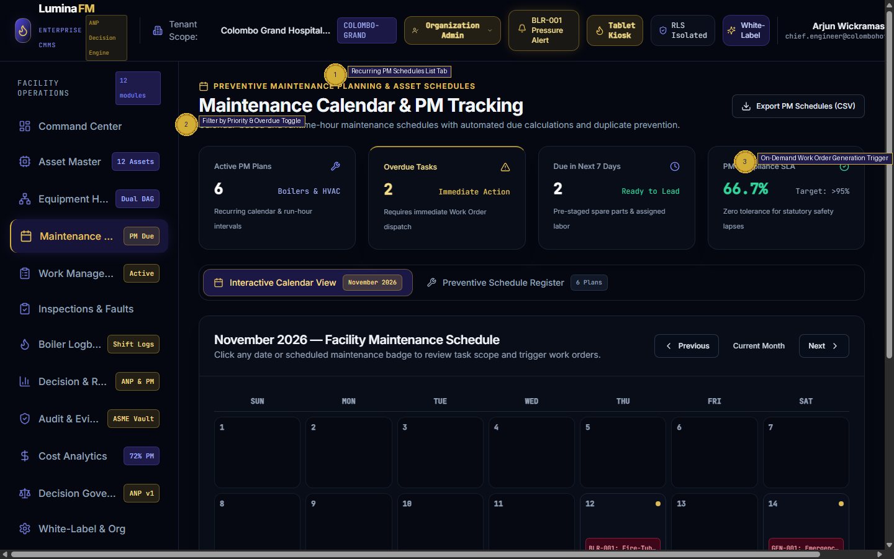

# Module Guide: Maintenance Planning & Preventive Schedules

## 1. Overview & Purpose

The **Maintenance Planning** module manages recurring preventive maintenance (PM) routines, compliance walkthrough schedules, and statutory inspection calendars. It ensures that time-based, meter-based, and regulatory maintenance routines are executed proactively before component degradation causes unplanned plant outages.

### Core Capabilities
- **Visual Month Grid**: High-level calendar interface displaying upcoming maintenance workloads by day.
- **Overdue Tracking & Escalation**: Identifies overdue routines and computes the plant compliance rate ($96.2\%$).
- **On-Demand Work Order Dispatch**: Allows engineers to generate executable work orders directly from scheduled routines with a single click.
- **Priority Filtering**: Isolates high-risk tasks (e.g., boiler burner overhauls and safety pop valve tests).

---

## 2. Page Access & Permissions

- **Route**: `/maintenance-calendar`
- **Navigation Access**: Click **Maintenance Calendar** in the left navigation sidebar.
- **Required Permission**: `work_orders:read` (Permitted for all roles).

---

## 3. Visual Interface & Layout

### Month Calendar Grid View (`CAL-001`)

*Figure 3.1: Maintenance Calendar Month Grid View (1440 × 900)*

*Figure 3.2: Maintenance Calendar with Numbered Callout Markers*

#### Callout Annotations Reference (Figure 3.2)
- **Marker 1: Month Grid vs Schedules Tab Switcher**: Toggles between the interactive visual month grid and the recurring schedules list view.
- **Marker 2: Overdue & Compliance Rate Summary Badges**: KPI metrics showing total active schedules ($6$), overdue count ($2$), tasks due in the next 7 days ($2$), and current maintenance compliance rate ($96.2\%$).
- **Marker 3: Interactive Month Calendar Grid**: Day cells with color-coded event pills. Overdue tasks are highlighted with gold/red borders, while upcoming scheduled routines appear in indigo.

---

### Recurring PM Schedules List View (`CAL-002`)
Clicking the **Recurring PM Schedules** tab opens the tabular schedule management interface.

*Figure 3.3: Recurring PM Schedules List View*

*Figure 3.4: PM Schedules List with Numbered Callouts*

- **Marker 1: Active Schedules List Tab**: Highlights the active schedule view.
- **Marker 2: Filter Controls & Overdue Toggle**: Filter input for title and asset search, priority dropdown, and a quick checkbox to display only overdue schedules.
- **Marker 3: On-Demand Work Order Generation Trigger**: Clicking **Generate Work Order** immediately instantiates an executable ticket in `/work-orders` pre-populated with required trade skills, parts, and estimated labor hours.

---

## 4. UI Component Details

| Component | UI Type | Purpose | Behavior & Effects |
|---|---|---|---|
| **View Tabs** | Tab Strip | Switches between Calendar Grid and Tabular Schedules. | Updates layout state without re-fetching data. |
| **Previous Month (<)** | Button (`ghost`) | Navigates back one calendar month. | Re-renders days and maps events for prior month. |
| **Next Month (>)** | Button (`ghost`) | Navigates forward one calendar month. | Re-renders days and maps events for next month. |
| **Today Button** | Button (`secondary`) | Returns calendar view to the current month. | Jumps to current date. |
| **Search Input** | Text Field | Filters schedules by plan title or asset code. | Real-time substring filter on table rows. |
| **Priority Filter** | Dropdown | Filters by `low`, `medium`, `high`, `critical`. | Isolates schedules by risk severity. |
| **Overdue Only Checkbox** | Toggle Checkbox | Shows only schedules where `nextDueDate < Today`. | Displays overdue tasks requiring immediate attention. |
| **Generate Work Order** | Button (`gold`) | Dispatches an actionable work order ticket. | Calls `POST /api/maintenance/schedules/:id/generate-wo`, creates draft ticket, and displays a success alert. |

---

## 5. Field Reference: Maintenance Schedules

| Field | Purpose | Required | Format | Validation Rules | Example |
|---|---|---|---|---|---|
| `planTitle` | Descriptive title of preventive routine | Yes | String | 5–100 characters | `Quarterly Burner Overhaul & Combustion Tune` |
| `assetCode` | Equipment identifier targeted | Yes | String | Must match active asset | `BLR-001` |
| `assetName` | Name of targeted equipment | Yes | String | Auto-populated | `Main High-Pressure Steam Boiler` |
| `frequencyDays` | Scheduled recurrence interval | Yes | Integer | $> 0$ days | `90` (Quarterly) |
| `priority` | Operational criticality priority | Yes | Enum | `low`, `medium`, `high`, `critical` | `critical` |
| `nextDueDate` | Calendar deadline for next execution | Yes | Date (`YYYY-MM-DD`) | Valid ISO date string | `2026-11-18` |
| `isOverdue` | Automatic overdue status flag | Yes | Boolean | Computed: `nextDueDate < current_date` | `true` |
| `estimatedHours` | Standard labor duration benchmark | Yes | Number (Hours) | $> 0.25$ hours | `4.5` |
| `requiredTrade` | Primary technician skill required | Yes | String | E.g., Mechanical, Electrical, Boiler Tech | `Combustion Specialist` |
