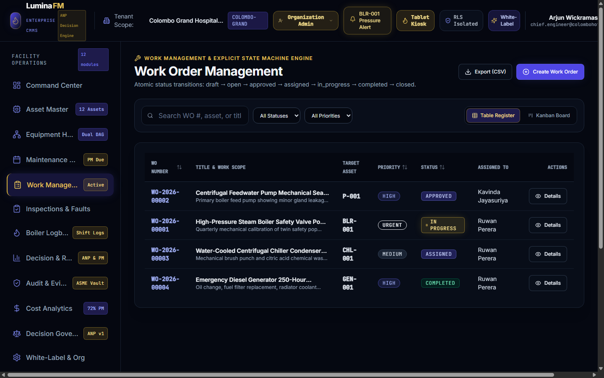
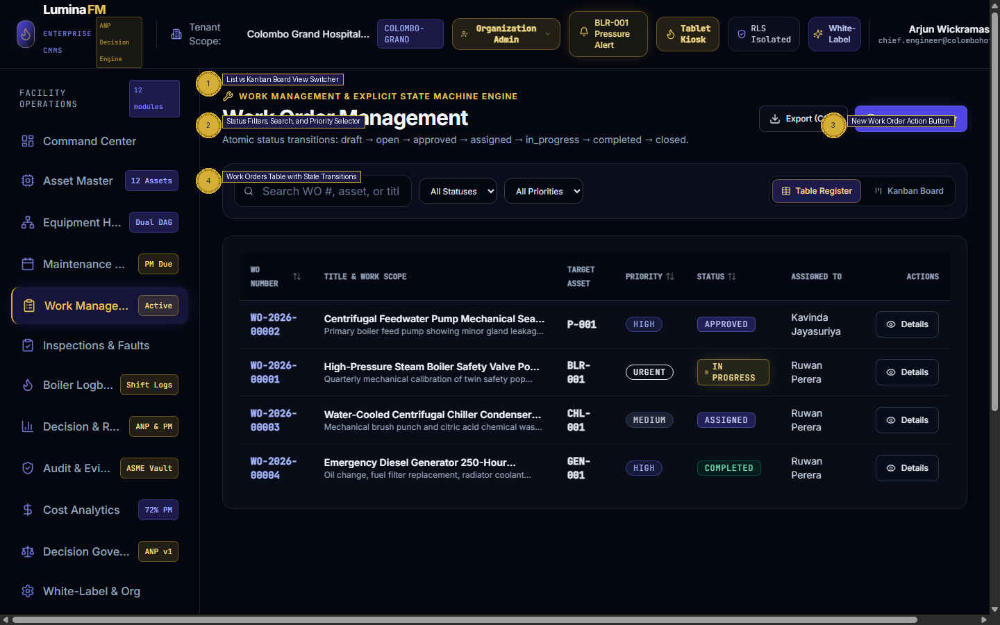
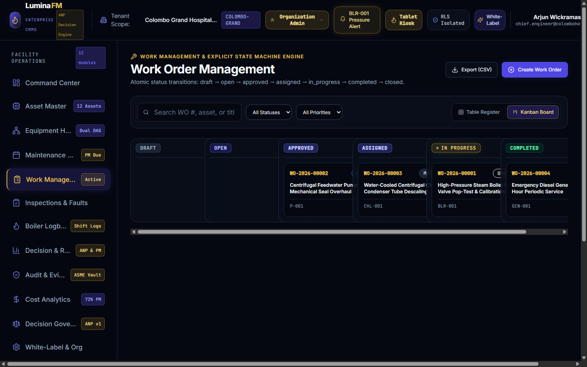
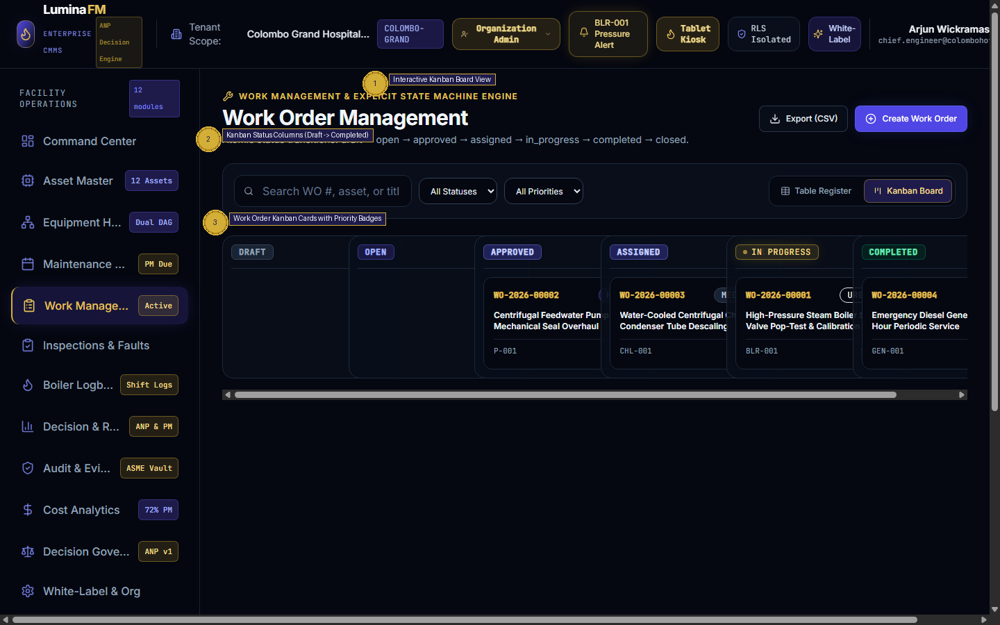
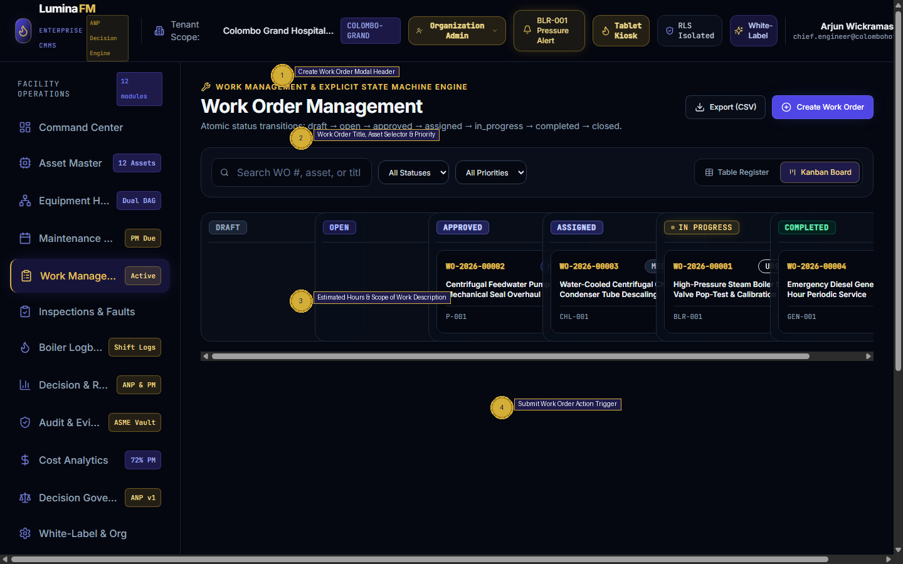
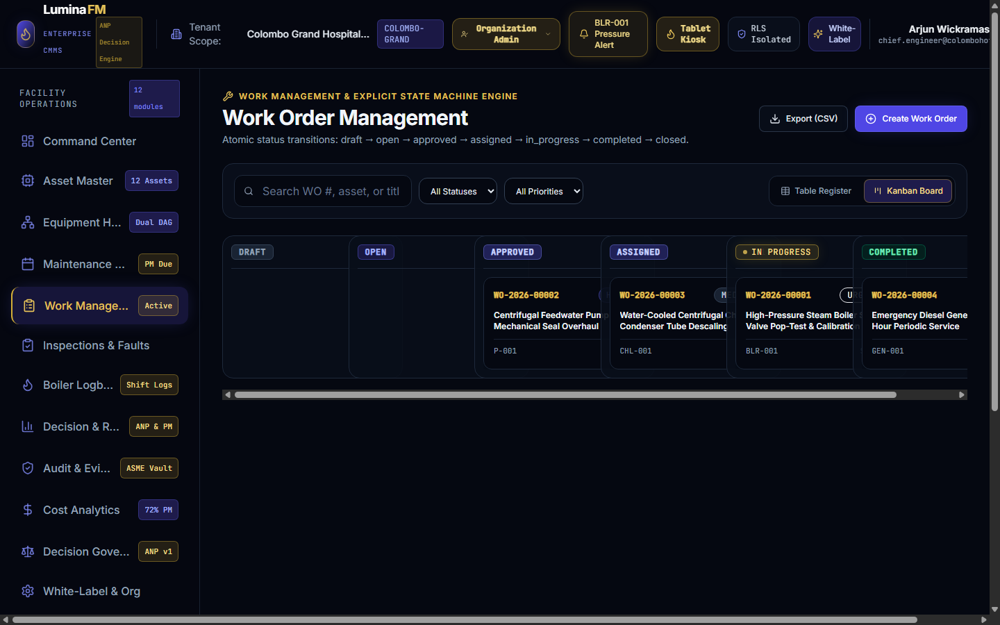
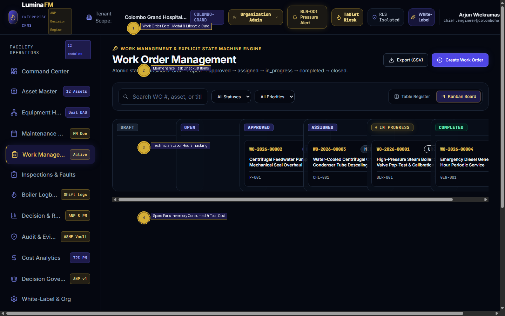

# Module Guide: Work Orders & Work Management

## 1. Overview & Purpose

The **Work Management** module orchestrates the complete maintenance execution lifecycle. From the initial creation of work tickets to supervisor approvals, technician task execution, labor logging, spare parts consumption, and final closure, LuminaFM enforces a strict, auditable state machine.

### Core Capabilities
- **Dual Visual Modes**: Seamless switching between high-density tabular list view and an interactive drag-and-drop **Kanban Board**.
- **Formal State Machine**: Enforces valid status transitions:
  $$\text{Draft} \longrightarrow \text{Open} \longrightarrow \text{Approved} \longrightarrow \text{Assigned} \longrightarrow \text{In Progress} \longrightarrow \text{Completed} \longrightarrow \text{Closed}$$
- **Resource & Cost Tracking**: Accurately tallies technician labor hours and consumed inventory spare parts into the work order's financial ledger.
- **Mandatory Audit Trail**: Every status change prompts for a documented justification recorded in the immutable audit log.

---

## 2. Page Access & Permissions

- **Route**: `/work-orders`
- **Navigation Access**: Click **Work Management** in the left navigation sidebar.
- **Required Permission**: `work_orders:read` to view; `work_orders:manage` to create, edit, transition, or log resources (Permitted for `Organization Admin`, `Plant Reliability Engineer`, and `Maintenance Technician`).

---

## 3. Visual Interface & Layout

### Tabular List View (`WO-001`)

*Figure 4.1: Work Orders Tabular List View (1440 × 900)*

*Figure 4.2: Work Orders List with Numbered Callout Markers*

#### Callout Annotations Reference (Figure 4.2)
- **Marker 1: List vs Kanban Board View Switcher**: Toggles the display between the tabular register and the drag-and-drop Kanban workflow columns.
- **Marker 2: Status Filters, Search, and Priority Selector**: Filter controls to search by work order number (e.g., `WO-2026-00042`) or equipment title, filter by priority (`critical`, `high`, `medium`, `low`), or filter by lifecycle status.
- **Marker 3: New Work Order Action Button**: Opens the `CreateWorkOrderModal` dialog to draft a new ticket.
- **Marker 4: Work Orders Table with State Transitions**: High-density table displaying order number, title, target asset, priority badge, assigned technician, estimated hours, and direct state transition action buttons.

---

### Kanban Board View (`WO-002`)
Clicking the **Kanban** view button renders work orders across six workflow columns.

*Figure 4.3: Work Orders Kanban Board View*

*Figure 4.4: Kanban Board with Numbered Callouts*

- **Marker 1: Active Kanban View Tab**: Confirms Kanban workflow layout mode.
- **Marker 2: Kanban Status Columns**: Six distinct columns representing active states: `Draft`, `Open`, `Approved`, `Assigned`, `In Progress`, and `Completed`.
- **Marker 3: Work Order Kanban Cards**: Interactive cards showing title, equipment code, priority badge, estimated duration, and quick transition buttons.

---

## 4. Modals & Overlay Workflows

### A. Create Work Order Modal (`WO-003`)
Clicking **New Work Order** launches the creation dialog.

*Figure 4.5: Create Work Order Modal Dialog*

*Figure 4.6: Create Work Order Dialog with Numbered Callouts*

- **Marker 1: Modal Header**: Dialog title and close trigger.
- **Marker 2: Title, Asset Selector & Priority**: Ticket name, target equipment dropdown, and operational priority level.
- **Marker 3: Estimated Hours & Scope Description**: Standard labor time estimate and detailed scope of work instructions.
- **Marker 4: Submit Work Order Trigger**: Dispatches creation request, instantiating a new `draft` record.

---

### B. Work Order Detail & Resource Tracking Modal (`WO-004`)
Clicking **Details** or **Manage** on any work order card opens the resource tracking dialog.

*Figure 4.7: Work Order Detail & Resource Tracking Dialog*

*Figure 4.8: Detail Modal with Numbered Callouts*

- **Marker 1: Work Order Header & State**: Displays ticket number, active status, priority, and parent asset.
- **Marker 2: Maintenance Task Checklist**: Step-by-step procedure checklist (e.g., LOTO verification, tube brushing, torque checks) with interactive checkboxes.
- **Marker 3: Technician Labor Hours Tracking**: Form to log hours worked, hourly rate, and technician name. Total labor cost computes automatically.
- **Marker 4: Spare Parts Inventory Consumed**: Form to record parts pulled from stock (e.g., spiral wound gaskets, burner nozzles) with quantity and unit cost. Total material cost updates automatically.

---

## 5. Field Reference: Work Order Data Contracts

### Work Order Creation Fields
| Field | Purpose | Required | Format | Validation Rules | Example |
|---|---|---|---|---|---|
| `title` | Summary title of maintenance work | Yes | String | 5–120 characters | `Emergency Feedwater Pump Mechanical Seal Replacement` |
| `assetId` | Target equipment asset UUID | Yes | UUID | Must reference existing asset | `a2000000-0000-0000-0000-000000000002` |
| `priority` | Operational urgency level | Yes | Enum | `low`, `medium`, `high`, `critical` | `high` |
| `estimatedHours` | Target duration for task completion | Yes | Number (Hours) | $> 0.25$ hours | `3.5` |
| `description` | Comprehensive scope of work & safety notes | Yes | Text | Minimum 10 characters | `Isolate suction and discharge valves. Lockout motor MCC breaker.` |

### Labor Hours Tracking Fields
| Field | Purpose | Required | Format | Validation Rules | Example |
|---|---|---|---|---|---|
| `technicianName` | Performing technician identity | Yes | String | Non-empty text | `K. Bandara (Senior Millwright)` |
| `hoursWorked` | Actual hours spent on site | Yes | Number | $> 0.1$ hours | `4.0` |
| `hourlyRate` | Labor billing rate per hour | Yes | Currency ($) | $\ge 0$ | `45.00` |

### Spare Parts Consumption Fields
| Field | Purpose | Required | Format | Validation Rules | Example |
|---|---|---|---|---|---|
| `partNumber` | Inventory spare part SKU | Yes | String | Must match catalog part | `GSK-SPIRAL-4IN-300#` |
| `partName` | Item descriptive title | Yes | String | Non-empty | `4-inch Spiral Wound Graphite Flange Gasket` |
| `quantity` | Number of units consumed | Yes | Integer | $\ge 1$ | `2` |
| `unitCost` | Inventory replacement cost per unit | Yes | Currency ($) | $> 0$ | `18.50` |
