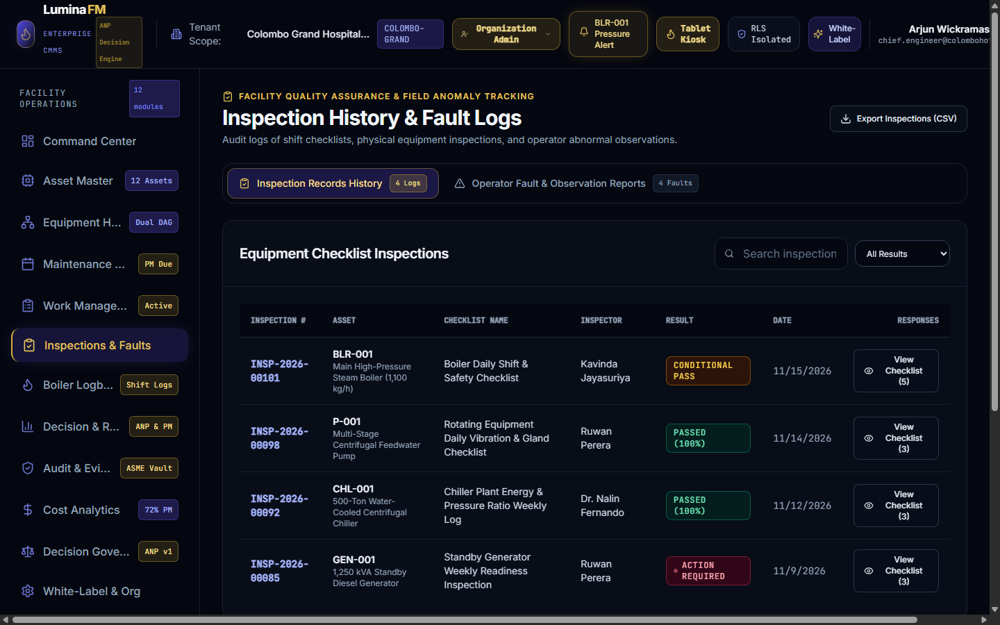
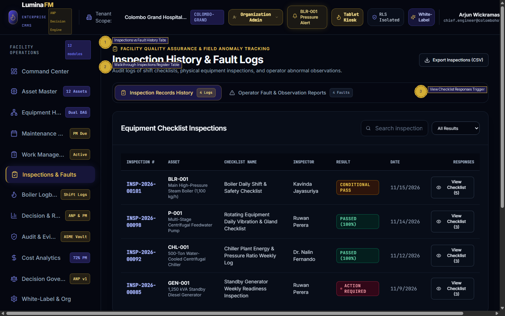
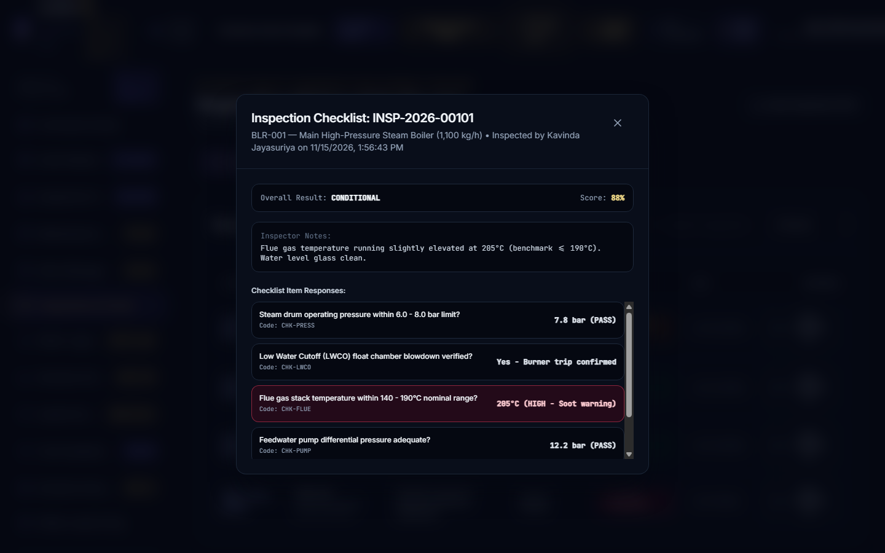
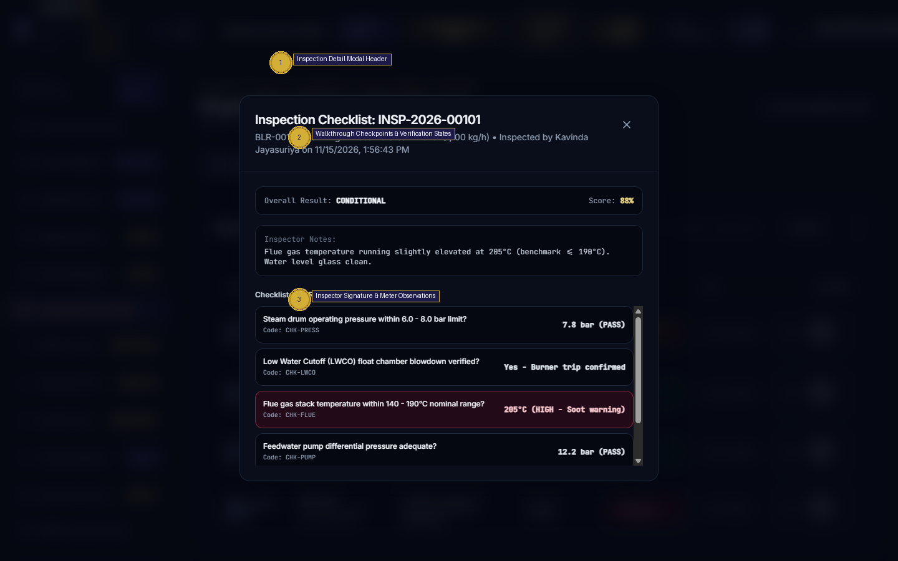
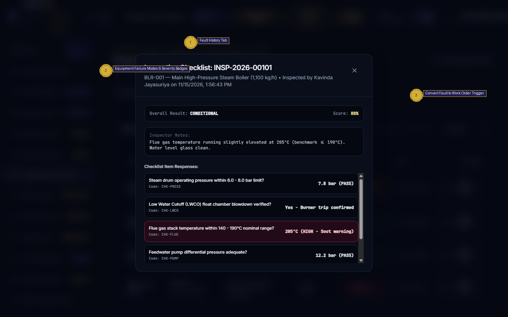

# Module Guide: Inspections & Equipment Faults

## 1. Overview & Purpose

The **Inspections & Faults** module manages standard operating walkthrough checklists, compliance inspection audits, and equipment defect tracking. It provides the crucial link between routine operator walkthroughs and corrective maintenance actions.

### Core Capabilities
- **Walkthrough Inspection Log**: Records all completed visual, auditory, and gauge verification walkthroughs.
- **Defect Tracking & Severity Grading**: Catalogs equipment faults with standardized severity ratings: `CRITICAL`, `MAJOR`, and `MINOR`.
- **Fault-to-Work-Order Escalation**: Instantly converts an unresolved mechanical or electrical defect into a corrective work order ticket with pre-filled asset context.
- **Checklist Audit Trail**: Archives individual checkpoint pass/fail responses, physical gauge readings, and inspector digital sign-offs.

---

## 2. Page Access & Permissions

- **Route**: `/inspections`
- **Navigation Access**: Click **Inspections & Faults** in the left navigation menu.
- **Required Permission**: `work_orders:read` (Permitted for all roles).

---

## 3. Visual Interface & Layout

### Walkthrough Inspections Register (`INSP-001`)

*Figure 5.1: Inspections Register Table (1440 × 900)*

*Figure 5.2: Inspections Register with Numbered Callout Markers*

#### Callout Annotations Reference (Figure 5.2)
- **Marker 1: Inspections vs Fault History Tabs**: Toggles between completed inspection logs and unresolved equipment fault records.
- **Marker 2: Walkthrough Inspections Register Table**: Displays inspection code (e.g., `INSP-2026-00018`), asset code, template title, inspection date, inspector identity, and overall outcome badge (`PASS`, `WARNING`, `FAIL`).
- **Marker 3: View Checklist Responses Trigger**: Clicking **View Checklist** opens the `InspectionDetailModal` dialog.

---

### Inspection Detail Modal (`INSP-002`)
Clicking **View Checklist** on any inspection row displays the full walkthrough response record.

*Figure 5.3: Walkthrough Inspection Detail Modal Dialog*

*Figure 5.4: Detail Modal with Numbered Callouts*

- **Marker 1: Inspection Modal Header**: Displays inspection code, asset name, and timestamp.
- **Marker 2: Walkthrough Checkpoints & Verification States**: Checkpoint-by-checkpoint breakdown (e.g., water gauge glass blowdown, safety valve free movement, flame scanner cleanliness) with pass/fail status and verification type (`VISUAL`, `AUDITORY`, `GAUGE_VERIFICATION`, `LEAK_CHECK`).
- **Marker 3: Inspector Signature & Meter Observations**: Digital sign-off, recorded operating hours, and operator qualitative notes.

---

### Equipment Fault History & Work Order Escalation (`INSP-003`)
Clicking the **Fault History** tab displays all recorded equipment defects across the plant.

*Figure 5.5: Equipment Fault History Table*

*Figure 5.6: Fault History with Numbered Callouts*

- **Marker 1: Active Fault History Tab**: Confirms fault tracking view.
- **Marker 2: Equipment Failure Modes & Severity Badges**: Displays equipment failure mode, descriptive findings, failure code (e.g., `FLT-BRN-02`), and severity pills (`CRITICAL`, `MAJOR`, `MINOR`).
- **Marker 3: Convert Fault to Work Order Trigger**: Clicking **Create Work Order** instantiates a new corrective work order in `/work-orders` pre-linked to the failed component and automatically updates the fault record status to `converted_to_wo`.

---

## 4. Field Reference: Inspection & Fault Records

### Inspection Record Fields
| Field | Purpose | Required | Format | Validation Rules | Example |
|---|---|---|---|---|---|
| `inspectionNumber` | Sequential inspection identifier | Yes | String (`INSP-YYYY-XXXXX`) | Generated sequentially per organization | `INSP-2026-00018` |
| `assetCode` | Target equipment code | Yes | String | Must match active asset | `BLR-001` |
| `templateName` | Inspection checklist blueprint | Yes | String | Non-empty | `Daily Industrial Boiler Shift Walkthrough` |
| `overallResult` | Aggregate inspection outcome | Yes | Enum | `pass`, `warning`, `fail` | `warning` |
| `inspectorName` | Person conducting the walkthrough | Yes | String | Non-empty | `M. Perera (Shift Operator)` |
| `performedAt` | Date and time inspection completed | Yes | ISO Date-Time | Valid timestamp | `2026-11-15T08:30:00Z` |

### Fault Record Fields
| Field | Purpose | Required | Format | Validation Rules | Example |
|---|---|---|---|---|---|
| `faultCode` | Defect tracking identifier | Yes | String | Unique code | `FLT-2026-00104` |
| `assetCode` | Defective equipment asset | Yes | String | Valid asset | `P-001` |
| `failureMode` | Classification of failure | Yes | String | Standard failure code | `Mechanical Seal Packing Leakage` |
| `severity` | Risk impact severity | Yes | Enum | `critical`, `major`, `minor` | `major` |
| `description` | Physical observation findings | Yes | Text | Detailed description | `Steady water droplet leakage from gland seal > 15 drops/min.` |
| `status` | Defect resolution state | Yes | Enum | `open`, `investigating`, `converted_to_wo`, `resolved` | `open` |
