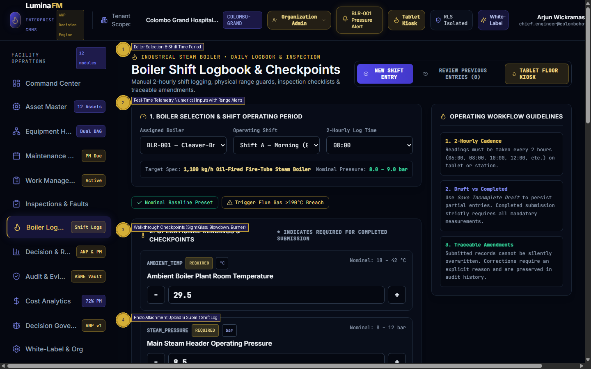
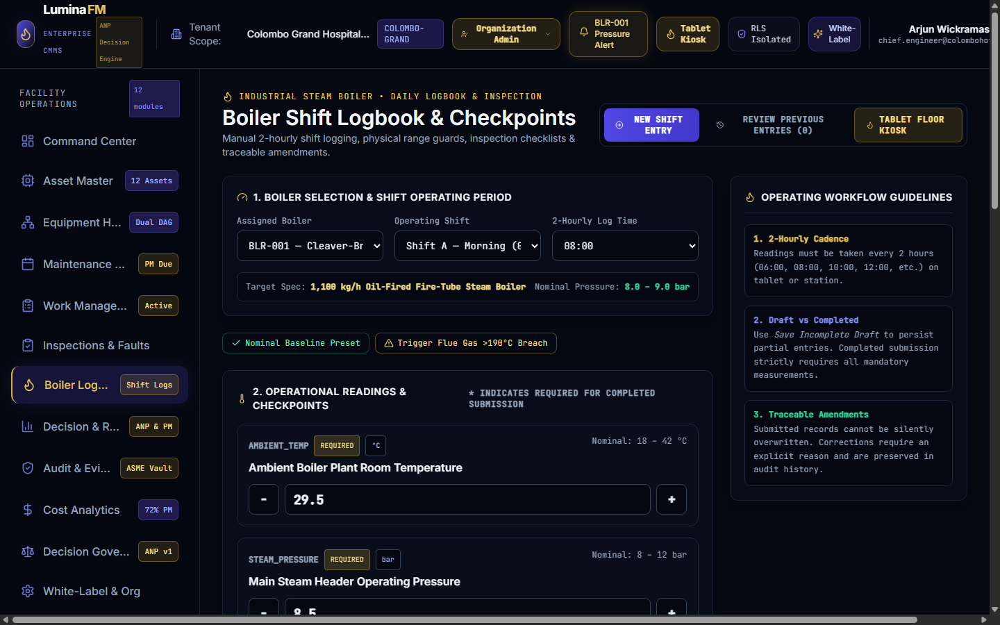
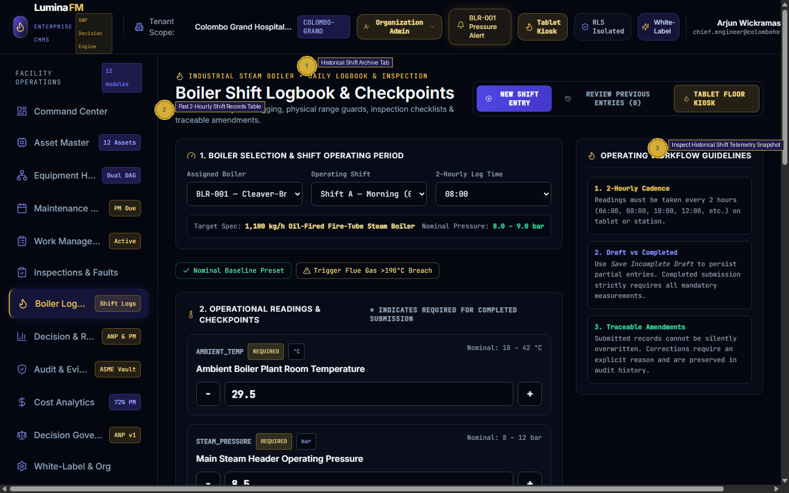

# Module Guide: Daily Boiler Monitoring Logbook

## 1. Overview & Purpose

The **Daily Boiler Monitoring** module provides a specialized 2-hourly digital logbook for industrial fire-tube and water-tube steam boilers ($1,000 - 1,800\text{ kg/h}$ capacity). It replaces paper boiler log sheets, automatically validating operating parameters against engineering benchmarks, enforcing mandatory physical walkthrough checks, and feeding validated telemetry directly into the ANP decision-support engine.

### Core Capabilities
- **2-Hourly Watchkeeping Interval**: Supports standardized industrial shifts (Shift A, Shift B, Shift C) and 2-hourly logging intervals (`06:00`, `08:00`, `10:00`, `12:00`, `14:00`, `16:00`, `18:00`, `20:00`, `22:00`, `00:00`, `02:00`, `04:00`).
- **Instantaneous Limit Enforcement**: Evaluates live sensor inputs against design working limits, providing real-time color-coded indicators (Normal: Emerald, Excursion: Gold/Red).
- **Auto-Draft Corrective Work Orders**: Automatically stages draft work order tickets when high-risk anomalies (such as flue gas soot fouling or excessive TDS) are recorded.
- **Physical Walkthrough Checkpoints**: Mandates verification of critical safety components, including sight glass water levels, blowdown execution, and flame scanner stability.

---

## 2. Page Access & Permissions

- **Route**: `/daily-monitoring`
- **Navigation Access**: Click **Boiler Logbook** in the left navigation sidebar.
- **Required Permission**: `operations:daily_log` (Permitted for `Organization Admin`, `Plant Reliability Engineer`, `Boiler Plant Operator`, and `Maintenance Technician`).

---

## 3. Visual Interface & Layout

### Active Shift Log Entry Form (`LOG-001`)

*Figure 6.1: Boiler Logbook Active Shift Entry (1440 × 900)*

*Figure 6.2: Boiler Logbook Entry with Numbered Callout Markers*

#### Callout Annotations Reference (Figure 6.2)
- **Marker 1: Boiler Selection & Shift Time Period**: Selects the operating boiler unit (`BLR-001`), active watchkeeper shift (`Shift A: 06:00–14:00`), and logging time mark (`08:00`).
- **Marker 2: Real-Time Telemetry Numerical Inputs**: High-precision numerical inputs with live range indicators. Entering values outside nominal limits immediately highlights the field with warning messages.
- **Marker 3: Walkthrough Checkpoints**: Physical operating checks (Gauge Glass Blowdown, Water Treatment Chemical Dosing, Primary Burner Flame Pattern) with instant Yes/No status toggles.
- **Marker 4: Photo Attachment Upload & Submit Shift Log**: Evidence photograph uploader with caption support, auto-draft work order toggle, and the primary **Submit Shift Logbook** button.

---

### Historical Shift Archive Tab (`LOG-002`)
Clicking the **Historical Shift Archive** tab displays past watchkeeper logs.

*Figure 6.3: Historical Shift Archive View*

*Figure 6.4: Historical Archive with Numbered Callouts*

- **Marker 1: Active Historical Shift Archive Tab**: Highlights the archived shift logs view.
- **Marker 2: Past 2-Hourly Shift Records Table**: Chronological table displaying date, shift, time mark, recorded steam pressure, stack temperature, TDS, and operator sign-off.
- **Marker 3: Inspect Historical Telemetry Snapshot**: Clicking an archived log expands the complete parameter snapshot, including associated photographs and ANP calculation links.

---

## 4. Telemetry Parameters & Engineering Limits

The logbook enforces the following thermodynamic and chemical boundaries:

| Parameter Key | Parameter Name | Engineering Unit | Nominal Operating Range | Alert Threshold (High) | Critical Action on Exceedance |
|---|---|---|---|---|---|
| `STEAM_PRESSURE` | Main Steam Header Operating Pressure | $\text{bar}$ | $6.0 - 10.0$ | $> 10.2\text{ bar}$ | Check modulating burner pressure regulator; test safety valve pop setting ($10.5\text{ bar}$). |
| `FLUE_GAS_TEMP` | Stack Exit Gas Temperature | $^\circ\text{C}$ | $140.0 - 190.0$ | $> 190.0^\circ\text{C}$ | Indicates fireside soot fouling on tube banks; schedule soot blowdown and fireside brushing. |
| `BOILER_WATER_TDS` | Total Dissolved Solids in Boiler Water | $\text{ppm}$ | $1,500 - 2,500$ | $> 2,800\text{ ppm}$ | Risk of priming and steam carryover; execute bottom blowdown and increase continuous blowdown rate. |
| `AMBIENT_TEMP` | Boiler Plant Room Air Intake Temp | $^\circ\text{C}$ | $20.0 - 38.0$ | $> 42.0^\circ\text{C}$ | Increases burner forced-draft fan intake temperature; inspect plant room ventilation dampers. |
| `WATER_LEVEL_OK` | Gauge Glass Water Level Verified | Boolean | `true` | `false` | **IMMEDIATE TRIP HAZARD**: Perform sight glass drain blowdown. If low, shut down burner immediately. |
| `PUMP_HOURS` | Feedwater Pump Operating Hours | $\text{hours}$ | Non-decreasing | $\Delta > 2.5\text{ hrs/period}$ | Inspect feed pump mechanical seal packing and motor bearing vibration. |

---

## 5. Field Reference: Shift Log Submission Form

| Field | Purpose | Required | Format | Validation Rules | Example |
|---|---|---|---|---|---|
| `assetId` | Target boiler asset UUID | Yes | UUID | Must reference valid boiler | `a1000000-0000-0000-0000-000000000001` |
| `shiftCode` | Operating shift identifier | Yes | Enum | `SHIFT_A`, `SHIFT_B`, `SHIFT_C` | `SHIFT_A` |
| `operatingPeriod` | 2-hourly time stamp | Yes | String (`HH:MM`) | Standard 24h time format | `08:00` |
| `logDate` | Operational calendar date | Yes | Date (`YYYY-MM-DD`) | Valid date | `2026-11-15` |
| `STEAM_PRESSURE` | Header steam pressure reading | Yes | Number | $0.0 - 15.0\text{ bar}$ | `8.5` |
| `FLUE_GAS_TEMP` | Flue gas exit temperature | Yes | Number | $50.0 - 350.0^\circ\text{C}$ | `175.0` |
| `BOILER_WATER_TDS` | Boiler water TDS meter reading | Yes | Integer | $100 - 10,000\text{ ppm}$ | `2400` |
| `AMBIENT_TEMP` | Boiler room air temperature | Yes | Number | $10.0 - 60.0^\circ\text{C}$ | `29.5` |
| `WATER_LEVEL_OK` | Visual sight glass confirmation | Yes | Boolean | Must be confirmed `true` | `true` |
| `operatorNotes` | Shift handover remarks | No | Text | Optional qualitative notes | `Burner firing stable on modulating high fire. Sight glass blown down.` |
| `autoDraftWorkOrder` | Create draft work order on excursion | Yes | Boolean | Default: `true` | `true` |
