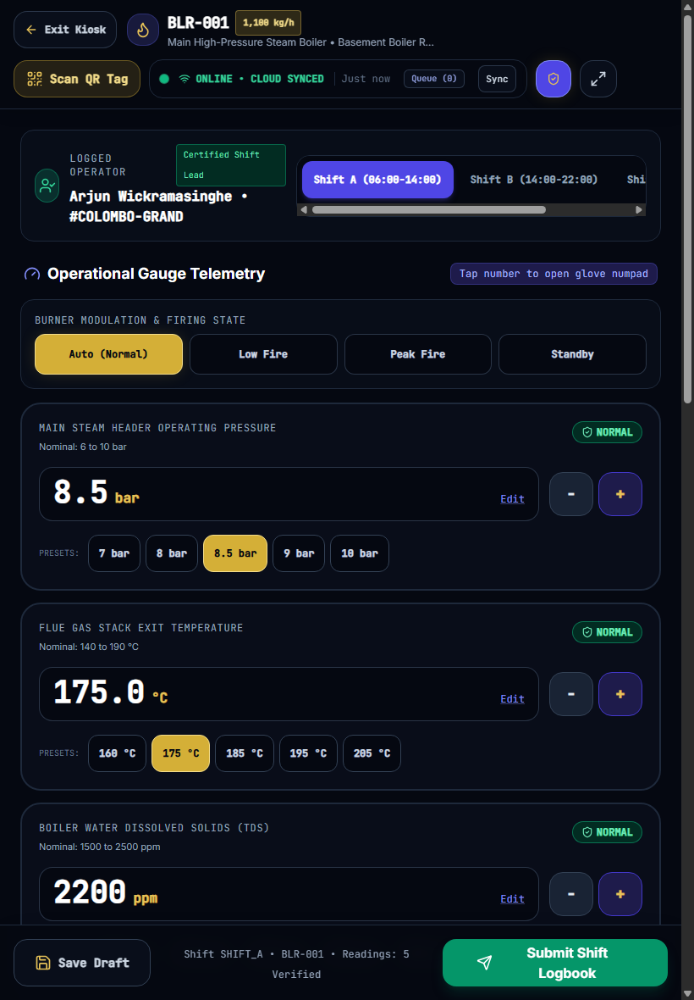
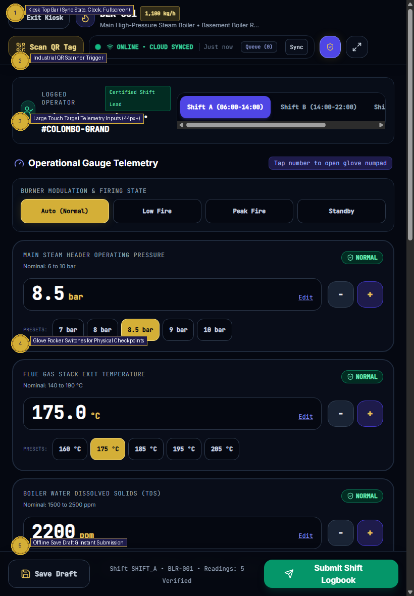
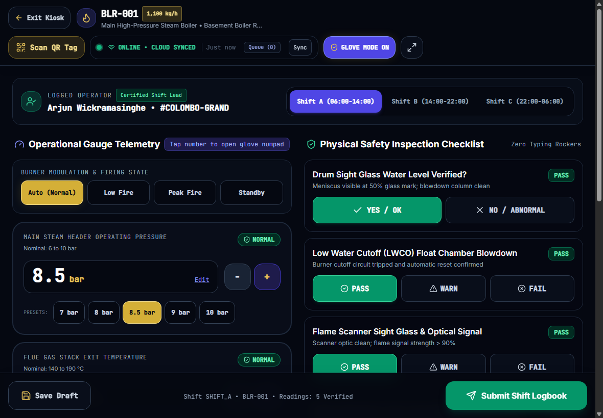
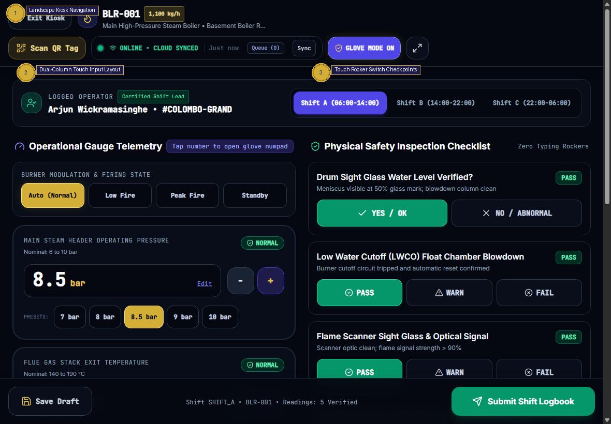
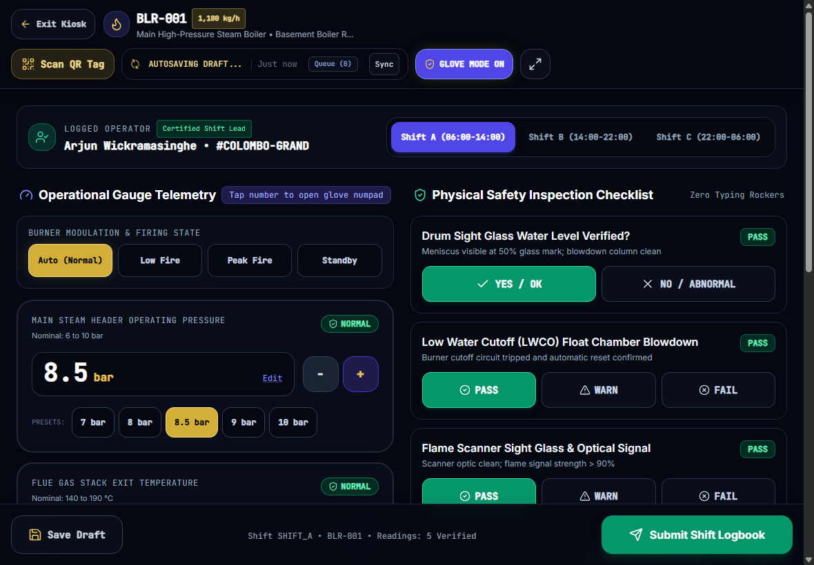
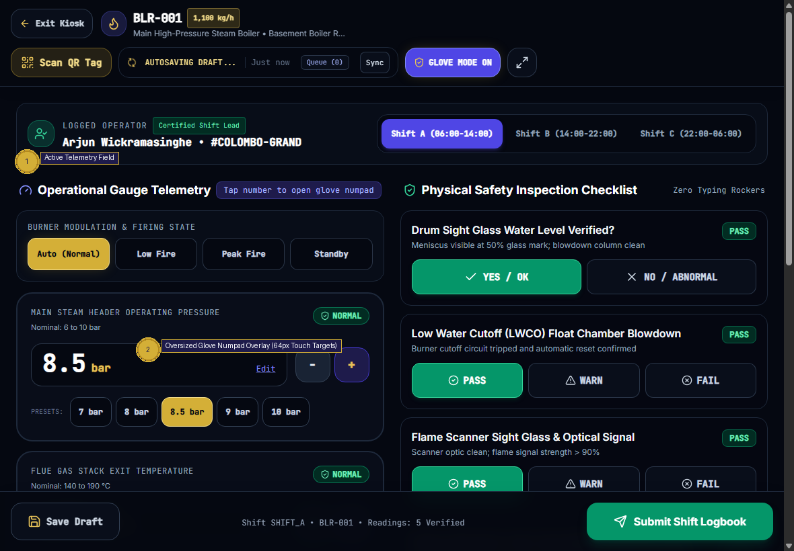
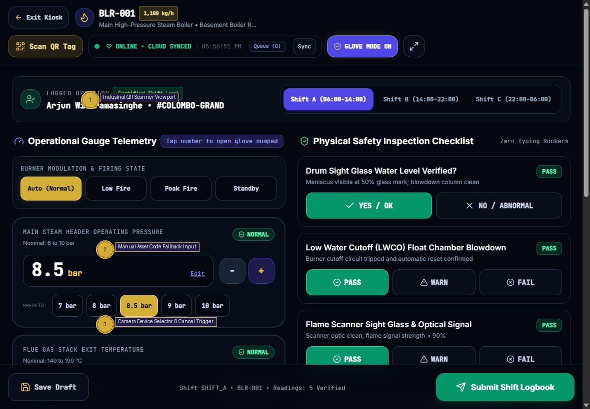
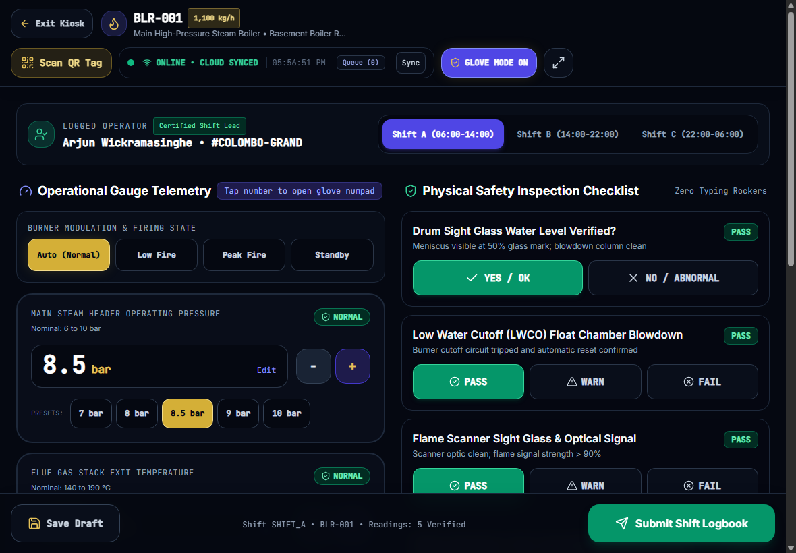
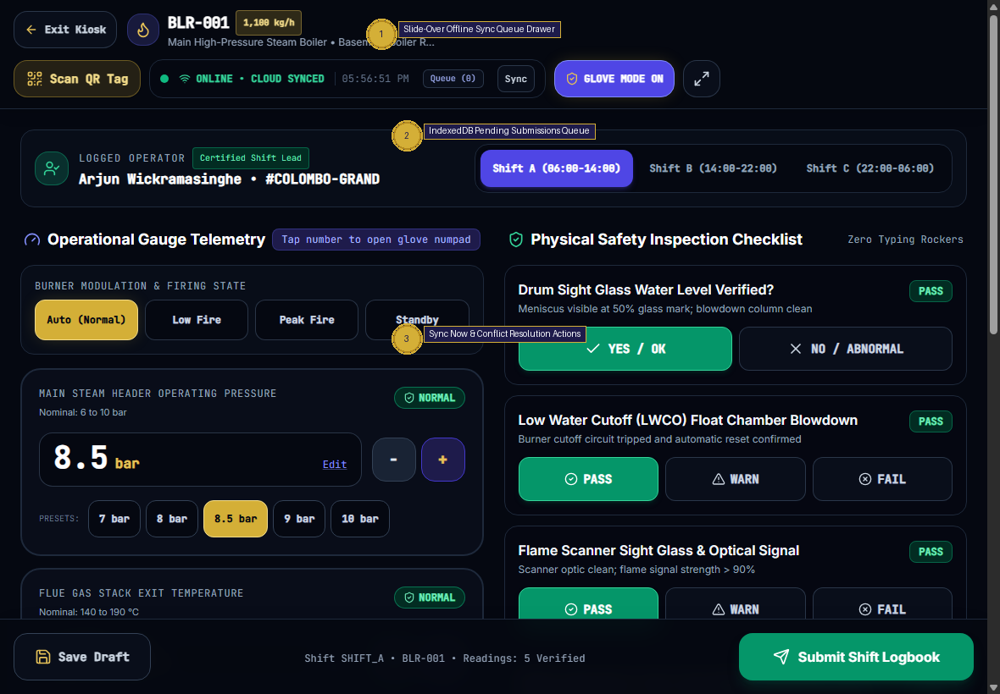

# Module Guide: Factory-Floor Operator Tablet Kiosk

## 1. Overview & Purpose

The **Factory-Floor Operator Tablet Kiosk** is a dedicated, touch-first mobile web application designed specifically for operators, watchkeepers, and maintenance technicians working on industrial plant floors. Engineered for use on iPads and Android tablets (in both portrait and landscape orientations), it accommodates operators wearing bulky protective work gloves in high-noise, high-temperature boiler rooms and central utility plants.

### Key Industrial Ergonomic Features
- **Touch-First Target Standards**: All interactive controls, buttons, and switches feature touch dimensions of at least $44 \times 44\text{px}$, with numerical keys expanded to $64 \times 64\text{px}$.
- **Tactile Glove Numpad (`GloveNumpad`)**: Pop-up floating numpad that eliminates reliance on miniature native mobile virtual keyboards.
- **Bipolar Glove Rocker Switches (`GloveRockerSwitch`)**: Oversized physical toggle controls providing positive visual and tactile feedback for equipment walkthrough checks.
- **Integrated QR Barcode Scanner (`QrScannerModal`)**: Allows operators to scan physical QR codes affixed to boiler nameplates or pumps to jump directly into the correct asset inspection log.
- **Offline PWA Local Persistence**: Fully operational when working in subterranean basements or shielded utility vaults with zero cellular or Wi-Fi connectivity.

---

## 2. Page Access & Permissions

- **Route**: `/operator`
- **Navigation Access**: Click the gold **Tablet Kiosk** button in the top navigation bar from any screen in LuminaFM.
- **Permitted Roles**: All authenticated roles (`Boiler Plant Operator`, `Maintenance Technician`, `Plant Reliability Engineer`, `Organization Admin`).

---

## 3. Visual Interface & Device Viewports

### Tablet Portrait Orientation ($820 \times 1180$) (`KIOSK-001`)
The primary posture for handheld field walkthroughs.

*Figure 7.1: Factory-Floor Kiosk in Portrait Orientation (820 × 1180)*

*Figure 7.2: Kiosk Portrait View with Numbered Callout Markers*

#### Callout Annotations Reference (Figure 7.2)
- **Marker 1: Kiosk Top Bar**: Displays active offline synchronization status, network indicator, system time, battery meter, and fullscreen toggle button.
- **Marker 2: Industrial QR Scanner Trigger**: Clicking **Scan Asset QR** opens the barcode camera scanner.
- **Marker 3: Large Touch Target Numerical Inputs**: Field telemetry inputs (Steam Pressure, Stack Temp, Water TDS) with preset quick-tap buttons.
- **Marker 4: Glove Rocker Switches**: Bipolar toggle controls for physical verification checkpoints (Water Level OK, Chemical Dosing Active, Burner Flame Stable).
- **Marker 5: Offline Save Draft & Instant Submission**: Dual touch triggers to save a local draft into IndexedDB or immediately dispatch a shift log.

---

### Tablet Landscape Orientation ($1180 \times 820$) (`KIOSK-002`)
Optimized for tablet enclosures mounted directly to boiler burner control cabinets or field workstations.

*Figure 7.3: Factory-Floor Kiosk in Landscape Orientation (1180 × 820)*

*Figure 7.4: Kiosk Landscape View with Numbered Callout Markers*

- **Marker 1: Condensed Landscape Header**: High-contrast top status bar with tenant logo.
- **Marker 2: Dual-Column Touch Layout**: Left column presents telemetry parameters; right column displays walkthrough rocker switches.
- **Marker 3: Touch Rocker Switch Checkpoints**: Arranged in accessible vertical cards.

---

## 4. Specialized Touch Components & Modals

### A. Oversized Glove Numpad (`GloveNumpad`) (`KIOSK-003`)
Tapping the **Numpad** icon beside any numerical field summons the floating tactile keypad.

*Figure 7.5: Oversized Tactile Glove Numpad*

*Figure 7.6: Glove Numpad with Numbered Callouts*

- **Marker 1: Active Telemetry Target Field**: Shows the focused input (e.g., `FLUE_GAS_TEMP: 175.0°C`).
- **Marker 2: Oversized Glove Numpad ($64\text{px}$ Targets)**: Grid of large keys ($0 - 9$, Decimal Point, Backspace, Clear) ensuring accurate entry when wearing leather or rubber work gloves.
- **Marker 3: Preset Quick-Tap Buttons**: Quick-selection values based on standard boiler operating benchmarks (e.g., $160^\circ\text{C}$, $175^\circ\text{C}$, $185^\circ\text{C}$, $195^\circ\text{C}$, $205^\circ\text{C}$). Tapping a preset inputs the exact value instantly with zero typing.

---

### B. Industrial QR Barcode Scanner Modal (`QrScannerModal`) (`KIOSK-004`)
Clicking **Scan Asset QR** opens the scanner overlay.

*Figure 7.7: Industrial QR Scanner Dialog*

*Figure 7.8: QR Scanner with Numbered Callouts*

- **Marker 1: Camera Video Viewport**: Real-time camera viewfinder with targeting reticle.
- **Marker 2: Manual Asset Code Fallback Input**: Allows manual entry of the asset identifier (e.g., `BLR-001`) if the physical QR barcode tag is damaged or unreadable.
- **Marker 3: Camera Selector & Cancel**: Toggles between front and rear cameras or cancels scanning.

---

### C. Offline Synchronization Queue Drawer (`SyncQueueDrawer`) (`KIOSK-005`)
Tapping the **Sync Status Pill** in the top bar opens the local persistence queue.

*Figure 7.9: Offline Sync Queue Inspection Drawer*

*Figure 7.10: Sync Queue Drawer with Numbered Callouts*

- **Marker 1: Slide-Over Sync Drawer**: Displays local IndexedDB offline storage status.
- **Marker 2: Pending Submissions Queue**: Lists shift logs and inspection records captured while offline, showing submission UUID, timestamp, and retry count.
- **Marker 3: Sync Now & Conflict Resolution**: Triggers manual synchronization retry or reviews conflict diffs if server data changed during disconnection.

---

## 5. Field Reference: Factory-Floor Kiosk Inputs

| Field | Purpose | Minimum Target Size | Input Method | Validation Bounds |
|---|---|---|---|---|
| `STEAM_PRESSURE` | Main header steam operating pressure | $48 \times 48\text{px}$ | Glove Numpad / Presets | $0.0 - 15.0\text{ bar}$ |
| `FLUE_GAS_TEMP` | Stack exit temperature | $48 \times 48\text{px}$ | Glove Numpad / Presets | $50.0 - 350.0^\circ\text{C}$ |
| `BOILER_WATER_TDS` | Dissolved solids in water | $48 \times 48\text{px}$ | Glove Numpad / Presets | $100 - 10,000\text{ ppm}$ |
| `AMBIENT_TEMP` | Plant room combustion air temp | $48 \times 48\text{px}$ | Glove Numpad / Presets | $10.0 - 60.0^\circ\text{C}$ |
| `WATER_LEVEL_OK` | Visual sight glass level verified | $56 \times 96\text{px}$ | Glove Rocker Switch | Bipolar: `Normal` / `Abnormal` |
| `CHEMICAL_DOSING_OK`| Chemical feed pump operating | $56 \times 96\text{px}$ | Glove Rocker Switch | Bipolar: `Normal` / `Abnormal` |
| `BURNER_FLAME_OK` | Stable flame envelope verified | $56 \times 96\text{px}$ | Glove Rocker Switch | Bipolar: `Normal` / `Abnormal` |
| `FEED_PUMP_RUNNING` | Feedwater pump operating steadily | $56 \times 96\text{px}$ | Glove Rocker Switch | Bipolar: `Normal` / `Abnormal` |
