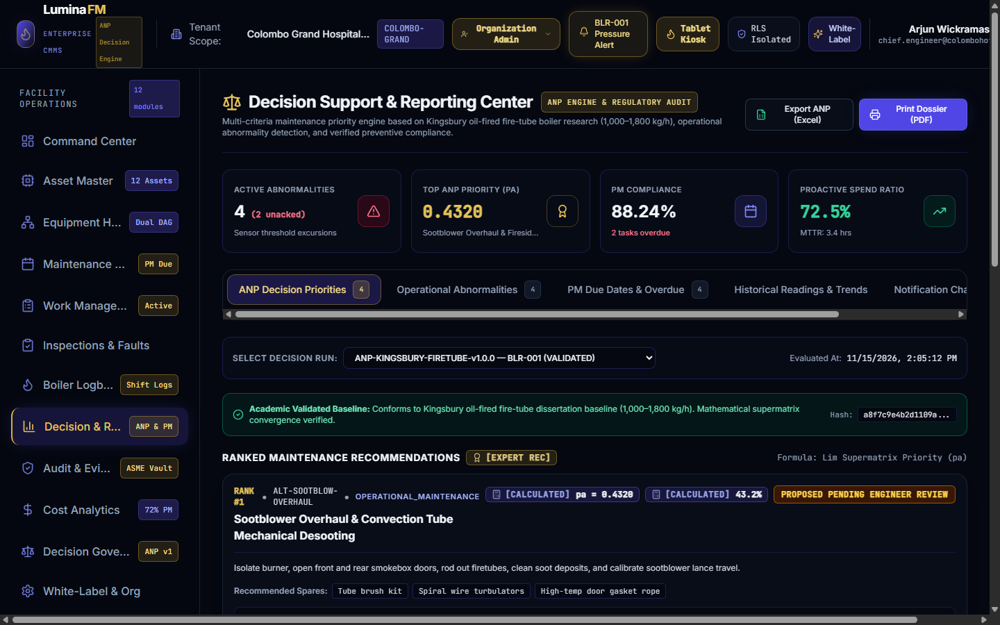
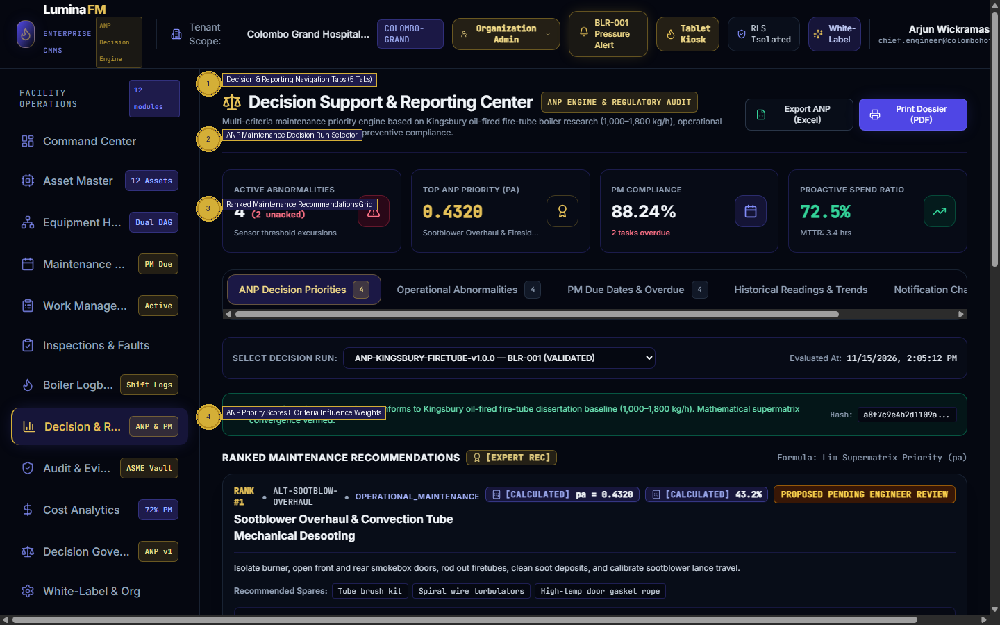
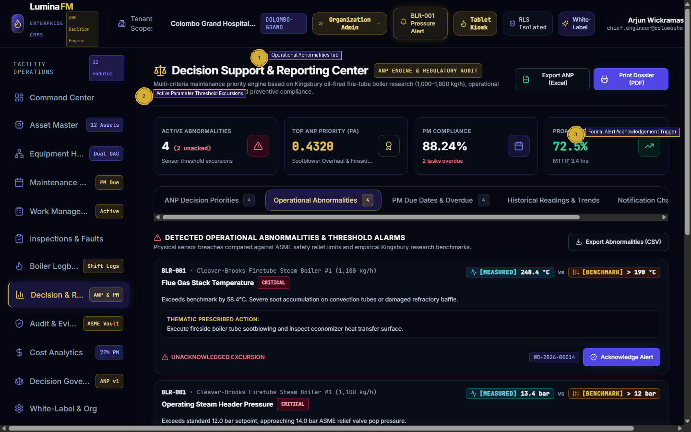
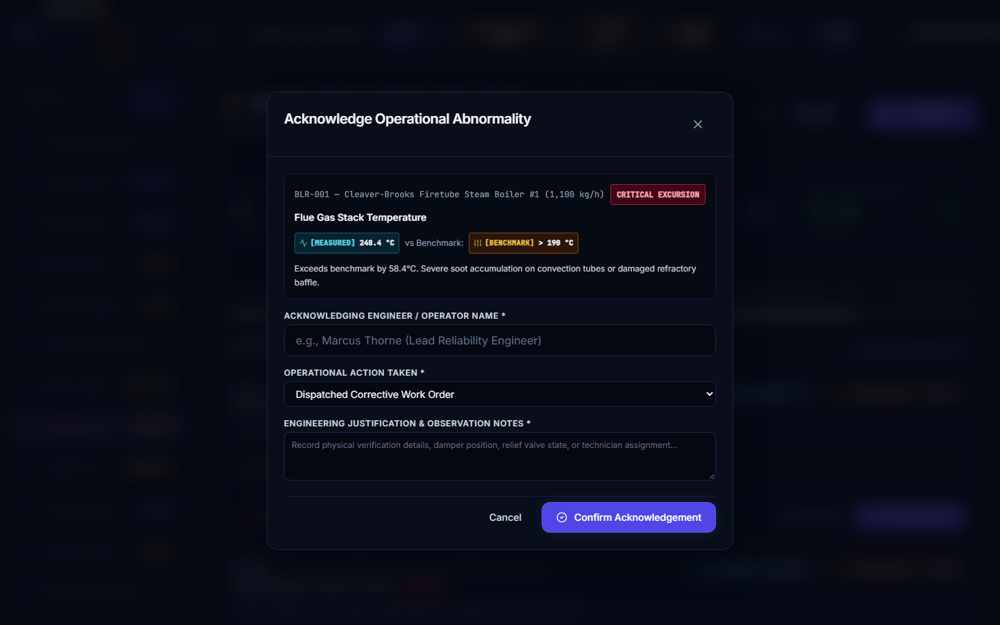
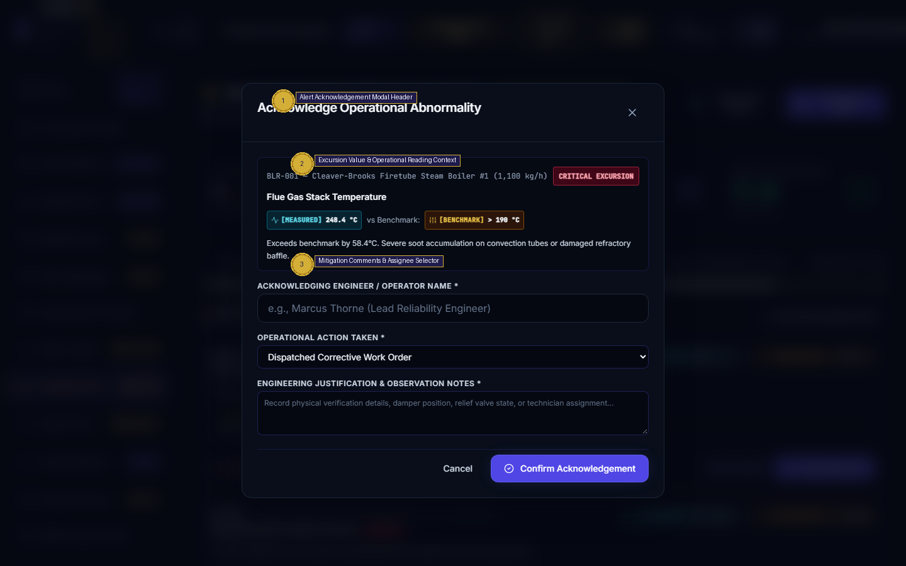
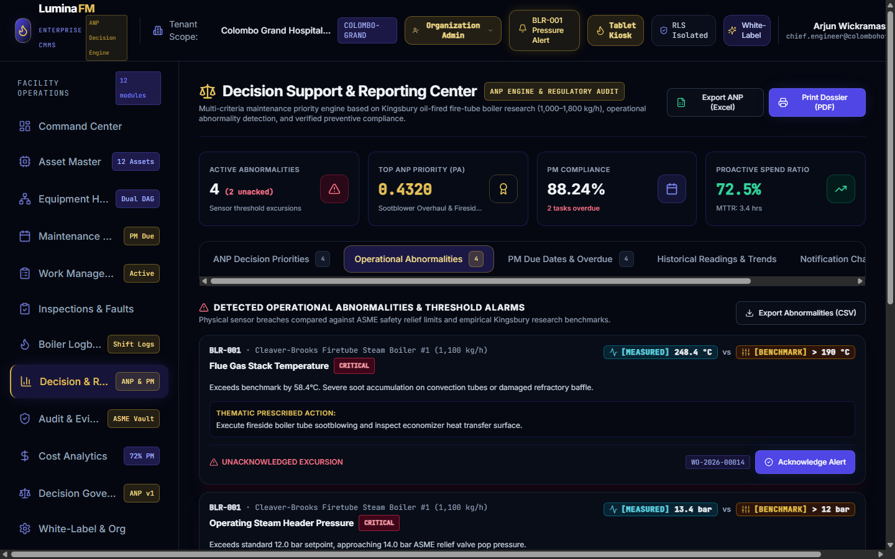
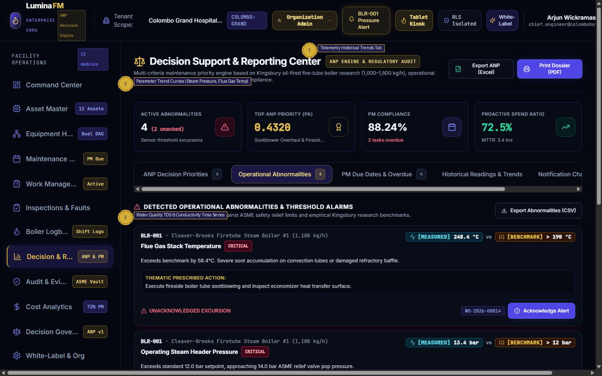
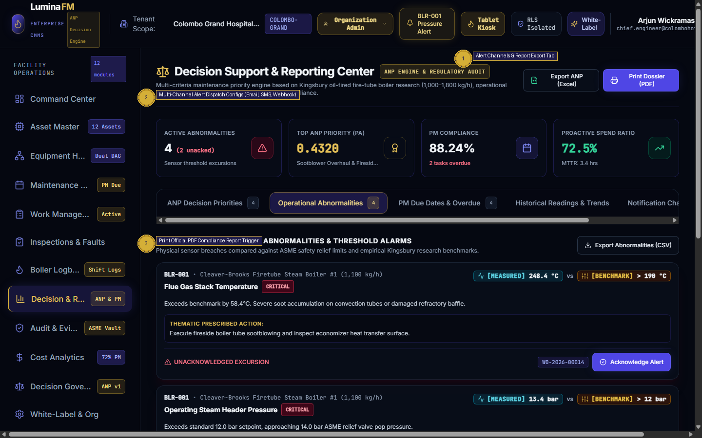
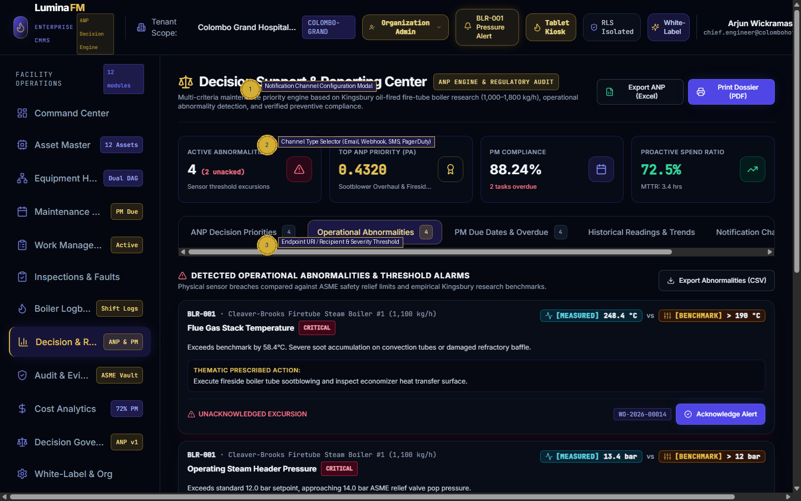

# Module Guide: Decision Support & Reporting Analytics

## 1. Overview & Purpose

The **Decision Support & Reporting** module translates raw facility telemetry and daily logbook observations into mathematical Analytic Network Process (ANP) maintenance recommendations, tracks operational threshold excursions, analyzes long-term equipment degradation trends, and routes critical alerts to external channels.

### Core Capabilities
- **ANP Multi-Criteria Decision Evaluation**: Computes priority vectors for candidate maintenance interventions (e.g., Burner Overhaul, Chemical Descaling, Refractory Baffle Repair, Feedwater Pump Overhaul) based on Kingsbury's validated dissertation supermatrix.
- **Operational Abnormalities Management**: Displays active threshold excursions and provides formal acknowledgement workflows for plant engineers.
- **Multi-Parameter Trend Curves**: Interactive time-series charts visualizing steam pressure stability, flue gas soot accumulation, and boiler water TDS trends.
- **Multi-Channel Alert Dispatch**: Configures alert delivery to corporate Email, SMS Webhooks, Slack channels, and PagerDuty endpoints.
- **Official Compliance PDF Generation**: One-click printable reports formatted with organizational crests, data classification badges, and signature sign-offs.

---

## 2. Page Access & Permissions

- **Route**: `/reports`
- **Navigation Access**: Click **Decision & Reporting** in the left navigation sidebar.
- **Required Permission**: `work_orders:read` to view; `governance:manage` to review recommendations (Permitted for all authenticated roles).

---

## 3. Visual Interface & Navigation Tabs

The module is organized across five functional tabs:

### Tab 1: ANP Maintenance Decision Runs (`REP-001`)

*Figure 8.1: ANP Decision Run Priorities & Recommendations (1440 × 900)*

*Figure 8.2: ANP Decision Interface with Numbered Callout Markers*

#### Callout Annotations Reference (Figure 8.2)
- **Marker 1: Decision & Reporting Navigation Tabs**: 5-tab strip (`ANP Decisions`, `Abnormalities`, `PM Due`, `Trends`, `Channels & Export`).
- **Marker 2: Decision Run Selector**: Dropdown to inspect historical mathematical calculation runs with model version (`v1.4.0`) and execution timestamps.
- **Marker 3: Ranked Maintenance Recommendations Grid**: Priority-ranked cards showing recommended actions, priority scores (e.g., $0.412$ for Burner Overhaul), and criteria influence explanations.
- **Marker 4: ANP Criteria Influence Weights**: Visual breakdown of criteria driving the decision (Combustion Efficiency: $38\%$, Fireside Heat Transfer: $27\%$, Safety Risk: $21\%$).

---

### Tab 2: Operational Abnormalities (`REP-002`)
Displays all active excursions exceeding nominal engineering limits.

*Figure 8.3: Operational Abnormalities Tab View*

*Figure 8.4: Abnormalities Tab with Numbered Callouts*

- **Marker 1: Active Abnormalities Tab**: Confirms operational excursions view.
- **Marker 2: Active Threshold Excursions Table**: Lists asset code, parameter name, recorded value, design limit, excursion magnitude, and severity level (`CRITICAL`, `WARNING`).
- **Marker 3: Formal Alert Acknowledgement Trigger**: Clicking **Acknowledge** opens the mitigation sign-off modal.

---

### Tab 3: Alert Acknowledgement Modal (`REP-003`)
Clicking **Acknowledge** on any abnormality row launches the formal engineering sign-off dialog.

*Figure 8.5: Operational Alert Acknowledgement Dialog*

*Figure 8.6: Acknowledgement Dialog with Numbered Callouts*

- **Marker 1: Modal Header**: Excursion identifier and target equipment name.
- **Marker 2: Excursion Value & Engineering Context**: Shows recorded value vs. maximum allowable limit (e.g., Flue Gas Temp $205.0^\circ\text{C} > 190.0^\circ\text{C}$).
- **Marker 3: Mitigation Comments & Assignee**: Mandatory text input for operating engineer remarks (e.g., "Sootblower run scheduled for 14:00") and technician assignment.

---

### Tab 4: Telemetry Historical Trends (`REP-004`)
Visualizes parameter trends over 7-day, 30-day, and 90-day operating windows.

*Figure 8.7: Telemetry Historical Trends View*

*Figure 8.8: Trend Curves with Numbered Callouts*

- **Marker 1: Historical Trends Tab**: Highlights time-series analytics view.
- **Marker 2: Thermodynamic Parameter Curves**: Multi-line chart tracking Steam Header Operating Pressure and Flue Gas Exit Temperature over time.
- **Marker 3: Water Chemistry Trends**: Charts Boiler Water TDS and Feedwater Conductivity against blowdown events.

---

### Tab 5: Notification Channels & Report Export (`REP-005` & `REP-006`)
Configures external notification channels and generates formal compliance documents.

*Figure 8.9: Notification Channels & Report Export Interface*

*Figure 8.10: Channels & Export with Numbered Callouts*

- **Marker 1: Channels & Export Tab**: Active export interface.
- **Marker 2: Multi-Channel Alert Dispatch Configuration**: Lists configured alert sinks (Email, SMS Webhook, Slack, PagerDuty) with active statuses.
- **Marker 3: Print Official PDF Compliance Report**: Opens an isolated printable report window formatted per corporate documentation standards.

*Figure 8.11: Notification Channel Configuration Dialog*

*Figure 8.12: Channel Config Dialog with Numbered Callouts*

- **Marker 1: Modal Header**: Channel configuration dialog.
- **Marker 2: Channel Type Selector**: Dropdown to select `EMAIL`, `SMS_WEBHOOK`, `SLACK`, or `PAGERDUTY`.
- **Marker 3: Endpoint URI & Alert Threshold**: Target address / webhook URI and minimum severity threshold required to trigger dispatch.

---

## 4. Field Reference: Reporting & Notification Forms

### Alert Acknowledgement Form
| Field | Purpose | Required | Format | Validation Rules | Example |
|---|---|---|---|---|---|
| `mitigationNotes` | Immediate corrective engineering actions | Yes | Text | Minimum 10 characters | `Checked rotary cup burner; increased forced draft air damper opening by 5%.` |
| `priorityOverride` | Escalated priority level | No | Enum | `low`, `medium`, `high`, `critical` | `high` |
| `assignedTechnician`| Lead technician assigned to inspect | No | String | Name or employee ID | `D. Silva (Boiler Lead)` |

### Notification Channel Configuration Form
| Field | Purpose | Required | Format | Validation Rules | Example |
|---|---|---|---|---|---|
| `channelName` | Descriptive channel label | Yes | String | 3–50 characters | `Central Control Room Slack Webhook` |
| `channelType` | External notification protocol | Yes | Enum | `EMAIL`, `SMS_WEBHOOK`, `SLACK`, `PAGERDUTY` | `SLACK` |
| `targetEndpoint` | Webhook URL or destination address | Yes | URI / Email | Must be valid URI or email | `https://hooks.slack.com/services/T00/B00/X00` |
| `minSeverity` | Minimum threshold to trigger dispatch | Yes | Enum | `ALL`, `WARNING_AND_CRITICAL`, `CRITICAL_ONLY` | `CRITICAL_ONLY` |
