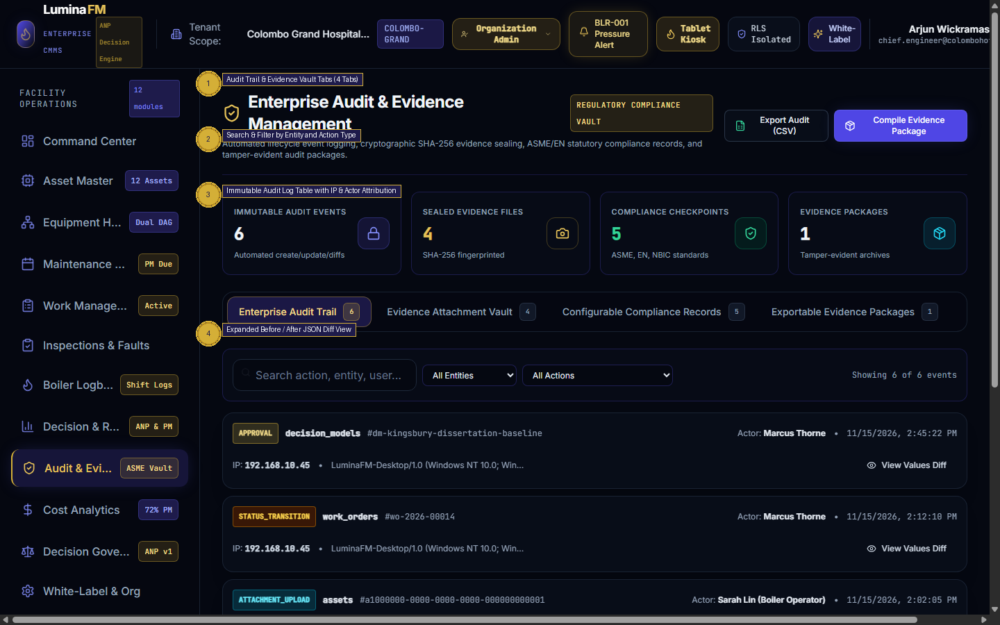
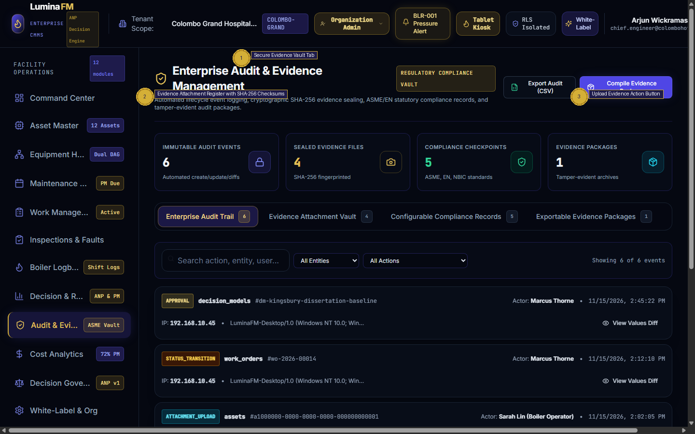
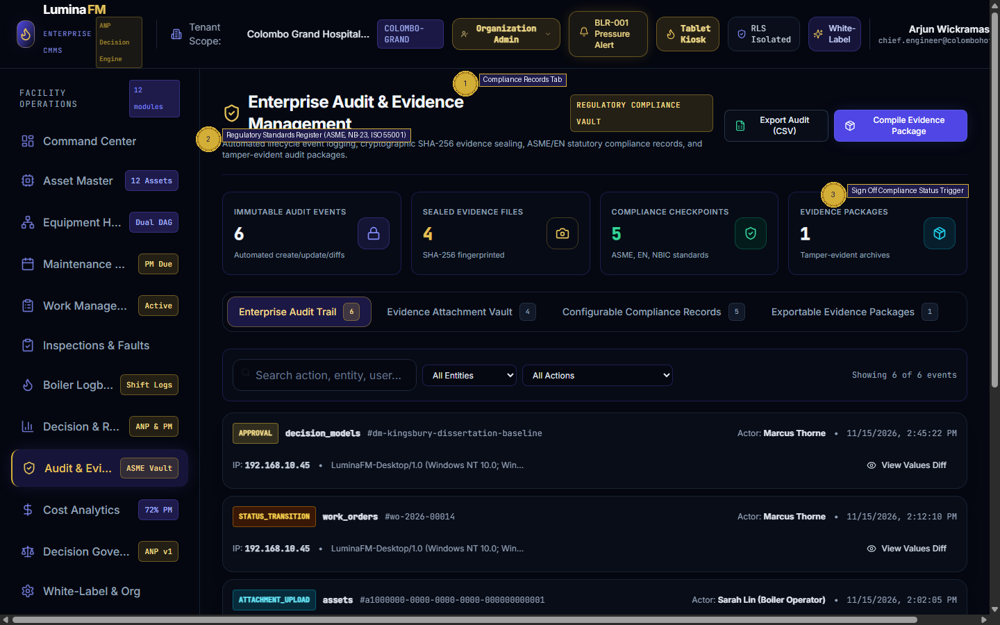
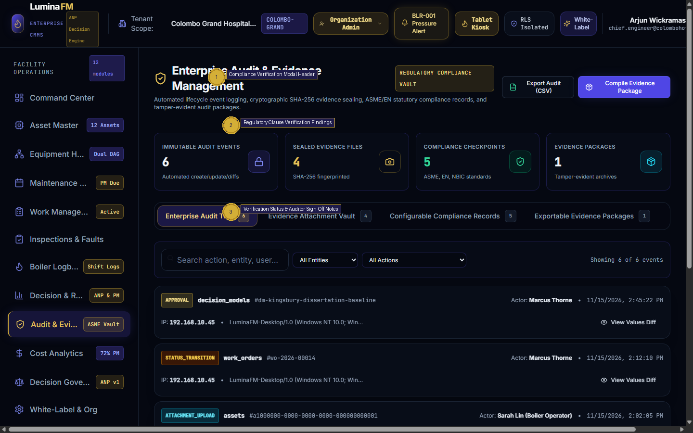
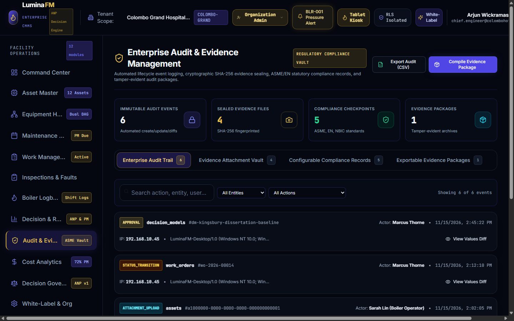
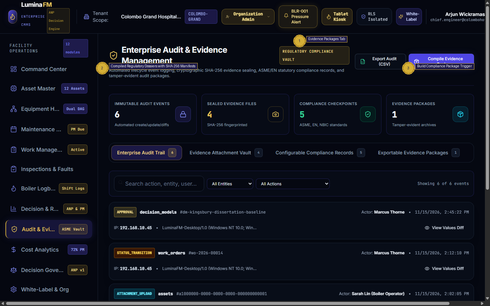
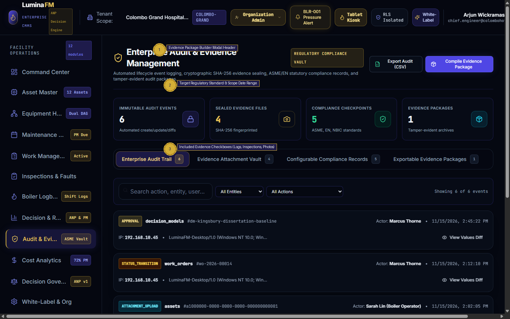

# Module Guide: Enterprise Audit Trail & Evidence Vault

## 1. Overview & Purpose

The **Enterprise Audit & Evidence Vault** module ensures complete regulatory traceability, non-repudiation, and document integrity across all facility maintenance operations. It records an immutable history of every create, update, delete, approval, and status-transition event while securing photographs, non-destructive examination (NDE) test certificates, and compliance dossiers with client-side **SHA-256 cryptographic hashes**.

### Core Capabilities
- **Immutable Audit Trail**: Captures actor identity, IP address, organization tenant ID, timestamp, and before/after state diffs for every critical action.
- **SHA-256 Cryptographic Evidence Hashing**: Computes cryptographic checksums upon upload to verify file integrity against tampering.
- **Multi-Level Data Classification**: Tags attachments according to enterprise data governance tiers: `PUBLIC`, `INTERNAL`, `CONFIDENTIAL`, and `RESTRICTED`.
- **Regulatory Framework Mapping**: Tracks compliance against governing boiler and asset management codes (ASME Section I, NBIC NB-23, ISO 55001, OSHA 1910.119 PSM).
- **Exportable Evidence Packages**: Compiles multi-source inspection, maintenance, and photographic evidence into standardized audit dossiers with cryptographic manifests.

> [!WARNING]
> **Mandatory Regulatory Notice**: Generating a PDF report or compiling an evidence dossier within LuminaFM does **not** automatically confer certified statutory compliance. All evidence packages must be formally reviewed and signed off by an authorized inspector in accordance with applicable local jurisdiction boiler safety rules.

---

## 2. Page Access & Permissions

- **Route**: `/audit-evidence`
- **Navigation Access**: Click **Audit & Evidence** in the left navigation sidebar.
- **Required Permission**: `work_orders:read` to view; `assets:manage` to upload evidence or sign off compliance (Permitted for all authenticated roles).

---

## 3. Visual Interface & Navigation Tabs

The module contains four primary tabs:

### Tab 1: Immutable Audit Trail (`AUDIT-001`)

*Figure 9.1: Immutable Audit Trail Table (1440 × 900)*

*Figure 9.2: Audit Trail with Numbered Callout Markers*

#### Callout Annotations Reference (Figure 9.2)
- **Marker 1: Audit Trail & Evidence Vault Tabs**: 4-tab strip (`Audit Trail`, `Evidence Vault`, `Compliance Records`, `Evidence Packages`).
- **Marker 2: Search & Filter Toolbar**: Filter audit events by target entity (`Asset`, `WorkOrder`, `InspectionRecord`, `DailyLogbook`), action (`CREATE`, `UPDATE`, `STATUS_CHANGE`), or user ID.
- **Marker 3: Immutable Audit Log Table**: Displays timestamp, actor full name, tenant ID, action badge, entity code, and client IP address.
- **Marker 4: Expanded Before / After JSON Diff View**: Clicking any row expands an inline JSON diff viewer highlighting modified fields in red (old value) and green (new value).

---

### Tab 2: Secure Evidence Vault (`AUDIT-002` & `AUDIT-003`)
Catalogs all uploaded inspection photographs, laboratory oil test certificates, and statutory inspection reports.

*Figure 9.3: Secure Evidence Vault Attachment Register*

*Figure 9.4: Evidence Vault with Numbered Callouts*

- **Marker 1: Active Evidence Vault Tab**: Highlights the secure file repository view.
- **Marker 2: Attachment Register with SHA-256 Checksums**: Displays document title, file format (PDF, PNG, JPG), size, associated asset, data classification badge, and the SHA-256 cryptographic hash.
- **Marker 3: Upload Evidence Action Button**: Opens the `EvidenceUploadModal` dialog.

*Figure 9.5: Evidence Upload Dialog*

*Figure 9.6: Upload Dialog with Numbered Callouts*

- **Marker 1: Modal Header**: Evidence upload dialog.
- **Marker 2: File Selector & Associated Asset**: Selects local document and links it to an active plant asset.
- **Marker 3: Data Classification Selector**: Assigns enterprise confidentiality rating (`PUBLIC`, `INTERNAL`, `CONFIDENTIAL`, `RESTRICTED`).

---

### Tab 3: Regulatory Compliance Records (`AUDIT-004` & `AUDIT-005`)
Maps maintenance and inspection activities directly to governing statutory standards.

*Figure 9.7: Regulatory Compliance Records Tab*

*Figure 9.8: Compliance Records with Numbered Callouts*

- **Marker 1: Compliance Records Tab**: Highlights statutory standards tracking.
- **Marker 2: Regulatory Standards Register**: Displays standard code (ASME Section I Part PG, NB-23 Part 2, ISO 55001 Clause 8), clause description, compliance state, and last audit date.
- **Marker 3: Sign Off Compliance Status Trigger**: Clicking **Verify Compliance** opens the formal auditor sign-off modal.

*Figure 9.9: Compliance Verification Sign-Off Dialog*

*Figure 9.10: Verification Dialog with Numbered Callouts*

- **Marker 1: Modal Header**: Standard clause title and reference code.
- **Marker 2: Regulatory Clause Verification Findings**: Findings summary and supporting work order evidence.
- **Marker 3: Verification Status & Auditor Sign-Off**: Verification status dropdown (`VERIFIED`, `PENDING_REVIEW`, `NON_COMPLIANT`) and auditor sign-off remarks.

---

### Tab 4: Exportable Evidence Packages (`AUDIT-006` & `AUDIT-007`)
Compiles multi-source records into exportable compliance packages.

*Figure 9.11: Evidence Packages Register with Mandatory Disclaimer*

*Figure 9.12: Evidence Packages with Numbered Callouts*

- **Marker 1: Evidence Packages Tab**: Highlights package compilation view.
- **Marker 2: Compiled Regulatory Dossiers**: List of generated packages showing title, governing code, file count, package size, and download triggers.
- **Marker 3: Build Compliance Package Trigger**: Clicking **Build Package** launches the package builder wizard.

*Figure 9.13: Evidence Package Builder Modal Dialog*

*Figure 9.14: Package Builder with Numbered Callouts*

- **Marker 1: Modal Header**: Package builder dialog.
- **Marker 2: Target Regulatory Standard & Date Scope**: Selects target governing standard and inspection date range.
- **Marker 3: Included Evidence Checkboxes**: Toggles inclusion of shift logbooks, PM work orders, calibration certificates, and inspection photographs.

---

## 4. Field Reference: Audit & Compliance Forms

### Evidence Upload Form
| Field | Purpose | Required | Format | Validation Rules | Example |
|---|---|---|---|---|---|
| `file` | Document to upload | Yes | Binary File | Max $10\text{ MB}$; Allowed: PDF, PNG, JPG | `BLR001_SafetyValve_Cert.pdf` |
| `title` | Human-readable document name | Yes | String | 3–100 characters | `Safety Pop Valve Annual Recertification Certificate` |
| `category` | Evidence classification type | Yes | Enum | `INSPECTION_PHOTO`, `REPORT`, `STANDARDS_CLAUSE`, `TEST_REPORT` | `TEST_REPORT` |
| `assetId` | Target equipment asset | Yes | UUID | Must reference valid asset | `a1000000-0000-0000-0000-000000000001` |
| `classification` | Data confidentiality rating | Yes | Enum | `PUBLIC`, `INTERNAL`, `CONFIDENTIAL`, `RESTRICTED` | `RESTRICTED` |

### Evidence Package Builder Form
| Field | Purpose | Required | Format | Validation Rules | Example |
|---|---|---|---|---|---|
| `packageTitle` | Name of regulatory evidence dossier | Yes | String | 5–120 characters | `2026 Annual Statutory Boiler Inspection Evidence Package` |
| `frameworkCode` | Governing regulatory code | Yes | Enum | `ASME_SEC_I`, `NBIC_NB23`, `ISO_55001`, `OSHA_1910` | `ASME_SEC_I` |
| `dateFrom` | Beginning of audit review period | Yes | Date (`YYYY-MM-DD`) | Valid date $\le$ `dateTo` | `2026-01-01` |
| `dateTo` | End of audit review period | Yes | Date (`YYYY-MM-DD`) | Valid date $\ge$ `dateFrom` | `2026-11-15` |
| `includePhotos` | Attach high-resolution photographs | Yes | Boolean | Default: `true` | `true` |
| `includeLogs` | Attach daily shift logbook records | Yes | Boolean | Default: `true` | `true` |
| `includeWorkOrders`| Attach completed PM work orders | Yes | Boolean | Default: `true` | `true` |
