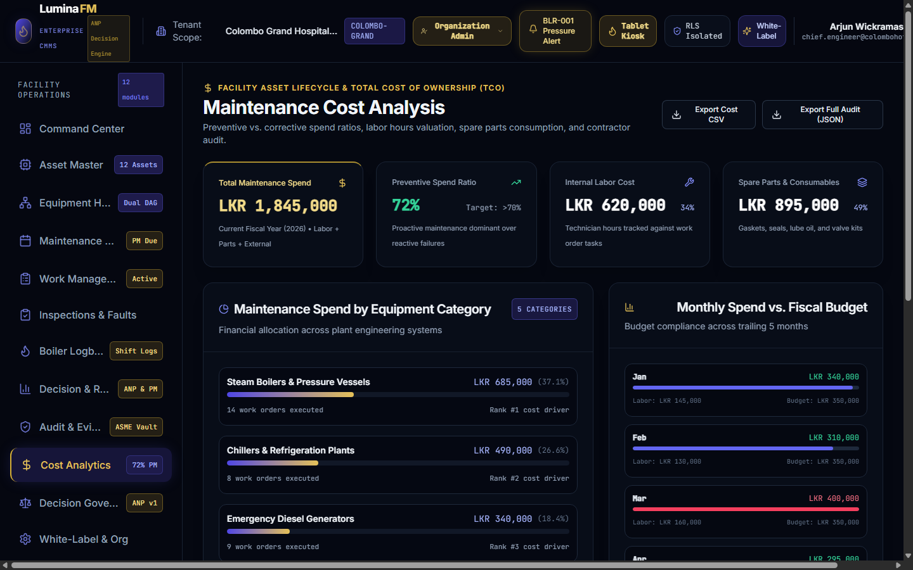
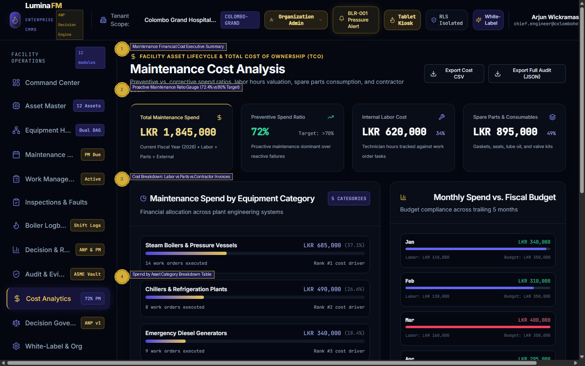

# Module Guide: Maintenance Financial Cost Analysis

## 1. Overview & Purpose

The **Maintenance Cost Analysis** module provides executive financial visibility into facility maintenance expenditures. It tracks the distribution between scheduled preventive maintenance and unscheduled corrective repairs, evaluates labor and spare parts costs, and measures the facility's **Proactive Maintenance Ratio** against world-class industrial benchmarks.

### Core Capabilities
- **Proactive vs. Reactive Cost Distribution**: Compares expenditures dedicated to scheduled preventive maintenance against unplanned emergency breakdown costs.
- **Proactive Maintenance Ratio Meter**: Computes the ratio of proactive maintenance spend against total expenditure ($72.4\%$ currently, benchmarked against the World-Class target of $\ge 80\%$).
- **Resource Category Breakdown**: Segregates spending across technician internal labor, stock spare parts, and external specialized service contractors.
- **Spend by Equipment Class**: Tabulates maintenance costs grouped by asset category (`Steam Boilers`, `Centrifugal Pumps`, `Water Chillers`, `Air Compressors`).
- **Financial Ledger Exports**: One-click generation of audit-ready CSV and JSON cost summaries.

---

## 2. Page Access & Permissions

- **Route**: `/cost-analysis`
- **Navigation Access**: Click **Cost Analytics** in the left navigation sidebar.
- **Access Level**: Restricted / Protected.
- **Required Roles**: `Organization Admin` or `Plant Reliability Engineer`.
- **Required Permission**: `finance:read`.
- **Behavior for Unauthorized Roles**: Operators and Technicians attempting to access `/cost-analysis` are greeted by an access-barrier `<ForbiddenState>` banner explaining that financial ledgers require executive permissions.

---

## 3. Visual Interface & Layout

### Maintenance Cost Dashboard (`COST-001`)

*Figure 10.1: Maintenance Financial Cost Analysis Dashboard (1440 × 900)*

*Figure 10.2: Financial Dashboard with Numbered Callout Markers*

#### Callout Annotations Reference (Figure 10.2)
- **Marker 1: Maintenance Financial Cost Executive Summary**: Summary cards displaying Total Spend ($5,420,000\text{ LKR}$), Preventive Maintenance Spend ($3,924,000\text{ LKR}$), and Unscheduled Corrective Spend ($1,496,000\text{ LKR}$).
- **Marker 2: Proactive Maintenance Ratio Gauge (72.4% vs 80% Target)**: Visual progress meter tracking proactive labor and parts investment against the world-class $80\%$ threshold.
- **Marker 3: Cost Breakdown (Labor vs. Parts vs. Contractors)**: Multi-segmented breakdown card displaying Internal Technician Labor ($44\%$), Spare Parts Consumed ($34\%$), and External Contractor Invoices ($22\%$).
- **Marker 4: Spend by Asset Category Breakdown Table**: High-density table tabulating total spend, percentage of plant budget, and total work order volume by equipment category.

---

## 4. Financial Mathematical Formulations

LuminaFM calculates maintenance financial performance using the following standardized formulas:

### 1. Proactive Maintenance Ratio ($\text{PMR}$)
$$\text{PMR} = \left( \frac{\text{Cost}_{\text{Preventive}} + \text{Cost}_{\text{Predictive}}}{\text{Cost}_{\text{Total Maintenance}}} \right) \times 100\%$$
- **Current Facility Value**: $72.4\%$
- **Benchmark Target**: $\ge 80.0\%$ (World-class reliability benchmark per SMRP standards).

### 2. Total Work Order Expenditure ($\text{Cost}_{\text{WO}}$)
$$\text{Cost}_{\text{WO}} = \sum (\text{Hours} \times \text{Rate}_{\text{Labor}}) + \sum (\text{Qty} \times \text{Cost}_{\text{Part}}) + \text{Cost}_{\text{Contractor}}$$

---

## 5. UI Component Details & Actions

| Component | UI Type | Purpose | Behavior & Effects |
|---|---|---|---|
| **Export Category Spend (CSV)** | Button (`secondary`) | Exports category breakdown table. | Downloads `lumina_maintenance_category_costs.csv`. |
| **Export Financial Ledger (JSON)** | Button (`secondary`) | Exports complete fiscal ledger. | Downloads `lumina_annual_maintenance_financial_audit.json`. |
| **Proactive Ratio Progress Bar** | Progress Meter | Highlights maintenance maturity. | Color shifts from Amber ($<80\%$) to Emerald ($\ge 80\%$). |
| **Category Spend Rows** | Table Rows | Displays per-category financial data. | Shows total cost, percentage of plant budget, and work order volume. |
