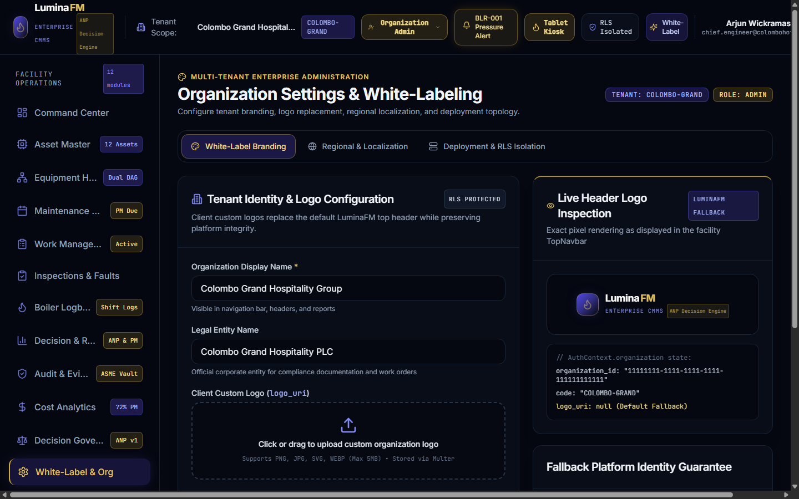
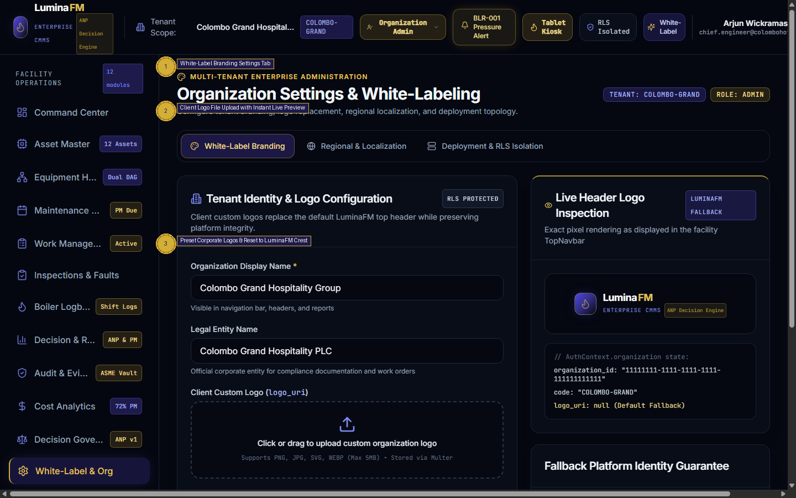
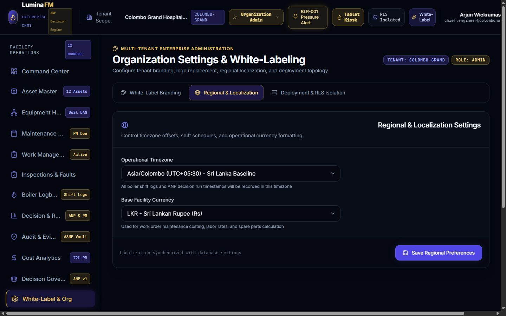
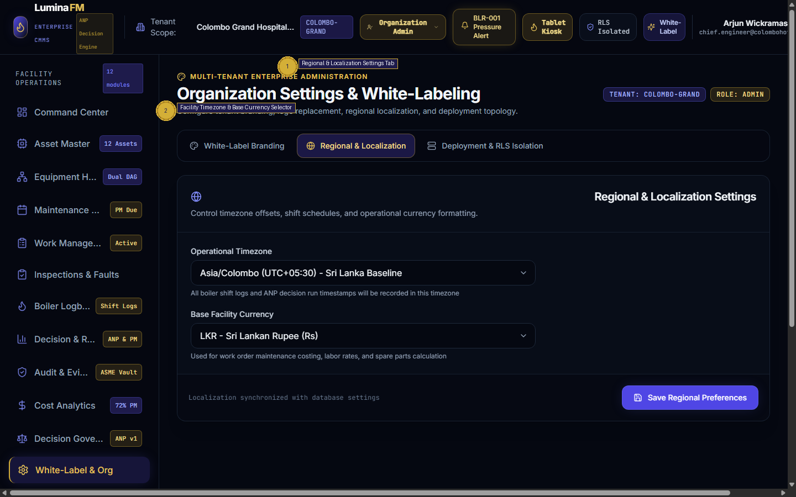
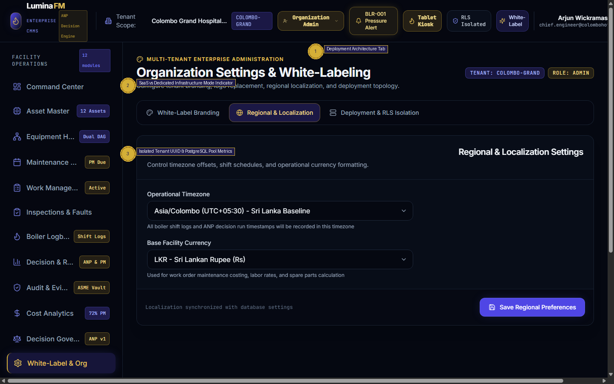

# Module Guide: White-Label Branding & Organization Settings

## 1. Overview & Purpose

The **Organization Settings** module enables enterprise administrators to customize white-label branding, configure regional localization parameters, and verify multi-tenant infrastructure isolation. 

### Core Capabilities
- **Instant Client White-Labeling**: Upload custom SVG, PNG, or JPG corporate logos with immediate visual preview in the sticky global header navigation bar.
- **Preset Corporate Branding**: One-click application of corporate brand identities for demonstration and multi-site configuration.
- **Regional Localization**: Configures operational timezones and reporting base currencies for international facility portfolios.
- **Deployment Architecture Transparency**: Displays multi-tenant SaaS vs. Dedicated customer deployment mode, PostgreSQL connection pool metrics, and Row-Level Security (RLS) tenant isolation UUIDs.

---

## 2. Page Access & Permissions

- **Route**: `/settings`
- **Navigation Access**: Click **White-Label & Org** in the left navigation sidebar or click the **White-Label** shortcut in the top navigation bar.
- **Access Level**: Restricted to `Organization Admin`.
- **Required Permission**: `org:admin`.

---

## 3. Visual Interface & Navigation Tabs

The settings interface is organized across three primary tabs:

### Tab 1: White-Label Branding (`SET-001`)

*Figure 12.1: White-Label Branding Settings Tab (1440 × 900)*

*Figure 12.2: Branding Settings with Numbered Callout Markers*

#### Callout Annotations Reference (Figure 12.2)
- **Marker 1: White-Label Branding Settings Tab**: Active branding tab.
- **Marker 2: Client Logo File Upload with Instant Live Preview**: Drag-and-drop or file selector allowing upload of client logo files. The application immediately updates the top navbar brand crest via a local data URI reader.
- **Marker 3: Preset Corporate Logos & Reset Trigger**: Pre-configured corporate brand identities (`Colombo Grand Gold Crest`, `Ceylon Thermal Power Corp`) and the **Reset to Default** trigger to restore the official LuminaFM crest.

---

### Tab 2: Regional & Localization Settings (`SET-002`)
Configures time and currency parameters.

*Figure 12.3: Regional & Localization Settings Tab*

*Figure 12.4: Localization Settings with Numbered Callouts*

- **Marker 1: Regional & Localization Tab**: Active localization tab.
- **Marker 2: Facility Timezone & Base Currency Selector**: Dropdown menus to set the facility operating timezone (e.g., `Asia/Colombo (UTC+05:30)`) and base financial accounting currency (e.g., `LKR`, `USD`, `EUR`, `SGD`).

---

### Tab 3: Deployment Architecture & Tenant Status (`SET-003`)
Provides operational transparency into cloud hosting infrastructure and database isolation.

*Figure 12.5: Deployment Architecture & Infrastructure View*

*Figure 12.6: Deployment View with Numbered Callouts*

- **Marker 1: Deployment Architecture Tab**: Active infrastructure view.
- **Marker 2: SaaS vs. Dedicated Mode Indicator**: Displays active cloud architecture:
  - **Shared Multi-Tenant SaaS**: Tenant shares application instances with strict Row-Level Security (RLS) enforcement at the PostgreSQL database level.
  - **Dedicated Customer Deployment**: Tenant operates on independent isolated infrastructure.
- **Marker 3: Isolated Tenant UUID & Pool Metrics**: Displays the tenant's cryptographic UUID (`11111111-1111-1111-1111-111111111111`), active database pool connections, and transaction latency.

---

## 4. Field Reference: Organization Configuration

| Field | Purpose | Required | Format | Validation Rules | Example |
|---|---|---|---|---|---|
| `organizationName` | Corporate business name | Yes | String | 3–100 characters | `Colombo Grand Hospitality Group` |
| `legalName` | Registered corporate entity name | Yes | String | 3–120 characters | `Colombo Grand Hospitality PLC` |
| `organizationCode` | Unique tenant routing slug | Yes | String | Uppercase alphanumeric with hyphens | `COLOMBO-GRAND` |
| `logoFile` | Custom corporate brand logo | No | Image File (SVG, PNG, JPG) | Max $2\text{ MB}$; Scaled to $44\text{px}$ height | `colombo_crest.svg` |
| `timezone` | Operating facility timezone | Yes | IANA Timezone String | Must be valid IANA timezone | `Asia/Colombo` |
| `baseCurrency` | Ledger financial currency | Yes | ISO 4217 Currency Code | 3-letter currency code | `LKR` |
| `showPlatformBadge` | Display 'Powered by LuminaFM' pill | Yes | Boolean | `true` or `false` | `true` |
