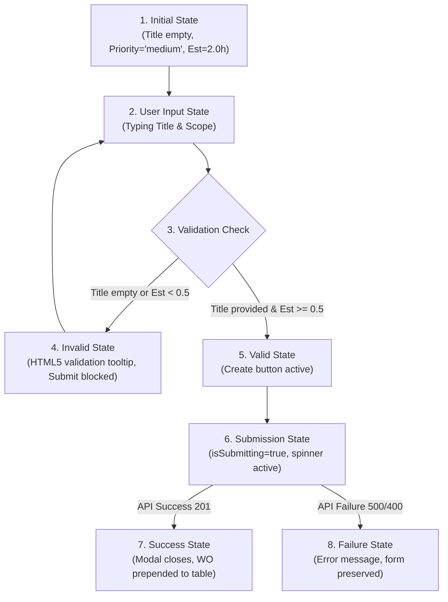
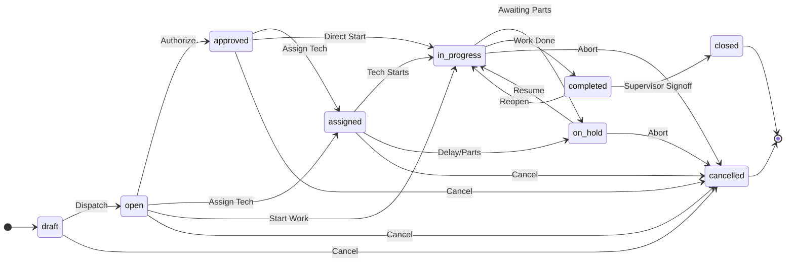

# Work Orders Modals & State Transition Overlays

This guide provides an exhaustive technical reference for all interactive modals and dialogs governing the Work Order lifecycle in LuminaFM:
1. **Create Work Order Modal** (`CreateWorkOrderModal`)
2. **Work Order Detail Modal** (`WorkOrderDetailModal`)
3. **Status Transition Reason Modal** (`WorkOrderStatusTransitionModal`)

---

## 1. Create Work Order Modal (`CreateWorkOrderModal`)

### 1.1 Purpose & Role Permissions
- **Purpose**: Initiates a formal, sequenced maintenance work order bound to an explicit equipment asset. Creates an active state-machine record starting in `draft` or `open` status.
- **Access Route**: `/work-orders` (Click the `+ New Work Order` button in the top-right toolbar).
- **Authorized Roles**:
  - `Organization Admin`: Full creation & direct authorization rights.
  - `Plant Reliability Engineer`: Full creation rights.
  - `Boiler Plant Operator`: Can create draft work orders from floor abnormalities.
  - `Maintenance Technician`: Read-only (button hidden or restricted).

---

### 1.2 Visual Presentation & Callout Annotations

```carousel

<!-- slide -->

```

#### Numbered Callout Descriptions

| Callout # | UI Component | Description & Operational Function |
|:---:|---|---|
| **1** | **Modal Header & Context** | Displays dialog title `"Create Authorized Facility Work Order"` and compliance subtext highlighting sequential numbering. |
| **2** | **Work Order Title & Scope** | Text input for high-level mechanical operation summary (e.g., `"Centrifugal Chiller Annual Condenser Overhaul"`). |
| **3** | **Priority & Estimated Labor** | Priority dropdown selector (`Urgent`, `High`, `Medium`, `Low`) and numerical input for estimated labor hours. |
| **4** | **Action Triggers** | `Cancel` (ghost button dismissing form) and `Create Work Order` (primary blue trigger executing API mutation). |

---

### 1.3 Field-by-Field Form Specification

| Field Name | UI Input Type | Format / Type | Required? | Default Value | Validation Rules & Constraints |
|---|---|---|:---:|---|---|
| **Work Order Title** | Text Input | String (1–150 chars) | **Yes** | `""` | Non-empty string. Whitespace-only rejected. |
| **Technical Scope of Work** | Multiline Textarea | String (0–2000 chars) | Optional | `""` | Optional descriptive narrative detailing isolation, lock-out/tag-out (LOTO), and mechanical steps. |
| **Priority** | Select Dropdown | Enum (`urgent`, `high`, `medium`, `low`) | **Yes** | `medium` | Must match one of 4 defined priority tiers. Urgent triggers high-visibility alerts. |
| **Estimated Labor (Hours)** | Number Input | Float (`step="0.5"`) | **Yes** | `2.0` | Minimum `0.5` hours. Must be positive numerical float. |

---

### 1.4 Interactive Lifecycle States



1. **Initial State**:
   - Title is blank.
   - Technical Scope textarea is empty with placeholder: `"Detailed mechanical tasks, safety precautions, and isolation requirements..."`.
   - Priority defaults to `medium`.
   - Estimated Labor is preset to `2.0` hours.
   - `Create Work Order` button is enabled (will trigger HTML5 validation if clicked immediately).
2. **User Input State**:
   - Operator types title (e.g., `"Centrifugal Chiller Annual Condenser Overhaul"`).
   - Priority changed to `urgent` or `high`.
   - Labor estimated at `16.0` hours.
3. **Invalid Input State**:
   - If user submits with blank title: browser focuses on title field with `"Please fill out this field"`.
   - If estimated labor is set to `0` or negative: field enforces `min="0.5"`.
4. **Valid Input State**:
   - Title filled, priority selected, labor hours valid. Form ready for atomic transaction.
5. **Submission State**:
   - Clicking `Create Work Order` sets `isSubmitting = true`.
   - The button displays an inline animated spinner icon; buttons are disabled against repeat clicks.
6. **Success State**:
   - API returns HTTP 201 Created with generated `workOrderNumber` (e.g. `WO-2026-0042`).
   - Modal unmounts automatically.
   - Parent `WorkOrdersPage` triggers `loadData()` to refresh both List and Kanban views.
7. **Failure State**:
   - If the backend rejects the submission (e.g., DB constraint or network failure), an alert is displayed and the modal remains open with all inputs preserved.

---

## 2. Work Order Detail Modal (`WorkOrderDetailModal`)

### 2.1 Purpose & Role Permissions
- **Purpose**: Comprehensive inspection and lifecycle management dialog for an existing Work Order. Surfaces current lifecycle state, allowed atomic transitions, execution checklist tasks, technician labor tracking, spare parts consumption, and financial ledger totals.
- **Access Route**: `/work-orders` (Click `Details` button on any row in List view, or click any Work Order card in Kanban view).
- **Authorized Roles**:
  - `Organization Admin` & `Plant Reliability Engineer`: Full transition execution, task editing, and cost review.
  - `Maintenance Technician`: Check off tasks, log labor hours, log spare parts.
  - `Boiler Plant Operator`: Read-only view of progress and status.

---

### 2.2 Visual Presentation & Callout Annotations

```carousel

<!-- slide -->

```

#### Numbered Callout Descriptions

| Callout # | UI Component | Description & Operational Function |
|:---:|---|---|
| **1** | **Modal Header & Asset Context** | Displays `workOrderNumber` (e.g. `WO-001`), work order title, and linked asset code (`BLR-001 — Main High-Pressure Steam Boiler`). |
| **2** | **State Machine & Status Bar** | Shows Current State (`in_progress`), Priority (`critical`), and dynamic gold action buttons for all permitted state transitions. |
| **3** | **Execution Task Checklist** | Scrollable task registry with sequence numbering (`#1`, `#2`, `#3`), task descriptions, and status pills (`completed`, `in_progress`, `pending`). |
| **4** | **Financial Cost Ledger** | Monospace 4-column cost summary calculating `Labor Cost`, `Parts Cost`, `Contractor Cost`, and cumulative `Total Cost`. |

---

### 2.3 Execution Task Checklist & State Management

The modal renders all sequential tasks registered under the Work Order:

| Task Component | Data Field | Display Style | Behavior |
|---|---|---|---|
| **Sequence Number** | `task.sequenceNo` | Font-mono text in Indigo-400 (`#1`, `#2`) | Indicates prescribed operational execution order. |
| **Description** | `task.description` | Slate-200 text | Details the physical mechanical requirement (e.g., `"Calibrate primary steam pressure transmitter PT-101"`). |
| **Task Status Pill** | `task.status` | `completed` (Emerald)<br>`in_progress` (Gold)<br>`pending` (Slate) | Visual badge reflecting individual task completion state. |

---

### 2.4 Financial Cost Breakdown Grid

When cost records exist on the Work Order, an integrated ledger is rendered:

$$\text{Total Work Order Cost} = \text{Labor Cost} + \text{Parts Cost} + \text{Contractor Cost}$$

| Cost Category | Field Key | Format | Example Value | Description |
|---|---|---|---|---|
| **Labor Cost** | `costs.laborCost` | Currency (`$`) | `$320.00` | Technician internal billing rate $\times$ logged operational hours. |
| **Parts Cost** | `costs.partsCost` | Currency (`$`) | `$145.50` | Inventory requisition value for gaskets, valves, and seals. |
| **Contractor Cost** | `costs.contractorCost` | Currency (`$`) | `$0.00` | Third-party specialist or certified NDT inspector fees. |
| **Total Cost** | `costs.totalCost` | Bold Gold Currency (`$`) | `$465.50` | Audited financial cost committed against the asset cost center. |

---

## 3. Status Transition Reason Modal (`WorkOrderStatusTransitionModal`)

### 3.1 Purpose & Role Permissions
- **Purpose**: Enforces regulatory compliance and non-repudiation by requiring an explicit technical justification reason whenever an operator transitions a Work Order from one lifecycle state to another.
- **Access Route**: Inside `WorkOrderDetailModal`, clicking any dynamic `"Transition to <STATUS>"` gold action button.
- **Authorized Roles**:
  - `Organization Admin` & `Plant Reliability Engineer`: Permitted across all states.
  - `Maintenance Technician`: Permitted transitions from `assigned` $\rightarrow$ `in_progress` $\rightarrow$ `completed`.
  - Terminal states (`closed`, `cancelled`): Require Admin or Lead Engineer approval.

---

### 3.2 State Machine Transition Matrix



#### Valid Next States Matrix

| Current State | Permitted Next States (`VALID_NEXT_STATES`) | Required Action Button Label |
|---|---|---|
| `draft` | `open`, `cancelled` | `TRANSITION TO OPEN`, `TRANSITION TO CANCELLED` |
| `open` | `approved`, `assigned`, `in_progress`, `cancelled` | `TRANSITION TO APPROVED`, `TRANSITION TO ASSIGNED`, etc. |
| `approved` | `assigned`, `in_progress`, `cancelled` | `TRANSITION TO ASSIGNED`, `TRANSITION TO IN_PROGRESS`, etc. |
| `assigned` | `in_progress`, `on_hold`, `cancelled` | `TRANSITION TO IN_PROGRESS`, `TRANSITION TO ON_HOLD`, etc. |
| `in_progress` | `on_hold`, `completed`, `cancelled` | `TRANSITION TO ON_HOLD`, `TRANSITION TO COMPLETED`, etc. |
| `on_hold` | `in_progress`, `cancelled` | `TRANSITION TO IN_PROGRESS`, `TRANSITION TO CANCELLED` |
| `completed` | `closed`, `in_progress` | `TRANSITION TO CLOSED`, `TRANSITION TO IN_PROGRESS` |
| `closed` | *(Terminal State — No transitions permitted)* | Displays: `Work Order reached terminal state (closed)` |
| `cancelled` | *(Terminal State — No transitions permitted)* | Displays: `Work Order reached terminal state (cancelled)` |

---

### 3.3 Form Specification: Transition Reason

| Field Name | Input Type | Format / Constraints | Required? | Purpose & Audit Impact |
|---|---|---|:---:|---|
| **Transition Notes / Justification Reason** | Text Input | String (1–255 chars) | **Yes** | Mandatory explanation of why the state is changing (e.g. `"Completed mechanical seal installation and passed leak test at 10.5 bar"`). Written to immutable audit trail. |

#### Cancel & Close Behavior
- Clicking `Cancel` or pressing `Escape` dismisses the reason prompt without mutating the Work Order state.
- Clicking `Confirm State Transition` records the status update, stores the user's justification into the change log, closes both modals, and refreshes the primary Work Orders table.
