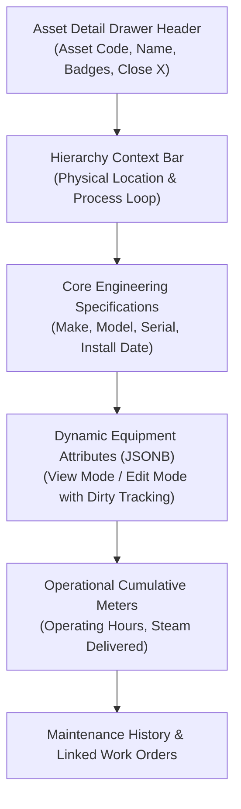

# Inspections & Asset Management Drawers & Modals

This guide provides an exhaustive technical reference for the detail inspection overlays within LuminaFM:
1. **Asset Detail Drawer** (`AssetDetailDrawer`)
2. **Inspection Detail Modal** (`InspectionDetailModal`)

---

## 1. Asset Detail Drawer (`AssetDetailDrawer`)

### 1.1 Purpose & Role Permissions
- **Purpose**: Provides a full-height, slide-over drawer for deep technical inspection of any physical asset registered in the facility. Renders core asset specifications, dynamic JSONB equipment attributes, physical and process hierarchy paths, operational meters, and historical work order logs.
- **Access Route**: `/assets` (Clicking on any asset row or card in the Asset Master Registry).
- **Authorized Roles**:
  - `Organization Admin` & `Plant Reliability Engineer`: Read and full inline editing rights for dynamic attributes.
  - `Boiler Plant Operator` & `Maintenance Technician`: Read-only inspection rights.

---

### 1.2 Visual Presentation & Callout Annotations

```carousel

<!-- slide -->

```

#### Numbered Callout Descriptions

| Callout # | UI Component | Description & Operational Function |
|:---:|---|---|
| **1** | **Background Dimmed Registry** | Backdrop overlay (`bg-midnight-950/80`) maintaining context while preventing stray clicks on the underlying table. |
| **2** | **Slide-Over Drawer Container** | High-contrast drawer panel (`w-full max-w-xl md:max-w-2xl bg-midnight-900 border-l border-slate-800`) with smooth entrance animation and sticky header. |
| **3** | **Dynamic Technical Specifications** | JSONB-driven attribute section displaying category-specific technical parameters (e.g. Design Steam Pressure, Heating Surface Area, Fuel Burner Capacity) with inline edit controls. |
| **4** | **Operating Meters & WO History** | Tabular telemetry readouts for cumulative operating hours, total fuel throughput, and linked historical work orders. |

---

### 1.3 Layout & Section Breakdown



#### Section 1: Header & Status Indicators
- **Asset Code**: Large monospace gold tag (e.g., `BLR-001`, `CHL-001`).
- **Asset Name**: Primary mechanical designation (e.g., `"Main High-Pressure Steam Boiler (1,100 kg/h)"`).
- **Status Badge**: Real-time asset health state (`operational`, `degraded`, `in_maintenance`, `decommissioned`).
- **Criticality Badge**: Impact ranking (`critical`, `high`, `medium`, `low`).
- **Close Button (X)**: Top-right icon button; also triggerable via physical `Escape` key.

#### Section 2: Physical & Process Hierarchies
- **Physical Hierarchy**: Displays breadcrumb path: $\text{Site} \rightarrow \text{Building} \rightarrow \text{Room}$ (e.g., `Main Campus` $\rightarrow$ `Central Utilities Plant` $\rightarrow$ `Basement Boiler Room B-01`).
- **Process Hierarchy**: Displays system loop membership (e.g., `Steam Distribution Loop A`, `Chilled Water Return Loop 2`).

#### Section 3: Dynamic Technical Attributes (JSONB)
LuminaFM uses a dynamic JSONB schema allowing different equipment classes (boilers, chillers, pumps) to carry distinct engineering parameters without altering the database schema:

| Attribute Code | Display Label | Data Type | Example Value | Description |
|---|---|---|---|---|
| `design_pressure_bar` | Design Working Pressure | `number` | `10.5` | Maximum allowable working pressure (MAWP) in bar. |
| `steam_capacity_kgh` | Nominal Steam Evaporation | `number` | `1100.0` | Maximum rated continuous steam output in kg/h. |
| `heating_surface_sqm` | Total Heating Surface Area | `number` | `28.4` | Boiler water-wall and fire-tube surface area in $\text{m}^2$. |
| `burner_fuel_type` | Primary Burner Fuel | `string` | `Heavy Fuel Oil (HFO)` | Verified combustible fuel specification. |
| `has_economizer` | Flue Gas Economizer Fitted | `boolean` | `true` | Boolean toggle indicating secondary heat recovery unit. |
| `last_ndt_inspection` | Last Ultrasonic NDT Date | `date` | `2026-05-12` | Regulatory shell thickness inspection timestamp. |

---

### 1.4 Dynamic Attribute Edit Mode & Validation

When an authorized engineer clicks the `Edit Attributes` button:
1. All static values convert to interactive inputs (inputs, number steppers, toggles).
2. The drawer tracks dirty changes in local `draftValues` state.
3. If an invalid value is entered (e.g. negative pressure or non-numerical string in number field), inline warning alerts prevent submission.
4. Clicking `Save Changes` dispatches `PATCH /api/v1/assets/:id/attributes` and displays an inline confirmation message (`"Dynamic attributes saved successfully"`).
5. Clicking `Cancel` reverts all fields to their committed server state.

---

## 2. Inspection Detail Modal (`InspectionDetailModal`)

### 2.1 Purpose & Role Permissions
- **Purpose**: Displays the certified, completed checklist record for a facility walkthrough inspection. Surfaces checkpoint-by-checkpoint pass/fail statuses, recorded meter readings, identified anomalies, inspector credentials, and audit signoff timestamps.
- **Access Route**: `/inspections` (Clicking the `View Details` eye icon on any row in the Walkthrough Inspections tab).
- **Authorized Roles**: Accessible to all authenticated facility roles (`Organization Admin`, `Plant Reliability Engineer`, `Boiler Plant Operator`, `Maintenance Technician`).

---

### 2.2 Visual Presentation & Callout Annotations

```carousel

<!-- slide -->

```

#### Numbered Callout Descriptions

| Callout # | UI Component | Description & Operational Function |
|:---:|---|---|
| **1** | **Modal Header & Context** | Displays inspection reference code (e.g. `INSP-2026-001`), inspected asset code, inspector name, and inspection timestamp. |
| **2** | **Score & Overall Result Bar** | Summary status strip indicating Overall Disposition (`PASS`, `FAIL`, `WARNING`) and quantitative compliance score (`94%`). |
| **3** | **Checklist Item Breakdown** | Scrollable list of verified checkpoints with question descriptions, item codes, recorded responses, and red anomaly highlights. |

---

### 2.3 Checkpoint Data Structure & Anomaly Alerting

Each inspection record contains an array of verified checkpoints:

| Checkpoint Field | Format | Example Value | Description |
|---|---|---|---|
| **Question** | String | `"Check feed pump mechanical seal for weeping or packing leakage"` | Human-readable instruction followed during physical walkthrough. |
| **Item Code** | Monospace String | `CHK-PUMP-SEAL-01` | Normalized taxonomy code linking checkpoint to historical defect trends. |
| **Answer** | String | `Pass` / `Fail` / `0.2 mm` / `Normal` | Direct input recorded by inspector at the equipment. |
| **Anomaly Flag** | Boolean (`isAnomaly`) | `true` / `false` | If `true`, row renders with a high-contrast rose background (`bg-rose-950/40 border-rose-500/50`) and white text. |

#### Anomaly Escalation Workflow
When a checkpoint is flagged with an anomaly:
1. LuminaFM surfaces the row in high-visibility alert styling.
2. The parent inspection receives an overall disposition of `WARNING` or `FAIL`.
3. The defect is automatically registered under the **Fault History Tab** (`INSP-003`), where an engineer can trigger a 1-click **Dispatch WO** action to escalate the fault into a formal maintenance work order.

---

### 2.4 Inspector Signoff & Audit Header

| Inspection Metadata Field | Database Column | Example Value | Description |
|---|---|---|---|
| **Inspection Code** | `inspectionNumber` | `INSP-2026-001` | Unique facility sequence ID. |
| **Inspector Name** | `inspectorName` | `Dave Miller (Boiler Plant Operator)` | User who conducted the walkthrough. |
| **Inspection Timestamp** | `inspectedAt` | `2026-11-15T08:30:00Z` | Cryptographically signed execution date and time. |
| **Overall Score** | `scorePercentage` | `94%` | Ratio of passed checkpoints over total checkpoints. |
| **Inspector Narrative Notes** | `notes` | `"Minor weeping noted on auxiliary feed pump packing. Main pump nominal."` | Unstructured observation comments. |

#### Dismissal & Escape Behavior
- Clicking the `Close` button or pressing `Escape` closes the modal immediately without altering any inspection records (inspections are immutable historical records).
