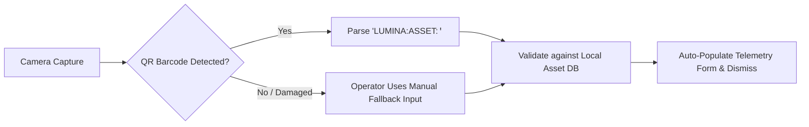
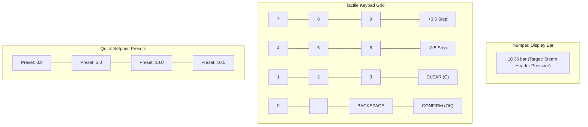
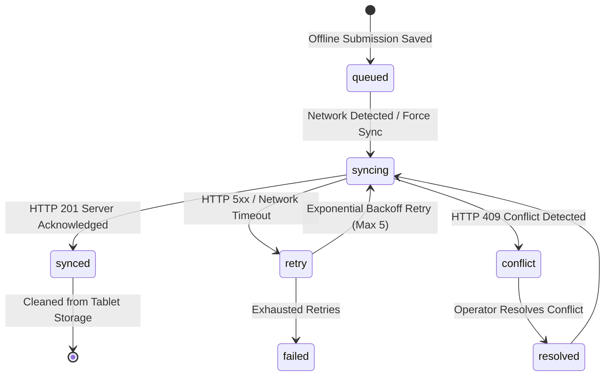
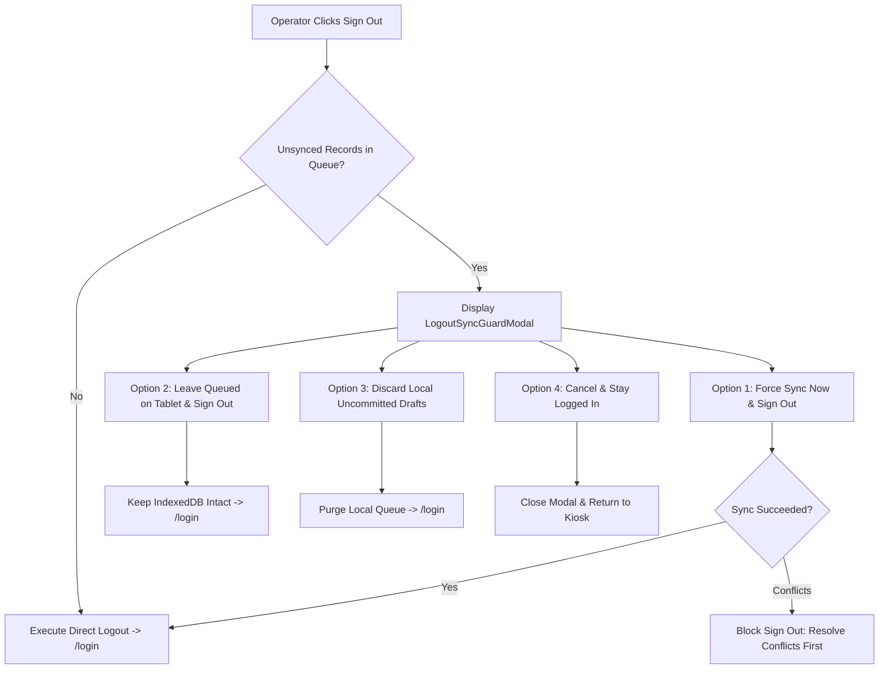

# Floor Kiosk & Offline Synchronization Modals & Overlays

This guide provides an exhaustive technical reference for the industrial floor-operator overlays and offline synchronization dialogs in LuminaFM:
1. **Industrial QR Scanner Modal** (`QrScannerModal`)
2. **Glove-Accessible Numerical Numpad Overlay** (`GloveNumpad`)
3. **Offline Synchronization Queue Drawer** (`SyncQueueDrawer`)
4. **Logout Synchronization Guard Modal** (`LogoutSyncGuardModal`)

---

## 1. Industrial QR Scanner Modal (`QrScannerModal`)

### 1.1 Purpose & Role Permissions
- **Purpose**: Enables factory-floor boiler operators to instantly identify and lock onto equipment by scanning high-contrast 2D Data Matrix or QR codes affixed to physical asset nameplates.
- **Access Route**: `/operator` (Clicking the large `Scan QR Barcode` button in the kiosk toolbar).
- **Authorized Roles**: Accessible to all authenticated floor operators and technicians (`Boiler Plant Operator`, `Maintenance Technician`, `Plant Reliability Engineer`, `Organization Admin`).

---

### 1.2 Visual Presentation & Callout Annotations

```carousel

<!-- slide -->

```

#### Numbered Callout Descriptions

| Callout # | UI Component | Description & Operational Function |
|:---:|---|---|
| **1** | **Camera Viewfinder Viewport** | Simulated live camera feed with an industrial high-contrast aiming reticle and animated laser scanline. |
| **2** | **Manual Asset Code Fallback** | Text input field allowing manual entry of asset codes if physical metal barcodes are obscured by boiler soot or grease. |
| **3** | **Hardware Controls & Dismissal** | Flashlight illumination toggle (`Flashlight`), camera stream selector, and oversized 48px `Close` button. |

---

### 1.3 Interactive Controls & Barcode Parsing



| Control Element | UI Type | Touch Target | Action / Impact |
|---|---|---|---|
| **Viewfinder Reticle** | Visual HUD | N/A | Center targeting box bounding the optical recognition area. |
| **Flashlight Toggle** | Button | $48 \times 48\text{ px}$ | Activates device camera flash LED for dark boiler rooms and pump basements. |
| **Simulated Asset Tags** | Quick-Tap Pills | $44\text{ px Height}$ | Pre-configured plant targets (`BLR-001`, `BLR-002`, `P-001`, `CHL-001`) for test environments. |
| **Manual Code Input** | Text Field | $48\text{ px Height}$ | Direct keyboard entry fallback (e.g. typing `BLR-001`). |
| **Close Scanner (X)** | Button | $48 \times 48\text{ px}$ | Stops active camera video tracks and unmounts scanner dialog. |

---

## 2. Glove-Accessible Numerical Numpad Overlay (`GloveNumpad`)

### 2.1 Purpose & Ergonomic Design
- **Purpose**: Factory-floor boiler rooms require operators to wear thick leather or thermal protective gloves. Standard on-screen tablet keyboards cause frequent miss-taps. The `GloveNumpad` provides an oversized, high-contrast numerical keypad specifically calibrated for gloved touch interaction.
- **Access Route**: `/operator` (Tapping any numerical reading field, such as Steam Pressure, Flue Gas Temp, Water Level, or TDS).
- **Touch Target Standard**: Keypad buttons enforce a minimum size of $64 \times 64\text{ px}$ with 8px physical margins.

---

### 2.2 Visual Presentation & Callout Annotations

```carousel

<!-- slide -->

```

#### Numbered Callout Descriptions

| Callout # | UI Component | Description & Operational Function |
|:---:|---|---|
| **1** | **Target Telemetry Readout** | Large monospace display reflecting current entered value, unit of measure (`bar`, `°C`, `%`), and parameter code. |
| **2** | **Tactile Keypad Matrix (64px+)** | Oversized numerical keys ($0–9$, decimal point `.`, backspace, clear `C`, step `+` / `-`) for gloved accuracy. |
| **3** | **Preset Value Quick-Tap Buttons** | Pre-calibrated operating setpoint shortcuts (e.g., `0.0`, `5.0`, `10.0`, `10.5` bar) for single-touch entry. |

---

### 2.3 Keypad Matrix & Input Constraints



| Key / Feature | Behavior & Validation |
|---|---|
| **Numerical Keys (0–9)** | Appends digit to string. If current value is `"0"`, replaces `"0"` with typed digit. Enforces maximum length of 9 characters. |
| **Decimal Point (.)** | Appends decimal. Enforces single decimal rule: if `.` is already present, subsequent taps are safely ignored. |
| **Backspace ($\leftarrow$)** | Deletes trailing character. If only one digit remains, safely resets value to `"0"`. |
| **Clear (C)** | Instantly resets entered value to `"0"`. |
| **Step Buttons (+ / -)** | Increments or decrements current float value by predefined step delta ($\pm 0.1$ or $\pm 0.5$) rounded to 2 decimal places. |
| **Presets Row** | Overwrites display directly with common plant values (e.g. atmospheric `0.0`, idle `5.0`, normal load `10.2`). |
| **Range Validation Guard** | Live comparison against `minValue` and `maxValue`. If exceeded, display border shifts to amber warning and displays: `Value outside nominal operating range`. |
| **Confirm Action (OK)** | Commits entered numerical float to the underlying shift logbook form and closes numpad. |

---

## 3. Offline Synchronization Queue Drawer (`SyncQueueDrawer`)

### 3.1 Purpose & Architecture
- **Purpose**: Provides visibility into local IndexedDB queues during network outages, surfaces transmission retries, and gives operators a transparent interface to inspect and resolve submission conflicts.
- **Access Route**: `/operator` (Clicking the **Sync Status Pill** in the top-right status bar).
- **Storage Layer**: Browser IndexedDB (`lumina_offline_store`) backed by local ServiceWorker persistence.

---

### 3.2 Visual Presentation & Callout Annotations

```carousel

<!-- slide -->

```

#### Numbered Callout Descriptions

| Callout # | UI Component | Description & Operational Function |
|:---:|---|---|
| **1** | **Slide-Over Drawer Container** | High-contrast drawer panel displaying current network state (`ONLINE` / `OFFLINE`) and pending queue volume. |
| **2** | **IndexedDB Submission Queue** | Chronological list of queued shift submissions with unique client IDs, timestamps, and retry counts. |
| **3** | **Queue Actions & Conflict Tools** | `Force Sync Now` trigger, `Clean Synced Items` garbage collection button, and conflict resolution modal. |

---

### 3.3 Queued Item Lifecycle & Statuses



| Status Key | Badge Display | Meaning & Operator Action |
|---|---|---|
| `queued` | Blue Clock | Record safely stored in local IndexedDB; awaiting network restoration. |
| `syncing` | Gold Animated Spinner | Payload actively transmitting to central server. |
| `synced` | Emerald Checkmark | Confirmed committed to authoritative PostgreSQL database. |
| `retry` | Amber Alert | Temporary network dropout; system will automatically re-attempt with exponential backoff. |
| `conflict` | Rose Shield Alert | Server detected a conflicting submission from another tablet or shift log. **Requires operator resolution**. |

---

### 3.4 Conflict Resolution Workflow

When a submission encounters an HTTP 409 Conflict:
1. LuminaFM **never silently overwrites** existing server records.
2. The item is highlighted in the `SyncQueueDrawer` with a `Resolve Conflict` button.
3. Clicking `Resolve Conflict` presents two non-destructive options:
   - **Amend as Traceable Revision**: Appends the local record as an explicit timestamped correction note referencing the original submission ID.
   - **Discard Local Duplicate**: Safely purges the local duplicate if the operator confirms the reading was already recorded.

---

## 4. Logout Synchronization Guard Modal (`LogoutSyncGuardModal`)

### 4.1 Purpose & Data Protection Standards
- **Purpose**: Prevents accidental loss of un-synchronized boiler operational logs when an operator attempts to log out of a shared floor tablet while offline.
- **Trigger**: Clicking the `Sign Out` button in the top navigation or sidebar while unsynchronized records remain in the local tablet queue.
- **Regulatory Rule**: Under industrial safety standards, shift telemetry must either be transmitted to central servers or explicitly preserved in local isolated storage before ending an operator session.

---

### 4.2 Modal Dialog Options & Behavior



#### Detailed Option Specifications

| Option Button | Styling | Action Taken | Security & Safety Impact |
|---|---|---|---|
| **Force Sync Now & Sign Out** | Emerald Primary (`bg-emerald-600`) | Attempts immediate queue transmission. If successful, purges synced cache and logs out. | **Safest**. Guarantees all data is written to PostgreSQL before session termination. |
| **Leave Queued on Tablet & Sign Out** | Slate Neutral (`bg-midnight-950 border-slate-700`) | Retains encrypted IndexedDB records on the physical device. Closes session and navigates to `/login`. | **Safe for offline shift handovers**. Next operator logging in can resume synchronization. |
| **Discard Local Drafts & Sign Out** | Rose Destructive (`bg-rose-950 text-rose-300`) | Purges local unsynchronized draft queue immediately and logs out. | **Destructive**. Requires explicit second-step confirmation to prevent accidental loss. |
| **Cancel** | Ghost Button | Closes dialog and returns operator to the active kiosk session. | **Non-destructive**. Leaves all state unaltered. |
