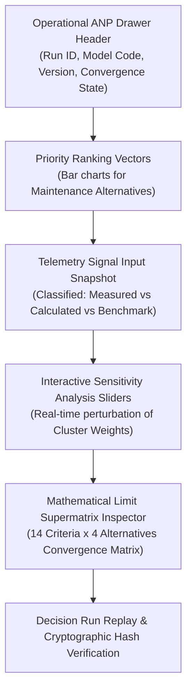
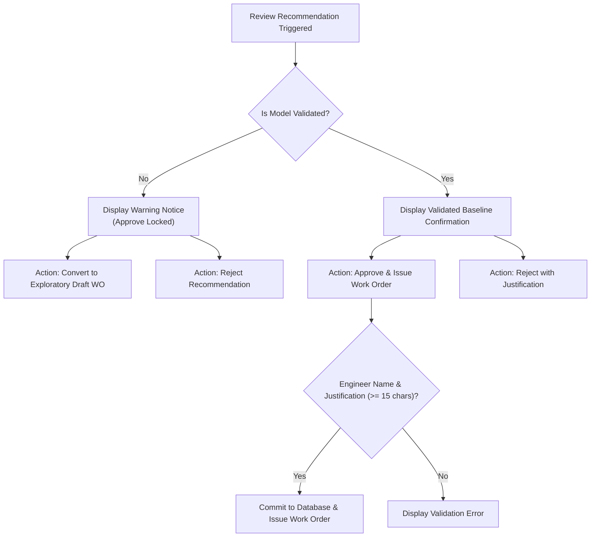
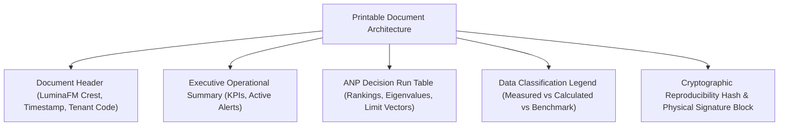

# Decision Support & Reporting Modals & Overlays

This guide provides an exhaustive technical reference for the interactive decision-support drawers, alert acknowledgement modals, channel configuration dialogs, recommendation review popups, and printable report windows in LuminaFM:
1. **Operational ANP Decision Drawer** (`OperationalAnpDrawer`)
2. **Alert Acknowledgement Modal** (`AlertAcknowledgementModal`)
3. **Notification Channel Configuration Modal** (`NotificationChannelConfigModal`)
4. **Recommendation Review Modal** (`RecommendationReviewModal`)
5. **Printable Audit Report Window** (`PrintableReportWindow`)

---

## 1. Operational ANP Decision Drawer (`OperationalAnpDrawer`)

### 1.1 Purpose & Role Permissions
- **Purpose**: Provides deep mathematical transparency into Analytic Network Process (ANP) multi-criteria decision runs. Displays converged limit supermatrix weights, raw telemetry signal snapshots, priority rankings across maintenance alternatives, and dynamic sensitivity analysis sliders.
- **Access Route**: `/reports` (Clicking `Inspect ANP Matrix` on the ANP Maintenance Priorities tab) or `/` (Executive Dashboard).
- **Authorized Roles**:
  - `Organization Admin` & `Plant Reliability Engineer`: Full access including sensitivity perturbation and replay verification.
  - `Boiler Plant Operator` & `Maintenance Technician`: Read-only view of prioritized maintenance recommendations.

---

### 1.2 Layout & Mathematical Transparency Architecture



#### Section Breakdown

| Section | Key Technical Data Displayed | Interactive Capabilities |
|---|---|---|
| **Header Strip** | `decisionRunId`, Model Code (`ANP-BOILER-OPERATIONAL-V1.0`), Model Version, Timestamp, Convergence Status (`CONVERGED`). | Close button (X) and Escape key support. |
| **Priority Rankings** | Normalized priority scores ($w_i \in [0, 1]$ where $\sum w_i = 1.0$) for maintenance alternatives: Chemical Descaling, Burner Tuning, SRV Recertification, Refractory Repair. | Click alternative to inspect contributing criteria breakdown. |
| **Telemetry Snapshot** | Raw measured inputs: Boiler Pressure, Flue Gas Temp, Steam Output, Total Dissolved Solids, Vibration. | Distinguishes Measured, Calculated, Benchmark, and Expert data. |
| **Sensitivity Sliders** | Real-time sliders adjusting relative cluster importance (e.g. Safety vs Energy Efficiency vs Asset Longevity). | Dynamic client-side recalculation of priority vectors. |
| **Replay & Audit** | SHA-256 calculation hash reproducing exact mathematical steps. | Trigger `Replay Decision Run` to verify output against database baseline. |

---

## 2. Alert Acknowledgement Modal (`AlertAcknowledgementModal`)

### 2.1 Purpose & Regulatory Mandate
- **Purpose**: Captures certified engineering acknowledgement and mitigation actions when operational telemetry breaches safety thresholds.
- **Access Route**: `/reports` $\rightarrow$ **Operational Abnormalities Tab** (Clicking `Acknowledge` on any unacknowledged abnormality card).
- **Regulatory Requirement**: Under ASME Section I and statutory plant safety standards, critical excursions (e.g., steam overpressure, flue gas overheating) cannot simply be dismissed with a single click. A named engineer must log an explicit mitigation disposition and technical notes.

---

### 2.2 Visual Presentation & Callout Annotations

```carousel

<!-- slide -->

```

#### Numbered Callout Descriptions

| Callout # | UI Component | Description & Operational Function |
|:---:|---|---|
| **1** | **Modal Header & Context** | Displays dialog title `"Acknowledge Operational Abnormality"` and severity banner (`CRITICAL EXCURSION`). |
| **2** | **Excursion Value vs Benchmark** | High-contrast comparison block highlighting Measured Value (`11.45 bar`) vs Configured Benchmark (`> 10.5 bar`). |
| **3** | **Mitigation Comments & Assignee** | Mandatory text input for Operator / Engineer Name and multiline engineering justification notes. |

---

### 2.3 Form Specification & Field Constraints

| Field Name | UI Input Type | Format / Constraints | Required? | Purpose & Audit Impact |
|---|---|---|:---:|---|
| **Operator / Engineer Name** | Text Input | String (2–100 chars) | **Yes** | Certified identity of person acknowledging alert. Written to audit trail. |
| **Action Taken** | Select Dropdown | Enum (`dispatched_work_order`, `recalibrated`, `verified_nominal`, `monitoring`) | **Yes** | Operational classification of immediate corrective response. |
| **Acknowledgement Notes** | Multiline Textarea | String (5–1000 chars) | **Yes** | Technical notes detailing physical inspection, valve adjustments, or work order dispatch. |

#### Action Taken Options Explained

| Option Code | Label | Operational Meaning |
|---|---|---|
| `dispatched_work_order` | Dispatched Maintenance Work Order | Physical defect found; escalated to maintenance team. |
| `recalibrated` | Recalibrated Field Transmitter | Sensor zero-drift identified; transmitter re-zeroed. |
| `verified_nominal` | Verified Nominal (Transient Spike) | Transient fluctuation (e.g., rapid steam load change); nominal restored. |
| `monitoring` | Active Engineering Monitoring | Parameter elevated but within secondary safety boundaries; shift watch initiated. |

---

## 3. Notification Channel Config Modal (`NotificationChannelConfigModal`)

### 3.1 Purpose & Role Permissions
- **Purpose**: Manages multi-channel dispatch destinations for critical operational alerts and ANP maintenance recommendations (Email distribution lists, SMS webhooks, Slack channels, PagerDuty integration).
- **Access Route**: `/reports` $\rightarrow$ **Alert Channels & Export Tab** (Clicking `+ Add Channel` or `Configure`).
- **Authorized Roles**: Restricted strictly to `Organization Admin` and `Plant Reliability Engineer`.

---

### 3.2 Visual Presentation & Callout Annotations

```carousel

<!-- slide -->

```

#### Numbered Callout Descriptions

| Callout # | UI Component | Description & Operational Function |
|:---:|---|---|
| **1** | **Modal Header & Channel Title** | Displays channel type indicator (e.g., `EMAIL`, `SLACK`, `SMS_WEBHOOK`, `PAGERDUTY`). |
| **2** | **Channel Name & Endpoint URI** | Text fields for friendly channel label and recipient address or HTTPS webhook URL. |
| **3** | **Severity & Priority Thresholds** | Dropdown for minimum alert level (`CRITICAL`, `WARNING`, `INFO`) and numerical filter for ANP score ($\ge 0.70$). |

---

### 3.3 Field-by-Field Form Specification

| Field Name | Input Type | Format / Constraints | Required? | Default | Description |
|---|---|---|:---:|---|---|
| **Channel Name** | Text Input | String (1–80 chars) | **Yes** | `""` | Friendly name (e.g., `"Boiler Room Emergency Pager"`). |
| **Destination / Endpoint URI** | Text Input | Email / URL string | **Yes** | `""` | Webhook URL or comma-separated email list. |
| **Channel Active Status** | Toggle Switch | Boolean | **Yes** | `true` | Quickly mute or activate channel dispatching. |
| **Minimum Severity Level** | Select Dropdown | Enum (`CRITICAL`, `WARNING`, `INFO`) | **Yes** | `WARNING` | Prevents alert fatigue by filtering out minor informational notices. |
| **Min ANP Priority Score** | Number Input | Float (`0.00` to `1.00`) | **Yes** | `0.65` | Dispatches recommendations exceeding priority threshold. |
| **Cooldown Period (Minutes)** | Number Input | Integer (`0` to `1440`) | **Yes** | `30` | Throttles duplicate alerts for recurring abnormalities. |
| **Include Audit Hash** | Checkbox | Boolean | Optional | `true` | Appends cryptographic SHA-256 signature to notification payloads. |

#### Test Dispatch Action
- Clicking `Test Ping` dispatches a test payload to the configured endpoint without affecting real plant alert counters.
- Success or failure status is displayed inline in an alert banner (`CheckCircle2` or `AlertTriangle`).

---

## 4. Recommendation Review Modal (`RecommendationReviewModal`)

### 4.1 Purpose & Regulatory Safeguard
- **Purpose**: Enables reliability engineers to evaluate and approve ANP-recommended maintenance activities.
- **CRITICAL SAFETY RULE**: **Unvalidated ANP outputs cannot be approved as operational maintenance decisions**. If the underlying decision model has not achieved validated baseline status (`isValidated === false`), the `Approve` button is strictly locked, and a prominent yellow **Unvalidated Model Advisory Notice** is displayed.

---

### 4.2 Modal Workflow & Form Specification



| Field Name | Constraints | Required? | Purpose |
|---|---|:---:|---|
| **Reviewing Engineer Name** | String (2–100 chars) | **Yes** | Regulatory sign-off identity. |
| **Engineering Justification** | String (minimum 15 characters for safety-critical actions) | **Yes** | Required justification confirming on-site physical inspection. |
| **Action Buttons** | `Approve` / `Reject` / `Convert to Draft WO` | **Yes** | Atomic state transition for the recommendation. |

---

## 5. Printable Audit Report Window (`PrintableReportWindow`)

### 5.1 Purpose & Architecture
- **Purpose**: Generates high-fidelity, regulatory-grade printable reports formatted strictly for print media (`@media print`) and PDF generation.
- **Trigger**: Clicking `Print Official Report` or `Export PDF` in the Decision Reporting toolbar.
- **Popout Mechanics**: Invokes `openPrintableReportWindow(options)` via a dedicated browser popout window (`window.open('', '_blank')`).

---

### 5.2 Document Structure & Compliance Styling



1. **Header Block**:
   - High-resolution SVG LuminaFM crest with white-label client branding.
   - Title: `FACILITY OPERATIONAL AUDIT & DECISION SUPPORT REPORT`.
   - Generation timestamp, tenant code, and asset identifier.
2. **Tabular Sections**:
   - Operational Abnormalities with exact numerical excursion values.
   - Converged ANP priorities with model provenance citations.
   - Color-coded data classification tags (`[MEASURED]`, `[CALCULATED]`, `[BENCHMARK]`, `[EXPERT]`).
3. **Reproducibility & Signature Block**:
   - SHA-256 digest calculated over all tabular values.
   - Dual signature lines for:
     - *Plant Reliability Engineer (Certified Signature & Date)*
     - *Lead Boiler Inspector / Statutory Auditor (NBIC / ASME Certification)*
4. **Print Execution**:
   - Automatically executes `window.print()` upon DOM load.
   - Clean page-break CSS rules (`break-inside: avoid;`) prevent tables from cutting across pages.
