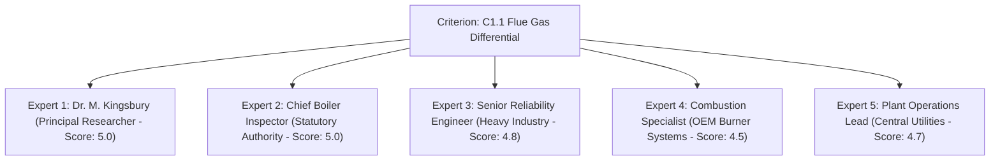

# Decision Governance & Academic Model Overlays

This guide provides an exhaustive technical reference for the model governance, dissertation provenance, and commercial version proposal modals in LuminaFM:
1. **Criterion Governance Detail Modal** (`CriterionGovernanceDetailModal`)
2. **Propose Model Version Modal** (`ProposeModelVersionModal`)
3. **Expert Evaluation Modal** (`ExpertEvaluationModal`)
4. **Attach Empirical Evidence Modal** (`AttachEmpiricalEvidenceModal`)
5. **Governance Approval Modal** (`GovernanceApprovalModal`)

---

## 1. Criterion Governance Detail Modal (`CriterionGovernanceDetailModal`)

### 1.1 Purpose & Academic Lineage
- **Purpose**: Provides complete provenance and scientific transparency for any of the 14 core decision criteria established in the Kingsbury dissertation baseline (University of Moratuwa, 2018). Surfaces peer-reviewed literature citations (DOIs), published papers, and independent evaluations from 5 certified domain experts.
- **Access Route**: `/governance` $\rightarrow$ **Academic Baseline Tab** (Clicking on any criterion card).
- **Authorized Roles**: Accessible to all authenticated users for audit inspection.

---

### 1.2 Visual Presentation & Callout Annotations

```carousel

<!-- slide -->

```

#### Numbered Callout Descriptions

| Callout # | UI Component | Description & Operational Function |
|:---:|---|---|
| **1** | **Modal Header & Provenance Badge** | Displays Criterion Code (e.g. `C1.1: Flue Gas Temperature Differential`), Cluster, and Academic Baseline badge. |
| **2** | **Literature Citations & DOIs** | Academic peer-reviewed publication references, journal names, authors, publication years, and external DOI links. |
| **3** | **5 Expert Profiles & Ratings** | Individual evaluation cards showing 5 independent expert votes (`Keep`/`Discard`), relevance scores ($1–5$), and threshold notes. |

---

### 1.3 Literature Reference Data Structure

Each criterion links directly to published thermodynamic and reliability literature:

| Metadata Field | Example Data | Description |
|---|---|---|
| **Paper Title** | *"Exergy and Reliability Analysis of Industrial Fire-Tube Steam Boilers"* | Peer-reviewed academic research paper title. |
| **Authors** | `Kingsbury, M. et al.` | Primary research authors. |
| **Journal / Conference** | `International Journal of Energy Research (Vol. 42)` | Certified academic publishing venue. |
| **Publication Year** | `2018` | Year published. |
| **Digital Object Identifier (DOI)** | `10.1002/er.4128` | Direct clickable hyperlink to permanent academic DOI resolver. |
| **Dissertation Text Excerpt** | *"Flue gas temperature differential serves as the primary early indicator of convection-pass gas-side fouling and fireside tube soot accumulation..."* | Direct quotation establishing physical causality. |

---

### 1.4 Expert Evaluation Profiles Matrix

Every criterion reflects judgments from a panel of 5 diverse domain experts:



| Expert ID | Professional Role | Retention Vote | Relevance Rating | Operational Threshold Boundary |
|---|---|:---:|:---:|---|
| `EXP_01` | Lead Academic Researcher | **KEEP** | `5.0 / 5.0` | $\Delta T_{\text{flue}} > 25^\circ\text{C}$ above design baseline |
| `EXP_02` | Chief Statutory Boiler Inspector | **KEEP** | `5.0 / 5.0` | Flue gas exit $> 240^\circ\text{C}$ mandates soot blower cycle |
| `EXP_03` | Plant Reliability Engineer | **KEEP** | `4.8 / 5.0` | 3-day moving average trend $\ge 1.5^\circ\text{C/day}$ shift |
| `EXP_04` | Burner Systems Specialist | **KEEP** | `4.5 / 5.0` | Correlate with $\text{O}_2$ flue trim $< 3.0\%$ |
| `EXP_05` | Utilities Shift Supervisor | **KEEP** | `4.7 / 5.0` | Daily logbook 2-hourly shift excursion trigger |

---

## 2. Propose Model Version Modal (`ProposeModelVersionModal`)

### 2.1 Purpose & Role Permissions
- **Purpose**: Allows organizations to propose custom or localized variants of the ANP decision model (e.g. tailored for tropical high-humidity climates, alternative fuels like biomass or syngas, or specific chiller equipment) without compromising the immutable academic baseline.
- **Access Route**: `/governance` $\rightarrow$ **Commercial Configurations Tab** (Clicking `Propose New Model Version`).
- **Authorized Roles**: Restricted to `Organization Admin` and `Plant Reliability Engineer`.

---

### 2.2 Visual Presentation & Callout Annotations

```carousel

<!-- slide -->

```

#### Numbered Callout Descriptions

| Callout # | UI Component | Description & Operational Function |
|:---:|---|---|
| **1** | **Modal Header & Advisory Notice** | Dialog header explaining that commercial variants fork safely from baseline templates. |
| **2** | **Model Code & Version Inputs** | Text fields for Model Identifier (`ANP-BOILER-COMM-V2.0`), Version Name, and Base Template selector. |
| **3** | **Engineering Justification Scope** | Multiline text area detailing operational justification, thermodynamic differences, and expected benefits. |

---

### 2.3 Field-by-Field Form Specification

| Field Name | Input Type | Format / Constraints | Required? | Default | Description |
|---|---|---|:---:|---|---|
| **Proposed Model Code** | Text Input | Uppercase alphanumeric + hyphens (`^[A-Z0-9-]+$`) | **Yes** | `""` | Machine-readable ID (e.g., `ANP-BOILER-TROPICAL-V2.1`). |
| **Version Display Name** | Text Input | String (3–100 chars) | **Yes** | `""` | Friendly title (e.g., `"High-Humidity Coastal Refinery Boiler Model"`). |
| **Base Model Template** | Select Dropdown | Existing Model ID | **Yes** | Baseline ID | Parent model from which criteria and supermatrices are inherited. |
| **Engineering Justification** | Multiline Textarea | String (20–2500 chars) | **Yes** | `""` | Mandatory justification explaining operational need and departures. |

---

## 3. Expert Evaluation Modal (`ExpertEvaluationModal`)

### 3.1 Purpose & Governance Workflow
- **Purpose**: Collects structured evaluation feedback from designated plant specialists or academic consultants on specific criteria in a commercial proposal.
- **Access Route**: Inside `/governance` $\rightarrow$ **Commercial Configurations Tab** $\rightarrow$ Click `Submit Expert Judgment` on any criterion card.

### 3.2 Form Specification

| Field Name | Input Type | Constraints | Required? | Description |
|---|---|---|:---:|---|
| **Expert Profile** | Select Dropdown | `EXP_01` through `EXP_05` | **Yes** | Designated specialist submitting the review. |
| **Retention Vote** | Radio / Toggle | `KEEP` / `DISCARD` | **Yes** | Whether criterion should remain in active supermatrix. |
| **Relevance Rating** | Number Slider | Integer (`1` to `5`) | **Yes** | Quantitative importance ($1 = \text{Negligible}, 5 = \text{Critical}$). |
| **Proposed Threshold** | Text Input | String (e.g. `> 12.0 bar`) | Optional | Operational excursion limit proposed by expert. |
| **Qualitative Comments** | Textarea | String (5–1000 chars) | **Yes** | Technical narrative supporting vote. |

---

## 4. Attach Empirical Evidence Modal (`AttachEmpiricalEvidenceModal`)

### 4.1 Purpose
- **Purpose**: Binds empirical operational data (e.g., past tube failure reports, boiler chemistry charts, burner test bench data) to a criterion modification to justify altered supermatrix weights.
- **Access Route**: Commercial Proposals tab $\rightarrow$ Click `Attach Evidence`.

### 4.2 Form Specification

| Field Name | Constraints | Required? | Description |
|---|---|:---:|---|
| **Evidence Type** | Enum (`operational_log_sheet`, `standards_clause`, `inspection_photograph`, `test_report`) | **Yes** | Classification of operational evidence. |
| **Evidence Title** | String (3–120 chars) | **Yes** | Short descriptor (e.g., `"2025 Waterside Scale Failure Incident Report"`). |
| **Storage URI / Document Link** | URL or Vault File Path | **Yes** | Link to secure file stored in Evidence Vault. |
| **Excerpt / Engineering Rationale** | String (10–1000 chars) | **Yes** | Explanation of how evidence proves weight shift validity. |

---

## 5. Governance Approval Modal (`GovernanceApprovalModal`)

### 5.1 Purpose & Safety Enforcement
- **Purpose**: Final formal signoff by Lead Reliability Engineer or Organization Admin granting or rejecting operational approval for a proposed model version.
- **Enforcement**: Commercial proposals remain in `provisional` status until approved. Only models reaching `commercial_validated` status can be selected to generate approved work orders.

### 5.2 Form Specification

| Field Name | Constraints | Required? | Description |
|---|---|:---:|---|
| **Approval Disposition** | `approved` / `rejected` | **Yes** | Formal signoff decision. |
| **Validation Level** | `commercial_field_tested` / `unvalidated_custom` | **Yes** | Resulting academic validation tier. |
| **Approver Signoff Notes** | String (minimum 15 characters) | **Yes** | Formal engineering justification recorded in audit log. |
