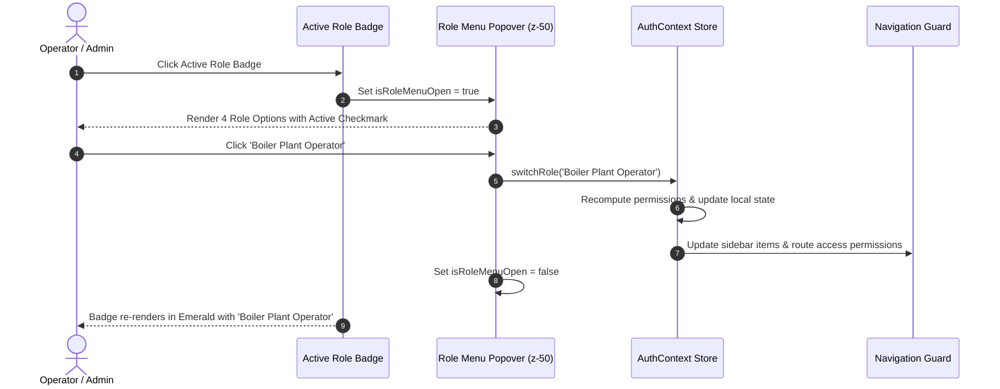

# Navigation Popovers & Role Switcher Overlays

This guide provides an exhaustive technical reference for the interactive popover overlays embedded within the global LuminaFM application shell:
1. **RBAC Role Switcher Popover** (`TopNavbarRoleSelectorPopover`)

---

## 1. RBAC Role Switcher Popover (`TopNavbarRoleSelectorPopover`)

### 1.1 Purpose & Role Simulation Capabilities
- **Purpose**: Enables rapid testing, role simulation, and administrative persona switching across the 4 primary facility user personas without logging out or re-entering tenant credentials.
- **Access Route**: Global Application Shell (Top-right of `TopNavbar` or bottom of `Sidebar`).
- **Interactive Trigger**: Clicking the Active Role badge (e.g. `[Plant Reliability Engineer ▾]`).

---

### 1.2 Visual Presentation & Callout Annotations

```carousel

<!-- slide -->

```

#### Numbered Callout Descriptions

| Callout # | UI Component | Description & Operational Function |
|:---:|---|---|
| **1** | **Active User Role Badge** | Header trigger button rendering current persona name with role-specific color accents and chevron indicator. |
| **2** | **Interactive Role Menu Dropdown** | Popover card (`w-64 bg-midnight-900 border border-slate-800 rounded-xl shadow-2xl`) listing all 4 system personas. |
| **3** | **Instantaneous Role Switch** | Single-click selection triggering immediate client-side authorization recomputation and route gating updates. |

---

### 1.3 Role Hierarchy & Dynamic Styling Matrix

Each role renders with distinctive chromatic styling across the header, badges, and popover highlights:

| Persona Role | UI Chromatic Tone | Visual Style Classes | Operational Privilege Scope |
|---|---|---|---|
| **Organization Admin** | Regal Gold Accent | `bg-gold-500/15 text-gold-300 border-gold-500/40 shadow-glow-gold/30` | Complete platform governance, white-label branding, user provisioning, cloud deployment configuration. |
| **Plant Reliability Engineer** | Deep Indigo Accent | `bg-indigo-950 text-indigo-300 border-indigo-500/40 shadow-glow-indigo/30` | ANP model execution, supermatrix sensitivity tuning, alert mitigations, compliance signoffs, WO creation. |
| **Boiler Plant Operator** | Industrial Emerald Accent | `bg-emerald-950/70 text-emerald-300 border-emerald-500/40` | Shift telemetry logging, floor kiosk touch entry, glove numpad inputs, QR scanning, offline sync queue. |
| **Maintenance Technician** | Amber Accent | `bg-amber-950/70 text-amber-300 border-amber-500/40` | Work order task checklist completion, labor hours tracking, spare parts consumption logging. |

---

### 1.4 Interactive Popover Lifecycle & State Flow



#### Dismissal & Outside Click Behavior
- Clicking outside the popover window activates an invisible full-screen backdrop click listener (`fixed inset-0 z-40`) that instantly closes the popover without altering the current role.
- Pressing `Escape` on physical keyboards triggers immediate closure.
- Selecting any role triggers an immediate state update and automatically dismisses the popover.
