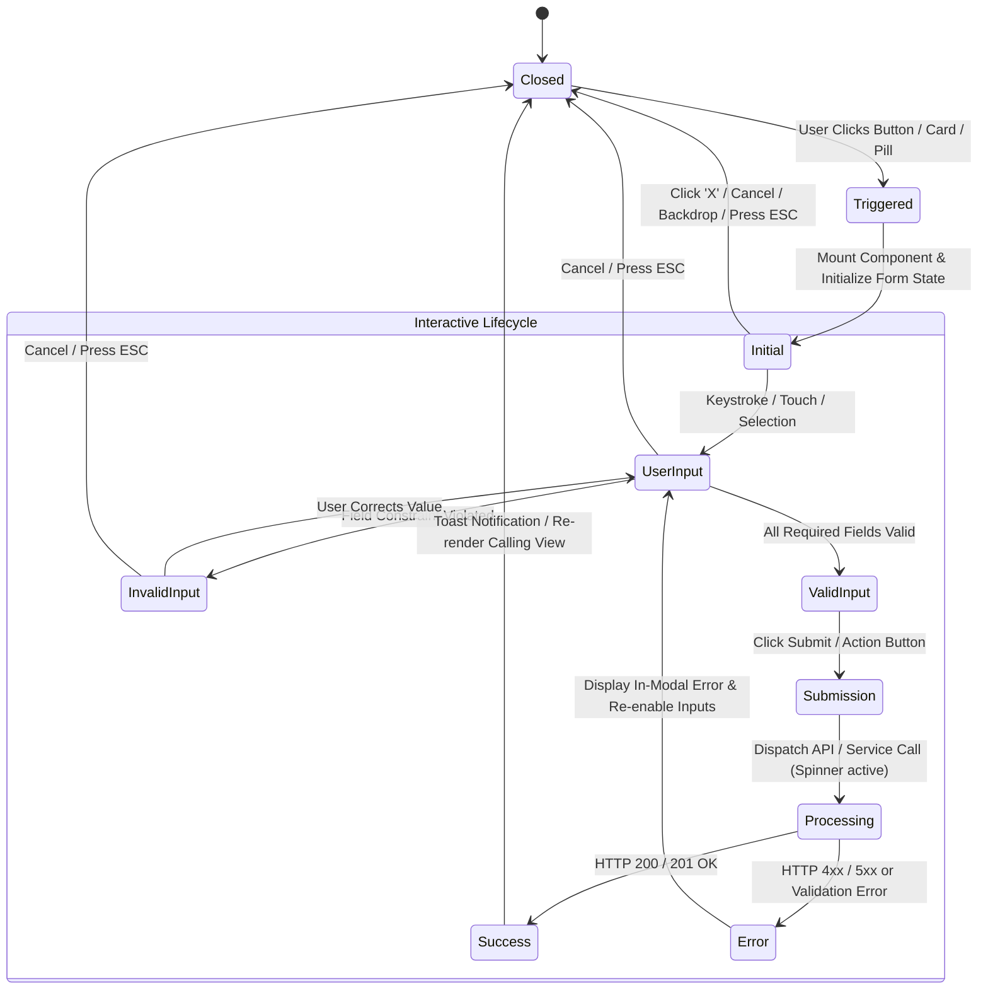

# LuminaFM User Manual — Modal, Drawer & Overlay System Reference

This document serves as the master architecture guide and exhaustive index for all 21 interactive overlay components in LuminaFM. It covers modal dialogs, slide-over drawers, specialized glove overlays, and contextual popovers implemented across the platform.

---

## 1. Overlay System Architecture & Interaction Guidelines

LuminaFM employs a strict modal and drawer design pattern based on enterprise safety and ergonomic standards:

### 1.1 Architectural Standards
1. **Focus Trap & Keyboard Accessibility**:
   - When any modal or drawer is active, keyboard focus is strictly trapped within the DOM dialog container.
   - Pressing `Escape` on physical keyboards triggers immediate dismissal (unless a destructive or in-flight network operation is actively saving).
2. **Backdrop & Z-Index Stratification**:
   - Backdrop: Dark translucent indigo-slate (`bg-midnight-950/85` to `bg-midnight-950/90`) with `backdrop-blur-md` to maintain cognitive contrast while visually dimming the underlying tabular data.
   - Stacking order:
     - Global Header / TopNavbar: `z-40`
     - Modal Backdrop & Window: `z-50`
     - Nested Touch Overlays (e.g. Glove Numpad over Floor Kiosk): `z-50`
     - Role Selector Popover: `z-50`
3. **Form Validation & Safe Error Handling**:
   - Field validations evaluate on-blur and on-submit.
   - Destructive operations require explicit confirmation or mandatory audit justification notes (e.g., Work Order status transitions, Compliance signoffs).
   - Form inputs provide explicit input formats, numerical step boundaries, and live range indicators.
4. **Touch & Ergonomic Sizing**:
   - On desktop, dialogs span responsive widths (`sm` = 448px, `md` = 512px, `lg` = 768px, `xl` = 896px).
   - On industrial floor kiosks and tablet viewports, all touch targets enforce minimum 44px (and 64px on glove numpads) to guarantee single-touch accuracy under harsh factory environments.

---

## 2. Master Modals, Drawers & Overlays Directory

The 21 interactive overlays are grouped by functional operational domain across the following dedicated technical guides:

| Module Guide File | Covered Overlays | Associated Screenshots | Target Operational Domain |
|---|---|---|---|
| [**01. Work Orders Modals**](file:///e:/My%20Owns/docs/user-manual/03-module-guides/modal-reference/01-work-orders-modals.md) | 1. `CreateWorkOrderModal` 2. `WorkOrderDetailModal` 3. `WorkOrderStatusTransitionModal` | `WO-003` `WO-004` | Work Order Lifecycle, Task Checklists, Labor & Parts, Audit Justifications |
| [**02. Inspections & Asset Drawers**](file:///e:/My%20Owns/docs/user-manual/03-module-guides/modal-reference/02-inspections-and-assets-drawers.md) | 4. `AssetDetailDrawer` 5. `InspectionDetailModal` | `ASSET-002` `INSP-002` | Asset Technical Specs, Dynamic JSONB Attributes, Walkthrough Checkpoint Audits |
| [**03. Floor Kiosk & Offline Modals**](file:///e:/My%20Owns/docs/user-manual/03-module-guides/modal-reference/03-floor-kiosk-modals.md) | 6. `QrScannerModal` 7. `GloveNumpad` Overlay 8. `SyncQueueDrawer` 9. `LogoutSyncGuardModal` | `KIOSK-003` `KIOSK-004` `KIOSK-005` | Industrial QR Recognition, 64px Gloved Touch Entry, IndexedDB Sync Queue, Logout Data Guards |
| [**04. Decision & Reporting Modals**](file:///e:/My%20Owns/docs/user-manual/03-module-guides/modal-reference/04-decision-reporting-modals.md) | 10. `OperationalAnpDrawer` 11. `AlertAcknowledgementModal` 12. `NotificationChannelConfigModal` 13. `RecommendationReviewModal` 14. `PrintableReportWindow` | `REP-003` `REP-006` | ANP Decision Runs, Limit Supermatrix Telemetry, Alert Mitigations, Multi-Channel Webhooks, Print Export |
| [**05. Audit Trail & Evidence Modals**](file:///e:/My%20Owns/docs/user-manual/03-module-guides/modal-reference/05-audit-and-evidence-modals.md) | 15. `EvidenceUploadModal` 16. `ComplianceVerificationModal` 17. `EvidencePackageModal` | `AUDIT-003` `AUDIT-005` `AUDIT-007` | Cryptographic SHA-256 Vault, Statutory Clause Verification, Tamper-Evident Package Compilation |
| [**06. Decision Governance Modals**](file:///e:/My%20Owns/docs/user-manual/03-module-guides/modal-reference/06-governance-modals.md) | 18. `CriterionGovernanceDetailModal` 19. `ProposeModelVersionModal` 20. `ExpertEvaluationModal` 21. `AttachEmpiricalEvidenceModal` *(Bonus: `GovernanceApprovalModal`)* | `GOV-002` `GOV-005` | Academic Dissertation Baselines (14 Criteria, 5 Experts), Model Version Proposals, Expert Retention Votes |
| [**07. Navigation Popovers**](file:///e:/My%20Owns/docs/user-manual/03-module-guides/modal-reference/07-navigation-popovers.md) | 22. `TopNavbarRoleSelectorPopover` | `NAV-001` | Instant Multi-Role RBAC Simulation, Active Scope Recomputation |

---

## 3. Universal Modal Lifecycle States

Every modal documented in this series is evaluated against 7 verified UI lifecycle states:

1. **Initial State**:
   - The default rendering when triggered.
   - Clean input fields with either empty values or sensible defaults.
   - Submit buttons enabled or disabled based on required field criteria.
2. **User Input State**:
   - Active user typing, dropdown toggling, or file selection.
   - Character count tracking (where applicable) and dynamic field enablement.
3. **Invalid Input State**:
   - Visual alerts triggered when input violates validation constraints (e.g., negative labor hours, missing certified inspector name, file exceeding 25MB).
   - In-modal alert banner (`AlertTriangle`) with clear corrective guidance.
4. **Valid Input State**:
   - All required fields conform to syntax, type, and range limits.
   - Action triggers (e.g., "Create Work Order", "Save Channel", "Sign Off Record") shift to active primary styling.
5. **Submission State**:
   - Action button enters loading state with spinning indicator (`RefreshCw animate-spin` or `LoadingState`).
   - Inputs are set to `disabled` to prevent accidental double-submission.
6. **Success State**:
   - Modal automatically dismisses, or displays an inline success confirmation (`CheckCircle2`).
   - Calling view refreshes data asynchronously and updates table counters.
7. **Failure State**:
   - Network or server validation errors (e.g., duplicate sequence number, 403 Forbidden) are captured.
   - Rendered inline in an error container with red/rose accent; modal remains open so user input is preserved.

---

> [!NOTE]
> All modals and drawers are fully functional in both desktop and touch environments. For detailed field specifications, cross-reference [Field Reference Directory](file:///e:/My%20Owns/docs/user-manual/07-reference/field-reference.md) and [Modals Inventory](file:///e:/My%20Owns/docs/user-manual/inventory/modals-inventory.md).
