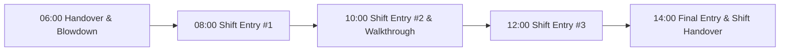

# LuminaFM Role User Manual: Boiler Plant Operator

### Boiler Plant Operator Operational Manual

```carousel

<!-- slide -->

```

---

## 1. Role Overview & Core Responsibilities

The **Boiler Plant Operator** serves as the Licensed Boiler Watchkeeper, Stationary Steam Plant Operator, or Utilities Watchkeeping Technician. This role operates directly on the plant floor, responsible for boiler safety, watchkeeping rounds, and telemetry capture:

- **2-Hourly Watchkeeping Telemetry Entry**: Recording steam header pressure, flue gas exit temperature, boiler water total dissolved solids (TDS), and combustion air ambient temperature.
- **Physical Safety Verifications**: Conducting physical gauge glass blowdowns and confirming sight glass water levels, burner flame stability, and feedwater pump operation.
- **Factory-Floor Tablet Operations**: Operating LuminaFM in high-temperature, dimly-lit boiler basements using touch-first controls, optical QR barcode scanning, and $64\text{px}$ glove numpads.
- **Offline Shift Persistence**: Storing shift entries locally in IndexedDB when operating in Wi-Fi-shielded underground utility vaults and managing background synchronization.
- **Defect & Fault Escalation**: Flagging physical equipment abnormalities (pump packing leaks, casing hot spots, refractory cracks) during routine walkthrough inspections.

---

## 2. Login & First Access

1. Navigate to `/login`.
2. Input operator credentials:
   - Email: `chief.engineer@colombohotel.lk`
   - *Quick Shortcut*: Click the **Boiler Operator** quick-login button.
3. Click **Sign In to Facility**.
4. In the top-right header, confirm that the **Active Role Badge** renders in an industrial Emerald Green (`bg-emerald-950/70 text-emerald-300 border-emerald-500/40`) with the label **Boiler Plant Operator**.
5. *On mobile tablets*: Tap the **Floor Kiosk** button in the header to launch the touch-first tablet interface (`/operator`).

---

## 3. Relevant Dashboard: Floor Operator Kiosk & Daily Monitoring

The Boiler Plant Operator operates primarily through two dedicated interfaces:
1. **Floor Operator Tablet Kiosk (`/operator`)** (`KIOSK-001`, `KIOSK-002`):
   - Touch-first design with $44\text{px}+$ targets and glove-compatible inputs.
   - Built-in QR scanner modal (`KIOSK-004`) for optical nameplate scanning.
   - Slide-over offline sync queue drawer (`KIOSK-005`).
2. **Daily Boiler Logbook Portal (`/daily-monitoring`)** (`LOG-001`):
   - Desktop entry form for 2-hourly shift telemetry with real-time range alerts.
   - Historical shift archive tab (`LOG-002`) for reviewing previous shift logs.

```carousel

<!-- slide -->

```

**Numbered Callout Descriptions (`KIOSK-003`):**
- **Marker 1 (Active Telemetry Readout)**: Large monospace display reflecting entered float value and unit (`bar`).
- **Marker 2 (Tactile Keypad Matrix)**: 64px+ oversized touch keys ($0–9$, decimal `.`, backspace, clear `C`, step $\pm 0.5$).
- **Marker 3 (Preset Value Shortcuts)**: Pre-calibrated quick-tap setpoints (`0.0`, `5.0`, `10.0`, `10.5` bar).

---

## 4. Accessible Modules & Navigation Scope

The Boiler Plant Operator has access to operational plant modules while administrative modules are strictly restricted:

| Module Name | Route | Operational Capability | Access Level |
|---|---|---|:---:|
| **Command Center** | `/` | View plant availability and active alerts | Read-Only |
| **Asset Master** | `/assets` | View asset codes, nameplates, and locations | Read-Only |
| **Equipment Hierarchies** | `/hierarchies` | Inspect physical and process locations | Read-Only |
| **Maintenance Calendar** | `/maintenance-calendar` | Inspect scheduled maintenance events | Read-Only |
| **Work Orders** | `/work-orders` | View open maintenance tickets | Read-Only |
| **Inspections & Faults** | `/inspections` | Conduct walkthrough inspections, report faults | Full Access |
| **Boiler Logbook** | `/daily-monitoring` | Log 2-hourly shift telemetry, review archive | Full Access |
| **Floor Operator Kiosk** | `/operator` | Touch kiosk, QR scanner, glove numpad, sync queue | Full Access |
| **Decision & Reporting** | `/reports` | Inspect ANP priorities and alert history | Read-Only |
| **Audit & Evidence** | `/audit-evidence` | View verified compliance records | Read-Only |
| **Cost Analytics** | `/cost-analysis` | Financial spend analysis | **FORBIDDEN (403)** |
| **Decision Governance** | `/governance` | ANP model administration | **FORBIDDEN (403)** |
| **White-Label & Settings** | `/settings` | Corporate settings and branding | **FORBIDDEN (403)** |

---

## 5. Daily Tasks & Practical User Training

### Standard 8-Hour Shift Watchkeeping Routine (Shift A: 06:00 - 14:00)



1. **06:00 - Shift Handover & Morning Blowdown**:
   - Arrive at Basement Boiler Room B-01.
   - Perform physical gauge glass blowdown: crack blowdown valve, verify water returns briskly to center gauge line.
   - Perform continuous blowdown valve check; confirm boiler chemical dosing pump is primed.
2. **08:00 - First 2-Hourly Telemetry Logging Round**:
   - Open tablet to `/operator` (or desktop at `/daily-monitoring`).
   - Scan boiler QR nameplate (`BLR-001`).
   - Input readings via Glove Numpad:
     - Steam Pressure: `8.5 bar` (Nominal: $6.0 - 10.0\text{ bar}$)
     - Flue Gas Exit Temp: `175.0°C` (Nominal: $140.0 - 190.0^\circ\text{C}$)
     - Water TDS: `2,400 ppm` (Nominal: $1,500 - 2,500\text{ ppm}$)
     - Ambient Air Temp: `29.5°C`
   - Toggle **Sight Glass Level Confirmed** to `ON`.
   - Tap **Commit Shift Logbook Submission**.
3. **10:00 - Second Logging Round & Physical Walkthrough**:
   - Record 10:00 telemetry.
   - Conduct physical walkthrough inspection (`/inspections`).
   - If an abnormality is found (e.g. auxiliary feed pump gland weeping), log it on the **Fault History** tab (`FLT-0042`).
4. **12:00 - Midday Telemetry Round**:
   - Record 12:00 telemetry. Check fuel tank day levels and steam header load.
5. **14:00 - Final Shift Round & Handover**:
   - Record 14:00 telemetry.
   - In the **Handover Notes** field, enter: `"Boiler firing steady on modulating high fire; water clear in sight glass; chemical tank 70% full."`
   - Confirm all shift entries show `synced` in the Sync Status Pill.

---

## 6. Important Workflows for This Role

- [**WF-08: Inspection Walkthrough & Fault Escalation**](file:///e:/My%20Owns/docs/user-manual/05-workflows/08-inspections-and-fault-escalation.md): Conducting walkthroughs and reporting faults.
- [**WF-09: Desktop 2-Hourly Daily Boiler Logbook Entry**](file:///e:/My%20Owns/docs/user-manual/05-workflows/09-daily-boiler-logbook.md): Logging shift data on desktop workstations.
- [**WF-10: Industrial Tablet Floor Kiosk Experience**](file:///e:/My%20Owns/docs/user-manual/05-workflows/10-floor-kiosk-operations.md): Using QR scanner, glove numpad, and touch toggles.
- [**WF-11: Offline PWA Queueing & Conflict Resolution**](file:///e:/My%20Owns/docs/user-manual/05-workflows/11-offline-sync-and-conflict-resolution.md): Working in disconnected boiler rooms.

---

## 7. Restricted Operations & Common Errors

### Restricted Operations
- **Forbidden Modules**: Attempting to navigate to `/cost-analysis`, `/governance`, or `/settings` renders the `ForbiddenState` (HTTP 403 Forbidden).
- **Work Order Management**: Operators cannot authorize, reassign, or close work orders; tickets must be managed by technicians and engineers.
- **Decision Approvals**: Operators cannot approve or reject ANP maintenance decisions.

### Common Errors & Solutions
- *Error*: `"Water level verification is mandatory before logbook submission"`.
  *Solution*: You must physically inspect the sight glass and toggle the **Sight Glass Water Level Confirmed** switch to `ON` before the submit button unlocks.
- *Error*: `"EXCURSION: Pressure exceeds MAWP threshold (10.5 bar)"`.
  *Solution*: The entered steam pressure breaches maximum allowable working pressure. Double-check your gauge reading. If real, initiate immediate safety relief blowdown and contact the Lead Reliability Engineer.
- *Error*: `"Offline submission queued"`.
  *Solution*: Normal operation in shielded utility basements. Your readings are safely saved in local tablet storage. When you return to the control room, the system will sync automatically.
