# LuminaFM Role-Based User Manuals & Authorization Architecture

This directory provides dedicated operational user manuals tailored for each verified user role implemented in LuminaFM.

---

## 1. System Authorization Architecture & Role Inspection

LuminaFM implements a strict multi-tier **Role-Based Access Control (RBAC)** architecture enforced across three layers:
1. **Prisma Database Layer**: The relational schema enforces multi-tenant organization boundaries via composite foreign keys (`[organization_id, id]`) and links memberships to roles via `membership_roles` and permissions via `role_permissions`.
2. **Backend Express Middleware Layer**:
   - `authenticateTenant`: Validates the JWT Bearer token, rejects unverified client tenant headers, binds the active organization context into `AsyncLocalStorage`, and extracts verified permissions from the database.
   - `requirePermission`: Blocks requests with HTTP 403 Forbidden if the authenticated user lacks the required permission key (`assets:manage`, `work_orders:manage`, `governance:manage`, `finance:read`, `org:admin`, etc.).
   - `requireRole`: Enforces explicit role constraints where applicable.
3. **Frontend React Router Layer**:
   - `ProtectedRoute`: Evaluates `activeRole` and `hasPermission` before mounting page components, rendering a high-contrast `ForbiddenState` component if access criteria are not met.
   - `Sidebar` & `TopNavbar`: Dynamically filters menu items and action buttons according to the active role persona.

```mermaid
graph TD
    A["User Authentication (/login)"] --> B["JWT Token & Organization Context"]
    B --> C{"Role Evaluation"}
    
    C -->|Organization Admin| D["Superuser Scope (*) -> All 14 Modules Accessible"]
    C -->|Plant Reliability Engineer| E["Engineering & Governance Scope -> 13 Modules (Settings Forbidden 403)"]
    C -->|Boiler Plant Operator| F["Plant Floor Scope -> Floor Kiosk, Daily Logs, Inspections (Cost/Gov/Settings Forbidden 403)"]
    C -->|Maintenance Technician| G["Execution Scope -> Work Orders, Kanban, Resource Tracking (Cost/Gov/Settings Forbidden 403)"]
    
    style D fill:#3b2d10,stroke:#d4af37,stroke-width:2px
    style E fill:#1e1e4a,stroke:#6366f1,stroke-width:2px
    style F fill:#0f3824,stroke:#10b981,stroke-width:2px
    style G fill:#38270f,stroke:#f59e0b,stroke-width:2px
```

---

## 2. Implemented vs. Unimplemented Roles Analysis

During comprehensive codebase inspection of the backend database seed (`prisma/seed.ts`), Prisma schema (`prisma/schema.prisma`), backend RBAC middleware (`src/middleware/rbac.middleware.ts`), and frontend authentication store (`frontend/src/store/AuthContext.tsx`), the following authorization facts were verified:

### The 4 Verified System Roles:
1. **`Organization Admin`**: Facility Executive / System Administrator possessing superuser administrative privileges (`*`, `org:admin`).
2. **`Plant Reliability Engineer`**: Senior Engineer overseeing thermodynamic models, ANP governance, preventive maintenance planning, asset master registers, and cost analysis.
3. **`Boiler Plant Operator`**: Licensed boiler watchkeeper executing 2-hourly shift logging, physical walkthrough inspections, and floor kiosk operations.
4. **`Maintenance Technician`**: Mechanical/electrical technician executing authorized work orders, task checklists, labor tracking, and spare parts requisitioning.

### Analysis of the "Manager" Persona:
> [!IMPORTANT]
> **No distinct "Manager" (or "Facility Manager") role exists as an independent system role in LuminaFM.**
> In the LuminaFM architectural model, managerial responsibilities are divided between two specialized personas:
> - **Commercial / Corporate Governance**: Handled by the `Organization Admin` (tenant settings, white-label branding, cost center financial rollups).
> - **Engineering / Operational Management**: Handled by the `Plant Reliability Engineer` (work order dispatch, PM schedule approval, ANP recommendation signoff, and statutory clause compliance).
>
> In accordance with strict manual guidelines, "Manager" is marked in all permission matrices as **`UNIMPLEMENTED / INACCESSIBLE`** to prevent misleading facility personnel into searching for a non-existent role.

---

## 3. Directory of Role-Based User Manuals

Each role guide provides an exhaustive, practical handbook outlining daily routines, permissions, workflows, and annotated visual walk-throughs:

| Manual Document | Target Role Persona | Chromatic UI Tone | Key Operational Scope |
|---|---|---|---|
| [**01. Organization Admin Guide**](file:///e:/My%20Owns/docs/user-manual/04-role-based-guides/01-organization-admin-guide.md) | `Organization Admin` | **Regal Gold** | Corporate branding, white-label preview, cloud deployment inspection, financial cost analysis, model approvals, superuser override. |
| [**02. Plant Reliability Engineer Guide**](file:///e:/My%20Owns/docs/user-manual/04-role-based-guides/02-plant-reliability-engineer-guide.md) | `Plant Reliability Engineer` | **Deep Indigo** | Asset master specifications, dual hierarchy DAGs, PM calendar planning, ANP decision runs, sensitivity tuning, alert mitigations, statutory signoffs. |
| [**03. Boiler Plant Operator Guide**](file:///e:/My%20Owns/docs/user-manual/04-role-based-guides/03-boiler-plant-operator-guide.md) | `Boiler Plant Operator` | **Emerald Green** | 2-hourly shift watchkeeping, floor tablet kiosk, glove numpad entry, optical QR scanning, offline IndexedDB sync, fault escalation. |
| [**04. Maintenance Technician Guide**](file:///e:/My%20Owns/docs/user-manual/04-role-based-guides/04-maintenance-technician-guide.md) | `Maintenance Technician` | **Amber** | Work order Kanban execution, sequential task completion, labor hours tracking, inventory parts consumption, repair photo uploads. |

---

## 4. Master Permissions Matrix Cross-Reference

For the complete module-by-module and action-by-action permission grid across all roles, refer to:
- [**Master Permissions Matrix**](file:///e:/My%20Owns/docs/user-manual/07-reference/permissions-matrix.md)
