# Full Operational Lifecycle: Asset Registration to Maintenance Closeout

### Full Lifecycle Maintenance Workflow

**Purpose:** Connects all core LuminaFM functional modules into an unbroken, end-to-end operational sequence — demonstrating how equipment data flows seamlessly from master registry configuration through preventive scheduling, floor defect detection, work order assignment, parts and labor tracking, state-machine closeout, and financial ledger settlement.

**Required Role:** Multi-role workflow involving `Organization Admin` (Initial Configuration), `Plant Reliability Engineer` (Asset Master & PM Planning), `Boiler Plant Operator` (Shift Logging & Fault Detection), and `Maintenance Technician` (Work Order Execution & Resource Tracking).

**Prerequisites:**
1. LuminaFM tenant account provisioned (e.g. `COLOMBO-GRAND`).
2. Operating database with PostgreSQL migrations applied.
3. Access to network or local development server (`http://localhost:3000`).

**Starting Point:** `/login` (User Authentication Screen).

---

## Complete Operational Sequence Diagram

```mermaid
sequenceDiagram
    autonumber
    actor Admin as Organization Admin
    actor Eng as Reliability Engineer
    actor Op as Boiler Operator
    actor Tech as Maintenance Tech

    rect rgb(15, 23, 42)
        Note over Admin, Eng: Phase 1: Asset Master Registration & Specs
        Admin->>Eng: Provisions Tenant Scope
        Eng->>Eng: Navigates to /assets and creates/configures BLR-001
        Eng->>Eng: Enters Dynamic JSONB Attributes (MAWP: 10.5 bar, Evap: 1100 kg/h)
        Eng->>Eng: Maps Physical Location (B-01) & Process Loop (Steam Header A)
    end

    rect rgb(30, 41, 59)
        Note over Eng: Phase 2: Preventive Maintenance Planning
        Eng->>Eng: Navigates to /maintenance-calendar
        Eng->>Eng: Configures Recurring PM Schedule (Quarterly Burner Overhaul, 90 days)
        Eng->>Eng: Confirms Calendar Grid Populates Event Markers
    end

    rect rgb(20, 30, 50)
        Note over Op: Phase 3: Operational Telemetry & Anomaly Trigger
        Op->>Op: Conducts Walkthrough / Daily Logbook (/daily-monitoring or /operator)
        Op->>Op: Inputs Flue Gas Temp = 210°C (Nominal: 140-190°C)
        Op->>Op: System flags Anomaly and auto-stages Defect / Draft Work Order
    end

    rect rgb(35, 25, 45)
        Note over Eng, Tech: Phase 4: Work Order Authorization & Execution
        Eng->>Eng: Navigates to /work-orders
        Eng->>Eng: Authorizes Ticket: Transitions draft -> approved -> assigned (Tech assigned)
        Tech->>Tech: Opens Work Order Detail Modal (/work-orders)
        Tech->>Tech: Transitions assigned -> in_progress (Mandatory justification logged)
        Tech->>Tech: Completes Checklist Tasks (#1, #2, #3)
        Tech->>Tech: Logs Labor Hours (4.0 hrs @ $45/hr) & Consumed Parts (2 Gaskets @ $18.50)
        Tech->>Tech: Transitions in_progress -> completed
    end

    rect rgb(15, 35, 25)
        Note over Eng, Admin: Phase 5: Supervisory Signoff & Cost Ledger Closeout
        Eng->>Eng: Reviews task completion and financial ledger ($217.00 Total Cost)
        Eng->>Eng: Executes final transition: completed -> closed
        Eng->>Eng: Verifies Maintenance History updated in Asset Detail Drawer (/assets)
        Admin->>Admin: Reviews Financial Proactive Ratio (72.4%) in /cost-analysis
        Admin->>Admin: Archives Cryptographic Work Order Signoff in /audit-evidence
    end
```



---

## Step-by-Step Procedure

### Stage 1: Asset Master Registration & JSONB Attribute Configuration
1. Log into LuminaFM as `Plant Reliability Engineer`.
2. Navigate to **Asset Master Registry** via sidebar or `/assets`.
3. Locate the target equipment card (e.g. `BLR-001: Main High-Pressure Steam Boiler`).
4. Click the asset card to open the **Slide-Over Asset Detail Drawer** (`AssetDetailDrawer`).

```carousel

<!-- slide -->

```

5. Click **Edit Attributes** on the Dynamic Specifications tab.
6. Verify and update technical parameters:
   - Design Pressure: `10.5 bar`
   - Nominal Steam Evaporation: `1,100 kg/h`
   - Primary Burner Fuel: `Heavy Fuel Oil (HFO)`
7. Click **Save Changes**. Verify confirmation badge: `"Dynamic attributes saved successfully"`.
8. Review the **Hierarchy Breadcrumb**: `Main Campus` $\rightarrow$ `Central Utilities Plant` $\rightarrow$ `Basement Boiler Room B-01`.

---

### Stage 2: Preventive Maintenance Routine Configuration
1. Navigate to **Maintenance Planning** via sidebar or `/maintenance-calendar`.
2. Switch to the **Schedules Tab** (`CAL-002`).

```carousel

<!-- slide -->

```

3. Review the recurring PM routine: `"Quarterly Burner Overhaul & Air-Fuel Ratio Tuning"`.
4. Inspect frequency: `90 Days` | Target Asset: `BLR-001` | Urgency: `High`.
5. Switch to the **Interactive Month Grid** (`CAL-001`) to verify that scheduled execution deadlines render cleanly across the calendar matrix.

---

### Stage 3: Operational Anomaly Detection & Defect Escalation
1. Simulate or conduct shift watchkeeping via `/daily-monitoring` or the floor kiosk at `/operator`.
2. The operator logs an elevated Flue Gas Temperature of `210.0°C` (exceeding nominal $190.0^\circ\text{C}$ limit).
3. The system generates an active operational excursion under `/reports` $\rightarrow$ **Operational Abnormalities Tab** (`REP-002`).

```carousel

<!-- slide -->

```

4. The engineer clicks **Acknowledge** on the excursion card.
5. In the **Alert Acknowledgement Modal** (`REP-003`), the engineer selects:
   - Action Taken: `dispatched_work_order`
   - Mitigation Notes: `"Dispatched corrective maintenance ticket for convection pass soot blow and burner damper check."`
6. Click **Confirm Acknowledgment**. The ticket automatically stages in the Work Orders module.

---

### Stage 4: Work Order Authorization & Lifecycle Execution
1. Navigate to **Work Orders** (`/work-orders`).
2. Switch between **List View** (`WO-001`) and **Interactive Kanban Board** (`WO-002`).

```carousel

<!-- slide -->

```

3. Locate the new ticket (e.g. `WO-001`). Click **Details** to open `WorkOrderDetailModal` (`WO-004`).
4. Click **Transition to ASSIGNED**. In the mandatory reason modal, input: `"Assigned to Senior Mechanical Technician John Doe"`.
5. Using the top navigation role switcher, toggle active role to **Maintenance Technician**.
6. The technician clicks **Transition to IN_PROGRESS** with reason: `"Commenced mechanical isolation and lock-out/tag-out."`
7. Check off the sequential tasks:
   - [x] `#1: Isolate fuel supply and lock out burner control panel`
   - [x] `#2: Inspect and brush fire-tube convection pass soot deposits`
   - [x] `#3: Replace access door spiral wound gasket`
8. Log labor hours: `4.0 Hours` at `$45.00/hr` ($=\$180.00$).
9. Log inventory parts: `2x GSK-SPIRAL-4IN-300#` at `$18.50/ea` ($=\$37.00$).
10. Verify that the **Financial Cost Ledger** computes:
    $$\text{Labor (\$180.00)} + \text{Parts (\$37.00)} + \text{Contractor (\$0.00)} = \text{Total (\$217.00)}$$
11. Click **Transition to COMPLETED** with reason: `"Completed soot blow, gasket installed, pass leak check nominal."`

---

### Stage 5: Supervisory Signoff & Immutable Audit Archival
1. Switch role back to **Plant Reliability Engineer**.
2. Open ticket `WO-001` and verify all tasks show `completed`.
3. Click **Transition to CLOSED** with final approval reason: `"Verified post-maintenance combustion efficiency at 84.2%. Ticket closed."`
4. Navigate to **Asset Master Registry** (`/assets`) and open `BLR-001` in the `AssetDetailDrawer`.
5. Verify that `WO-001` is permanently appended to the **Maintenance History** ledger.
6. Navigate to **Maintenance Cost Analysis** (`/cost-analysis`) (`COST-001`) to verify that the $\$217.00$ spend is reflected in the cumulative facility cost center.
7. Navigate to **Audit Trail & Evidence Vault** (`/audit-evidence`) (`AUDIT-001`) to confirm that all 5 state transitions have been written to the immutable event ledger with user ID, timestamps, and IP addresses.

---

**Expected Result:** The asset, maintenance plan, floor anomaly, work order, cost ledger, and audit vault reflect a 100% reconciled, traceable lifecycle execution.

**Common Problems & Practical Solutions:**
- *Problem*: Transition button is disabled or missing from the modal.
  *Solution*: Check current state. If ticket is in `completed` status, only an `Organization Admin` or `Plant Reliability Engineer` can transition it to `closed`. Switch active persona via TopNavbar.
- *Problem*: State transition fails with `"Mandatory transition justification required"`.
  *Solution*: Enter at least 5 characters into the justification text area before clicking Confirm.

**Related Workflows:**
- [WF-03: Asset Catalog & Dynamic Attributes](file:///e:/My%20Owns/docs/user-manual/05-workflows/03-asset-catalog-and-attributes.md)
- [WF-05: Preventive Maintenance Scheduling](file:///e:/My%20Owns/docs/user-manual/05-workflows/05-preventive-maintenance-scheduling.md)
- [WF-06: Work Order Execution & Lifecycle](file:///e:/My%20Owns/docs/user-manual/05-workflows/06-work-order-lifecycle.md)
- [WF-07: Work Order Resource Tracking](file:///e:/My%20Owns/docs/user-manual/05-workflows/07-work-order-resource-tracking.md)
- [WF-16: Enterprise Compliance Audit](file:///e:/My%20Owns/docs/user-manual/05-workflows/16-compliance-audit-and-evidence-package.md)
