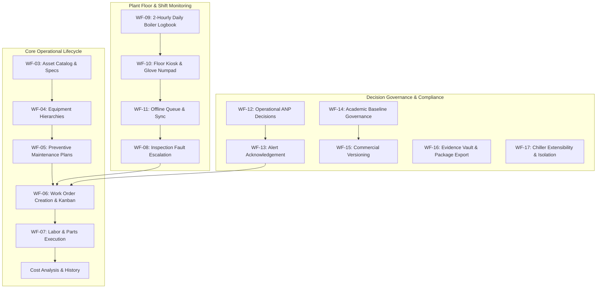

# LuminaFM User Manual — Operational Workflows Master Directory

This directory provides comprehensive, practical, step-by-step operational guides for all 17 verified end-to-end user workflows supported by the LuminaFM Enterprise CMMS platform.

---

## 1. Workflows Architecture & Operational Scope

All workflows in LuminaFM are designed around strict enterprise facility principles:
1. **Multi-Tenant Isolation**: Every workflow operates strictly within the active organization tenant scope.
2. **Role-Based Access Control (RBAC)**: Workflows adapt dynamically to the authenticated role (`Organization Admin`, `Plant Reliability Engineer`, `Boiler Plant Operator`, `Maintenance Technician`).
3. **Non-Repudiation & Audit Immutability**: Every mutation, status transition, alert mitigation, and evidence upload automatically captures actor, timestamp, tenant, before/after JSON diffs, and cryptographic SHA-256 hashes.
4. **Offline Resiliency**: Shift telemetry logging and inspection tasks operate seamlessly in disconnected boiler basements via IndexedDB and ServiceWorker queues.

---

## 2. Complete Workflow Directory

| Workflow ID | Workflow Guide File | Target Operational Domain | Primary Actor | Key Verified Artifacts |
|:---:|---|---|---|---|
| **WF-00** | [**00-full-lifecycle-maintenance.md**](file:///e:/My%20Owns/docs/user-manual/05-workflows/00-full-lifecycle-maintenance.md) | **Full Lifecycle CMMS Chain** (Asset $\rightarrow$ PM $\rightarrow$ WO $\rightarrow$ Execution $\rightarrow$ Costs $\rightarrow$ Audit) | Facility Team | End-to-end integration |
| **WF-01** | [**01-user-auth-and-rbac.md**](file:///e:/My%20Owns/docs/user-manual/05-workflows/01-user-auth-and-rbac.md) | User Authentication & 1-Click Role Simulation | All Roles | `AUTH-001`, `NAV-001` |
| **WF-02** | [**02-white-label-branding.md**](file:///e:/My%20Owns/docs/user-manual/05-workflows/02-white-label-branding.md) | Tenant White-Label Logo & Regional Settings | Admin | `SET-001`, `SET-002` |
| **WF-03** | [**03-asset-catalog-and-attributes.md**](file:///e:/My%20Owns/docs/user-manual/05-workflows/03-asset-catalog-and-attributes.md) | Asset Master Registry & Dynamic JSONB Specs | All Roles / Engineer | `ASSET-001`, `ASSET-002` |
| **WF-04** | [**04-equipment-hierarchies.md**](file:///e:/My%20Owns/docs/user-manual/05-workflows/04-equipment-hierarchies.md) | Dual Equipment Hierarchies (Physical & Process DAGs) | All Roles | `HIER-001`, `HIER-002` |
| **WF-05** | [**05-preventive-maintenance-scheduling.md**](file:///e:/My%20Owns/docs/user-manual/05-workflows/05-preventive-maintenance-scheduling.md) | PM Calendar Scheduling & On-Demand WO Dispatch | Engineer / Tech | `CAL-001`, `CAL-002` |
| **WF-06** | [**06-work-order-lifecycle.md**](file:///e:/My%20Owns/docs/user-manual/05-workflows/06-work-order-lifecycle.md) | Work Order Execution & Lifecycle State Machine | Engineer / Tech | `WO-001`, `WO-002`, `WO-003` |
| **WF-07** | [**07-work-order-resource-tracking.md**](file:///e:/My%20Owns/docs/user-manual/05-workflows/07-work-order-resource-tracking.md) | Work Order Resource Tracking (Tasks, Labor, Parts) | Technician | `WO-004`, `COST-001` |
| **WF-08** | [**08-inspections-and-fault-escalation.md**](file:///e:/My%20Owns/docs/user-manual/05-workflows/08-inspections-and-fault-escalation.md) | Walkthrough Inspections & Fault Escalation | Operator / Inspector | `INSP-001`, `INSP-002`, `INSP-003` |
| **WF-09** | [**09-daily-boiler-logbook.md**](file:///e:/My%20Owns/docs/user-manual/05-workflows/09-daily-boiler-logbook.md) | Desktop 2-Hourly Daily Boiler Logbook Entry | Boiler Operator | `LOG-001`, `LOG-002` |
| **WF-10** | [**10-floor-kiosk-operations.md**](file:///e:/My%20Owns/docs/user-manual/05-workflows/10-floor-kiosk-operations.md) | Industrial Tablet Floor Kiosk Experience | Boiler Operator | `KIOSK-001`, `KIOSK-003`, `KIOSK-004` |
| **WF-11** | [**11-offline-sync-and-conflict-resolution.md**](file:///e:/My%20Owns/docs/user-manual/05-workflows/11-offline-sync-and-conflict-resolution.md) | Offline PWA Queueing & Conflict Resolution | Floor Operator | `KIOSK-005` |
| **WF-12** | [**12-operational-anp-decision-review.md**](file:///e:/My%20Owns/docs/user-manual/05-workflows/12-operational-anp-decision-review.md) | Operational ANP Telemetry Evaluation & Action Review | Reliability Engineer | `REP-001`, `DASH-001` |
| **WF-13** | [**13-operational-alerts-and-channels.md**](file:///e:/My%20Owns/docs/user-manual/05-workflows/13-operational-alerts-and-channels.md) | Operational Alert Acknowledgment & Routing | Reliability Engineer | `REP-002`, `REP-003`, `REP-006` |
| **WF-14** | [**14-model-governance-baseline.md**](file:///e:/My%20Owns/docs/user-manual/05-workflows/14-model-governance-baseline.md) | ANP Model Governance & Academic Baseline Validation | Reliability Engineer | `GOV-001`, `GOV-002` |
| **WF-15** | [**15-commercial-model-versioning.md**](file:///e:/My%20Owns/docs/user-manual/05-workflows/15-commercial-model-versioning.md) | Commercial Model Proposals & Version Diffing | Reliability Engineer | `GOV-003`, `GOV-004`, `GOV-005` |
| **WF-16** | [**16-compliance-audit-and-evidence-package.md**](file:///e:/My%20Owns/docs/user-manual/05-workflows/16-compliance-audit-and-evidence-package.md) | Compliance Audit & Tamper-Evident Package Building | Compliance Officer / Admin | `AUDIT-001`, `AUDIT-003`, `AUDIT-007` |
| **WF-17** | [**17-chiller-extensibility-and-isolation.md**](file:///e:/My%20Owns/docs/user-manual/05-workflows/17-chiller-extensibility-and-isolation.md) | Chiller Telemetry & Cross-Module Isolation | Reliability / HVAC Engineer | `DASH-001` |

---

> [!TIP]
> Before operating any workflow, verify that your active user persona corresponds to the **Required Role** listed in the workflow specifications. Use the top navigation role switcher to toggle test personas instantly.
