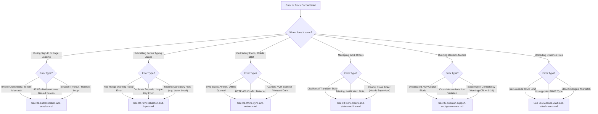

# LuminaFM Troubleshooting & Diagnostic Directory

This directory provides comprehensive, practical, step-by-step diagnostic and recovery guides for all verified error conditions, validation failures, authorization blocks, and offline synchronization conflicts in LuminaFM.

---

## 1. Diagnostic Decision Tree

When encountering an unexpected error or block in LuminaFM, use the diagnostic flowchart below to identify the issue domain:

---

## 2. Master Error Taxonomy & HTTP Status Code Mapping

LuminaFM adheres to standard RESTful HTTP status codes and structured JSON error responses:

| HTTP Status | Error Code (`err.code`) | Component / Domain | Typical Occurrence | Reference Guide Link |
|:---:|---|---|---|---|
| **400 Bad Request** | `INVALID_STATUS_TRANSITION` | Work Order State Machine | Attempting to skip states (e.g. `draft` directly to `completed`). | [04. Work Orders Guide](file:///e:/My%20Owns/docs/user-manual/06-troubleshooting/04-work-orders-and-state-machine.md) |
| **400 Bad Request** | `ATTRIBUTE_VALIDATION_ERROR` | Dynamic JSONB Specs | Entering string into float field, or value exceeding MAWP limits. | [02. Validation Guide](file:///e:/My%20Owns/docs/user-manual/06-troubleshooting/02-form-validation-and-inputs.md) |
| **400 Bad Request** | `REQUIRED_ATTRIBUTE_MISSING` | Asset Registry | Omitting mandatory engineering specifications. | [02. Validation Guide](file:///e:/My%20Owns/docs/user-manual/06-troubleshooting/02-form-validation-and-inputs.md) |
| **400 Bad Request** | `HIERARCHY_CYCLE_DETECTED` | Equipment Hierarchy | Assigning an asset as its own parent or cyclic loop dependency. | [02. Validation Guide](file:///e:/My%20Owns/docs/user-manual/06-troubleshooting/02-form-validation-and-inputs.md) |
| **400 Bad Request** | `FILE_UPLOAD_ERROR` | Evidence Vault | File exceeds the 25MB single-file size ceiling. | [06. Evidence Vault Guide](file:///e:/My%20Owns/docs/user-manual/06-troubleshooting/06-evidence-vault-and-attachments.md) |
| **401 Unauthorized** | `UNAUTHORIZED` | Auth Middleware | Missing, malformed, or expired JWT Bearer token. | [01. Auth & Session Guide](file:///e:/My%20Owns/docs/user-manual/06-troubleshooting/01-authentication-and-session.md) |
| **403 Forbidden** | `FORBIDDEN_INSUFFICIENT_ROLE` | Route Guard / RBAC | Role lacks access (e.g. Operator navigating to `/cost-analysis`). | [01. Auth & Session Guide](file:///e:/My%20Owns/docs/user-manual/06-troubleshooting/01-authentication-and-session.md) |
| **403 Forbidden** | `CROSS_TENANT_ACCESS_DENIED` | Tenant Security | Attempting to access data belonging to another facility organization. | [01. Auth & Session Guide](file:///e:/My%20Owns/docs/user-manual/06-troubleshooting/01-authentication-and-session.md) |
| **403 Forbidden** | `CMMS_ISOLATION_ERR_403` | Extensibility Framework | Executing a boiler ANP decision model against chiller equipment. | [05. Decision Model Guide](file:///e:/My%20Owns/docs/user-manual/06-troubleshooting/05-decision-support-and-governance.md) |
| **404 Not Found** | `NOT_FOUND` | Database / API | Requesting a non-existent asset UUID or deleted work order ID. | [02. Validation Guide](file:///e:/My%20Owns/docs/user-manual/06-troubleshooting/02-form-validation-and-inputs.md) |
| **409 Conflict** | `CONFLICT` (`P2002`) | Database Unique Constraint | Duplicate asset code (e.g. creating a second `BLR-001`). | [02. Validation Guide](file:///e:/My%20Owns/docs/user-manual/06-troubleshooting/02-form-validation-and-inputs.md) |
| **409 Conflict** | `OFFLINE_SYNC_CONFLICT` | Offline Sync Engine | Two operators submitting conflicting shift telemetry for same timestamp. | [03. Offline Sync Guide](file:///e:/My%20Owns/docs/user-manual/06-troubleshooting/03-offline-sync-and-network.md) |

---

## 3. Directory of Troubleshooting Guides

| Guide Document | Covered Problem Domains | Key Symptoms Addressed |
|---|---|---|
| [**01. Authentication & Session Issues**](file:///e:/My%20Owns/docs/user-manual/06-troubleshooting/01-authentication-and-session.md) | User login, tenant routing, session timeout, 403 Forbidden. | Red credentials banner, "Tenant not found", session expiration logout, unauthorized route blocks. |
| [**02. Form Validation & Input Errors**](file:///e:/My%20Owns/docs/user-manual/06-troubleshooting/02-form-validation-and-inputs.md) | Data types, range bounds, required fields, duplicate records. | Negative hours error, missing water level toggle, duplicate asset code `P2002`, cyclic hierarchy error. |
| [**03. Offline Sync & Network Interruption**](file:///e:/My%20Owns/docs/user-manual/06-troubleshooting/03-offline-sync-and-network.md) | Underground basements, IndexedDB queueing, 409 conflicts. | Sync pill shows "Offline", items stuck in retry, conflict diff popup, camera permission denied in QR scanner. |
| [**04. Work Orders & State Machine Errors**](file:///e:/My%20Owns/docs/user-manual/06-troubleshooting/04-work-orders-and-state-machine.md) | Lifecycle state machine, justification notes, ticket closeout. | "Transition rejected", technician unable to close completed ticket, empty justification block. |
| [**05. Decision Support & Model Governance**](file:///e:/My%20Owns/docs/user-manual/06-troubleshooting/05-decision-support-and-governance.md) | ANP limit convergence, sensitivity sliders, isolation guards. | Locked Approve button on unvalidated model, high inconsistency ratio $CR \ge 0.10$, cross-module isolation alert. |
| [**06. Evidence Vault & Upload Problems**](file:///e:/My%20Owns/docs/user-manual/06-troubleshooting/06-evidence-vault-and-attachments.md) | File uploads, SHA-256 calculation, package compiler. | "File exceeds 25MB limit", unsupported format, package generation blocked without disclaimer acknowledgement. |

---

> [!TIP]
> Before submitting an escalation ticket to IT or engineering support, verify whether your active user persona possesses the necessary role permissions for the attempted operation via the [Permissions Matrix](file:///e:/My%20Owns/docs/user-manual/07-reference/permissions-matrix.md).
