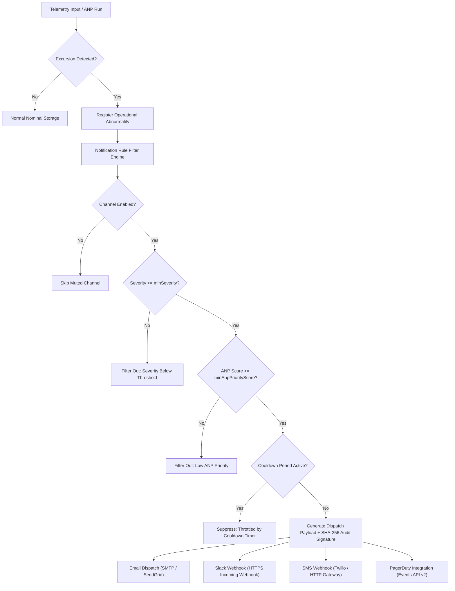

# Notification Architecture & Alert Routing Reference

This document provides a comprehensive technical reference for the multi-channel notification subsystem in LuminaFM.

---

## 1. Notification Pipeline Architecture

LuminaFM implements a robust asynchronous alert dispatch pipeline designed to avoid alert fatigue while guaranteeing immediate escalation of safety-critical boiler and chiller abnormalities:



---

## 2. Supported Notification Channels

| Channel Protocol | Identifier | Target Destination Format | Supported Event Types |
|---|---|---|---|
| **Slack Incoming Webhook** | `SLACK` | `https://hooks.slack.com/services/T00/B00/X00` | Operational Abnormalities, ANP Recommendations, Work Order Assignments |
| **Email Distribution** | `EMAIL` | `engineer@facility.com, control@facility.com` | High-Priority Alerts, Shift Handover Summaries, Weekly Compliance Digests |
| **SMS Gateway Webhook** | `SMS_WEBHOOK` | `https://sms-api.facility.net/v1/dispatch` | Critical Overpressure Alarms, Low-Water Cutoff Trips |
| **PagerDuty Events API** | `PAGERDUTY` | `https://events.pagerduty.com/v2/enqueue` | Emergency Critical Safety Excursions requiring immediate physical dispatch |

---

## 3. Webhook Payload Specification (JSON Schema)

When configured with `includeAuditHash: true`, LuminaFM appends a cryptographic SHA-256 digest to the alert payload, allowing receiving systems to verify payload integrity:

```json
{
  "eventId": "evt-alert-2026-11-15-0842",
  "organizationCode": "COLOMBO-GRAND",
  "timestamp": "2026-11-15T08:00:14.241Z",
  "severity": "CRITICAL",
  "category": "OPERATIONAL_ABNORMALITY",
  "asset": {
    "assetId": "a1000000-0000-0000-0000-000000000001",
    "assetCode": "BLR-001",
    "name": "Main High-Pressure Steam Boiler (1,100 kg/h)",
    "location": "Basement Boiler Room B-01"
  },
  "excursion": {
    "parameterCode": "STEAM_PRESSURE",
    "parameterName": "Steam Header Operating Pressure",
    "measuredValue": 11.45,
    "unit": "bar",
    "benchmarkThreshold": 10.50,
    "benchmarkOperator": ">",
    "deviationPercentage": "+9.0%"
  },
  "anpDecisionContext": {
    "decisionRunId": "RUN-2026-11-15-001",
    "topRecommendation": "CONVECTION_PASS_SOOT_BLOW",
    "priorityScore": 0.3842
  },
  "audit": {
    "recordedBy": "Dave Miller (Boiler Plant Operator)",
    "payloadSha256": "4b227777d4dd1fc61c6f884f48641d02b4d121d3fd328cb08b5531fcacdabf8a"
  }
}
```

---

## 4. Alert Filtering & Throttling Controls

In the `NotificationChannelConfigModal` (`REP-006`), administrators and reliability engineers configure three layers of filtering to eliminate alert spam:

1. **Minimum Severity Filter (`minSeverity`)**:
   - `INFO`: Receives routine informational advisories (e.g. shift log saved).
   - `WARNING`: Receives abnormal telemetry deviations and elevated temperatures.
   - `CRITICAL_ONLY`: Restricts notifications strictly to emergency safety boundary violations.
2. **Minimum ANP Priority Score (`minAnpPriorityScore`)**:
   - Numerical filter ($0.00$ to $1.00$).
   - Only recommendations where the top alternative's normalized priority weight exceeds the threshold (e.g. $\ge 0.70$) trigger external notifications.
3. **Cooldown Throttling Period (`cooldownMinutes`)**:
   - Integer duration between $0$ and $1,440\text{ minutes}$ (24 hours).
   - If an operational parameter remains elevated across multiple 2-hourly shift entries, the system suppresses duplicate webhook dispatches until the cooldown timer expires, preventing channel flooding.
