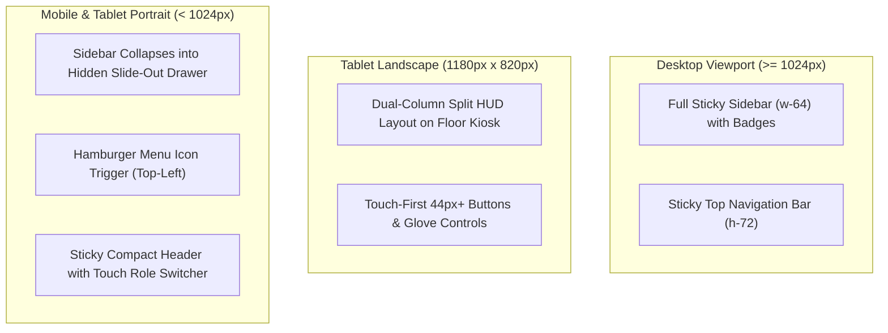

# Quick Navigation & Shortcuts Reference

This reference provides a consolidated directory of application routes, keyboard shortcuts, responsive navigation behaviors, and header quick-action triggers in LuminaFM.

---

## 1. Application URL Route Directory

| Route Path | Module Name | Primary Operational Focus | Role Access Restriction |
|---|---|---|---|
| `/` | **Command Center Dashboard** | Executive KPIs, critical alert monitor, Chiller module HUD | Authenticated personnel |
| `/login` | **Authentication Portal** | Sign-in, tenant selection, 1-click test simulation | Public |
| `/assets` | **Asset Master Registry** | Equipment inventory, dynamic JSONB specs, meter totals | All roles (`assets:read`) |
| `/hierarchies` | **Equipment Hierarchies** | Physical Location DAG and Process System Loop DAG | All roles (`assets:read`) |
| `/maintenance-calendar` | **Maintenance Calendar** | Month grid and recurring PM schedule registry | All roles (`work_orders:read`) |
| `/work-orders` | **Work Orders Management** | Tabular list view and interactive 6-column Kanban board | All roles (`work_orders:read`) |
| `/inspections` | **Inspections & Faults** | Walkthrough inspection register and fault escalation log | All roles (`work_orders:read`) |
| `/daily-monitoring` | **Daily Boiler Logbook** | Desktop 2-hourly shift telemetry logging & archive | Operators & Engineers |
| `/operator` | **Floor Operator Kiosk** | Touch-first tablet mode, QR scanner, glove numpad, sync queue | Operators & Technicians |
| `/reports` | **Decision & Reporting** | ANP limit supermatrix, abnormalities, alert channels | Engineers & Admins |
| `/audit-evidence` | **Audit & Evidence Vault** | Immutable JSON diffs, SHA-256 vault, compliance records | All roles (Restricted diffs) |
| `/cost-analysis` | **Cost Analytics** | Financial spend, category breakdown, proactive ratio ($72.4\%$) | **Admin & Engineer Only** |
| `/governance` | **Decision Governance** | Dissertation baseline audit, commercial version diffing | **Admin & Engineer Only** |
| `/settings` | **White-Label & Organization** | Logo branding, regional timezone/currency, cloud deployment | **Admin Only** |

---

## 2. Keyboard & Accessibility Shortcuts

| Key / Shortcut | Context / Scope | Action Triggered |
|---|---|---|
| `Escape` (`ESC`) | Any Open Modal or Slide-Over Drawer | Closes the modal or drawer immediately (returns focus to trigger element). |
| `Tab` / `Shift+Tab` | Inside Modals / Forms | Navigates forward/backward through form fields within the modal focus trap. |
| `Enter` | Single-line Form Inputs | Submits the active form if all mandatory validation constraints are satisfied. |
| `Ctrl + P` (or `Cmd + P`) | Printable Report Window | Triggers browser system print dialog to save as PDF or print hard copy. |
| `F5` / `Ctrl + R` | Browser Shell | Hard refreshes application cache and reloads active route data. |

---

## 3. Responsive Shell Navigation Behavior

LuminaFM dynamically adapts its navigation shell across viewport form factors:

---

## 4. Top Navigation Bar Quick-Links

The sticky top navigation bar (`TopNavbar.tsx`) provides five persistent quick-action triggers accessible from any view:

1. **Brand Logo Link**: Clicking the corporate crest in the top-left returns immediately to the Executive Command Center at `/`.
2. **Tenant Scope Indicator**: Displays active corporate division (e.g. `Colombo Grand Hospitality Group`) and uppercase tenant code (`COLOMBO-GRAND`).
3. **Active Role Selector Popover (`NAV-001`)**: Displays current persona with role-specific chromatic tones; clicking opens the 1-click simulation switcher.
4. **Emergency Alert Bounce Link**: When a critical boiler overpressure alert is active, a bouncing gold bell icon appears in the header; clicking links directly to the affected equipment work order.
5. **Floor Tablet Kiosk Trigger**: One-click link launching the fullscreen, touch-optimized floor interface at `/operator`.
6. **Sign Out Trigger (with Sync Guard)**: Initiates secure logout. If unsynchronized offline records exist, automatically intercepts the action with the `LogoutSyncGuardModal` to prevent data loss.
