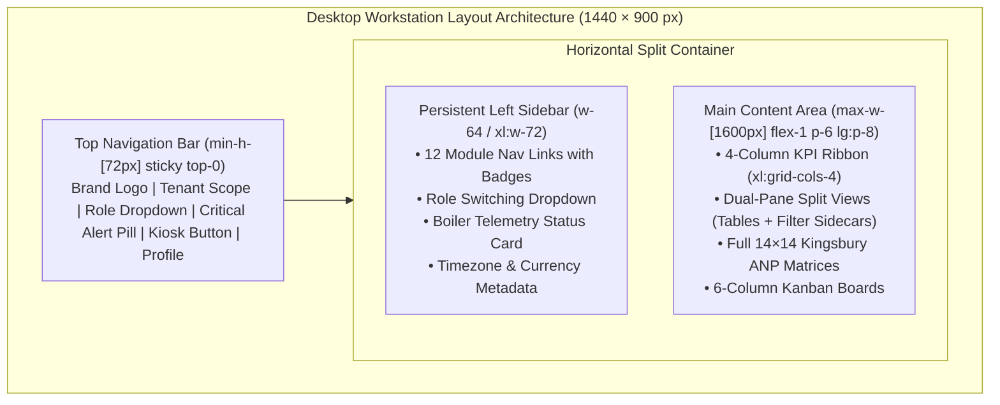

# LuminaFM Desktop Workstation User Guide (1440 × 900)

This guide documents the user experience, layout architecture, and operational workflows of LuminaFM on desktop and high-resolution enterprise workstation displays ($1440 \times 900\text{ px}$ and above).

---

## 1. Desktop Experience Overview

The desktop workstation viewport ($1440 \times 900\text{ px}$ and higher) represents the primary environment for **Organization Administrators** and **Plant Reliability Engineers**. It offers maximum information density, multi-pane layouts, full-width data tables, interactive directed acyclic graphs (DAGs), and side-by-side analytical comparisons without horizontal scrolling or view clipping.

---

## 2. Desktop Navigation & Shell Architecture

### 2.1 Sticky Top Navigation Bar (`min-h-[72px]`)
On desktop viewports, the top navbar spans the entire display width with translucent dark glass styling (`bg-midnight-950/90 backdrop-blur-xl border-b border-slate-800/80`):
- **Brand Identity**: Features the organization's custom SVG crest and typography.
- **Tenant Scope Indicator** (`hidden md:flex`): Displays the active organization name (`Colombo Grand Luxury Hotel & Spa`) and unique tenant code (`COLOMBO-HOTEL`) isolated by Postgres Row-Level Security (RLS).
- **Interactive RBAC Role Selector**: Clicking the role badge opens an absolute dropdown menu allowing instant testing and simulation across all 4 system roles without logging out.
- **Critical Alert Indicator** (`hidden xl:inline-flex`): Displays an active animated badge (`BLR-001 Pressure Alert`) with a pulsing bell icon linking directly to urgent boiler work orders.
- **Tablet Kiosk Quick Launcher**: Direct link to the `/operator` factory-floor mode.
- **RLS Isolation Badge**: Visual verification that all queries are scoped to the authenticated tenant UUID.
- **User Profile & Logout**: Displays the user's full name, email address, and a sign-out button equipped with uncommitted offline data guards.

### 2.2 Persistent Left Sidebar (`w-64` / `xl:w-72`)
Unlike mobile and tablet portrait modes where navigation is tucked into a drawer, the desktop interface features a **permanently pinned sidebar**:
- **Full Navigation Menu**: Direct 1-click access to all 12 operational modules, complete with real-time badges (e.g., `12 Assets`, `Dual DAG`, `PM Due`, `ASME Vault`, `72% PM`, `ANP v1`).
- **In-Sidebar RBAC Selector**: A dedicated testing selector with role description blurbs for rapid authorization auditing.
- **Specialized Boiler Module Telemetry Card**: Live operating status for `BLR-001` showing the design threshold ($16.5\text{ bar max}$), ANP validation indicator, and a 1-click button to launch the floor kiosk.
- **Footer Metadata**: Displays tenant localization parameters (`TZ: Asia/Colombo` and currency `LKR`).

---

## 3. Desktop Visual Inspection & Screenshots

### 3.1 Command Center Dashboard Viewport ($1440 \times 900$)

Below is the verified desktop rendering of the LuminaFM Command Center:

*Figure 1: LuminaFM Command Center Dashboard rendered at $1440 \times 900\text{ px}$ ([DASH-001](file:///e:/My%20Owns/docs/user-manual/screenshots/annotated/DASH-001-dashboard-overview-annotated.png)).*

#### Desktop Callout Annotations:
1. **Top Navigation Bar & Tenant Scope (`1`)**: Full horizontal brand ribbon with Colombo Grand Luxury Hotel & Spa tenant scope indicator and role badge.
2. **Persistent Navigation Sidebar (`2`)**: Docked $288\text{ px}$ sidebar displaying all facility operations routes and live counter badges.
3. **Executive KPI Ribbon (`3`)**: Full 4-column desktop layout (`xl:grid-cols-4`) showing Active Assets (12), Open Work Orders (8), PM Compliance (94.2%), and Health Index (88.4%).
4. **Primary Equipment Telemetry Console (`4`)**: Real-time gauge metrics for `BLR-001` with pressure limit bars, fuel rates, and flue gas temperatures.
5. **Non-Boiler Extensibility Showcase (Chiller-01) (`5`)**: Dedicated module demonstrating dynamic extension with chilled water supply/return temperatures ($6.8^\circ\text{C} / 12.4^\circ\text{C}$) and strict decision model isolation.
6. **Recent Work Orders & Priority Queue (`6`)**: High-density table displaying work order numbers, asset tags, priorities, technician assignments, and status pills.

---

### 3.2 Desktop Authentication Portal Viewport ($1440 \times 900$)

*Figure 2: Authentication Portal rendered at $1440 \times 900\text{ px}$ ([AUTH-001](file:///e:/My%20Owns/docs/user-manual/screenshots/annotated/AUTH-001-login-desktop-annotated.png)).*

On desktop displays, the authentication screen presents a centered, elevated modal card with dual-column role-simulation cards below, allowing engineers and evaluators to launch pre-configured personas with a single click.

---

### 3.3 High-Density Work Orders Registry ($1440 \times 900$)

*Figure 3: Work Orders Management Table rendered at $1440 \times 900\text{ px}$ ([WO-001](file:///e:/My%20Owns/docs/user-manual/screenshots/annotated/WO-001-work-orders-list-annotated.png)).*

#### Desktop Table Advantages:
- **Zero Horizontal Clipping**: Displays all 8 data columns simultaneously (`WO Number`, `Title & Asset`, `Type`, `Priority`, `Assigned Technician`, `Due Date`, `Status`, `Actions`).
- **Comprehensive Filter Toolbar**: Search query input, Status dropdown filter, Priority dropdown filter, and View Mode toggle (Table vs. Kanban) positioned side-by-side without wrapping.
- **Sticky Column Headers**: Table headers remain locked at the top during vertical scrolling (`sticky top-0`).

---

### 3.4 Kingsbury ANP Decision Supermatrix & Sensitivity Charts

*Figure 4: Decision Support & Reporting Suite at $1440 \times 900\text{ px}$ ([REP-001](file:///e:/My%20Owns/docs/user-manual/screenshots/annotated/REP-001-decision-anp-priorities-annotated.png)).*

The desktop resolution is required to inspect the full $14 \times 14$ academic limit supermatrix derived from Dr. H. Kingsbury’s dissertation baseline. The 14 criteria weights, cluster matrices, and live sensitivity bar graphs render in full detail without truncation.

---

## 4. Desktop-Specific Interactions & Usability Features

### 4.1 Mouse Hover Interactions & Micro-Animations
- **Table Row Highlighting**: Hovering over any table row in Work Orders, Asset Master, or Audit Trail shifts the background from `bg-midnight-950/60` to `bg-indigo-950/40` with an animated left gold accent border.
- **Action Button Previews**: Action buttons (Edit, View Detail, Download Dossier) elevate slightly on hover with subtle glow rings (`shadow-glow-indigo` or `shadow-glow-gold`).
- **Tooltips on Truncated Text**: Long asset descriptions and SHA-256 cryptographic hashes feature native browser tooltips (`title="..."`) displaying the full string on mouse hover.

### 4.2 Keyboard Navigation & Shortcuts
Desktop power users can operate LuminaFM entirely via keyboard shortcuts:
- `Escape` (`ESC`): Closes any active modal, drawer, or dropdown popover instantly.
- `Tab` / `Shift + Tab`: Cycles sequentially through focusable inputs, selectors, and buttons within modal dialogs with an active focus ring.
- `Enter`: Submits active forms or activates focused primary buttons.
- `Ctrl + P` (or `Cmd + P`): Invokes the browser's system print dialog when viewing the Printable Decision Report window (`PrintableReportWindow`).

---

## 5. Desktop Operational Recommendations

1. **Optimal Display Scaling**: Set OS display scaling to $100\%$ on standard monitors ($1920 \times 1080$ or $1440 \times 900$) or $200\%$ on high-DPI Retina screens to maintain crisp typography and sharp chart rendering.
2. **Browser Window Maximization**: Keep the browser window maximized or at a minimum width of $1280\text{ px}$ to prevent the persistent sidebar from collapsing into mobile drawer mode.
3. **Dual-Monitor Setup**: For central plant engineers, position the **Command Center** or **Work Orders Kanban** on a secondary monitor while using the primary monitor for detailed root cause analysis or logbook verification.
