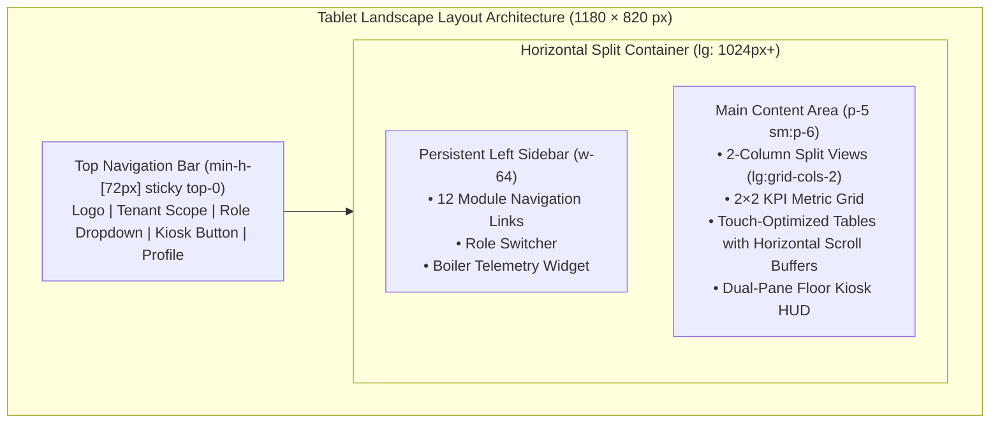

# LuminaFM Tablet Landscape User Guide (1180 × 820)

This guide documents the user experience, layout adaptations, and operational workflows of LuminaFM on tablets in landscape orientation ($1180 \times 820\text{ px}$), such as the Apple iPad Air, iPad Pro, Samsung Galaxy Tab, and rugged industrial field tablets.

---

## 1. Tablet Landscape Overview

Landscape orientation ($1180 \times 820\text{ px}$) provides an optimal balance between desktop information density and tablet portability. It serves as the primary device profile for **Plant Reliability Engineers** conducting physical mechanical walk-throughs, **Maintenance Technicians** reviewing Kanban boards at equipment skids, and **Boiler Plant Operators** managing shift telemetry from a desk-mounted or cart-mounted tablet cradle.

---

## 2. Layout & Responsive Adaptations (vs. Desktop)

Because the viewport width ($1180\text{ px}$) exceeds the Tailwind `lg:` breakpoint ($1024\text{ px}$), LuminaFM retains key desktop desktop conveniences while intelligently condensing secondary elements:

| UI Component | Desktop ($1440 \times 900$) | Tablet Landscape ($1180 \times 820$) | Adaptation Logic & Purpose |
|---|---|---|---|
| **Left Sidebar** | Extended Width (`xl:w-72` / $288\text{px}$) | Standard Width (`lg:w-64` / $256\text{px}$) | Preserves valuable horizontal canvas space for core operational charts and tables. |
| **Top Bar Alerts** | Visible Critical Alert Banner (`BLR-001 Pressure Alert`) | Hidden (`hidden xl:inline-flex`) | Prevents header crowding while keeping the active role selector and kiosk button accessible. |
| **Executive KPI Ribbon** | 4 Columns in 1 Row (`xl:grid-cols-4`) | 2 Columns $\times$ 2 Rows (`md:grid-cols-2`) | Ensures metric numbers, sparklines, and percentage indicators remain legible without text truncation. |
| **Floor Kiosk (`/operator`)** | Centered Full-Width Console | **2-Column Split Console** (`lg:grid-cols-2`) | Places telemetry readings on the left and safety checklist/submit controls on the right for simultaneous view without scrolling. |
| **Data Tables** | Wide Unconstrained Layout | Contained with `overflow-x-auto` | Prevents page blowout while preserving sticky headers (`sticky top-0`) during vertical scrolling. |

---

## 3. Visual Inspection & Screenshot Analysis

### 3.1 Command Center Dashboard in Tablet Landscape ($1180 \times 820$)

Below is the verified rendering of the LuminaFM Command Center on a tablet in landscape orientation:

*Figure 1: LuminaFM Command Center Dashboard rendered at $1180 \times 820\text{ px}$ ([DASH-002](file:///e:/My%20Owns/docs/user-manual/screenshots/annotated/DASH-002-dashboard-tablet-landscape-annotated.png)).*

#### Annotated Callout Breakdown:
1. **Condensed Top Navigation Bar (`1`)**: Retains the brand crest, tenant code badge (`COLOMBO-HOTEL`), active RBAC dropdown, and tablet kiosk launcher, while hiding the extended alert badge to conserve width.
2. **Persistent Sidebar (`2`)**: Docked at $256\text{ px}$ width, providing direct touch access to all 12 operational modules without requiring a slide-out hamburger gesture.
3. **2 $\times$ 2 Responsive KPI Ribbon (`3`)**: Metric cards automatically re-flow into two neat rows of two columns each.
4. **Primary Boiler HUD (`4`)**: Real-time gauge metrics for `BLR-001` scale dynamically to fit the reduced width, maintaining legible bar gauges and operating limits.
5. **Non-Boiler Extensibility (Chiller-01) (`5`)**: Displays the Chiller module parameters side-by-side with the primary boiler.
6. **Recent Work Orders Table (`6`)**: Data rows feature minimum $44\text{ px}$ touch targets, enabling effortless tapping to open work order detail modals.

---

### 3.2 Purpose-Built Factory-Floor Kiosk in Tablet Landscape ($1180 \times 820$)

The tablet landscape orientation is the **recommended primary mode** for operating the LuminaFM Factory-Floor Kiosk (`/operator`):

*Figure 2: Factory-Floor Operator Kiosk in Landscape Orientation at $1180 \times 820\text{ px}$ ([KIOSK-002](file:///e:/My%20Owns/docs/user-manual/screenshots/annotated/KIOSK-002-floor-operator-landscape-annotated.png)).*

#### Landscape Dual-Column Ergonomic Layout:
1. **Header & Fast Controls (`1`)**: Includes the back button, QR code scanner modal trigger, offline sync status pill, Glove Mode toggle, and Fullscreen toggle.
2. **Left Column: Operational Gauge Telemetry Console (`2`)**:
   - **Burner Firing State**: 4 large touch buttons (`Auto`, `Low Fire`, `Peak Fire`, `Standby`) for instant 1-tap mode selection.
   - **Oversized Telemetry Cards**: 5 primary gauge cards (`Steam Pressure`, `Flue Gas Temp`, `Boiler Water TDS`, `Ambient Temp`, `Pump Hours`).
   - **Tappable Readout Display**: Tapping any number opens the large Glove Numpad.
   - **Incremental Stepper Buttons**: Plus and minus step buttons (`-1.0`, `-0.1`, `+0.1`, `+1.0`) allow fine-tuning values without opening the keypad.
3. **Right Column: Safety Checklist & Submissions (`3`)**:
   - **Tactile Glove Rocker Switches**: 5 large 3-state rocker switches (`Pass`, `Warn`, `Fail`) for physical safety inspections.
   - **Preset Observation Chips**: 1-tap tag selection for common boiler room observations.
   - **Voice Memo & Photo Attachments**: Quick camera and microphone capture triggers.
   - **Submit Shift Logbook Button**: High-contrast, full-width primary submission button.

---

## 4. Touch Navigation & Field Usability

### 4.1 Two-Thumb Ergonomics in Landscape Mode
When holding a tablet with two hands in landscape orientation:
- The **left thumb** comfortably reaches the left sidebar navigation links and the primary boiler burner modulation buttons.
- The **right thumb** comfortably reaches the safety checklist rocker switches and the primary "Submit Shift Logbook" button.
- When placed in a magnetic wall mount or cart cradle, the two-column split prevents the operator from having to scroll up and down to check telemetry against safety verification points.

### 4.2 Touch Drag & Scroll Behavior
- **Kanban Column Scrolling**: In `/work-orders` Kanban mode, columns scroll vertically independently, while the entire board allows horizontal touch swiping.
- **Table Row Tap Precision**: All table rows across Asset Master, Work Orders, and Audit Trail have an expanded touch target area with active visual tap feedback (`active:bg-indigo-900/60`).

---

## 5. Tablet Landscape Operational Best Practices

1. **Enable Fullscreen Mode (`Maximize2`)**: When operating on the boiler plant floor, tap the fullscreen button in the kiosk header to hide the browser URL bar and OS navigation tabs, eliminating accidental app dismissal.
2. **Activate Glove Mode**: Ensure the "Glove Mode" badge in the kiosk header is active (`GLOVE MODE ON`). This increases touch sensitivity and ensures tap targets expand to their maximum ergonomic dimensions.
3. **Landscape Lock in Industrial Mounts**: If mounting the tablet to a boiler room operator desk or inspection cart, configure the tablet OS settings to lock the orientation to Landscape to prevent accidental orientation flip when driving over floor thresholds.
