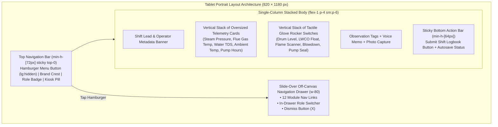

# LuminaFM Tablet Portrait User Guide (820 × 1180)

This guide documents the user experience, touch-first responsive behavior, and operational workflows of LuminaFM on tablets in portrait orientation ($820 \times 1180\text{ px}$), representing the primary handheld form factor for operators and technicians on the plant floor.

---

## 1. Tablet Portrait Overview

In portrait orientation ($820 \times 1180\text{ px}$), LuminaFM transforms from a dual-pane desktop interface into a streamlined, touch-first mobile console. This form factor is engineered for **Boiler Plant Operators** and **Maintenance Technicians** holding a rugged industrial tablet (e.g., Zebra ET51, Getac UX10, Panasonic Toughbook, or iPad in a drop-proof strap case) while standing beside boilers, feedwater pumps, and chemical dosing skids.

---

## 2. Responsive Adaptations in Portrait Mode

At an $820\text{ px}$ viewport width (below the Tailwind `lg:` $1024\text{ px}$ threshold), the UI dynamically adapts:

1. **Collapsible Hamburger Navigation**:
   - The persistent left sidebar automatically collapses (`lg:hidden`).
   - A dedicated hamburger button (`min-h-[44px] min-w-[44px]` with `<Menu className="h-5 w-5 text-gold-400" />`) appears on the left of the top navbar.
   - Tapping the hamburger button slides in an off-canvas drawer (`w-80 max-w-[85vw] bg-midnight-900 shadow-2xl`) over a frosted backdrop (`backdrop-blur-sm`), providing full access to all 12 modules and role switching.
2. **Single-Column Stacked Content**:
   - The dual-column layout of the desktop and tablet landscape views collapses into a single vertical scroll stream (`grid-cols-1`), eliminating horizontal scrolling and awkward viewport panning.
3. **Optimized Vertical Real Estate**:
   - The $1180\text{ px}$ vertical height allows 3 to 4 complete telemetry cards or inspection checklist items to remain visible simultaneously without crowding.
4. **Sticky Bottom Action Container**:
   - Primary action buttons (such as "Submit Shift Logbook") lock to the bottom of the viewport with a high-contrast shadow, ensuring the technician never has to scroll through long logs to execute submissions.

---

## 3. Visual Inspection & Screenshot Analysis

### 3.1 Command Center Dashboard in Tablet Portrait ($820 \times 1180$)

Below is the verified rendering of the LuminaFM Command Center on a tablet in portrait orientation:

*Figure 1: LuminaFM Command Center Dashboard rendered at $820 \times 1180\text{ px}$ ([DASH-003](file:///e:/My%20Owns/docs/user-manual/screenshots/annotated/DASH-003-dashboard-tablet-portrait-annotated.png)).*

#### Annotated Callout Breakdown:
1. **Hamburger Navigation Trigger (`1`)**: Accessible button for opening the slide-over facility navigation drawer.
2. **Top Bar Metadata & Kiosk Launcher (`2`)**: Compact layout displaying the active role badge and the gold Tablet Kiosk quick-launcher.
3. **2-Column Responsive KPI Cards (`3`)**: Metric cards neatly grouped into a 2-column grid (`md:grid-cols-2`), keeping key metrics prominent.
4. **Full-Width Boiler Telemetry Console (`4`)**: Stacked gauges for `BLR-001` with clear threshold limit bars.
5. **Chiller Extensibility HUD (`5`)**: Dynamically positioned directly beneath the boiler console for seamless vertical scrolling.
6. **Recent Work Orders Stream (`6`)**: Work orders rendered in a vertically scrollable table with horizontal overflow container (`overflow-x-auto`) to protect table formatting.

---

### 3.2 Purpose-Built Floor Kiosk in Tablet Portrait ($820 \times 1180$)

*Figure 2: Factory-Floor Operator Kiosk in Portrait Orientation at $820 \times 1180\text{ px}$ ([KIOSK-001](file:///e:/My%20Owns/docs/user-manual/screenshots/annotated/KIOSK-001-floor-operator-portrait-annotated.png)).*

#### Portrait Kiosk Layout Features:
- **Header Action Bar (`1`)**: Features back navigation, QR code scanner modal trigger, real-time sync pill, Glove Mode toggle, and Fullscreen expander.
- **Operator Metadata Banner (`2`)**: Displays the active shift lead (`Kavinda Jayasuriya`), organization code, and 1-tap shift selector pills (`Shift A`, `Shift B`, `Shift C`).
- **Vertical Telemetry Stream (`3`)**: Large gauge cards with tap-to-open numpad triggers, stepper controls (`-0.1`, `+0.1`), and nominal operating benchmarks.
- **Safety Rocker Switches (`4`)**: Positioned sequentially below telemetry for structured top-to-bottom shift workflow completion.

---

## 4. Specialized Tablet Overlays & Dialogs

LuminaFM includes three purpose-built overlays optimized specifically for tablet portrait operation:

### 4.1 Glove-Accessible Numerical Keypad (`GloveNumpad.tsx`)

*Figure 3: Glove Numpad Overlay rendered at $820 \times 1180\text{ px}$ ([KIOSK-003](file:///e:/My%20Owns/docs/user-manual/screenshots/annotated/KIOSK-003-floor-glove-numpad-annotated.png)).*

#### Key Ergonomic Features:
1. **Oversized Digital Readout (`1`)**: High-contrast numerical display ($48\text{px}$ font) showing current value, engineering unit, and real-time "IN SPEC" / "OUT OF SPEC" validation pill.
2. **1-Tap Standard Gauge Presets (`2`)**: Common operating values (e.g., $7.0$, $8.0$, $8.5$, $9.0$, $10.0\text{ bar}$) selectable with a single tap.
3. **Fine-Tuning Steppers (`3`)**: Four increment/decrement buttons (`-1.0`, `-0.1`, `+0.1`, `+1.0`) for quick calibration.
4. **$64 \times 64\text{ px}$ Tactile Number Keys (`4`)**: Generously spaced digits (`7`, `8`, `9`, `4`, `5`, `6`, `1`, `2`, `3`, `0`, `.`) designed for heavy leather or thermal safety gloves.
5. **Confirmation & Backspace Actions (`5`)**: Dedicated `DEL` and full-width green "Confirm Reading" button with tactile press feedback.

---

### 4.2 Camera Barcode & QR Code Scanner (`QrScannerModal.tsx`)

*Figure 4: Industrial Asset QR Scanner Modal at $820 \times 1180\text{ px}$ ([KIOSK-004](file:///e:/My%20Owns/docs/user-manual/screenshots/annotated/KIOSK-004-floor-qr-scanner-modal-annotated.png)).*

#### Key Scanning Features:
1. **Live Camera Feed & Optical Reticle (`1`)**: Gold aiming reticle with dynamic pulse animation to guide alignment over physical asset nameplates.
2. **Flashlight / Torch Toggle (`2`)**: Toggles the tablet's rear LED flash for scanning QR tags in dark boiler pits or behind pipes.
3. **Camera Flip Trigger (`3`)**: Switches between rear-facing wide lens and front camera.
4. **Manual Code Fallback (`4`)**: Input field allowing manual typing of asset codes (e.g., `BLR-001`, `PUMP-FEED-01`) if the barcode label is physically damaged or covered in soot.

---

### 4.3 Offline Synchronization Queue Drawer (`SyncQueueDrawer.tsx`)

*Figure 5: Offline Sync Queue Drawer at $820 \times 1180\text{ px}$ ([KIOSK-005](file:///e:/My%20Owns/docs/user-manual/screenshots/annotated/KIOSK-005-floor-sync-queue-drawer-annotated.png)).*

#### Key Synchronization Features:
1. **Engine Connectivity Status (`1`)**: Live indicator showing online/offline status, pending records count, and last successful sync timestamp.
2. **Unsynchronized Records Ledger (`2`)**: Lists all telemetry readings and checklists buffered locally in browser IndexedDB (`lumina_offline_store`).
3. **Traceable Conflict Resolution Panel (`3`)**: Displays server-side 409 conflict details with dual resolution options: "Amend as Traceable Revision" or "Discard Local Duplicate".
4. **Manual Force Sync Trigger (`4`)**: Immediately retries sending queued items over Wi-Fi/LTE.

---

## 5. Handheld Ergonomics & Field Recommendations

1. **Use Tablet Hand Straps**: In industrial boiler facilities, equip tablets with an elastic rear hand strap or shoulder lanyard to prevent drops when climbing vertical catwalk ladders.
2. **Glove Touch Calibration**: The LuminaFM Glove Mode is calibrated for standard 2mm-3mm industrial nitrile and leather work gloves. Capacitive styluses are fully supported for ultra-fine note taking.
3. **One-Handed Navigation**: With the tablet held in portrait orientation, the bottom third of the screen is within easy reach of the thumb, making the sticky footer and lower numpad keys comfortable to operate without hand fatigue.
