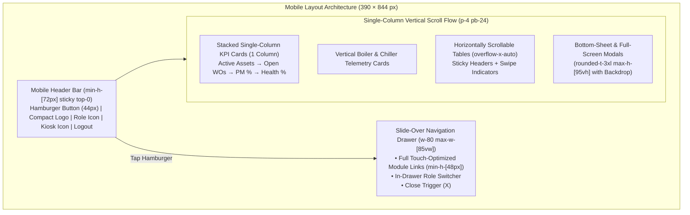

# LuminaFM Mobile Phone User Guide (390 × 844)

This guide documents the user experience, layout adaptations, and operational workflows of LuminaFM on smartphones and compact handheld devices ($390 \times 844\text{ px}$), such as the Apple iPhone 14/15/16, Samsung Galaxy S23/S24, and Google Pixel.

---

## 1. Mobile Experience Overview

The mobile phone interface ($390 \times 844\text{ px}$) provides a responsive, on-the-go experience for **On-Call Maintenance Technicians** responding to after-hours alarms, **Plant Reliability Engineers** verifying plant status off-site, and **Corporate Directors** reviewing facility KPIs from their smartphones.

Every screen in LuminaFM is designed with fluid responsive CSS that stacks neatly into a single-column layout without clipping content or forcing horizontal page panning.

---

## 2. Mobile Responsive Adaptations

| Interface Element | Desktop ($1440 \times 900$) | Mobile ($390 \times 844$) | Mobile Adaptation Logic |
|---|---|---|---|
| **Facility Navigation** | Persistent Left Sidebar (`w-64` / `xl:w-72`) | Off-Canvas Drawer (`lg:hidden`) | Hides sidebar completely to dedicate $100\%$ of screen width to operational data. Triggered by a $44\text{px}$ hamburger button. |
| **Top Bar Branding** | Extended Brand Crest + Name + Tenant Scope | Compact Brand Crest + Icon | Tenant scope name is hidden; only the essential brand mark and quick-action icons remain. |
| **Role Selector** | Text Dropdown (`Organization Admin`) | Condensed Badge (`UserCheck` icon) | Role name text is hidden (`hidden sm:inline`) to prevent header overflow; tapping the icon opens the role menu. |
| **KPI Metric Grid** | 4 Columns in 1 Row (`xl:grid-cols-4`) | **1 Column Vertical Stack** | Stacks all 4 metrics vertically, providing large, legible numbers and full-width trend sparklines. |
| **Data Tables** | Full-width multi-column tables | Contained with `overflow-x-auto` | Prevents page blowout. Users swipe horizontally to inspect secondary columns (Assigned Tech, Due Date, Actions). |
| **Modal Dialogs** | Centered floating windows | **Bottom-Sheet Modal** (`rounded-t-3xl`) | Modals anchor to the bottom of the screen with smooth slide-up animation and thumb-accessible dismiss buttons. |

---

## 3. Visual Inspection & Screenshot Analysis

### 3.1 Command Center Dashboard on Mobile ($390 \times 844$)

Below is the verified mobile rendering of the LuminaFM Command Center:

*Figure 1: LuminaFM Command Center Dashboard rendered at $390 \times 844\text{ px}$ ([DASH-004](file:///e:/My%20Owns/docs/user-manual/screenshots/annotated/DASH-004-dashboard-mobile-annotated.png)).*

#### Annotated Callout Breakdown:
1. **Compact Mobile Header (`1`)**: Accessible hamburger button, brand crest, condensed role pill, and direct tablet kiosk launcher.
2. **Single-Column KPI Stack (`2`)**: Executive facility metrics stacked vertically for effortless thumb scrolling.
3. **Primary Boiler Gauge HUD (`3`)**: Scaled boiler cards displaying pressure bars, temperatures, and firing status with clear high-contrast typography.
4. **Chiller Telemetry Card (`4`)**: Fully responsive presentation of chilled water supply/return temperatures.
5. **Horizontally Scrollable Work Orders List (`5`)**: Table encapsulated in a fluid scroll container (`overflow-x-auto`) with touch-friendly tap targets.

---

### 3.2 Mobile Authentication Portal ($390 \times 844$)

*Figure 2: Authentication Portal rendered at $390 \times 844\text{ px}$ ([AUTH-002](file:///e:/My%20Owns/docs/user-manual/screenshots/annotated/AUTH-002-login-mobile-annotated.png)).*

#### Mobile Login Features:
1. **Centered Brand Logo (`1`)**: Clear brand crest and subtitle optimized for small screens.
2. **Thumb-Friendly Input Fields (`2`)**: $44\text{px}$ high email and password fields with native mobile keyboard triggers (`type="email"`, `type="password"`).
3. **Primary Sign-In Button (`3`)**: Full-width gold gradient button (`w-full min-h-[48px]`).
4. **Stacked Role Simulation Launchers (`4`)**: Vertical list of 1-click test simulation buttons for instant role testing on mobile devices.

---

## 4. Mobile Touch Ergonomics & Form Usability

### 4.1 Native Mobile Keyboard Adaptation
- **Numerical Inputs**: Form fields requiring numerical values (e.g., pressure readings, temperatures, meter hours) utilize `inputMode="decimal"` or `type="number"`, prompting the mobile OS to display an oversized numerical keypad rather than a crowded QWERTY keyboard.
- **Date Pickers**: Trigger native mobile date/time wheels (`<input type="date">`) for effortless calendar selection.
- **Photo Uploads**: Tapping attachment controls opens the mobile camera directly, enabling immediate equipment photo capture and upload.

### 4.2 Horizontal Table Scrolling
When viewing wide tables (such as Work Orders or the ASME Audit Trail) on a phone:
- Column headers remain sticky (`sticky top-0`) while scrolling vertically.
- A subtle fade gradient indicates that additional columns exist to the right.
- Swiping horizontally reveals secondary metadata (e.g., `Due Date`, `Priority Badge`, `Actions`) without displacing the page layout.

---

## 5. Mobile Operational Scope & Best Practices

### Recommended Mobile Tasks:
- Reviewing urgent safety alarms and boiler pressure notifications.
- Changing work order execution statuses (e.g., advancing `IN_PROGRESS` to `COMPLETED`).
- Capturing equipment fault photos and attaching them to work orders.
- Performing rapid visual checks of shift telemetry while away from the control desk.

### Tasks Recommended for Tablet or Desktop:
- Detailed ANP limit supermatrix calculations and sensitivity modeling (`/reports`, `/governance`).
- Complex preventive maintenance scheduling and multi-asset calendar dispatch (`/maintenance-calendar`).
- White-label SVG logo uploads and tenant configuration (`/settings`).
