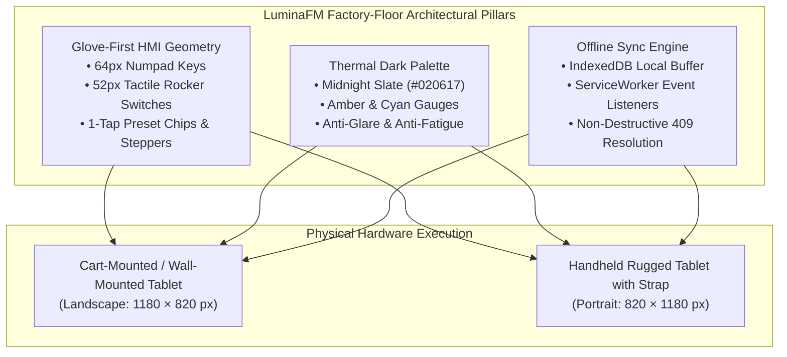
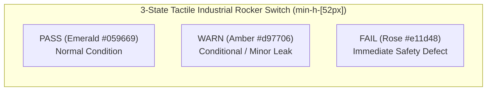
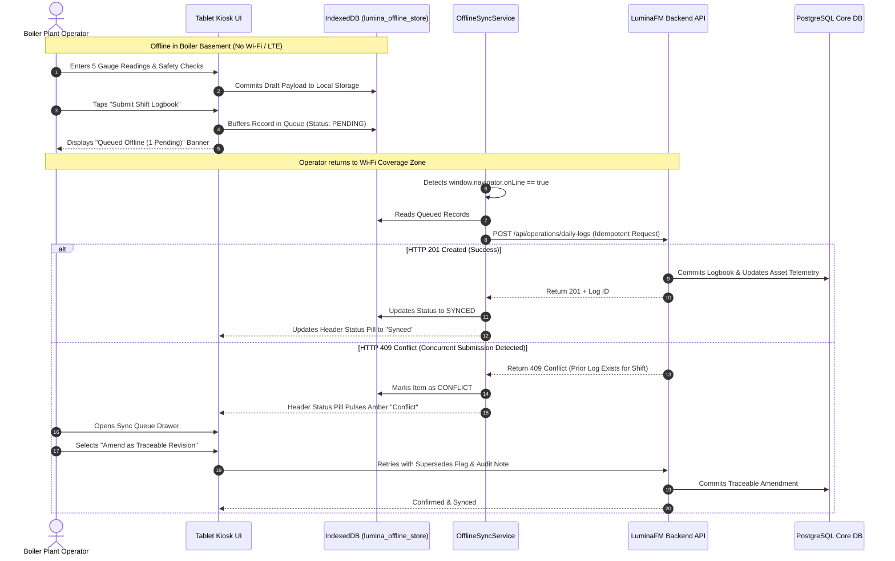

# Factory-Floor Tablet Ergonomics & Offline Architecture

This guide provides an engineering and operational reference for deploying LuminaFM on industrial tablets within factory-floor, central utility plant, and boiler room environments.

---

## 1. Industrial Environment Design Challenges

Commercial boiler plant rooms and central utility basements present severe environmental challenges for standard mobile and tablet software:
1. **Personal Protective Equipment (PPE)**: Operators wear heavy thermal, leather, or nitrile gloves, rendering tiny touch targets ($< 40\text{px}$) unusable.
2. **Harsh Ambient Lighting**: Boiler rooms alternate between pitch-black burner basements, sodium-vapor lamps, and bright furnace glare.
3. **Severe RF Shielding & Zero Connectivity**: Thick reinforced concrete walls and multi-ton steel boiler pressure vessels block cellular and Wi-Fi signals entirely.
4. **Vibration & Wet Hands**: Steam condensation, chemical mist, and mechanical pump vibration cause missed taps and accidental screen inputs.

LuminaFM resolves these challenges through a dedicated **Factory-Floor Kiosk Mode (`/operator`)** built on three architectural pillars: **Glove-Friendly Touch Geometry**, **High-Contrast Dark Theme**, and a **Resilient Offline Synchronization Engine**.

---

## 2. Touch Target Geometry & Glove Calibration

LuminaFM adheres to and exceeds **WCAG 2.1 AAA** guidelines by establishing a three-tier touch target hierarchy:

| Component Type | Target Dimensions | Minimum Spacing | PPE Compatibility | Verified Implementation |
|---|---|---|---|---|
| **Standard Shell Buttons** | $\ge 44 \times 44\text{ px}$ | $8\text{ px}$ | Bare finger, light nitrile | Top bar hamburger, modal dismiss, tab headers (`min-h-[44px] min-w-[44px]`). |
| **Tactile Inspection Rockers** | $\ge 52\text{ px}$ height | $8\text{ px}$ | Medium work gloves | 3-state `Pass` / `Warn` / `Fail` rockers (`GloveRockerSwitch.tsx`). |
| **Glove Numpad Keypad** | **$\ge 64 \times 64\text{ px}$** | **$8\text{ px} - 12\text{ px}$** | **Heavy leather / thermal safety gloves** | Large digit grid (`7`, `8`, `9`, `4`, `5`, `6`, `1`, `2`, `3`, `0`, `.`) in `GloveNumpad.tsx`. |

### 2.1 The Glove Numpad Interface (`GloveNumpad.tsx`)

*Figure 1: Glove Numpad Interface at $820 \times 1180\text{ px}$ ([KIOSK-003](file:///e:/My%20Owns/docs/user-manual/screenshots/annotated/KIOSK-003-floor-glove-numpad-annotated.png)).*

#### Ergonomic Design Mechanics:
- **$64\text{ px}$ Minimum Bounding Box**: Eliminates false adjacent keystrokes when wearing bulky thermal gloves.
- **1-Tap Standard Presets**: Prevents having to type numbers entirely for standard operating states (e.g., $7.0$, $8.0$, $8.5$, $9.0$, $10.0\text{ bar}$).
- **Stepper Incrementors**: Direct `+0.1`, `+1.0`, `-0.1`, `-1.0` buttons enable swift incremental adjustments.
- **Color-Coded Status Readout**: Instantly indicates whether the entered value falls within the nominal benchmark range:
  $$\text{Nominal Range: } [\text{nominalMin}, \text{nominalMax}]$$
  Values outside this envelope trigger an amber/red border pulse with an "OUT OF SPEC" warning pill.

---

### 2.2 Tactile Glove Rocker Switches (`GloveRockerSwitch.tsx`)

Traditional dropdowns and tiny checkboxes fail in industrial environments. LuminaFM replaces them with full-width tactile rocker switches:

- **One-Tap Operation**: Tapping any state immediately updates the record with acoustic and visual feedback.
- **Clear Visual Distinction**: Active states feature bright saturated backgrounds with drop shadows, while inactive states rest in muted dark slate.

---

## 3. High-Contrast Thermal Dark Theme

Boiler rooms subject operators to harsh visual transitions, from dark burner recesses to glaring inspection sight-glasses:
1. **Anti-Glare Palette**: The background uses pure midnight slate (`#020617` and `#0f172a`), eliminating screen glare caused by overhead mercury and sodium lights.
2. **Preserved Night Vision**: When technicians step away from boiler flame viewports into dim pump basements, the dark theme prevents pupil constriction and eye fatigue.
3. **High-Visibility Status Accents**:
   - **Normal / Healthy**: Emerald Green (`#10b981`)
   - **Caution / Warning**: Amber Gold (`#f59e0b`)
   - **Critical Alarm**: Bright Ruby (`#ef4444`)
   - **Instrumentation / Active**: Cyan Indigo (`#6366f1`)

---

## 4. Optical QR Barcode Scanning in Low Light (`QrScannerModal.tsx`)

*Figure 2: QR Scanner Modal with Optical Targeting and Torch Controls ([KIOSK-004](file:///e:/My%20Owns/docs/user-manual/screenshots/annotated/KIOSK-004-floor-qr-scanner-modal-annotated.png)).*

### Low-Light Scanning Features:
- **Integrated Flashlight Control**: A prominent torch button activates the tablet's rear LED flash to illuminate dark boiler recesses.
- **Optical Targeting Reticle**: High-contrast gold reticle guides barcode alignment even when holding the tablet with one hand.
- **Manual Code Entry Fallback**: If an asset tag is damaged, melted, or obscured by soot, the operator can type or speak the equipment tag directly into the fallback field.

---

## 5. Offline PWA Synchronization & Conflict Engine

The LuminaFM offline synchronization architecture ensures that **zero data is lost** when operating in un-connected boiler basements:

### 5.1 Local Persistence Layer (`lumina_offline_store`)
- All shift logs, draft notes, and queue states are committed to browser **IndexedDB** storage.
- Records persist indefinitely across tablet reboots, app terminations, and battery depletion.

### 5.2 Non-Destructive Conflict Resolution
When multiple operators log readings for the same boiler shift simultaneously:
1. The server issues an **HTTP 409 Conflict** error response.
2. The record is flagged with a pulsing amber badge in the kiosk header.
3. Opening the **Sync Queue Drawer (`SyncQueueDrawer.tsx`)** presents the operator with full conflict metadata.
4. The operator selects:
   - **Amend as Traceable Revision**: Keeps the local reading as an official engineering revision, recording the operator's amendment explanation for statutory compliance.
   - **Discard Local Duplicate**: Safely purges the redundant submission without altering the existing server record.

### 5.3 Unsynchronized Data Logout Guard (`LogoutSyncGuardModal.tsx`)
If an operator attempts to sign out or switch organizations while unsynchronized logs remain in IndexedDB, the system blocks the action and prompts the operator to either force a sync or explicitly retain the offline buffer.

---

## 6. Industrial Tablet Mounting & Hardware Profiles

| Hardware Category | Recommended Models | Mounting Configuration | Optimal Viewport Mode |
|---|---|---|---|
| **Operator Desk Station** | iPad Pro 11", Samsung Galaxy Tab S9, Dell Latitude Rugged | Fixed magnetic wall mount or swivel desk dock | **Landscape ($1180 \times 820$)** — 2-column split console for permanent telemetry monitoring. |
| **Inspection Walkthrough** | Zebra ET51/ET56, Getac UX10, iPad in OtterBox Defender with Hand Strap | Handheld with rear strap or shoulder lanyard | **Portrait ($820 \times 1180$)** — Vertical single-column stack for ladder climbing and skid walkthroughs. |
| **Hazardous Locations** | Aegex 100, Bartec Agile X (ATEX Zone 1/2 Certified) | Intrinsically safe carrying harness | **Portrait ($820 \times 1180$)** — Glove Mode enabled for Class 1, Div 1 boiler rooms. |
